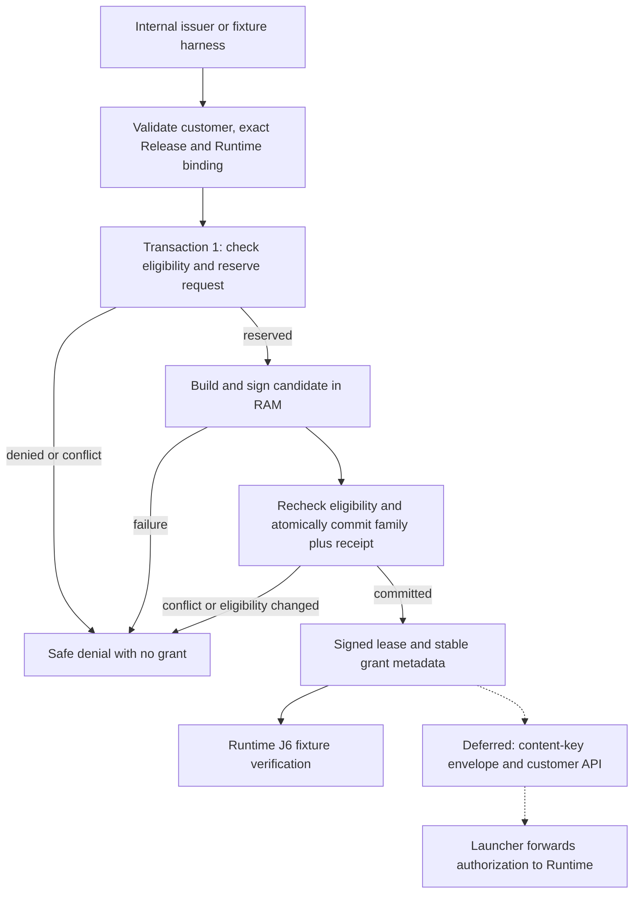

# Execution Authorization Module Feature Spec

## Overview

**Status:** Steps 11–13 delivered: migration applied with explicit user authorization, schema introspected/client generated, and internal initial issuer/signing/receipts/cleanup plus v2 fixtures implemented. Public authorization APIs, envelopes, renewal and reauthorization remain later deliveries.
**Module group:** 04 — Commerce, Entitlement, and Execution.  
**Review:** Reduced schema aligned with the complete Runtime J1–J16 flow on 2026-11-26.
**Owner:** Backend. Runtime verifies grants locally; Launcher transports authorization responses.

Execution Authorization gives one authenticated customer temporary permission to execute one exact installed Product Release. Backend checks current access, binds the decision to the Runtime execution/session/public key and signs a short-lived lease. It does not execute workflows, inspect Android devices or receive a plaintext workflow.

The current delivery prepares persistence, lets the user apply its reviewed migration, then implements an **internal initial-lease issuer and signed fixtures**. Those fixtures unblock Runtime J6 verification. The later envelope/API delivery combines this issuer with the existing Release KeyService and exposes the customer endpoint. There is no temporarily public endpoint that returns an incomplete authorization response.



### Reading and implementation order

1. Sections 1–4 define ownership, identities and persistence.
2. Section 5 defines migration preparation and the separate user-owned application gate.
3. Sections 6–9 define initial issuance, transaction boundaries, replay and signing.
4. Sections 10–13 define errors, operational behavior, source mapping and acceptance.
5. Section 14 records the later envelope/API, renewal and reauthorization work.

Shared wire authority: [Runtime production contracts](../../a2matex-runtime/j_protected_execution/j1_production_contracts.md#5-matching-backend-contracts). Database shape: [group 04 schema, section 5](../db_design/04_commerce_entitlement_execution.md#5-execution-lease). Product key ownership: [Key Service](../security/key_service.md). Business overview: [Production Execution Authorization v1](../../../specifications/production_execution_authorization_v1.md).

## 1. Delivery boundary and existing components

| Component | Existing behavior | Responsibility of this delivery |
| --- | --- | --- |
| SharedUserRepository | `hasActiveCustomer()` checks current User and active Customer role | Reuse it. Do not duplicate customer queries in the authorization repository |
| EntitlementService / EntitlementRepo | `checkUsage()` checks access and Product suspension/deletion; returns an ID, not the period | Expose the checked access period through the existing service, sharing its policy rather than creating a parallel entitlement validator |
| Product / ProductRelease | Exact immutable Release identity, package hash, publication and disable state | Read minimal eligible package metadata inside issuance admission and final recheck |
| KeyService | Wraps durable Release content keys under MASTER_KEY; `withKey()` exposes a temporary scoped key | Remains unchanged and unused by the initial signed-lease issuer |
| TransactionService | Joins transaction context; repositories use `PrismaService.getClient()` | Reuse for short reservation/decision transactions |
| ExecutionLease / request receipts | Not present in the inspected Prisma schema | Applied SQL-first migration; current family and bounded receipt repository implemented |
| Ed25519 lease signing | Not implemented | Implemented enabled-startup validation and injected signing provider using canonical JSON |
| Customer HTTP authorization | Not implemented | Deferred until the envelope response is complete |

No dependency addition is expected: Node `crypto` provides Ed25519 and public-key parsing; the Backend already depends on `canonicalize` for RFC 8785 serialization. Do not reuse login JWT signing configuration.

## 2. Domain identities and invariants

| Identity | Source and meaning |
| --- | --- |
| `userId` | Authenticated caller context, never a body-selected customer |
| `requestId` | Caller-generated UUID v4 identifying one operation across retries |
| `executionId` | UUID v4 allocated by Runtime preparation; future Runtime RunGroup ID |
| `leaseFamilyId` | Backend-generated `ExecutionLease.id`; stable for the lifetime of that execution |
| `leaseId` | Backend-generated ID of one signed grant; stored as `currentLeaseId` |
| `runtimeSessionId` | UUID v4 from the prepared Runtime authorization session |
| `runtimeKeyThumbprint` | Lowercase 64-character SHA-256 of exact Runtime SPKI DER bytes |
| `productId`, `releaseId`, `packageHash` | Validated against the exact immutable Backend Release; not resolved to the newest Release |
| `sequence` | Initial value 1, later advances in the same family; maximum 2,147,483,647 |

One execution has one globally unique family. A different customer cannot claim an existing execution ID. A fresh START request ID cannot allocate another family for an already authorized execution, even when its old lease expired. The later REAUTHORIZE operation must use that family explicitly.

These are identity/concurrency rules, **not device licensing**. There is no device list, machine identifier, installation binding, maximum lease count, customer execution count or concurrent-device ceiling in issuance.

A Backend grant does not prove that Runtime started, paused or completed a workflow. Runtime remains responsible for local admission, live-owner checks and node dispatch. Offline revocation is bounded by the signed expiry, not instantaneous.

## 3. Persistence contract

### 3.1 ExecutionLease: one durable family

The SQL in the group database design is the migration target. Both entities extend the existing `src/entities/base.model.ts` **Base**, not BaseWithUserFields. Include `id`, `createdAt`, nullable `updatedAt` and nullable `deletedAt` in their SQL and entity schemas. Extending a Zod model does not create SQL columns. These fields do not introduce delete/restore endpoints.

| Fields beyond Base | Rules |
| --- | --- |
| `executionId` | Globally unique UUID; Runtime RunGroup identity, not a device execution ID |
| `entitlementId`, `userId`, `productId`, `productReleaseId` | Required foreign keys, NO ACTION; retain direct user/Product ownership reads and validate agreement with Entitlement and Release |
| `packageHash` | Exact validated lowercase hash of the installed Release artifact |
| `runtimeSessionId`, `runtimeKeyThumbprint` | Current session/public-key binding; unchanged by ordinary renewal |
| `currentLeaseId`, `sequence`, `signingKeyId` | Current grant ID, increasing version and signing-key identifier, updated atomically |
| `issuedAt`, `refreshAfter`, `expiresAt` | UTC timestamps representing integer Unix seconds |

`id` is the stable lease-family ID. There is no separate stored `notBefore`: reconstruct the signed claim as `notBefore = issuedAt`. Keep the existing wire field so Runtime verifies the same explicit time contract. The signing-key ID belongs only to the current family, not duplicated on request receipts.

No family `status`, eligibility JSON snapshot, `renewedAt`, completion or lease-specific revocation fields are required for Phase J. Expiry follows `expiresAt`; current User/Entitlement/Product/Release checks govern new grants and replay. Backend does not know local completion/cancellation and must not invent that state. Runtime rejects controls/reauthorization of terminal or lost-owner runs. Administrative family revocation/cloud reporting is deferred.

Initial issuance inserts the family only at final commit. An initial signing failure leaves no family. No expiry cron is needed. Family records remain business data; receipt cleanup never deletes a family or Runtime SQLite execution history. FKs do not cascade.

Direct `userId`/`productId` columns simplify ownership reads and claim construction, but never replace current Entitlement eligibility/period checks. An Entitlement's owner/Product identity is immutable. Signed `releaseId` maps to database `productReleaseId`.

### Soft-delete behavior

Keep `deletedAt` nullable and unused by current business operations. Family `executionId` and request `(userId, requestId)` uniqueness are unconditional, not filtered by deletedAt. A soft-deleted row cannot make an old execution/request identity available again. Do not restore/recreate such a family; reads/admission/replay deny it. A soft-deleted receipt cannot authorize replay or be replaced while retained. Cleanup may hard-delete retention-expired receipts, including soft-deleted ones, but never families. This avoids turning a compatibility column into a second authorization lifecycle.

### 3.2 ExecutionAuthorizationRequest: short-lived request receipt

Use one small feature-owned table, not a generic idempotency/jobs framework.

| Fields beyond Base | Meaning |
| --- | --- |
| `userId`, `requestId` | Unique together across START, RENEW and REAUTHORIZE |
| `operation`, `requestFingerprint` | Validated operation and SHA-256 of canonical normalized public request |
| `state` | RESERVED or COMMITTED |
| `ownerToken`, `reservedUntil` | Opaque attempt UUID/deadline; required only while RESERVED |
| `leaseFamilyId`, `leaseId` | Null while RESERVED; required at COMMITTED, identifying the exact published grant |
| `retainUntil` | Indexed deadline for bounded receipt cleanup |

Receipt leaseId is a comparison value, not an FK to mutable family.currentLeaseId: old receipts must survive a family advance long enough to return a conflict. The stable leaseFamilyId has the FK. No receipt `claimsSnapshot`, signing-key ID or base-grant columns are needed. On committed replay, its lease ID must still equal the linked family's current lease ID. Reconstruct all 15 claims and the header from that family, including derived notBefore and stored signing-key ID. A superseded receipt conflicts instead of reconstructing history, which is why no historical claim snapshot is needed.

No table stores compact signed leases, envelopes, plaintext Release keys, Runtime private keys, Runtime public-key blobs, login credentials, decrypted workflows, local directories or device inputs. A later envelope retry uses the identical validated request public key whose fingerprint/thumbprint still matches the committed family. All grant/key-binding fields are immutable while currentLeaseId remains unchanged, including signingKeyId: rotation advances a grant, never silently rewrites it.

### 3.3 Durable constraints and indexes

- Unique `ExecutionLease.executionId`, unique `currentLeaseId`, positive INTEGER sequence and required foreign keys.
- Unique `(userId, requestId)` across all operation types and including soft-deleted rows.
- RESERVED requires owner/deadline and null family/grant references. COMMITTED requires family/grant references and null owner/deadline.
- Service Zod schemas validate exact hashes, IDs, keys, timestamps, cross-record identity and policy. Database constraints protect durable uniqueness, FKs and state pairing; no triggers or cryptographic database validation.
- Index receipts by retainUntil. No active-status/entitlement analytics index is needed by the Phase J request paths: lookup uses execution ID, family ID or user/request identity. Add other query indexes only with a real consumer.

### 3.4 Retention and abandoned reservations

| Constant | Value / reason |
| --- | --- |
| `EXECUTION_AUTHORIZATION_RESERVATION_SECONDS` | 60 seconds. Bounds one in-flight reservation; not an authorization lifetime |
| `EXECUTION_AUTHORIZATION_RECEIPT_RETENTION_SECONDS` | 300 seconds beyond grant expiry, matching the shared retry contract |
| `EXECUTION_AUTHORIZATION_RECEIPT_CLEANUP_BATCH_SIZE` | 500 rows per cleanup invocation, limiting DB work |

A RESERVED receipt initially retains until `reservedUntil + 300 seconds`. Reclaim after the reservation expires replaces its opaque owner and starts a fresh bounded attempt **only for the same operation/fingerprint**. It does not revive an old signature or silently accept a changed body.

A COMMITTED receipt retains through its signed `expiresAt + 300 seconds`. Replay does not extend this deadline. Terminal noncommitted failure may release its reservation immediately using the current owner token, while retaining the fingerprint for the remaining retry window. A later same-request attempt can reclaim it; a changed request still conflicts.

Cleanup uses database time and one bounded delete over expired eligible rows, with `FOR UPDATE SKIP LOCKED` where necessary. Recheck expiry in that operation so cleanup cannot delete a newly reclaimed reservation. Reuse the existing cron runner, once per minute by default, with the batch-size constant. Multiple instances may run safely. No full-table in-memory scan, per-row DB loop, active-grant deletion or family deletion. A delayed cron retains more metadata; it never extends authorization.

After receipt retention ends, request replay is no longer guaranteed. The family execution-ID uniqueness still prevents duplicate START grants. Clients must use fresh operation request IDs after their retry window and may not repurpose an old request ID for another body.

## 4. Internal input and output

### 4.1 Initial issuance input

The implemented internal issuer accepts the future START request shape plus trusted `userId` context. It accepts only START until later operations are implemented.

```text
issueInitial(userId, request):
  requestId: UUID v4
  purpose: "START"
  executionId: UUID v4
  productId: UUID v4
  releaseId: UUID v4
  packageHash: lowercase SHA-256 hex
  runtimeSessionId: UUID v4
  runtimePublicKey: canonical padded Base64 of RSA SPKI DER
  runtimeKeyThumbprint: lowercase SHA-256 hex
  previousLeaseFamilyId: null
```

Reject unknown fields. Validate UUIDs consistently with existing entity Zod models. Hashes are raw lowercase hex without `sha256:` prefixes. Verify that public key DER parses completely as RSA, modulus is exactly 3072 bits, exponent is 65537, and SHA-256 of the original DER equals the supplied thumbprint. Canonical Base64 must round-trip without extra whitespace/trailing bytes. Do not accept PEM, certificates, private keys or caller-selected algorithms.

The request remains at most 32 KiB when its later HTTP DTO is added. This internal delivery validates input shape/cryptographic key metadata but does not invent a temporary HTTP transport or rate limiter.

Normalize through the strict input schema and RFC 8785 serialization, then SHA-256 the complete normalized request including purpose, explicit null previous family, IDs, public key and thumbprint. Store that fingerprint. Customer scoping is supplied by the receipt unique key. Signing configuration and random response ciphertext are not client request fields.

### 4.2 Result

Return an internal typed result containing:

```text
requestId
executionId
leaseFamilyId
leaseId
sequence
lease                  compact signed JWS
serverTime             current UTC ISO timestamp
replayed               boolean
```

This is an internal result, not the future HTTP response contract. Safe claim metadata can be passed to the later envelope operation without loading a complete database record. Identical replay returns the same grant claims, header/key ID and deterministic signature; `serverTime` may be refreshed. A retry must not advance the sequence, expiry or family identity.

Later HTTP responses remain the exact shared shape `{requestId, executionId, authorization:{lease,keyEnvelope,serverTime}}`, wrapped by Backend as `{data,statusCode}`. New decision is 201; identical replay is 200. Do not expose `replayed` or extra internal metadata as undeclared HTTP fields.

### 4.3 Complete Backend endpoint shapes and delivery ownership

Paths are relative to configured API_PREFIX. All new routes require Backend Bearer authentication and permissions; userId is taken from authenticated identity, never accepted in the body. Current Customer-role/access policy remains enforced, independently of field naming. Existing Entitlement/Order customerId columns and APIs are unchanged.

| Endpoint | Owner and availability |
| --- | --- |
| GET /products/{productId}/package-download?releaseId=... | Existing Product module; no new implementation in this delivery |
| POST /execution-authorizations | New feature; START is exposed only after the post-J6 envelope delivery, REAUTHORIZE behavior added at its later delivery |
| POST /execution-authorizations/{leaseFamilyId}/renew | New feature; implemented at the later Backend renewal delivery |

No grant-list/status, generic decrypt/key-download or temporary lease-only HTTP endpoint is required. The current pre-J6 delivery remains internal initial issuance and signed fixtures.

**Initial request** — POST /execution-authorizations:

```json
{
  "requestId": "88888888-8888-4888-8888-888888888888",
  "purpose": "START",
  "executionId": "55555555-5555-4555-8555-555555555555",
  "productId": "11111111-1111-4111-8111-111111111111",
  "releaseId": "22222222-2222-4222-8222-222222222222",
  "packageHash": "09ec3f0a6a578539e18362027fa907be68257a5590d6a8b8eb6072481ad71d01",
  "runtimeSessionId": "66666666-6666-4666-8666-666666666666",
  "runtimePublicKey": "<canonical padded Base64 RSA SPKI DER>",
  "runtimeKeyThumbprint": "<64 lowercase hexadecimal characters>",
  "previousLeaseFamilyId": null
}
```

For REAUTHORIZE use the same closed body with purpose REAUTHORIZE and previousLeaseFamilyId equal to the existing family ID. Use a fresh Runtime session/key, the same execution/user/entitlement/Product/Release/package and an expired current grant. Backend checks expiry and ownership but cannot prove that a local worker is safely paused; Runtime J14 checks that live boundary.

**Initial/reauthorization response**, 201 new decision / 200 identical replay:

```json
{
  "data": {
    "requestId": "88888888-8888-4888-8888-888888888888",
    "executionId": "55555555-5555-4555-8555-555555555555",
    "authorization": {
      "lease": "<compact signed JWS>",
      "keyEnvelope": {
        "releaseId": "22222222-2222-4222-8222-222222222222",
        "algorithm": "RSA-OAEP-SHA256",
        "runtimeSessionId": "66666666-6666-4666-8666-666666666666",
        "runtimeKeyThumbprint": "<64 lowercase hexadecimal characters>",
        "encryptedKey": "<padded Base64 of 384 RSA ciphertext bytes>"
      },
      "serverTime": "2026-11-26T12:00:00.000Z"
    }
  },
  "statusCode": 201
}
```

The placeholder key/thumbprint/lease strings describe shape, not executable cryptographic fixtures. On replay statusCode is 200. The global interceptor wraps the inner service result once.

**Renew request** — POST /execution-authorizations/{leaseFamilyId}/renew:

```json
{
  "requestId": "aaaaaaaa-aaaa-4aaa-8aaa-aaaaaaaaaaaa",
  "executionId": "55555555-5555-4555-8555-555555555555",
  "runtimeSessionId": "66666666-6666-4666-8666-666666666666",
  "currentLeaseId": "77777777-7777-4777-8777-777777777777",
  "sequence": 1
}
```

Sequence is the caller's current version. Require an unexpired current grant and exactly matching session/currentLeaseId/sequence. Atomically advance sequence and both refresh/expiry deadlines, preserving family/user/entitlement/Product/Release/hash/session/key. Allow early renewal for attempt budget. Deny nonadvancing deadlines at a finite entitlement cap; normal renewal cannot revive expiry.

**Renew response**, same 201/200 rules:

```json
{
  "data": {
    "requestId": "aaaaaaaa-aaaa-4aaa-8aaa-aaaaaaaaaaaa",
    "executionId": "55555555-5555-4555-8555-555555555555",
    "authorization": {
      "lease": "<new compact signed JWS>",
      "serverTime": "2026-11-26T12:20:00.000Z"
    }
  },
  "statusCode": 201
}
```

No new envelope or RSA key is needed for normal renewal. Neither endpoint accepts device lists, local package paths, userId, entitlementId, requested sequence increments, expiry or signing keys. Requests are at most 32 KiB. See section 10 for typed errors.

## 5. Migration preparation and manual application gate

### 5.1 Backend preparation deliverable

Inspect applied migration history before generating a **new forward SQL migration** containing only the two lease/receipt tables, their types, indexes and FKs. The schema in the group design is proposed SQL, not proof of an applied migration. Do not copy the group's Offer, Order, Report or other planned entities into this migration.

Use repository SQL-first conventions and a Prisma-generated timestamp when preparing the migration. Do not begin by hand-editing `prisma/schema.prisma`; do not edit an old shared migration. Review `NO ACTION` FKs, coupled-state checks, retention indexes, table-name collisions and lock impact. Both new tables start empty; no existing entitlement/order/release data is converted or deleted.

Deliver the migration and repository contract review before applying anything. At this point generated types and running issuer behavior remain unavailable. The next user-owned gate must be completed before implementing repositories against those generated types.

### 5.2 User-owned database gate

Apply the reviewed migration only after explicit user authorization, on the intended database with the expected history. The user may execute the commands or explicitly delegate their execution; the 2026-11-26 application below was delegated by the user. From the Backend directory:

```bash
npx prisma migrate status --config prisma7.config.ts
npm run prisma:migrate:deploy
npx prisma db pull --config prisma7.config.ts
npm run prisma:generate
npx prisma migrate status --config prisma7.config.ts
```

Before deploy, review **all pending migrations**, not only the lease file: deploy applies pending migrations in order. Stop if unrelated pending migrations have not been approved. Use backup/staging procedures appropriate to the target. Never use `migrate reset`, destructive sync, or bookkeeping-only `resolve --applied` as a substitute for executing the SQL.

Inspect the actual two tables, indexes, constraints and foreign keys after application. Review introspection output for unrelated drift; preserve supported partial indexes/check constraints and generated client conventions. SQL generation, Prisma validation and TypeScript compilation alone do not establish database readiness.

Acceptance evidence records target environment, migration ID/status and verified schema shape, without secrets. This specification does not apply a migration or read/change a live database.

### 5.3 Persistence preparation snapshot — before application approval

The Backend README create-only workflow generated
[20261126155128_add_execution_authorization/migration.sql](../../../../a2matex-be/prisma/migrations/20261126155128_add_execution_authorization/migration.sql).
The timestamp came from Prisma, not a manually selected folder name:

```bash
npx --no-install prisma migrate dev --create-only --name add_execution_authorization --config prisma7.config.ts
```

Prisma created an empty migration without applying it; the approved SQL-first table/enum/constraint design was then added to that file. It contains only two new tables, two enums, the required uniqueness/foreign-key/state/time constraints and the receipt retention index. An explicit BEGIN/COMMIT wraps the additive SQL. Both tables include Base fields, including nullable deletedAt; no token/key/claims snapshot or device limits are introduced.

Review checks passed: exact semantic match to the approved group-design SQL (explicit TIMESTAMPTZ(6)/NO ACTION formatting aside), expected 18 lease and 14 receipt columns, six non-cascading FKs, and unchanged existing migration/schema/config/package/README checksums. The existing Prisma schema validates; that check does not execute or validate the new SQL against PostgreSQL.

Read-only target checks before/after generation confirm unchanged migration-history records and absence of both new tables/enums. Prisma migrate status reports **only this migration pending**. No deploy, reset, introspection or client generation was run. The migration's PostgreSQL execution/constraint behavior is not yet verified because application is intentionally deferred for user review.

That was the preparation-only snapshot. The user subsequently approved deployment and the internal issuer; the current application/implementation evidence is recorded below.

### 5.4 User-approved application and generated schema — 2026-11-26

Following explicit user authorization, the approved migration was deployed using the README commands:

```bash
npx --no-install prisma migrate deploy --config prisma7.config.ts
npx --no-install prisma db pull --config prisma7.config.ts
npx --no-install prisma generate --config prisma7.config.ts
npx --no-install prisma migrate status --config prisma7.config.ts
```

The local PostgreSQL target reports the migration applied and no pending migrations. Read-only
checks confirm 18 lease and 14 receipt columns. Introspection added only the two models/enums and
related reverse relations semantically; alignment whitespace is Prisma-generated. Existing CHECK
constraints remain in PostgreSQL even though Prisma warns that it does not represent them fully.
No old migration, secret/environment file or package lock was changed.

The application-schema gate is complete. Internal issuer and signed fixture evidence is in section
13.1; the public API/key-envelope and Runtime J6 consumers remain separate deliveries.

## 6. Eligibility and grant timing

### 6.1 Complete authorization decision

Evaluate all of the following at preparation and final decision. Replay also rechecks current eligibility before returning a signed lease.

| Check | Required behavior |
| --- | --- |
| Issuer availability | Feature enabled and valid configured signing key available |
| Customer | Existing `SharedUserRepository.hasActiveCustomer()` succeeds |
| Entitlement | Same customer/Product, ACTIVE and not revoked, `startsAt <= now`, expiry null or strictly later than now |
| Product | Not deleted or suspended; ARCHIVED preserves existing access; do not add an ACTIVE-only download/execution rule |
| Exact Release | Belongs to requested Product, PUBLISHED, not disabled, complete immutable package metadata |
| Package | Supplied hash equals that exact Release's stored package hash; published package reference exists |
| Runtime binding | Valid session/execution IDs and validated public key/thumbprint |
| Execution | START has no existing family with the execution ID |

Current `checkUsage()` is insufficient by itself: it does not expose starts/expiry and its query does not test a future `startsAt`. Expose a transaction-aware checked access-period result from the existing EntitlementService and share its eligibility policy with checkUsage rather than maintaining a parallel validator. Keep authorization-specific grant timing and exact Release/hash binding in the issuer. The Entitlement service can retain its existing customerId parameter/column internally; map it from this module's authenticated userId without renaming existing Entitlement/Order contracts. Existing purchase/download behavior is outside this change unless separately approved.

All published non-disabled Releases currently count as supported; no support-window table exists. An eligible older installed Release remains usable even when `currentReleaseId` changes. Do not compare package hashes with the newest Release, fetch the ZIP again from storage, or require another R2 HEAD/download for every issuance/replay. Eligibility uses immutable publication metadata and current revocation controls. The later KeyService stage will separately require usable wrapped-key fields.

### 6.2 Timestamp calculation

Sample authoritative Backend database wall time for a candidate, floor once to integer Unix seconds, and use:

```text
i = floor(databaseNow / 1000)
e = min(i + durationSeconds, floor(entitlementExpiresAt / 1000))
    # no entitlement bound when permanent
lifetime = e - i
lead = min(configuredRenewalLeadSeconds, floor(lifetime / 2))
issuedAt = notBefore = i
expiresAt = e
refreshAfter = e - lead
```

Deny if fewer than two whole seconds remain. Require `issuedAt == notBefore < refreshAfter < expiresAt`. The grant lifetime cannot exceed 604800 seconds. Timestamp integers must be safe and between zero and 253402300799.

At final recheck, sample PostgreSQL `clock_timestamp()` after acquiring the required locks, not transaction-start `now()` captured before waiting. Keep conversion in the repository and return a typed Date/seconds value to the service. Do not recompute already signed candidate claims. If time/entitlement changes make the candidate invalid, discard the signature and fail safely; a subsequent bounded retry may construct a new uncommitted candidate. A committed replay can never replace its recorded deadlines.

Example: database time 12:00:00, duration 1800 and permanent access yield expiry 12:30:00 and refresh 12:20:00. If access ends at 12:00:10, expiry is 12:00:10 and refresh 12:00:05. Access ending in one whole second yields no grant.

## 7. Reservation, signing and atomic publication

### 7.1 Two transactions with crypto between them

The outer issuer orchestrator must **not** be decorated with `@Transactional()`. It rejects an ambient caller transaction before any crypto work; later envelope/controller callers must not wrap the entire operation in a transaction. Only the specific persistence helpers open short transactions.

1. **Transaction 1 — check and reserve.** Check current customer/access/Product/exact Release/family eligibility, then insert or inspect the user/request receipt. Changed operation/fingerprint conflicts. An unexpired same-request reservation returns retryable unavailable without polling. An expired same-request reservation can be reclaimed with a fresh opaque owner UUID and 60-second deadline. A committed receipt takes the replay path. Return the candidate eligibility/binding data to RAM; do not store unsigned proposed claims.
2. **Outside transactions — construct authorization.** Allocate candidate grant/family IDs, calculate grant times from transaction 1's database sample and sign fixed claims in RAM. Initial delivery builds the lease only. When envelopes are implemented, invoke KeyService.withKey and wrap for the validated Runtime public key here too, before final commit. No network/crypto work holds row locks. A discarded unsigned/unpublished candidate needs no database recovery.
3. **Transaction 2 — recheck and commit.** Acquire the same business locks, sample fresh database wall time, and recheck eligibility, candidate lifetime/cap, receipt owner/deadline, exact identities and execution uniqueness. Insert/update the family and mark the receipt COMMITTED atomically with the candidate lease ID. Clear owner/deadline and set receipt retention to signed expiry plus 300 seconds. Return the prebuilt response only after this commit succeeds.

Resolve an identical COMMITTED receipt before applying **new-operation** guards: a START replay already has a family, a RENEW replay carries the old base sequence, and a REAUTHORIZE replay now has an unexpired new session. None should fail merely because its original successful operation changed that state. Match the receipt fingerprint/current grant and recheck current eligibility/expiry instead. If no committed replay applies, enforce START family absence, RENEW base-grant match or REAUTHORIZE expired-base rules normally. An initial unlocked receipt probe may select the branch, but locked final checks remain authoritative and retain the shared lock order.

There are two transactions, not a separately persisted proposal stage. If the process crashes between them, only a reclaimable reservation exists. If a candidate or envelope cannot be completed, no new family/grant commits. A later retry can build a fresh candidate only while no decision committed.

Use transaction-aware repositories and shared lock helpers, including ProductLockRepository rather than a duplicate Product locking query. Preserve the order Product, exact ProductRelease, Entitlement, existing family when present, then receipt. A new START family's absence is protected by executionId uniqueness, not a nonexistent-row lock. All branches that acquire multiple locks follow this order.

Future RENEW uses the request's expected currentLeaseId/sequence as an atomic update guard; keep those expected values in the operation, not extra receipt columns. REAUTHORIZE captures the checked expired base grant in RAM and conditionally replaces that exact grant. If another operation advances the family, the losing candidate conflicts rather than signing/committing another sequence. Refuse INTEGER sequence overflow.

Recheck current user roles/status through the existing shared repository in final commit. This module uses role-neutral userId naming, while current Customer eligibility remains the existing policy until separately changed. The decision uses the eligibility observed at that final check; subsequent account/resource revocation denies later issuance/replay/renewal, while already issued offline grants expire normally. No global identity-lock framework is introduced.

### 7.2 Losing, failing or interrupted attempts

Every write/cleanup of a RESERVED receipt predicates on its ID, state and exact owner token. It also checks its unexpired deadline when preparing/committing. A late signer cannot publish after ownership replacement or reservation expiry. A losing cleanup cannot release another attempt's reservation or alter a committed receipt.

Signing failure commits no family. Clear/release only the current attempt reservation and return unavailable. A business denial similarly commits no family and returns its safe domain error. Avoid persisting raw error text or stack traces in the receipt. Failure to perform best-effort reservation release does not authorize anything; the deadline permits later reclaim.

A crash before commit leaves only an expiring reservation. A crash after commit but before response leaves a committed replayable decision. On an uncertain commit result, do not delete or compensate a possibly committed family: recover by reading the same receipt and retrying with the same request ID. Database uniqueness/transaction guards are authoritative across Backend instances; Redis locks alone cannot provide these guarantees.

### 7.3 Concrete concurrency outcomes

| Requests | Expected result |
| --- | --- |
| Same customer/request/body concurrently | One grant; other caller sees bounded in-progress unavailable or committed identical replay |
| Same customer/request with changed key, package, operation or ID | 409 request conflict; no replacement |
| Different START request IDs for the same execution | At most one family/sequence-1 decision; loser conflicts and receives no lease |
| Different executions for the same customer/Product | Independent eligible grants, no licensing count limit |
| Old owner finishes after reservation takeover | Cannot commit or clean up the new owner's reservation |
| Eligibility revoked while signing | Final check rejects candidate; no newly committed grant |
| Response lost after commit | Retry reconstructs that exact grant without issuing another |

## 8. Committed replay

On receipt lookup, validate the user/operation/fingerprint before exposing family state. Require both rows to be non-deleted, the family user to equal authenticated userId, and receipt leaseId to equal family currentLeaseId. Reject superseded receipts even if their former expiry has not passed. There is no historical token reconstruction.

Recheck current user/access and exact Release eligibility, require an unexpired grant and ensure its stored expiry still fits the current entitlement deadline. Shortened access cannot be repaired by replay; extended access cannot extend a replayed grant. Backend need not track Runtime completion: the local Runtime rejects terminal/lost-owner admission or resume.

Reconstruct claims from the current family and `notBefore = issuedAt`, then sign outside transactions with that family's signingKeyId, not the newly active configuration key. Missing old key returns unavailable without mutating the family. Because no family fields may change under an unchanged currentLeaseId, this reproduces the exact canonical header/claims/signature.

After signing and, later, fresh envelope construction, perform the short final replay guard again. Reject an intervening family advance, deletion, expiry or eligibility denial observed there. No replay database write is needed. Do not claim a response in transit can be recalled after a later revocation. The later envelope may have fresh OAEP randomness while retaining the same recorded public-key binding and identical lease.

## 9. Ed25519 signing and configuration

### 9.1 Configuration

| Setting | Validation |
| --- | --- |
| `EXECUTION_AUTHORIZATION_ENABLED` | Boolean, default false; disabled issuer returns safe unavailable |
| `EXECUTION_LEASE_SIGNING_KEY_ID` | Active `kid`, 1–64 ASCII letters/digits/dot/underscore/hyphen |
| `EXECUTION_LEASE_SIGNING_KEYS` | Secret JSON map of valid kid to Ed25519 PKCS8 PRIVATE KEY PEM; active key must exist |
| `EXECUTION_LEASE_DURATION_SECONDS` | Integer 2–604800, default 1800 |
| `EXECUTION_LEASE_RENEWAL_LEAD_SECONDS` | Integer 1 through configured duration minus one, default 600 |

Validate once at enabled issuer startup. Reject wrong key type, malformed/duplicate key IDs and missing active key. Disabled authorization must not require signing secrets to run ordinary Backend modules or package downloads. Enabling invalid configuration fails startup rather than producing unsigned grants. Named constants hold fixed wire limits, algorithm/type, timestamp/sequence bounds and receipt policy; service bodies contain no unexplained numbers.

Keys belong to normal secret provisioning. This specification changes no `.env`, commits no private key and adds no customer key-management endpoint. Retain previous private signing keys while current retained grants require replay, and corresponding Runtime public trust through served grant/retry lifetimes. Never replace key material under an existing kid. Deploy Runtime trust for a new kid before Backend starts signing with it. The issuer does not download trust or accept a caller's verification key.

### 9.2 Exact JWS

Protected header has exactly:

```json
{"alg":"EdDSA","kid":"execution-lease-test-v1","typ":"a2matex-execution-lease+jws"}
```

Claims have exactly these 15 fields, no JWT-library additions:

```json
{
  "leaseId":"77777777-7777-4777-8777-777777777777",
  "leaseFamilyId":"99999999-9999-4999-8999-999999999999",
  "executionId":"55555555-5555-4555-8555-555555555555",
  "sequence":1,
  "entitlementId":"33333333-3333-4333-8333-333333333333",
  "userId":"44444444-4444-4444-8444-444444444444",
  "productId":"11111111-1111-4111-8111-111111111111",
  "releaseId":"22222222-2222-4222-8222-222222222222",
  "packageHash":"09ec3f0a6a578539e18362027fa907be68257a5590d6a8b8eb6072481ad71d01",
  "runtimeSessionId":"66666666-6666-4666-8666-666666666666",
  "runtimeKeyThumbprint":"aaaaaaaaaaaaaaaaaaaaaaaaaaaaaaaaaaaaaaaaaaaaaaaaaaaaaaaaaaaaaaaa",
  "issuedAt":1795694400,
  "notBefore":1795694400,
  "refreshAfter":1795695600,
  "expiresAt":1795696200
}
```

The displayed hash/IDs/time/thumbprint are explanatory fixture values; the real issuance test must bind them to its verified test package/key and actual test database identities.

Serialize header and claims separately with RFC 8785, UTF-8 encode, then unpadded base64url encode each. Sign the ASCII `headerSegment.payloadSegment` with Node `crypto.sign(null, bytes, ed25519PrivateKey)`. Signature is exactly 64 bytes; encode unpadded base64url and join the three segments. Maximum compact lease length is 8192 bytes. Do not add `iat`, `exp`, `iss`, `aud`, `jti`, embedded keys or an arbitrary JWT algorithm/header.

Validate signing configuration at startup and verify signatures using exact signing bytes in tests/fixtures. Do not self-verify every freshly generated signature on the request path. Envelopes later use RSA-OAEP-SHA256; RSA must not replace Ed25519 lease signing. A Runtime RSA key is not a Backend signing key.

## 10. Failure and logging contract

| Condition | Stable Backend key / eventual HTTP status |
| --- | --- |
| Invalid input/public-key encoding/binding | Existing strict-Zod field validation / 422 |
| Authentication or permission failure at future route | Existing guards / 401 or 403 |
| Customer/access denied, revoked or unavailable Product | `Error.ExecutionAuthorizationDenied` / 403 |
| Exact Release unavailable/disabled, incomplete package metadata or hash mismatch | `Error.ProductPackageUnavailable` / 404 |
| Changed request, execution ownership conflict or superseded receipt | `Error.AuthorizationRequestConflict` / 409 |
| Remaining lifetime too short, expired replay or later nonadvancing grant | `Error.ExecutionAuthorizationExpired` / 409 |
| Disabled issuer, reservation in progress, signing/DB failure, missing replay key | `Error.ExecutionAuthorizationUnavailable` / 503 |

These statuses describe future controller mapping. Internal methods use feature error types consistent with existing Backend exceptions; there is no HTTP endpoint in the current delivery. Do not leak another customer's family, SQL/OpenSSL messages, entitlement internals or exact secret/config values in response errors.

Use existing centralized request/error logging and safe feature context. Failed operations use ERROR, with operation/reason, request/execution/family IDs where safe and duration. Preserve the existing contextual logging format. Avoid duplicate boundary logs, raw error stacks or routine success logs. Useful fixed reasons include `customer_ineligible`, `release_unavailable`, `package_mismatch`, `request_conflict`, `reservation_busy`, `reservation_lost`, `grant_expired`, `eligibility_changed`, `signing_unavailable` and `database_unavailable`.

Never log request bodies, runtime public-key blobs, signed leases, envelope bytes, MASTER_KEY, signing PEM, content keys, decrypted workflows or customer inputs. Public keys are not secrets but blob logging is unnecessary and creates unsafe habits for the later sensitive response. Cleanup may report aggregate deleted counts; it must not dump receipts.

## 11. Implementation map and efficiency

| Location | Implementation responsibility |
| --- | --- |
| `prisma/migrations/<generated_timestamp>_execution_authorization/migration.sql` | SQL-first family/receipt schema only |
| `prisma/schema.prisma`, generated client | Derived only after user applies migration and introspection/generation runs |
| `src/routes/execution-authorization/execution-authorization.module.ts` | Feature-owned orchestration, issuer and repository providers; export only the concrete service needed by later API/envelope work |
| `execution-authorization.service.ts` in that folder | Initial issuance/replay with two transactions, RAM candidate ownership and safe error mapping |
| `execution-authorization.repo.ts` | Typed minimal reads, ownership/CAS writes, family/receipt atomic commit and bounded cleanup |
| `execution-authorization.model.ts`, `.error.ts` | Strict internal inputs, claim/result types and feature errors |
| `src/shared/constants/execution-authorization.constant.ts` | Fixed protocol, sequence/time, reservation and cleanup constants |
| `src/shared/config.ts` | Enabled/key/duration/lead validation; no real secret changes |
| EntitlementService and its existing repository | Narrow transaction-aware grant eligibility and period read; reuse current access policy |
| Existing Product/Release repositories | Minimal selection/locking reuse as needed, avoiding customer-policy duplication |
| Existing cron registration | One bounded receipt cleanup job following current cron runner conventions |
| Focused feature tests / fixture generator | Approval-scoped race/replay/signing tests and inspectable public-key/signed fixture output |

Use one feature module because this owns durable grant lifecycle and multiple later operations, not a one-endpoint wrapper around Product. Keep signing helpers in the feature unless an actual second consumer justifies a shared service. Do not create generic policy engines, outboxes, key-management modules, session job queues or repository interfaces for every private helper.

Resolve Prisma through the existing call-time client getter. Prefer ORM for normal queries/updates. Parameterized raw SQL is justified only for row locks, database wall-time sampling and bounded locked cleanup/CAS behavior unavailable in the generated API. Never concatenate caller SQL.

No file/archive reads, R2 requests, node catalog loading, RSA generation, plaintext workflow processing or per-device loop belongs in issuance. Each request uses a fixed number of small point reads/transactions independent of device/node count. DB locks never enclose Ed25519 signing or later `KeyService.withKey`. Key objects are parsed once at startup. There is no full-receipt cache or new database write on identical committed replay.

### Repository and service seams

Keep these responsibilities concrete without requiring a separate helper class for each method:

| Seam | Input and returned decision |
| --- | --- |
| Entitlement checked access period | user/Product plus transaction; shared policy returns entitlement identity and starts/expiry or denial |
| Check and reserve | Authenticated user/request/fingerprint, business selection and owner; returns eligibility data plus reservation, replay candidate, conflict or in-progress |
| Commit initial decision | Receipt/owner and RAM candidate; final eligibility checks, family insert and receipt COMMITTED transition in one transaction |
| Guard replay | User/request/fingerprint and expected grant; returns matching eligible current family or typed rejection |
| Release failed reservation | Receipt/owner; conditional RESERVED update never alters a committed grant |
| Cleanup expired receipts | Database cutoff and fixed batch size; returns aggregate count |

Services own policy and transaction scope; repositories return typed rows/affected-row outcomes. Zero-row ownership/CAS writes mean lost attempt, not an unbounded retry loop. Read a unique-conflict winner in a fresh valid transaction if PostgreSQL aborted the failed insertion; do not continue querying an aborted transaction. No candidate persistence or separate proposal repository method is required.

## 12. Signed fixture and manual verification deliverables

Before Runtime J6 starts, deliver an inspectable fixture set containing: fixture version, protected header, exact claims, compact lease, trusted Ed25519 SPKI PUBLIC KEY PEM/kid, expected acceptance/rejection, fixed verification time and expected package/session bindings. Deliver a new signed fixture set (v2) before J6. Existing immutable [v1 vectors](../../a2matex-runtime/j_protected_execution/fixtures/v1/README.md) sign the historical customerId claim and are not valid positives for the revised closed userId claim set. Preserve v1 bytes/digest and re-sign the current claim set into v2; editing JSON claims without re-signing cannot produce a valid vector. Use the Backend issuer to generate actual-service fixtures when available. The delivered [v2 set](../../a2matex-runtime/j_protected_execution/fixtures/v2/README.md) is generated with the actual Backend signing provider and synthetic identities. Backend digest/signature checks pass; Runtime J6 consumption is pending. Real package/customer HTTP exchange remains J15.

Generate any test signing key in an isolated test process; never export a production key. A committed golden fixture may retain only the public key and precomputed signed strings. Negative fixtures distinguish a tampered signature from a **correctly signed** but invalid claim: unknown kid, wrong package/session/thumbprint/execution, expired/future times, bad ordering, excessive lifetime, invalid sequence and unexpected fields. No private key or encrypted workflow is needed for J6 verification.

Supply a repeatable Backend-side harness using seeded or explicitly selected valid customer/Product/Release/Entitlement records and a RAM-generated test Runtime RSA public key. Print readable safe decision metadata and save public fixture output to a user-selected local file. The harness calls the internal service, not a temporary public endpoint. Use actual available IDs; never present illustrative IDs as live data.

Manual acceptance after migration and issuer implementation:

| Scenario | Action | Observable result |
| --- | --- | --- |
| First eligible issue | Run harness with new request/execution IDs | One family, one COMMITTED receipt, sequence 1; public-key signature verification succeeds |
| Lost-response replay | Repeat identical request | Same family/lease/claims/signature/deadlines; no new family or sequence |
| Same-request conflict | Change session/key or package under same request ID | Safe conflict; committed data unchanged |
| Competing starts | Launch two harness calls sharing execution ID but distinct request IDs | Exactly one family; other call conflicts and returns no authorization |
| Reservation race | Synchronize signing behind a harness barrier, retry same request | One owner; busy or committed replay; never two grants |
| Eligibility changes | Pause before final commit, revoke access/disable Release through existing APIs | Candidate discarded; no new family |
| Deadline/replay denial | Use controlled test clock or wait for short configured test grant | Expired replay rejected, no extension |
| Key rotation | Commit with old kid, activate new kid, replay while old secret remains provisioned | Old receipt uses old kid; unrelated new grant uses new kid |
| Cleanup | Inspect expired receipts, invoke bounded cleanup | Only retention-expired receipts removed; family/history retained |

Race/expiry barriers and clocks belong to tests/harness injection, not exposed production endpoints. Do not alter database clocks or customer access in production to test expiry. Until this internal issuer exists, Postman cannot test it; the later complete API introduces customer HTTP acceptance.

### Internal CLI: inspect a real initial issuance

The source is [execution-authorization.cli.ts](../../../../a2matex-be/src/routes/execution-authorization/execution-authorization.cli.ts).
It offers fixtures, prepare and issue modes. Only **issue** loads the normal Backend environment
and touches its configured database. Use a valid Backend environment with authorization enabled
and your own Ed25519 signing configuration from section 9. Do not use fixture keys as deployment
secrets. No real .env was changed by this implementation.

Create selection.json using **actual existing data**: authenticated-eligible User ID, entitled
Product, exact published/non-disabled Release and its Backend package hash. The illustrative IDs
below are not seeded records and must be replaced:

```json
{
  "userId": "<existing User UUID>",
  "productId": "<entitled Product UUID>",
  "releaseId": "<eligible installed Release UUID>",
  "packageHash": "<that Release package SHA-256>"
}
```

From the Backend root:

```bash
node --import tsx src/routes/execution-authorization/execution-authorization.cli.ts prepare selection.json request.json
node --import tsx src/routes/execution-authorization/execution-authorization.cli.ts issue request.json result.json
node --import tsx src/routes/execution-authorization/execution-authorization.cli.ts issue request.json replay.json
```

Prepare writes a readable public request with fresh request/execution/session IDs and an RSA public
key. Its throwaway private key is not saved: this harness can inspect leases, not decrypt an envelope
or execute a Product. Issue validates actual current access and commits a family/receipt, returning
safe decision metadata on the console and the full test lease result in the chosen local output.
Keep these inspectable files as local test artifacts, not Launcher token storage. Each output must
be a new filename. The two issue calls must retain the same request file: expect the same lease,
family, grant, sequence and deadlines, with replayed false then true. serverTime may differ.

In DataGrip, inspect ExecutionLease by executionId and ExecutionAuthorizationRequest by userId plus
requestId: one family, sequence 1, one COMMITTED receipt, null owner/deadline and matching leaseId.
Changing a valid request field under the same requestId returns a conflict. To inspect competing
STARTs, use two request files with the same executionId but distinct requestIds and launch issue
concurrently; at most one family commits. An in-progress same-request retry may return unavailable;
retry the identical file after the first call finishes. Successful calls create real authorization
metadata; choose an intended test account/Product and do not manually mutate production access.

There is no HTTP authorization endpoint yet. Full Backend .env validation still applies to issue
mode, including unrelated existing OAuth settings. Fixture/prepare modes work without those settings.

## 13. Acceptance criteria and completion evidence

| ID | Required evidence |
| --- | --- |
| EA-01 | New additive migration includes both tables, uniqueness/FKs/state constraints/indexes; unrelated data/tables untouched |
| EA-02 | User-owned application, introspection and generation recorded separately from code/build checks |
| EA-03 | Enabled invalid config fails startup; disabled issuer leaves download and unrelated modules operational |
| EA-04 | Initial grant binds exact authenticated customer/access/Product/Release/hash/execution/session/key and starts sequence 1 |
| EA-05 | Active-role/access start/expiry, archived-versus-suspended, disabled Release, older eligible Release and hash mismatch cases behave as specified |
| EA-06 | Same-request replay returns identical committed grant; changed body/operation conflicts across request types |
| EA-07 | Concurrent distinct START requests for one execution yield one family, never duplicate authorization |
| EA-08 | Crash before/after commit, expired reservation takeover and stale-owner cleanup cannot publish or release another grant |
| EA-09 | Two-transaction flow keeps lease/envelope crypto outside locks; final eligibility/time/ownership recheck discards stale RAM candidates |
| EA-10 | Seconds-based timing, two-second minimum, finite entitlement cap and short-lifetime refresh calculations verified |
| EA-11 | Canonical userId header/claims, derived notBefore, exact signature bytes/length and old-key replay produce current v2 Runtime-consumable fixtures |
| EA-12 | Expired/denied/superseded replay cannot extend deadlines or resurrect authorization |
| EA-13 | Bounded cleanup removes only expired receipts, never family/history; delayed cleanup does not extend grants |
| EA-14 | Errors/logs reveal no credentials, keys, tokens, private workflow or raw provider/DB failures |
| EA-15 | No device/installation/concurrent-run license limit; independent executions remain independently eligible |
| EA-16 | No incomplete public authorization endpoint, envelope generation or Runtime/Launcher source change in this delivery |

Discuss focused test additions before writing tests under Backend AGENTS.md. Reuse current fixtures and transaction/mock patterns. Required verification covers service/signing tests, real PostgreSQL uniqueness/commit-race checks after the manual migration gate, and a public fixture check that does not depend on Backend DB availability. A mock-only test cannot prove atomicity across Backend instances.

Run appropriate focused Vitest checks, TypeScript build and diff/format checks. Check cleanup and transaction behavior with a real database only when explicitly authorized. Record which checks actually ran, including fixture signature verification, and which remain pending. Native Runtime trust/admission verification is J6 acceptance, not something a passing Backend build proves.

Completion is staged: persistence prepared, user-approved schema application, then internal issuer
and signed fixtures. These stages are implemented; subsequent public API/Runtime integration is not.

### 13.1 Implementation evidence — 2026-11-26

- Migration deployed, schema introspected and Prisma Client 7.10.1 generated. Migration status is up
  to date; no synthetic acceptance rows were written into the application database.
- Internal START issuer, explicit signing configuration/provider, two-transaction request ownership,
  committed replay, expiry/cap checks, safe errors/logging and bounded receipt cron are implemented.
  Normal existing download/purchase behavior is preserved; no controllers or permission rows added.
- 10 focused signing/policy/fixture checks pass. PostgreSQL acceptance runs in a separately created
  disposable database using the actual feature migration/repositories/transactions. Its FK parent
  tables and eligibility ports are controlled stand-ins; the shared Entitlement policy has separate
  focused checks. This proves persistence/race behavior, not the full cloud package/customer flow.
- PostgreSQL checks include concurrent same/different requests, rollback after receipt failure,
  lost commit acknowledgement, stale owner fencing, ambient transaction rejection, eligibility
  change, superseded/deleted/expired replay, finite/two-second timing and cleanup/constraints.
- Build, focused lint and formatting/diff checks pass, apart from an existing wrapper Object lint
  warning in ProductReleaseRepository. Repository-wide no-emit typecheck still reports the existing
  test/app.e2e-spec.ts import of missing supertest/types; the production build passes.
- Full Vitest regressions pass with loopback sockets enabled. The opt-in PostgreSQL suite is skipped
  in the ordinary run and executed separately. Its disposable database is removed afterward.
- New v2 fixture bytes/digest are vendored in Backend tests and shared in Plan; no private fixture
  keys are saved. Generator and public-request preparation CLI modes run without DB/environment.

No envelope, authorize/renew HTTP handler, live Production app/Launcher exchange or Runtime J6
implementation is included. J6 must now consume the signed v2 cases; J15 owns actual package/customer
HTTP integration. Real application startup was not acceptance-tested here; its existing environment
requires a valid OAuth redirect allowlist. This implementation changes no deployment secrets.


## 14. Later consumers and deferred work

| Later delivery | Reuses this work | Adds later |
| --- | --- | --- |
| Runtime J6 | Signed fixtures, claim/header/time/identity contract | Local signature/trust/binding verification |
| Backend envelope and complete API, after J6 | Committed initial decision and session public key | `KeyService.withKey`, RSA-OAEP-SHA256 envelope, complete authenticated customer route/DTO/permissions |
| Backend renewal | Same family/current grant, receipt unique key and owner/CAS protocol | Renew route, unexpired base-grant guard, strictly advancing sequence and deadlines, no envelope |
| Backend fresh-session reauthorization | Same durable execution/family and receipt model | Same-family expired-grant check, fresh session/key, advancing sequence, new envelope |
| Runtime protected execution | Signed lease and envelope | RAM-only decrypt/validate/admit, dispatch gating, expiry pause and live reauthorization |
| Launcher integration | Complete public API when available | Transport local preparation bindings, forward authorization, renew and monitor without plaintext keys |

Future RENEW and REAUTHORIZE must atomically replace the exact recorded base grant. No sequence overflow, cross-customer transfer, package replacement, family recreation, deadline rollback or stale-receipt replay is permitted. Their enum values/schema seams exist now to avoid avoidable migration churn; their service behavior/endpoints remain unimplemented until their own approved deliveries.

Cloud ExecutionReport, instant offline revocation, restart-and-resume, device licensing, remote trust discovery, automatic key rotation infrastructure, administrative lease-management APIs and generic audit/outbox systems are outside this module's current scope.
