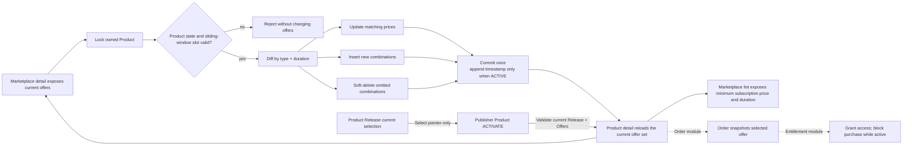

# Product Offer Module Feature Spec

**Status:** Approved for implementation
**Module group:** 04 — Commerce, Entitlement, and Execution  
**Owner:** Backend; consumed by the Publisher Portal, Marketplace, Order, and Entitlement modules

## Overview

The Product Offer module lets a Publisher define the currently available ways to acquire access to one Product. A Product may expose several offers at the same time, such as a one-time seven-day promotion and paid subscriptions for 30, 90, and 180 days. Offers remain separate from Product presentation and from Product Release because commercial terms can change without another workflow submission, Admin review, scan, or package build.

The Publisher replaces the Product's complete offer collection through one API. The Backend locks the Product, compares the requested collection with the current collection, updates matching prices, creates new type-and-duration combinations, and soft-deletes combinations omitted from the request. Once a Product is active, one Product-level sliding window limits material changes without blocking an immediate correction after an accidental edit.



Product Release owns package publication and pointer-only current-Release selection; its contract is
defined in [Product Release](../product_submission_release/product_release.md). Publishers can
prepare Offers on draft Products. `ProductService` injects the existing `ProductOfferService` to
validate Offer readiness and record the first public configuration in the Publisher activation
transaction. Product Release must not create, validate, rewrite, or approve Product Offers.

[Product](../product_submission_release/product.md) is authoritative for Publisher lifecycle, Admin
moderation, Marketplace visibility, and the activation transaction that calls Product Offer.

## 1. Purpose and domain boundary

This module owns:

- ProductOffer persistence and Publisher ownership enforcement;
- the complete-collection replacement API;
- offer input validation and canonical type-and-duration identity;
- set-based insert, price update, and soft deletion;
- Product-level commercial-change sliding-window enforcement;
- the Product-detail projection used by management and Marketplace reads; and
- the internal query contract used by Marketplace and Order modules.

This module does not own:

- Product creation, presentation, media, lifecycle decisions, or Admin suspension;
- WorkflowRevision, Submission, automated scan, or Admin review;
- ProductRelease persistence, package building, publication, rollback, or current-release selection;
- public Marketplace Product list/detail endpoints;
- balance deduction, Order, OrderItem, Entitlement, refund, payout, or commission settlement;
- automatic recurring billing or direct monetary payment;
- coupon, promotion schedule, price history, tax, regional currency, or revenue sharing; or
- Admin approval of price and duration.

An unreasonable offer is handled through the existing Admin Product suspension authority. There is
no ProductOffer review queue or approval status in the MVP.

## 2. Approved MVP decisions

- `ProductOffer` is a separate entity because one Product may expose several durations and prices.
- Product Offers are not included in WorkflowRevision, Submission, or Admin review snapshots.
- Changing an offer never requests a workflow scan and never builds a Product Release.
- The Publisher manages the complete desired offer collection through one idempotent
  `PUT /products/:productId/offers` API.
- The request contains only type, price, and duration. It contains no Offer ID and no status.
- The natural matching key within one Product is `(type, durationDays)`.
- A matching current non-deleted row is updated in place when only its price changes.
- A stored combination omitted from the request is soft-deleted, not hard-deleted.
- Soft-deleted Offer rows are immutable historical data. No application path may restore, update, or
  reuse them.
- Reintroducing a previously deleted type-and-duration combination creates a new Offer row and ID.
- `ProductOffer` has no public or persisted lifecycle status. Availability is derived from Product
  eligibility plus `ProductOffer.deletedAt IS NULL`.
- The complete offer set may be empty while Product is `DRAFT`. A Product cannot first activate, and
  an `ACTIVE` Product cannot accept a replacement, unless at least one current `SUBSCRIPTION` Offer
  remains.
- Draft Product offer edits are unrestricted because no customer can acquire the Product yet.
- A material offer-set change on an active Product consumes one Product-level sliding-window slot.
- All changes in one replacement request consume exactly one slot.
- A no-op replacement succeeds without changing rows or consuming a slot.
- `ONE_TIME` may be free or paid and may be temporary or permanent. A customer may acquire a
  `ONE_TIME` offer at most once for that Product across their account history.
- `SUBSCRIPTION` is paid, has a finite duration, and may be purchased again only after the
  customer's previous access to that Product has expired.
- A customer with currently active access cannot acquire any other offer for the same Product.
- Order and Entitlement enforcement is deferred to those modules; this spec fixes the semantics they
  must consume but does not implement their transactions.

This contract supersedes the earlier draft ProductOffer shape in
`db_design/04_commerce_entitlement_execution.md` when this spec is approved. In particular, the MVP
does not use `FREE`, `ProductOfferStatus`, `currency`, or Publisher-authored `usagePolicy` fields.

## 3. Data model

### 3.1 ProductOffer

```text
ProductOffer
  id UUID PK
  productId UUID FK Product, required
  type ProductOfferType, required
  priceAmount BIGINT, required
  durationDays INTEGER, nullable
  createdAt TIMESTAMPTZ, required
  updatedAt TIMESTAMPTZ, nullable
  deletedAt TIMESTAMPTZ, nullable
  createdById UUID FK User, required
  updatedById UUID FK User, nullable
  deletedById UUID FK User, nullable
```

```text
ProductOfferType = ONE_TIME | SUBSCRIPTION
```

The Backend entity schema extends the shared user-audit base:

```ts
export const ProductOffer = BaseWithUserFields.extend({
  id: z.uuid(),
  productId: z.uuid(),
  type: ProductOfferTypeSchema,
  priceAmount: BigIntStringSchema,
  durationDays: z.number().int().positive().nullable(),
});
```

`priceAmount` uses the same integer unit as `Profile.balance`. API JSON represents it as a base-10
string so JavaScript number precision cannot corrupt a BIGINT value. No currency field is required
while the system has one internal balance unit.

`durationDays = null` means permanent access and is valid only for `ONE_TIME`. A subscription always
has a positive finite duration.

### 3.2 Product sliding-window field

Add one system-managed field to Product:

```text
Product.offerChangeTimestamps TIMESTAMPTZ[], required, default empty
```

Clients cannot write this field through Product create/update. The Product Offer service changes it
only when first activation records the initial public Offer configuration or a material Offer-set
mutation on an `ACTIVE` Product commits. Draft editing, failed requests, unauthorized requests, and
no-op replacements do not change it. The array, remaining slots, configured window, and next allowed
time are internal and never appear in management or public responses.

### 3.3 Minimal SQL contract

```sql
CREATE TYPE "ProductOfferType" AS ENUM (
    'ONE_TIME',
    'SUBSCRIPTION'
);

ALTER TABLE "Product"
ADD COLUMN "offerChangeTimestamps" TIMESTAMPTZ[] NOT NULL DEFAULT '{}';

CREATE TABLE "ProductOffer" (
    id UUID PRIMARY KEY DEFAULT gen_random_uuid(),
    "productId" UUID NOT NULL
        REFERENCES "Product" (id) ON DELETE NO ACTION,
    type "ProductOfferType" NOT NULL,
    "priceAmount" BIGINT NOT NULL,
    "durationDays" INTEGER,

    -- BaseWithUserFields
    "createdAt" TIMESTAMPTZ NOT NULL DEFAULT now(),
    "updatedAt" TIMESTAMPTZ,
    "deletedAt" TIMESTAMPTZ,
    "createdById" UUID NOT NULL
        REFERENCES "User" (id) ON DELETE NO ACTION,
    "updatedById" UUID
        REFERENCES "User" (id) ON DELETE NO ACTION,
    "deletedById" UUID
        REFERENCES "User" (id) ON DELETE NO ACTION
);

CREATE INDEX "ProductOffer_productId_idx"
ON "ProductOffer" ("productId")
WHERE "deletedAt" IS NULL;
```

The database keeps only the primary key, foreign keys, heavy-read Product lookup index, and bounded
timestamp array. Type-specific price/duration rules, natural-key uniqueness, soft-delete pairing,
window pruning, counting, and rejection remain in the Backend. Every mutating path locks the Product
before reading or changing its Offers, so concurrent application instances cannot create duplicate
active natural keys or consume the same rate-limit slot.

Do not add a second index on `(productId, type, durationDays)` unless measured query behavior later
requires it. The Product lookup returns a bounded collection and the Backend performs the diff in
memory.

## 4. Offer validation and identity

### 4.1 Input shape

```ts
type ProductOfferInput = {
  type: "ONE_TIME" | "SUBSCRIPTION";
  priceAmount: string;
  durationDays: number | null;
};
```

All bounds are required validated environment configuration:

```text
PRODUCT_OFFER_MAX_COUNT = 10
PRODUCT_OFFER_MAX_DURATION_DAYS = 3650
PRODUCT_OFFER_CHANGE_MAX_COUNT = 2
PRODUCT_OFFER_CHANGE_WINDOW_HOURS = 24
PRODUCT_OFFER_MAX_PRICE_AMOUNT = 9223372036854775807
```

`config.ts` validates every value at startup. Offer count, duration, rate-limit count, and window
hours must be positive safe integers; maximum price is a non-negative decimal BIGINT string. Local
may use a larger count or shorter window for testing. Missing, malformed, zero, or out-of-range
configuration fails application startup instead of silently applying a fallback.

The parsed configuration is injected into validation and service logic. Controllers, repositories,
and Order integration must not repeat fallback values or magic numbers. Changing configuration
requires an application restart and does not change the API shape.

Validation rules:

| Type           | Price                                      | Duration                         |
| -------------- | ------------------------------------------ | -------------------------------- |
| `ONE_TIME`     | integer string, zero or positive           | `null` or `1..MAX_DURATION_DAYS` |
| `SUBSCRIPTION` | integer string, strictly greater than zero | required, `1..MAX_DURATION_DAYS` |

The request rejects signs, decimal points, exponent notation, whitespace-only values, unsafe
JavaScript numeric input, and values above signed BIGINT maximum. Unknown object fields are rejected.

### 4.2 Natural identity

Within a Product, these are different offers:

```text
(ONE_TIME, 7)
(ONE_TIME, null)
(SUBSCRIPTION, 30)
(SUBSCRIPTION, 90)
```

These are duplicates and cause `422 Error.ProductOfferDuplicate`:

```text
(SUBSCRIPTION, 30, price 100)
(SUBSCRIPTION, 30, price 120)
```

Price is not part of identity. Replacing price 100 with 120 updates the same current Offer row.
Changing duration from 30 to 90 removes the 30-day natural key and creates a new 90-day row when no
current 90-day row exists. A deleted historical 90-day row is never reused.

The Backend canonicalizes the request by `type`, then finite duration ascending, then permanent
`null` duration. Input order has no persistence or presentation meaning.

## 5. Lifecycle and availability

ProductOffer has no status state machine. Its storage lifecycle is:

```text
[insert] -> visible row
visible  -> soft-deleted when omitted from replacement payload
deleted  -X-> any mutation or restoration
```

Reintroducing the same type and duration after deletion starts again at `[insert]` with a new ID.

Availability for Marketplace and Order reads requires all of the following:

- ProductOffer is non-deleted;
- Product is non-deleted and `ACTIVE`;
- Product owner remains eligible under Marketplace Publisher policy; and
- Product has the eligible published current release required by the Product Release and Marketplace contracts.

Product states affect management as follows:

| Product status | Publisher may replace offers | Sliding window | Purchasable                                  |
| -------------- | ---------------------------- | -------------- | -------------------------------------------- |
| `DRAFT`        | yes                          | not consumed   | no                                           |
| `ACTIVE`       | yes                          | enforced       | yes, when release/publisher remain eligible  |
| `SUSPENDED`    | no                           | n/a            | no                                           |
| `ARCHIVED`     | no                           | n/a            | no new purchase; existing access is retained |

`DRAFT -> ACTIVE` is owned by the Publisher Product lifecycle transaction after a current Release is
selected. It locks and reads the current Offer collection and rejects activation unless at least one
eligible `SUBSCRIPTION` Offer exists. `ONE_TIME` alone does not satisfy readiness because Marketplace
list pricing is based only on subscription Offers.

Suspending or archiving a Product does not delete or rewrite its Offers. Publisher and Admin
reactivation call the same `ProductOfferService` readiness check before making the existing
non-deleted Offers eligible again. Reactivation does not change Offer terms or consume a rate-limit
slot.

### 5.1 Internal activation contract

`ProductOfferService` is the only Offer service. Do not create a separate eligibility service.
`ProductService` injects it and calls these internal methods inside its existing ambient
`TransactionService` lifecycle transaction:

```ts
assertActivationReady(productId: string): Promise<void>;

recordInitialPublicConfiguration(input: {
  productId: string;
  occurredAt: Date;
}): Promise<void>;
```

`assertActivationReady` performs one set-based existence query for a current non-deleted `SUBSCRIPTION` Offer with valid price and duration. It throws `Error.ProductSubscriptionOfferRequired` when none exists. It never mutates Offers.

`recordInitialPublicConfiguration` stores the activation timestamp as the first sliding-window entry.
Repositories resolve `PrismaService.getClient()` at execution time, so both calls join the caller's
transaction without passing a transaction client or opening another transaction.

## 6. API contracts

All examples use `/api/v1`; implementations use the configured API prefix consistently.

### 6.1 Replace the complete Product offer set

```http
PUT /api/v1/products/{productId}/offers
Authorization: Bearer <access-token>
Content-Type: application/json
```

Permission:

```text
method = PUT, path = /api/v1/products/:productId/offers, scope = OWN -> PUBLISHER
```

There is no unrestricted Admin mutation permission. Admin responds to abusive pricing through the existing Product suspension operation rather than editing Publisher-authored commercial terms.

Strict request body:

```ts
type ReplaceProductOffersInput = {
  offers: ProductOfferInput[]; // complete desired set, bounded by PRODUCT_OFFER_MAX_COUNT
};
```

Example:

```json
{
  "offers": [
    {
      "type": "ONE_TIME",
      "priceAmount": "0",
      "durationDays": 7
    },
    {
      "type": "SUBSCRIPTION",
      "priceAmount": "100",
      "durationDays": 30
    },
    {
      "type": "SUBSCRIPTION",
      "priceAmount": "250",
      "durationDays": 90
    },
    {
      "type": "SUBSCRIPTION",
      "priceAmount": "450",
      "durationDays": 180
    }
  ]
}
```

An empty set is valid only while the Product is `DRAFT`:

```json
{
  "offers": []
}
```

The request has full-replacement semantics. Omitting a stored offer means remove it from the current
offer set. The API is not PATCH-like and does not preserve omitted combinations. For an `ACTIVE`
Product, the desired set must contain at least one valid `SUBSCRIPTION` Offer; otherwise the entire
request is rejected before mutation.

Successful response for inserts, updates, removals, mixed changes, and no-op requests:

```json
{
  "data": {
    "message": "Success"
  },
  "statusCode": 200
}
```

The response does not return created or updated Offer rows. After any successful mutation, the
frontend reloads the appropriate Product detail endpoint to obtain the newest Product and Offer
state, including generated Offer IDs.

### 6.2 Product detail projections and purchase reads

There is no standalone Offer read endpoint. The permission-protected Product management detail and
the `@IsPublic()` Marketplace Product detail embed the current non-deleted Offers:

```ts
type ProductOfferOutput = {
  id: string;
  type: "ONE_TIME" | "SUBSCRIPTION";
  priceAmount: string;
  durationDays: number | null;
};
```

The Publisher editor maps `ProductOfferOutput[]` to the replacement input by sending only `type`,
`priceAmount`, and `durationDays`; generated IDs are read-only and are not accepted by the strict
`PUT` body. Detail output excludes audit timestamps and soft-delete/user fields.

The Marketplace Product list does not embed the collection. It exposes only the lowest-priced
current `SUBSCRIPTION` Offer's `priceAmount` and corresponding `durationDays`. Public eligibility
requires this Offer, so the list projection is non-null. `ONE_TIME` Offers do not participate in
that projection. Equal prices are resolved deterministically by `durationDays ASC`, then Offer ID
`ASC`. Product list loading must use a set-based relation/query rather than one Offer query per
Product.

The Order endpoint loads the selected Offer again inside its purchase transaction and never trusts
price or duration echoed by the client.

### 6.3 Permission records

| Permission name            | Module       | Method | Stored path                          | Scope | Assigned roles |
| -------------------------- | ------------ | ------ | ------------------------------------ | ----- | -------------- |
| Replace Own Product Offers | ProductOffer | `PUT`  | `/api/v1/products/:productId/offers` | `OWN` | `PUBLISHER`    |

Offer reads inherit the containing Product detail route. Management detail uses its existing Product `OWN`/Admin read permissions; Marketplace detail is `@IsPublic()` and has no Permission record.

Permission uniqueness follows the existing `(method, path, scope)` contract. No permission is assigned merely because a User owns a Publisher account; the active Publisher role and current Publisher policy remain required.

## 7. Replacement transaction and sliding window

### 7.1 Transaction algorithm

The service performs one transaction:

1. Resolve the authenticated User's active Publisher access before opening the transaction.
2. Normalize, validate, de-duplicate, and canonicalize the complete request in memory.
3. Lock the non-deleted Product row by `productId` using `FOR UPDATE`.
4. Require Product ownership by the resolved Publisher account.
5. Reject `SUSPENDED` and `ARCHIVED` Product states.
6. If Product is `ACTIVE`, require the canonical desired set to contain at least one
   `SUBSCRIPTION`; otherwise return `409 Error.ProductSubscriptionOfferRequired` without mutation.
7. Load all non-deleted ProductOffer rows for that Product in one query and lock them for update.
8. Compare the canonical desired set with the stored set by `(type, durationDays)`.
9. If there is no material difference, commit no mutation and return success without consuming a
   rate-limit slot.
10. If Product is `ACTIVE`, read the database transaction timestamp, discard stored timestamps at or
    before the rolling-window cutoff, and reject when the remaining count already equals
    `PRODUCT_OFFER_CHANGE_MAX_COUNT`.
11. Update matching visible rows whose price changed.
12. Insert desired combinations that do not match a current row, even if an immutable deleted row
    has the same type and duration.
13. Soft-delete visible stored combinations absent from the desired set.
14. If Product is `ACTIVE`, append the transaction timestamp to the bounded retained array.
15. Update the affected Offer and Product audit timestamps/user IDs consistently.
16. Commit once.

The repository must use set-based reads and bounded bulk mutations. It must not issue one database
read per input Offer. The maximum collection size bounds in-memory diff cost.

### 7.2 Sliding-window calculation

For an active Product:

```text
cutoff = transactionNow - PRODUCT_OFFER_CHANGE_WINDOW_HOURS
recent = offerChangeTimestamps where timestamp > cutoff

if recent.length >= PRODUCT_OFFER_CHANGE_MAX_COUNT:
    reject
else:
    persist recent + transactionNow
```

The stored array never exceeds `PRODUCT_OFFER_CHANGE_MAX_COUNT`. The Backend calculates the window
from validated configuration for every material request. When no slot remains, the service returns:

```text
429 Error.ProductOfferChangeRateLimitExceeded
```

The error does not expose timestamps, remaining slots, the configured window, or the next allowed
time. The exact response envelope follows the Backend's global error format. The service does not
rely on Redis or an HTTP request-rate limiter. The Product row lock and stored bounded array make the
rule consistent across API replicas and restarts.

Draft Product changes neither read nor write the sliding window. Publisher `ACTIVATE` records one
entry through `ProductOfferService.recordInitialPublicConfiguration`, leaving the remaining
configured slots available for corrections. Publisher/Admin reactivation and Release switching do
not change Offer terms and consume no slot.

### 7.3 Concurrent replacement

Two concurrent requests for the same Product serialize on the Product row:

- for `ACTIVE`, each material request sees every committed timestamp and receives `429` when the
  rolling window has no slot;
- for `DRAFT`, MVP last-write-wins semantics apply to the complete collection;
- an identical second request becomes a no-op and succeeds without consuming a slot.

Requests for different Products do not share a lock.

## 8. Order and Entitlement MVP contract

This section is the authoritative MVP acquisition policy consumed by Order and Entitlement. Product
Offer does not execute purchases or mutate Entitlements.

### 8.1 ONE_TIME

`ONE_TIME` supports several Publisher-defined uses:

- a free trial;
- a paid introductory package;
- a limited-duration promotion; or
- permanent access when `durationDays = null`.

The Publisher controls price and duration. Regardless of how many `ONE_TIME` offers or historical
Offer IDs exist, one customer may successfully acquire `ONE_TIME` access for a Product only once.
The once-only key is `(customerId, productId)`, not `(customerId, productOfferId)`.

A zero-price acquisition still creates a zero-value Order and OrderItem so idempotency, history, and
the once-only decision use the same transaction path as a paid acquisition.

### 8.2 SUBSCRIPTION

`SUBSCRIPTION` is a prepaid finite access period. The MVP has no automatic recurring charge. A
customer may buy another subscription after earlier access expires and may choose any currently
available duration at that time.

### 8.3 Active-access blocking

Before any acquisition, the Order module must evaluate current access by timestamp:

```ts
const hasActiveAccess =
  entitlement !== null &&
  (entitlement.expiresAt === null || entitlement.expiresAt > transactionNow);
```

If access is active, acquisition of every Product Offer type is rejected. Therefore, a customer with
an active 90-day package cannot buy a 180-day package, extend the expiration, or switch packages.
After expiration, a subscription purchase starts a new period from the purchase transaction time:

```text
startsAt  = transactionNow
expiresAt = transactionNow + durationDays
```

There is no stacking, proration, remaining-value conversion, early renewal, or package upgrade in
the MVP.

### 8.4 Durable downstream state

Entitlement keeps one durable row per customer and Product rather than one row per active period:

```text
UNIQUE(customerId, productId)
oneTimePurchasedAt TIMESTAMPTZ, nullable, never cleared by expiration
```

Order locks Product before the selected ProductOffer, then locks its customer-specific purchase
state in the consistent order defined by the Order module. It remains responsible for locking
balance and Entitlement state, deducting balance, creating Order/OrderItem snapshots, and creating or
reactivating Entitlement atomically. Product Offer only provides the current terms to snapshot.

New acquisition requires Product `ACTIVE`; `DRAFT`, `ARCHIVED`, and `SUSPENDED` reject Order
creation. Existing unexpired Entitlements remain usable while Product is `ARCHIVED`, provided its
current Release remains eligible. `SUSPENDED` blocks download and execution because it is an Admin
moderation control, whereas Publisher archival only stops discovery and new acquisition.

## 9. Failure behavior

| Condition                                         | Result                                                                       | Mutation      |
| ------------------------------------------------- | ---------------------------------------------------------------------------- | ------------- |
| Invalid Product UUID or body shape                | `422` validation error                                                       | none          |
| More than maximum Offer count                     | `422 Error.ProductOfferLimitExceeded`                                        | none          |
| Duplicate type and duration in payload            | `422 Error.ProductOfferDuplicate`                                            | none          |
| Invalid price or duration for type                | `422 Error.ProductOfferInvalid`                                              | none          |
| Product missing, deleted, or outside `OWN` access | `404 Error.ProductNotFound`                                                  | none          |
| Caller is not an eligible active Publisher        | existing Publisher policy error                                              | none          |
| Product is `SUSPENDED`                            | `409 Error.ProductOfferSuspendedProduct`                                     | none          |
| Product is `ARCHIVED`                             | `409 Error.ProductOfferArchivedProduct`                                      | none          |
| Active desired set has no subscription Offer      | `409 Error.ProductSubscriptionOfferRequired`                                 | none          |
| Active Product sliding window has no slot         | `429 Error.ProductOfferChangeRateLimitExceeded`                              | none          |
| Canonical desired set equals stored set           | `200 SUCCESS_RESPONSE`                                                       | none          |
| Known transaction serialization/deadlock failure  | retry transaction within bounded repository policy or return transient error | none/rollback |
| Unexpected persistence failure                    | existing internal error contract                                             | rollback      |

The Backend logs the trace ID, Product ID, Publisher account ID, outcome, inserted/updated/deleted
counts, and stable error code. It must not log access tokens or unrelated Product/Project payloads.
Application logs are not durable commercial audit history; general AuditLog integration is outside
this module.

## 10. Security and authorization

- `PUT` requires exact `OWN` permission and active Publisher policy.
- Ownership is derived from Product; requests never accept `publisherAccountId`.
- Cross-owner and missing Products are externally indistinguishable.
- Admin reads Offers through the existing Product management detail route.
- Admin intervention uses Product suspension; there is no hidden Admin price-edit path.
- The complete request is validated before database mutation.
- BIGINT input remains a string until safely parsed by the database/client layer.
- Order re-reads and locks Product before the selected non-deleted Offer; it cannot trust a client
  price, duration, Product status, or cached Marketplace response.
- Soft-deleted Offers remain addressable by historical Order foreign keys but are unavailable for
  new purchases.
- The sliding window is a database-backed business invariant, not an IP-, token-, process-, or
  Redis-local request throttle.

## 11. Efficiency and scalability

- Publisher offer writes are low-frequency and serialize only per Product.
- Maximum 50 Offers bounds request parsing, canonicalization, and diff memory.
- One Product lookup/lock and one Offer-set lookup replace per-item database queries.
- The Product lookup index supports management, public projection, and Order validation.
- Updating price in place avoids one historical row per price change.
- OrderItem snapshots preserve purchase history without requiring immutable Offer versions.
- Soft-deleted rows remain hidden from default Publisher queries and dashboards.
- The active Product sliding window requires one indexed primary-key Product lock and a bounded array;
  it needs no global lock or cleanup job.
- Order and Offer replacement both lock Product first. Whichever transaction obtains that Product
  row first completes its validation and mutation; the second transaction then sees the committed
  Offer terms or deletion and revalidates before continuing.
- No Kafka topic, consumer, background job, Redis lock, cache, or outbox is required.

If Offer volume, multiple Publisher team members, scheduled promotions, or high-frequency dynamic
pricing later invalidate these assumptions, introduce explicit optimistic versioning or a dedicated
commercial configuration aggregate rather than weakening the Product lock invariant.

## 12. Implementation mapping

Suggested Backend module:

```text
src/routes/product-offer/
  product-offer.controller.ts
  product-offer.dto.ts
  product-offer.error.ts
  product-offer.model.ts
  product-offer.module.ts
  product-offer.repo.ts
  product-offer.service.ts
```

Responsibilities:

| File                          | Responsibility                                                                         |
| ----------------------------- | -------------------------------------------------------------------------------------- |
| `product-offer.controller.ts` | Authenticated full-replacement PUT route                                               |
| `product-offer.dto.ts`        | Existing request/response DTO wrapper integration                                      |
| `product-offer.error.ts`      | Stable domain errors                                                                   |
| `product-offer.model.ts`      | Strict Zod entity/input/output schemas and set-level validation                        |
| `product-offer.module.ts`     | Product/Publisher dependencies and route wiring                                        |
| `product-offer.repo.ts`       | Product/Offer locks, set-based persistence, and read projections                       |
| `product-offer.service.ts`    | Access, activation readiness, sliding window, canonical diff, transaction, and logging |

Additional changes:

```text
src/entities/product-offer.model.ts              # BaseWithUserFields entity schema if repo convention requires
src/shared/config.ts                              # validated Product Offer environment configuration
src/shared/constants/product.constant.ts         # Offer rate-limit error/config names where shared
src/routes/product/product.model.ts              # management output compatibility when appropriate
src/routes/product/product.service.ts            # inject ProductOfferService for activation/reactivation readiness
prisma/migrations/<timestamp>_add_product_offer/  # SQL-first migration
prisma/schema.prisma                              # updated only through approved migration/introspection workflow
src/app.module.ts                                 # import ProductOfferModule
.env.example                                      # local/test Offer configuration examples
.env.production.example                           # required production Offer configuration keys
```

Follow the repository's SQL-first Prisma workflow. Do not edit generated Prisma client files by hand.
`ProductOfferModule` exports the existing `ProductOfferService` for Product. No separate eligibility
service is introduced.

## 13. Acceptance criteria

### Management API

- Publisher can replace all Offers for an owned `DRAFT` Product without consuming a slot.
- Publisher can replace all Offers for an owned `ACTIVE` Product when the sliding window has a slot.
- Active replacement must retain at least one SUBSCRIPTION Offer; a rejected request mutates no
  Offer or Product field.
- Admin can read Offers through Product detail but cannot mutate Product Offers.
- Cross-owner writes return Product not found.
- `SUSPENDED` and `ARCHIVED` Products reject Publisher Offer replacement.
- PUT returns only `SUCCESS_RESPONSE`; Product detail owns fetching the newest records and generated
  IDs after the mutation.
- Management and public Product detail return current non-deleted Offer ID/type/price/duration in
  deterministic order and omit rate-limit and audit fields.
- Marketplace Product list returns only the minimum-priced SUBSCRIPTION price and its duration,
  ignores ONE_TIME Offers, and excludes Products without an eligible subscription.

### Diff semantics

- Matching `(type, durationDays)` with a different price updates one existing row.
- New combinations insert one row.
- Omitted combinations are soft-deleted with user/timestamp fields.
- Reintroduced combinations create a new row and leave every deleted historical row unchanged.
- Duplicate combinations in one payload are rejected before persistence.
- Empty payload soft-deletes every current Offer only for `DRAFT`; it is rejected for `ACTIVE`.
- Identical normalized replacement is a no-op.
- Repository work uses bounded set-based queries rather than database operations inside an input loop.

### Sliding window and concurrency

- Every Offer bound, window, and rate-limit count comes from validated environment configuration.
- Invalid or missing Offer configuration fails application startup.
- First activation records one initial public-configuration timestamp.
- One active-Product replacement containing multiple changes consumes one slot.
- A create-by-new-combination cannot bypass the Product-level window.
- Failed, unauthorized, invalid, draft, and no-op requests consume no slot.
- Concurrent active-Product material replacements serialize and cannot exceed the configured count.
- Concurrent draft replacements serialize and follow last-write-wins semantics.
- Different Products can be changed concurrently.

### Downstream compatibility

- ONE_TIME supports zero or positive price and finite or permanent duration.
- SUBSCRIPTION requires positive price and finite duration.
- The Offer contract exposes enough information for OrderItem to snapshot exact commercial terms.
- The downstream contract clearly requires one lifetime ONE_TIME acquisition per customer/Product.
- The downstream contract clearly blocks all purchases while Product access remains active.
- Subscription repurchase is allowed only after expiration and starts from the new transaction time.
- Product lifecycle injects `ProductOfferService` for activation/reactivation readiness and initial
  window state; Product Release selection never reads Offers and there is no separate eligibility
  service.

## 14. Deferred work

- Public Product media delivery.
- Order, balance deduction, zero-value Order, and OrderItem implementation.
- Durable Entitlement renewal/reactivation implementation.
- General AuditLog integration and commercial change history UI.
- Scheduled promotion `startsAt`/`endsAt` fields.
- Coupon, campaign, referral, and targeted discount models.
- Automatic recurring subscription billing.
- Direct payment, multi-currency, tax, refund, payout, and commission settlement.
- Admin Offer review or approval workflow.
- Publisher team optimistic concurrency and Offer collection revision numbers.
- Price floor, maximum percentage change, paid/free conversion restrictions, and advanced abuse
  detection.
- Customer upgrade, downgrade, proration, early renewal, stacking, or prepaid-access horizon.
