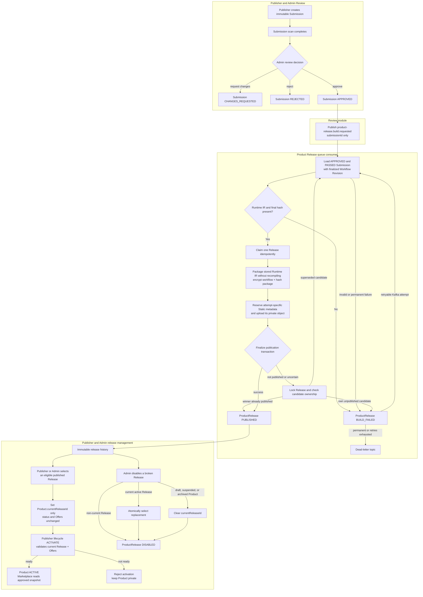

# Product Release Module Feature Spec

**Status:** Approved for implementation; implementation in progress

**Module group:** 03 — Product, Submission, Review, and Product Release

**Owner:** Backend; consumed by the queue consumer, Publisher Portal, Admin Portal, Marketplace,
Launcher, Download Authorization, and Execution Authorization modules

## Overview

The Product Release module turns one approved immutable Submission into one immutable executable
Product version. Review publishes a Kafka message containing only `submissionId`. The Product
Release consumer claims one Release idempotently, creates an encrypted standard ZIP package from the
approved WorkflowRevision, uploads it through Static to private Cloudflare R2, and publishes the
Release.

Successful publication creates an eligible immutable Release but never changes Product status or
`Product.currentReleaseId`. The Publisher explicitly selects a published Release; that operation
changes only the pointer and may be done before or after configuring Offers. The separate Publisher
Product lifecycle endpoint validates the selected Release and Offers before activating a draft or
reactivating an archived Product. A failed build leaves Product state and current Release unchanged.



HTTP never creates or rebuilds a Release. HTTP owns authenticated history/detail reads, controlled
current-Release selection, and Admin disable operations. Package construction always runs in the
separate queue consumer.

## 1. Purpose and domain boundary

This module owns:

- ProductRelease persistence and lifecycle;
- idempotent consumption of `product-release.build.requested`;
- durable `(productId, version)` reservation;
- loading one approved Submission and its immutable WorkflowRevision;
- current Product and Publisher eligibility checks before work and before publication;
- canonical Runtime package construction, encryption, hashing, and ZIP creation;
- private ZIP upload through the existing Static/R2 storage abstraction;
- atomic current-Release selection without Product lifecycle mutation;
- authenticated Release history/detail reads;
- Publisher/Admin rollback to an eligible published Release; and
- Admin disable behavior for a broken or unsafe Release.

This module does not own:

- Product authoring, Product media, Product Offer, price, or duration;
- Submission creation, scan execution, or Admin review;
- mutation of Submission or WorkflowRevision snapshots;
- content-key generation/wrapping or Runtime key envelopes;
- public Marketplace controllers;
- customer acquisition, Order, Entitlement, payment, or refund;
- package download authorization or presigned URL delivery;
- execution leases or Runtime admission; or
- public Product media delivery.

Key Service owns content-key generation, wrapping, and bounded plaintext-key use. ProductRelease
stores only the protected `wrappedKey` and non-secret `keyNonce`; it never stores plaintext key
bytes. The implementation contract is defined in [Key Service](../security/key_service.md); the
system-wide inventory remains in
[Cryptographic Keys and Security Credentials](../../../specifications/cryptographic_key_security.md).

Product Offers are independent commercial records. Build, publication, rollback, and disable paths
must never create, edit, delete, or snapshot Product Offers.

[Product](./product.md) is authoritative for Publisher lifecycle, Admin moderation, and Marketplace
visibility. [Product Offer](../commerce_entitlement_execution/product_offer.md) is authoritative for
Offer readiness and sliding-window behavior. This specification owns Release state, package
publication, pointer-only current selection, and Admin disable behavior.

`ProductReleaseService` exposes current-Release eligibility for `ProductService` activation and
reactivation checks. It does not inject `ProductOfferService`; Release selection never reads Offers.
Both modules resolve the ambient transaction through `PrismaService.getClient()` so lifecycle
readiness and the Product status transition commit or roll back together.

```ts
assertCurrentReleaseEligible(input: {
  productId: string;
  releaseId: string;
}): Promise<void>;
```

The method locks and requires a Release belonging to the Product with `PUBLISHED`, non-disabled, and
package-complete state. It performs no Product or Release mutation and joins the caller's ambient
transaction.

When approved, this specification supersedes the draft ProductRelease section in
`db_design/03_product_submission_release.md`.

## 2. MVP decisions

- Only an `APPROVED` Submission may create a ProductRelease.
- There is no ProductRelease create/update/rebuild API.
- There is no additional Product readiness status; the Publisher lifecycle transaction derives
  readiness from Product, current Release, Offer, and Publisher state.
- One Submission creates at most one ProductRelease.
- One Product cannot reuse the same normalized version.
- Kafka carries only `submissionId`; PostgreSQL snapshots are authoritative.
- The consumer inserts a new Release directly as `BUILDING`; `PENDING_BUILD` is unnecessary.
- Kafka redelivery resumes the same Release and version.
- Review/scan/WorkflowRevision validation is not repeated. Product Release parses immutable build
  inputs but trusts earlier module invariants.
- An approved build source must have non-null finalized `WorkflowRevision.runtimeIr` and
  `WorkflowRevision.contentHash`. Product Release never compiles or repairs workflow content.
- Product and Publisher mutable eligibility are checked before building and again before publishing.
- The package is a standard ZIP downloaded as `<buildSnapshotSlug>-<releaseVersion>.a2m`;
  `.a2m` is the product-package extension, not a custom archive codec. Static owns this filename.
- The ZIP contains exactly `manifest.json`, `workflow.enc`, and `input-schema.json` in the asset-free
  MVP.
- The final package has one Static record and one private R2 object.
- ProductRelease stores `packageStaticId` and `packageHash`; Static owns object key, filename, content
  type, and byte size.
- ProductRelease stores `wrappedKey` and `keyNonce` directly; plaintext key bytes are never stored.
- A Release becomes `PUBLISHED` only after its complete package exists and Static/package metadata
  can commit.
- Published package identity, hash, version, Submission, and timestamps are immutable.
- Release publication never changes Product status or `currentReleaseId`.
- Current-Release selection changes only `currentReleaseId` and Product audit fields. It never
  changes Product status, reads Offers, or consumes an Offer-change slot.
- Build failure never changes Product status or current Release.
- Publisher/Admin may select an older eligible published Release without rebuilding.
- Only Admin may disable; `DISABLED` is terminal and cannot be restored.
- There is no Release delete operation.
- Mutation APIs return only `SUCCESS_RESPONSE`; reads refresh the newest state.

## 3. Data model

### 3.1 Lifecycle

```text
ProductReleaseStatus = BUILDING | PUBLISHED | BUILD_FAILED | DISABLED
```

### 3.2 ProductRelease

```text
ProductRelease
  id UUID PK
  productId UUID FK Product, required
  submissionId UUID FK Submission, required, unique
  version VARCHAR(100), required
  status ProductReleaseStatus, required, default BUILDING

  packageStaticId UUID FK Static, nullable
  packageHash VARCHAR(64), nullable
  wrappedKey BYTEA, nullable
  keyNonce BYTEA, nullable
  buildFailureCode VARCHAR(100), nullable, internal-only

  publishedAt TIMESTAMPTZ, nullable
  disabledAt TIMESTAMPTZ, nullable
  disabledReason TEXT, nullable

  createdAt TIMESTAMPTZ, required
  updatedAt TIMESTAMPTZ, nullable
  createdById UUID FK User, required
  updatedById UUID FK User, nullable
```

Field responsibilities:

- `productId` supports Release history, Product locking, and Product/version uniqueness.
- `submissionId` is the idempotency and immutable-source identity.
- `version` is copied from immutable `Submission.releaseRequest` for uniqueness and frequent reads.
- `packageStaticId` is null until artifact reservation. While the Release is `BUILDING`, it may point
  to the current attempt's private Static object and fences older attempts. It is required for
  publication and becomes immutable with the published package hash/key.
- `packageHash` is lowercase SHA-256 of the exact final ZIP bytes; it is required for publication.
- `wrappedKey` is the Release's 32-byte content key protected by `MASTER_KEY`; it is exactly 48
  bytes (`ciphertext || 16-byte tag`) and is required before package encryption and publication.
- `keyNonce` is the non-secret 12-byte AES-GCM nonce used only to wrap that content key. It is not
  the workflow-encryption nonce stored in `manifest.json`.
- `buildFailureCode` is a stable Admin-only reason code, never an exception message.
- `publishedAt` is set exactly once.
- `disabledAt`, `disabledReason`, `updatedAt`, and `updatedById` audit the terminal Admin disable.
- `createdById` is the approving Admin derived from the Submission; Kafka cannot supply it.

The model intentionally does not duplicate:

- `workflowRevisionId`, because Submission owns it;
- changelog and minimum versions, because `Submission.releaseRequest` is immutable;
- Runtime IR, input schema, or capabilities, because WorkflowRevision owns them;
- object key, filename, content type, or size, because Static owns them;
- manifest or payload hash, because they live inside the immutable ZIP;
- plaintext key or workflow-encryption nonce, because plaintext is transient and the workflow nonce
  lives in the manifest; or
- `disabledById`, because the terminal disable actor is `updatedById`.

ProductRelease has no soft-delete fields. Historical Releases remain addressable.

### 3.3 Constraints and index

Keep only identity/concurrency integrity:

```text
UNIQUE(submissionId)
UNIQUE(productId, version)
FK Product.currentReleaseId -> ProductRelease.id
CHECK ((wrappedKey IS NULL) = (keyNonce IS NULL))
```

Release-history pagination uses:

```sql
CREATE INDEX "ProductRelease_productId_publishedAt_idx"
ON "ProductRelease" ("productId", "publishedAt" DESC, id DESC);
```

Lifecycle transitions, hash format, same-Product checks, and field completeness remain Backend
logic. No trigger or additional status index is required for the expected volume.

### 3.4 Related immutable data

API projections and package build load:

```text
ProductRelease
├── Submission
│   ├── productSnapshot
│   ├── releaseRequest
│   └── workflowRevisionId
├── WorkflowRevision
│   ├── runtimeIr
│   ├── inputSchema
│   └── capabilityManifest
└── Static
    ├── objectKey
    ├── originalFileName
    ├── contentType
    └── size
```

This is one bounded projection for detail/build, not duplicated persistence.

## 4. Lifecycle and Product invariants

```text
BUILDING     -> PUBLISHED
BUILDING     -> BUILD_FAILED
BUILD_FAILED -> BUILDING      # Kafka retry of the same Release
PUBLISHED    -> DISABLED      # Admin only

PUBLISHED -X-> BUILDING | BUILD_FAILED
DISABLED  -X-> any state
```

- Product may point only to a `PUBLISHED`, non-disabled Release belonging to that Product.
- Publication creates selectable Release history and never changes Product status or its pointer.
- Current-Release selection sets or replaces only the pointer and Product audit fields.
- Owner Publisher selection is allowed for non-deleted `DRAFT`, `ACTIVE`, and `ARCHIVED` Products.
  Admin selection is also allowed for `SUSPENDED` Products so a safe replacement can be prepared.
- Selection does not require an Offer. Publisher/Admin lifecycle operations revalidate the selected
  Release and Offers before changing Product status to `ACTIVE`.
- Publishing or selecting a Release never automatically reactivates a suspended Product.
- Failure preserves the existing Marketplace snapshot.
- Delayed builds cannot replace a newer current Release because builds never select Releases.
- Intentional first launch, update, or rollback uses the current-Release selection API.

## 5. Kafka consumer and reduced validation

The Product Release consumer accepts only the
finalized output of the Submission pipeline. It must not import, inject, or call
`WorkflowCompilerService`, and it must not use `ProjectDraft.runtimeIr` as a fallback.

### 5.1 Subscription

```text
topic: product-release.build.requested
dead letter: product-release.build.requested.dlq
type: product-release.build.requested
Kafka key: productId
message ID: product-release-build:<submissionId>
consumer group: product-release-build
```

```ts
type ProductReleaseBuildRequested = {
  submissionId: string;
};
```

The thin handler validates the payload and calls ProductReleaseService. Package logic does not live
in the handler.

### 5.2 Claim transaction

The consumer performs one short transaction:

1. Validate `submissionId` as UUID.
2. Load the non-deleted Submission with its scan status, Product, Publisher, and WorkflowRevision.
3. Independently enforce the release-source gate:
   - `Submission.status = APPROVED`;
   - `Submission.scanStatus = PASSED`;
   - `WorkflowRevision.runtimeIr` is non-null; and
   - `WorkflowRevision.contentHash` is non-null.
4. Treat a missing compiled field as a permanent broken-invariant failure. Stop before creating key
   material, reserving Static metadata, generating an object key, or contacting R2.
5. Require Product is non-deleted and `DRAFT`, `ACTIVE`, or `ARCHIVED`. Publisher archival is an
   unlisting operation and does not invalidate an already approved build.
6. Require Publisher remains release-eligible.
7. Load ProductRelease by `submissionId`.
8. If absent, reserve `(productId, version)` and insert `BUILDING` using the reviewer as
   `createdById`.
9. If `BUILD_FAILED`, reuse the Release identity. Clear its failure and transition to `BUILDING`
   only when this attempt reserves its fresh Static candidate under the Release row lock.
10. If `PUBLISHED` or `DISABLED`, return success without rebuilding.
11. Commit before encryption, ZIP creation, or R2 I/O.

Product Release does not repeat:

- workflow validation or scan execution; checking `scanStatus = PASSED` is only an invariant gate;
- Project/Revision identity comparisons already frozen by Submission;
- release-request syntax validation;
- WorkflowRevision hash recomputation; or
- workflow topology/node-policy scanning; or
- Editor Graph to Runtime IR compilation.

The consumer must package the exact stored `WorkflowRevision.runtimeIr`. It must never read the
Editor Graph for compilation, call the shared compiler, or substitute the nullable Project Draft
cache. `WorkflowRevision.contentHash` is required as finalized-source evidence but is not recomputed
by this module.

The package service still parses Runtime IR, input schema, and capabilities through their strict
schemas before serialization. Parsing protects the builder; it is not another business scan.

### 5.3 Handler result

- Permanently invalid message/business input returns `FAILED`. An attempt may persist
  `BUILD_FAILED` only while it owns the unpublished `packageStaticId`; no unowned failure write.
- Missing passed-scan/finalized-revision prerequisites return `FAILED` without starting package or
  storage work. A pre-candidate failure leaves any existing Release/candidate untouched.
- Transient failure returns `RETRY`; owned candidate cleanup records a stable failure code.
  If cleanup confirms an already published Release, return `SUCCESS` instead. A superseded attempt
  returns `RETRY` while no publication is confirmed, without changing the newer owner.
- Successful publication or an already terminal Release returns `SUCCESS`.
- Existing queue configuration controls bounded attempts and DLQ forwarding. No outbox or generic
  job table is introduced.

## 6. ZIP package contract

### 6.1 Authoritative inputs

```text
WorkflowRevision.runtimeIr            -> encrypted workflow.enc
WorkflowRevision.inputSchema          -> input-schema.json
WorkflowRevision.runtimeIr.entryNodeId -> manifest entryNodeId
WorkflowRevision.runtimeIr.requiredCapabilities
                                        -> manifest requiredCapabilities
Submission.releaseRequest             -> version and minimum versions in manifest
ProductRelease/Product IDs            -> package identity
```

`WorkflowRevision.capabilityManifest` remains frozen review/scan evidence; package creation does not
invent capabilities from it. The package copies the already validated, deduplicated capability list from
Runtime IR. Mutable Product authoring fields and Product Offers are not package inputs.

### 6.2 Exact package layout

```text
<buildSnapshotSlug>-<releaseVersion>.a2m
├── manifest.json
├── workflow.enc
└── input-schema.json
```

The package is a standard ZIP whose filename uses the `.a2m` product-package extension. Backend and
Runtime use standard ZIP libraries; there is no custom archive codec. Its media type remains
`application/zip`. Assets remain unsupported until the Asset module defines immutable asset
packaging.

### 6.3 `workflow.enc`

`workflow.enc` is the canonically serialized Runtime IR encrypted with the content key protected by
`ProductRelease.wrappedKey` and `ProductRelease.keyNonce`. Its complete binary format is exactly
`ciphertext || 16-byte authentication tag`; it has no wrapper or embedded nonce. Section 6.7 defines
the byte-level construction algorithm.

The nonce is non-secret and appears only in `manifest.json`. A failed package is deleted; a retry may
use a fresh nonce and produce a different unpublished hash. Published bytes never change.

### 6.4 `input-schema.json`

Strictly parse and canonically serialize `WorkflowRevision.inputSchema` as UTF-8 JSON. It defines
configuration/credential fields but contains no customer values or secrets. Section 6.7 defines its
exact serialization and hash input.

### 6.5 `manifest.json`

```ts
type ProductReleaseManifest = {
  productId: string;
  releaseId: string;
  version: string;
  minimumLauncherVersion: string;
  minimumRuntimeVersion: string;
  entryNodeId: string;
  workflow: {
    path: "workflow.enc";
    sha256: string;
    encryption: {
      algorithm: "AES-256-GCM";
      nonce: string; // base64
      authenticationTagBytes: 16;
    };
  };
  inputSchema: {
    path: "input-schema.json";
    sha256: string;
  };
  requiredCapabilities: string[];
};
```

No package-format version is handled in the MVP. `packageHash` is excluded because a ZIP cannot
contain its own final hash.

### 6.6 Canonical JSON bytes

`WorkflowRevision.runtimeIr`, `WorkflowRevision.inputSchema`, and the constructed manifest are
serialized with JSON Canonicalization Scheme rules (RFC 8785):

- object keys are sorted according to the canonicalization algorithm;
- array order is preserved;
- strings and numbers use canonical JSON escaping/number representation;
- `null`, booleans, strings, arrays, objects, and finite JSON numbers are allowed;
- `undefined`, functions, binary values, `NaN`, and infinities are rejected;
- output is UTF-8 without BOM, indentation, insignificant whitespace, or trailing newline.

Hashing and encryption always consume these exact output bytes, never a parsed object or a
re-serialized copy. Library selection or a new canonicalization dependency requires separate
implementation approval.

### 6.7 Exact file-construction pipeline

The builder prepares all three entry byte arrays before opening the ZIP writer because
`manifest.json` contains metadata derived from the other two entries but must be written first.

#### Step 1: load and parse inputs

Load one bounded projection containing ProductRelease, Submission, and WorkflowRevision. Strictly
parse:

- Runtime IR using the Runtime IR contract;
- input schema using its reduced schema contract; and
- release request using the immutable Submission snapshot contract.

This protects the builder from malformed storage. It does not repeat Submission scanning or compile
Runtime IR.

Missing `WorkflowRevision.runtimeIr` or `contentHash` is a permanent broken-invariant build failure.
The builder must not fall back to Project Draft content, read the Editor Graph for compilation, or
call `WorkflowCompilerService`. This gate runs before Key Service, Static reservation, object-key
generation, ZIP allocation, or R2 work.

#### Step 2: create `input-schema.json`

1. Canonically serialize `WorkflowRevision.inputSchema`.
2. Keep the resulting UTF-8 bytes as `inputSchemaBytes`.
3. Calculate `inputSchemaHash = lowercaseHex(SHA-256(inputSchemaBytes))`.

`input-schema.json` contains only the schema definition. It must not contain customer-provided API
keys, device values, defaults containing secrets, or execution-time input.

#### Step 3: create `workflow.enc`

1. Canonically serialize the complete `WorkflowRevision.runtimeIr` as `runtimeIrBytes`.
2. Resolve the immutable `ProductRelease.wrappedKey` and `ProductRelease.keyNonce`, allocating and
   storing one complete pair through the idempotent contract in the Key Service spec when absent.
3. Call `KeyService.withKey(releaseId, wrappedKey, keyNonce, callback)` and perform the remaining
   encryption steps inside that bounded callback using the supplied random 32-byte content key `K`.
4. Generate a cryptographically random 12-byte nonce that has never been used with `K`.
5. Encrypt `runtimeIrBytes` using AES-256-GCM with `K`, that nonce, and empty additional
   authenticated data for the MVP.
6. Construct `workflowBytes = ciphertext || authenticationTag`, where the tag is exactly 16 bytes.
7. Calculate `workflowHash = lowercaseHex(SHA-256(workflowBytes))`.
8. Release `runtimeIrBytes`, `K`, and intermediate plaintext buffers as far as the platform permits.

`workflow.enc` is exactly `workflowBytes`; it has no JSON wrapper, header, nonce prefix, length
prefix, or base64 encoding. The nonce is encoded separately in the manifest using padded RFC 4648
standard Base64.

#### Step 4: create `manifest.json`

Construct the manifest from these exact sources:

| Manifest field                               | Authoritative source                                                                                  |
| -------------------------------------------- | ----------------------------------------------------------------------------------------------------- |
| `productId`                                  | `ProductRelease.productId`                                                                            |
| `releaseId`                                  | `ProductRelease.id`                                                                                   |
| `version`                                    | `ProductRelease.version`, originally copied from `Submission.releaseRequest.version`                  |
| `minimumLauncherVersion`                     | `Submission.releaseRequest.minimumLauncherVersion`                                                    |
| `minimumRuntimeVersion`                      | `Submission.releaseRequest.minimumRuntimeVersion`                                                     |
| `entryNodeId`                                | parsed `WorkflowRevision.runtimeIr.entryNodeId`                                                       |
| `workflow.path`                              | constant `workflow.enc`                                                                               |
| `workflow.sha256`                            | `workflowHash`, calculated over final encrypted `workflowBytes`                                       |
| `workflow.encryption.algorithm`              | constant `AES-256-GCM`                                                                                |
| `workflow.encryption.nonce`                  | Base64 of the exact 12-byte nonce                                                                     |
| `workflow.encryption.authenticationTagBytes` | constant `16`                                                                                         |
| `inputSchema.path`                           | constant `input-schema.json`                                                                          |
| `inputSchema.sha256`                         | `inputSchemaHash`, calculated over final `inputSchemaBytes`                                           |
| `requiredCapabilities`                       | parsed `WorkflowRevision.runtimeIr.requiredCapabilities`, preserving its validated deduplicated order |

Canonically serialize that object as `manifestBytes`. `manifest.json` is exactly `manifestBytes`.
The manifest does not contain `packageHash`, `wrappedKey`, `keyNonce`, plaintext content-key
material, R2 identity, or a permanent download URL.

For the MVP, `minimumRuntimeVersion` remains the Publisher-supplied, Admin-reviewed value frozen in
`Submission.releaseRequest`. Product Release does not compare it with
`WorkflowRevision.runtimeIr.minimumRuntimeVersion`. Runtime validates its embedded Runtime IR
requirement after decryption. The MVP therefore accepts that an understated release value may let
Launcher download a package that Runtime then rejects; this is an explicit version-contract
limitation, not Product Release build logic.

### 6.8 Assemble the `.a2m` package

1. Open a standard ZIP writer over one bounded output buffer or temporary file.
2. Add exactly these regular-file entries in this order:
   1. `manifest.json` from `manifestBytes`, using DEFLATE;
   2. `workflow.enc` from `workflowBytes`, using STORE; and
   3. `input-schema.json` from `inputSchemaBytes`, using DEFLATE.
3. Use exact UTF-8 entry names with no leading slash, directory entries, duplicate names, comments,
   symlinks, or custom extra fields.
4. Normalize each entry timestamp to `1980-01-01T00:00:00Z` and regular-file permissions to `0644`.
5. Close/finalize the ZIP writer and treat close/finalization failure as build failure.
6. The finalized bytes are `packageBytes`; no bytes may be appended or changed afterward.
7. Calculate:

```text
packageHash = lowercaseHex(SHA-256(packageBytes))
```

8. Upload those exact `packageBytes` to the reserved Static object key with content type
   `application/zip`; `Static.originalFileName` supplies the `.a2m` download filename.

The Backend currently has no ZIP writer dependency. Implementation requires separate approval for
one established ZIP library rather than hand-writing a ZIP codec. The selected writer must support
explicit DEFLATE/STORE methods and normalized metadata.

Launcher later compares the authenticated `packageHash` before extraction. R2 ETag is not the
package hash. Package readers reject absolute paths, traversal, symlinks, duplicate or unknown
entries, and decompression/size-limit violations before parsing any file.

## 7. Static and private R2 storage

One published Release has one final Static/R2 object. Each overlapping or retried
build reserves a **fresh** Static UUID and sharded object key before its upload.
While unpublished, `packageStaticId` identifies the latest reservation, not a
shared overwrite target. A new reservation supersedes older attempts without
reusing their bytes, key or metadata. No new attempt table or migration is required.

```text
Static
  id = generated UUID
  objectKey = buildStaticObjectKey(id, PRODUCT_RELEASE_STATIC_PREFIX)
  originalFileName = {Submission.productSnapshot.slug}-{ProductRelease.version}.a2m
  contentType = application/zip
  size = exact ZIP byte size
```

`PRODUCT_RELEASE_STATIC_PREFIX` is a shared constant. The R2 object key does not need an `.a2m`
suffix; `originalFileName` and `contentType` preserve the download filename and media type.
The planned customer-download response includes that exact name as `fileName`.
Launcher preserves it under `<productId>/<installedReleaseId>/` inside its selected
package directory; this local layout does not change R2 keys or archive contents.
See [Runtime J1](../../a2matex-runtime/j_protected_execution/j1_production_contracts.md#3-installed-package-identity-and-public-schema)
for the planned directory header, portable filename validation and local replacement policy.

Artifact flow:

1. Finish `packageBytes` and calculate its hash and exact size before reservation.
2. Lock the Release in a short reservation transaction. Return without uploading
   if it is already `PUBLISHED` or `DISABLED`.
3. Create a fresh Static record with the immutable candidate filename/type/size,
   assign its ID to `packageStaticId`, set `BUILDING` and clear the old failure code.
4. Commit before R2 I/O. Never overwrite, update or delete a prior candidate here;
   its worker might still be uploading.
5. Upload the exact bytes once to this candidate's private object key and verify
   uploaded size/content type outside the database transaction.
6. In the short Product-first publication transaction, require both `BUILDING`
   and the same `packageStaticId`. Publish this candidate's hash, wrapped key,
   workflow/wrapping nonces and Static reference together. Do not mutate Product
   status or current-Release selection.
7. A mismatching candidate is superseded, not allowed to publish or fail the new
   owner. If another attempt has published, treat the Release as completed.

### 7.1 Failure, late completion and cleanup

Cleanup locks the Release and rechecks committed state. If this exact candidate
is published or has a non-null `publishedAt` (including a subsequently disabled
Release), preserve its Static row, object, hash and key, including after an
uncertain publication response. Otherwise, clear the Release pointer only when
it still equals this candidate and the Release is not `PUBLISHED` and has never been published. Only an owned
`BUILDING` Release changes to `BUILD_FAILED`; preserve `DISABLED` and never
change another candidate's state. Delete only this attempt's unused Static row
inside that transaction, then delete only its object after confirmed commit.

If the database cleanup/commit cannot be confirmed, retain the object and log
cleanup deferral. A best-effort object deletion failure can leave a private orphan;
a retry always uses a new key and does not overwrite the orphan. A process crash
before cleanup can also leave a superseded candidate. Automatic orphan collection
is deferred: operators must establish that no worker is still using a candidate
before removing it. Never delete a published object's metadata to hide a failure.
No public/Publisher response exposes an R2 object key or private storage URL.

For duplicate first creation, handle the unique `submissionId` conflict by
reloading that same Submission's Release. A conflict from a different Submission
using the same Product/version is not permission to adopt its Release.

### 7.2 Step 2 implementation and rollout

The Backend build service and shared Release repository implement these guards.
The shared Static helper's reservation/upload/delete mechanics are reused; no
new dependency, schema migration, queue or endpoint is added. Deploy after
draining/stopping older build workers: their old shared-object reuse policy must
not run concurrently with the new implementation.

See the [manual concurrency guide](../../../../a2matex-be/docs/product-release-build-concurrency.md)
for a deterministic late-upload/late-failure exercise, read-only database checks
and actual R2 download verification. Existing source tests are reused by request;
no new race test, fixture generator or demo program is added. Real PostgreSQL/R2
race acceptance and the actual Backend-generated package fixture remain pending
until that guide is executed; protocol-only J1 vectors are not that evidence.

## 8. Publication transaction

Publication uses only this prepared data:

```text
ProductRelease: id, productId, submissionId, status, wrappedKey, keyNonce, packageStaticId
Submission: status
Static: id, objectKey, originalFileName, contentType, size
Built artifact: packageHash and verified uploaded size/content type
Product: status, deletedAt, publisherAccountId
Publisher/User: release-publication eligibility
```

Before opening the transaction, verify the uploaded object size/content type. No R2 work runs while
database locks are held. Publication does not unwrap the content key again because successful
package construction already authenticated it.

After those checks, one short transaction follows the shared Product-first lock order:

1. Lock Product using the already loaded `productId`.
2. Lock ProductRelease and require `BUILDING` (or return success if already terminal).
3. Recheck the ProductRelease still belongs to the locked Product and still references the reserved
   Static ID that was uploaded.
4. Recheck only mutable Product status/deletion and Publisher eligibility. Product must remain
   `DRAFT`, `ACTIVE`, or `ARCHIVED`; Release publication does not activate or reactivate it.
5. Load the reserved Static metadata and require the expected object key, content type, and size.
6. Require a complete `wrappedKey`/`keyNonce` pair with the documented byte lengths.
7. Set ProductRelease `PUBLISHED`, `packageHash`, clear the failure code, and set `publishedAt`.
8. Leave Product status, `currentReleaseId`, and Product audit fields unchanged.
9. Commit Release publication.

The Product lock prevents publication eligibility from racing Product suspension, archival, or
deletion. Publication never reads or writes `currentReleaseId`, so a delayed build cannot overwrite a
Publisher's current selection. The lock is held only for this short database transaction, never
during package construction, encryption, Key Service access, or R2 I/O.

If Product became suspended, archived, deleted, or Publisher-ineligible during build, do not change
Product or current Release. Mark the attempt failed and clean the uncommitted package.

## 9. Management API

### 9.1 List Releases

```http
GET /api/v1/products/{productId}/releases?page=1&limit=20
Authorization: Bearer <access-token>
```

```text
GET /api/v1/products/:productId/releases, OWN -> PUBLISHER
GET /api/v1/products/:productId/releases, null -> ADMIN
```

```ts
type ProductReleaseSummaryOutput = {
  id: string;
  productId: string;
  submissionId: string;
  version: string;
  status: ProductReleaseStatus;
  changelog: string; // from Submission.releaseRequest
  minimumLauncherVersion: string; // from Submission.releaseRequest
  minimumRuntimeVersion: string; // from Submission.releaseRequest
  publishedAt: string | null;
  createdAt: string;
  isCurrent: boolean;
};
```

Use the existing pagination envelope. Default order is `publishedAt DESC NULLS LAST`, `createdAt
DESC`, ID `DESC`. Reads are set-based and preload Submission for the page.

### 9.2 Get Release detail

```http
GET /api/v1/products/{productId}/releases/{releaseId}
Authorization: Bearer <access-token>
```

```text
GET /api/v1/products/:productId/releases/:releaseId, OWN -> PUBLISHER
GET /api/v1/products/:productId/releases/:releaseId, null -> ADMIN
```

```ts
type ProductReleaseDetailOutput = ProductReleaseSummaryOutput & {
  workflowRevisionId: string; // from Submission
  packageSizeBytes: string | null; // from Static BIGINT
  packageHash: string | null;
  requiredCapabilities: string[]; // from WorkflowRevision
  inputSchema: Record<string, unknown>; // from WorkflowRevision
  disabledAt: string | null;
  disabledReason: string | null;
  buildFailureCode?: string | null; // Admin only
};
```

Never expose Static ID/object key, stored wrapped-key fields, plaintext key material, key-wrapping
nonce, workflow nonce outside the package manifest, private URLs, stack traces, or raw internal
exceptions.

### 9.3 Select current Release

```http
PUT /api/v1/products/{productId}/releases/current
Authorization: Bearer <access-token>
Content-Type: application/json

{"releaseId":"uuid"}
```

```text
PUT /api/v1/products/:productId/releases/current, OWN -> PUBLISHER
PUT /api/v1/products/:productId/releases/current, null -> ADMIN
```

- Release must belong to Product and be `PUBLISHED`, non-disabled, and package-complete.
- Publisher may select for an owned `DRAFT`, `ACTIVE`, or `ARCHIVED` Product. Publisher selection is
  rejected for `SUSPENDED` so Publisher cannot alter Admin-controlled moderation state.
- Admin may select for `DRAFT`, `ACTIVE`, `ARCHIVED`, or `SUSPENDED` Product when preparing or
  replacing an eligible package.
- Deleted Product rejects selection.
- Selecting current again is no-op success.
- Lock Product before the selected ProductRelease and any currently selected Release.
- Only Product pointer/audit fields change; set `updatedById` to the authenticated caller. Product
  status, Release, package, Offers, and Offer sliding-window state remain unchanged.
- Product activation/reactivation uses the separate role-specific Product endpoints and rechecks
  current Release and Offer readiness there.
- Return only `SUCCESS_RESPONSE`.

### 9.4 Disable Release

```http
PUT /api/v1/products/{productId}/releases/{releaseId}/lifecycle
Authorization: Bearer <access-token>
Content-Type: application/json
```

```ts
type ProductReleaseLifecycleInput = {
  action: "DISABLE";
  reason: string; // trimmed, 1..2,000 characters
  replacementReleaseId?: string; // strict UUID when present
};
```

The body is strict. Unknown fields, an unsupported action, blank/oversized reason, or malformed UUID
returns `422`. Define the reason bound once as
`PRODUCT_RELEASE_DISABLE_REASON_MAX_LENGTH = 2_000`; controllers and services must not repeat the
literal.

```text
PUT /api/v1/products/:productId/releases/:releaseId/lifecycle, null -> ADMIN
```

- Only `PUBLISHED` may become `DISABLED`.
- An already `DISABLED` Release with the same normalized reason is idempotent success. A different
  reason conflicts. This terminal retry check happens before replacement applicability and never
  changes the Product pointer.
- A non-current `PUBLISHED` Release disables directly and must omit `replacementReleaseId`. Supplying
  it returns `409 Error.ProductReleaseReplacementNotAllowed`; disabling historical Release A must
  not unexpectedly select unrelated Release B.
- The current Release of an `ACTIVE` Product requires `replacementReleaseId`.
- The current Release of a `DRAFT`, `ARCHIVED`, or `SUSPENDED` Product accepts an optional
  replacement. When present, select it atomically; when omitted, clear `currentReleaseId`.
- Every replacement must differ from the disabled Release, belong to the same Product, and be
  `PUBLISHED`, non-disabled, and package-complete.
- Lock Product before the target and replacement ProductRelease rows. When the Product pointer
  changes, set Product audit fields to the authenticated Admin.
- Disable retains Static/R2 package and historical metadata.
- Return only `SUCCESS_RESPONSE`.

The complete state matrix is:

| Target relation | Product status                      | Replacement input | Result                                              |
| --------------- | ----------------------------------- | ----------------- | --------------------------------------------------- |
| non-current     | any allowed status                  | omitted           | Disable target; keep `currentReleaseId` unchanged.  |
| non-current     | any allowed status                  | provided          | Reject; pointer change is not applicable.           |
| current         | `ACTIVE`                            | omitted           | Reject; an active Product requires a replacement.   |
| current         | `ACTIVE`                            | provided          | Validate/select replacement and disable atomically. |
| current         | `DRAFT`, `ARCHIVED`, or `SUSPENDED` | omitted           | Clear pointer and disable atomically.               |
| current         | `DRAFT`, `ARCHIVED`, or `SUSPENDED` | provided          | Validate/select replacement and disable atomically. |

Admin clients determine the form state from Product `status` plus Release `status` and `isCurrent`.
After success they reload Product detail and Release list; the mutation response never embeds the
updated rows.

### 9.5 Permission records

| Permission                 | Method | Path                                                        | Scope | Role      |
| -------------------------- | ------ | ----------------------------------------------------------- | ----- | --------- |
| List Own Product Releases  | GET    | `/api/v1/products/:productId/releases`                      | OWN   | PUBLISHER |
| List Any Product Releases  | GET    | `/api/v1/products/:productId/releases`                      | null  | ADMIN     |
| Read Own Product Release   | GET    | `/api/v1/products/:productId/releases/:releaseId`           | OWN   | PUBLISHER |
| Read Any Product Release   | GET    | `/api/v1/products/:productId/releases/:releaseId`           | null  | ADMIN     |
| Select Own Current Release | PUT    | `/api/v1/products/:productId/releases/current`              | OWN   | PUBLISHER |
| Select Any Current Release | PUT    | `/api/v1/products/:productId/releases/current`              | null  | ADMIN     |
| Disable Product Release    | PUT    | `/api/v1/products/:productId/releases/:releaseId/lifecycle` | null  | ADMIN     |

## 10. Concurrency and idempotency

- Unique `submissionId` converges concurrent/redelivered messages on one Release.
- Unique Product/version rejects concurrent duplicate version reservation.
- Build work holds no database transaction or Product lock.
- Publication, manual selection, and disable serialize on the Product row. Selection uses the lock
  order Product, target ProductRelease, then current ProductRelease when present. Product lifecycle
  activation separately uses Product, current ProductRelease, then ProductOffer.
- Different Products build and mutate independently.
- Duplicate delivery after `PUBLISHED`/`DISABLED` returns success.
- Failed retry reuses the Release ID but reserves a new Static/R2 key and new encryption material.
  Only the latest reserved candidate may publish; stale failure/cleanup cannot mutate the winner.
- Existing current Release remains usable during update build and after the new Release publishes,
  until an authorized caller explicitly selects the new Release.

## 11. Failure contract

### Consumer

| Condition                                 | Stored result                                                     | Handler result           |
| ----------------------------------------- | ----------------------------------------------------------------- | ------------------------ |
| Invalid payload                           | no mutation                                                       | FAILED                   |
| Submission missing/not approved           | no mutation                                        | FAILED                   |
| Submission scan is not `PASSED`           | no mutation                                        | FAILED                   |
| Final Runtime IR or content hash missing  | no mutation; no key/Static/R2 work                 | FAILED                   |
| Product version conflict                  | no new Release                                                    | FAILED                   |
| Product/Publisher not eligible            | only owned unpublished candidate may fail                                      | FAILED                   |
| Package input schema parse fails          | pre-candidate failure: Release/candidate unchanged | RETRY in current builder |
| Encryption/ZIP construction fails         | pre-candidate failure: Release/candidate unchanged | RETRY |
| Database/Key Service/R2 transient failure | only owned BUILDING candidate may fail; unclaimed/other owner unchanged | RETRY unless publication confirmed |
| R2 succeeds but publication fails         | ownership-checked candidate cleanup; preserve published winner; defer unsafe cleanup | RETRY unless publication confirmed |
| Duplicate terminal delivery               | no mutation                                                       | SUCCESS                  |

### HTTP

| Condition                                   | Result                                  |
| ------------------------------------------- | --------------------------------------- |
| Invalid UUID/query/body                     | 422 validation error                    |
| Product missing/deleted/cross-owner         | 404 ProductNotFound                     |
| Release missing/cross-Product/cross-owner   | 404 ProductReleaseNotFound              |
| Release not selectable                      | 409 ProductReleaseNotSelectable         |
| Selection unavailable for Product lifecycle | 409 ProductReleaseSelectionUnavailable  |
| Disable non-published Release               | 409 ProductReleaseNotDisableable        |
| Disable active current without replacement  | 409 ProductReleaseReplacementRequired   |
| Invalid replacement                         | 409 ProductReleaseReplacementInvalid    |
| Replacement supplied for non-current target | 409 ProductReleaseReplacementNotAllowed |
| Equal retry/no-op                           | 200 SUCCESS_RESPONSE                    |

## 12. Security and observability

- Queue message contains identifiers only.
- Cross-owner and missing resources are indistinguishable.
- R2 object is private; clients never receive permanent object keys/URLs.
- Plaintext Runtime IR and content key exist only transiently during build/decryption.
- Product Release persists only protected `wrappedKey` and non-secret `keyNonce`; plaintext key
  material exists only inside Key Service's bounded callback.
- Publisher output omits failure internals and all key/storage internals.
- Admin sees stable failure code, not raw exception or secret.
- Logs contain trace/message/Submission/Product/Release IDs, transition, duration, size, hash prefix,
  and stable outcome; never complete workflow, input schema, package, keys, credentials, or URL.
- Launcher verifies authenticated `packageHash` before extraction.
- Package readers reject traversal, duplicate entries, symlinks, unknown files, and decompression
  limits before parsing.

## 13. Efficiency and implementation mapping

- Work is human-triggered but CPU/storage-bound, so it runs in consumer process.
- Message is small; snapshots stay in PostgreSQL.
- Claim/publication transactions are short.
- Current approximately 2 MiB limit permits bounded in-memory package construction; asset support
  must move to streaming/temp-file construction.
- One published Static ID remains final; attempts use separate UUID-sharded keys without
  holding database locks during encryption/upload. Temporary failed candidates are cleaned best-effort.
- History is paginated and indexed.
- No Redis lock, outbox, or generic job table is added.

Suggested files:

```text
src/routes/product-release/
  product-release.controller.ts
  product-release.constant.ts
  product-release.dto.ts
  product-release.error.ts
  product-release.model.ts
  product-release.module.ts
  product-release.repo.ts
  product-release.service.ts
  product-release-package.service.ts

src/consumer/handlers/product-release-build.handler.ts
```

The package service owns serialization/encryption/ZIP/hash/upload orchestration but calls Key Service
for keys and Static/storage services for persistence. Backend currently has no ZIP writer dependency;
adding one requires explanation and approval.

The Product Release module must not import `WorkflowCompilerModule` or inject
`WorkflowCompilerService`. Its repository projection reads finalized `WorkflowRevision.runtimeIr`
and `contentHash`; its package service accepts those stored values as immutable inputs.

## 14. Acceptance criteria

- Only approved Submission creates one Release.
- Approved build input independently requires `scanStatus = PASSED`, finalized Workflow Revision
  Runtime IR, and final content hash.
- Invalid scan state or missing compiled fields stops before Key Service, Static reservation,
  object-key generation, ZIP construction, or R2 calls.
- Product Release does not import or call `WorkflowCompilerService`, read `ProjectDraft.runtimeIr`,
  or compile Editor Graph data.
- Package construction uses the exact stored `WorkflowRevision.runtimeIr`.
- Consumer does not repeat scan or immutable snapshot validation.
- One Submission/one Product-version concurrency rules hold.
- Package contains exactly the documented three entries.
- Entry bytes, hashes, source fields, encryption layout, order, compression methods, and normalized
  ZIP metadata follow the explicit Section 6 construction pipeline.
- Runtime IR is AES-256-GCM encrypted; no plaintext key is persisted.
- ProductRelease contains protected `wrappedKey` and wrapping `keyNonce`, but no plaintext key,
  workflow nonce, manifest, Runtime IR, input schema, capability, object-key, or duplicated
  release-request columns.
- Each attempt reserves a new Static ID/key before upload. Publication and cleanup match the
  owning `packageStaticId`; a late attempt cannot overwrite bytes, clear the pointer, fail or
  delete a published winner. Only one Static/object is referenced by the published Release.
- Published Release has Static-backed private ZIP and immutable package hash.
- Release publication never changes Product status, `currentReleaseId`, or Product audit fields.
- Current-Release selection changes only the pointer and Product audit fields for an eligible
  Product lifecycle state; it never reads Offers or changes Product status.
- Product lifecycle activation/reactivation reuses Product Release eligibility checks after
  selection and owns all Offer readiness/rate-limit integration.
- Publishing an update leaves the existing Marketplace Release current until an authorized caller
  explicitly selects the new Release.
- Failure preserves Product/current Release and cleans uncommitted object best-effort.
- Delayed builds cannot replace the current Release.
- Publisher/Admin rollback and Admin disable follow lifecycle/ownership rules.
- Disable validates the bounded reason and exact replacement state matrix: non-current rejects a
  replacement, current `ACTIVE` requires one, and current non-active Product may switch or clear.
- Mutations return only `SUCCESS_RESPONSE`.
- Reads are paginated/set-based and expose no storage/key secret.

## 15. Deferred work

- Asset-inclusive packages and large-file streaming build.
- Customer package Download Authorization/presigned delivery.
- Runtime key envelope and execution-lease implementation.
- Package signing beyond SHA-256 and authenticated API delivery.
- Staged/canary rollout and automatic health rollback.
- Publisher rebuild API.
- Restore disabled Release.
- Delete Release/package history.
- Package-format version negotiation.
- Submission scan comparison between release-request minimum Runtime version and Runtime IR minimum
  Runtime version.
- Cross-region replication/CDN/cold storage.
- General AuditLog and notifications.
