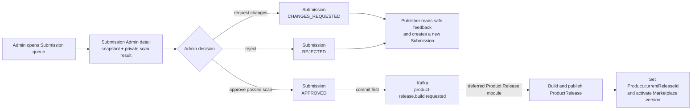

# Submission Review Module Feature Spec

**Status:** Proposed for review
**Module group:** 03 — Product, Submission, Review, and Product Release
**Owner:** Backend; consumed by the Admin Review UI, Publisher Portal, and Product Release module

## Overview

The Submission Review module records one final Admin decision for an immutable Submission after its
automated scan has completed. It turns `READY_FOR_REVIEW` into `CHANGES_REQUESTED`, `REJECTED`, or
`APPROVED`, stores Publisher-safe feedback directly on the Submission, and requests a Product
Release build only after approval commits.

The module does not create another review record. The current MVP permits exactly one terminal
decision per Submission, so the reserved review fields on `Submission` are sufficient. Admin queue
and detail reads remain owned by the Submission module; package construction and Marketplace
activation remain owned by Product Release.



An Admin decision never edits the frozen Product, media, WorkflowRevision, release request, review
context, or scan result. Approval authorizes later build work; it does not itself create a
ProductRelease, activate a Product, or replace the current Marketplace version.

## 1. Purpose and domain boundary

This module owns:

- the Admin-only Submission decision endpoint;
- decision eligibility and terminal-state enforcement;
- Publisher-safe review feedback validation and persistence;
- reviewer identity and review timestamp persistence;
- concurrent-review and repeated-request behavior; and
- post-commit publication of an approved Submission to the Product Release build topic.

This module does not own:

- Submission creation, list/detail reads, scan execution, findings, or scan retry;
- Product or ProductMedia editing;
- Project Draft or WorkflowRevision editing;
- ProductRelease persistence, version reservation, package construction, encryption, R2 upload,
  publication, rollback, or current-release selection;
- public Marketplace reads;
- Offer, Order, Entitlement, Payment, or execution authorization; or
- multi-round review history, reviewer assignment, comments, or appeals.

## 2. Proposed MVP decisions for review

- A Submission is reviewable only in `READY_FOR_REVIEW`.
- One Submission receives exactly one terminal Admin decision.
- `CHANGES_REQUESTED`, `REJECTED`, and `APPROVED` are terminal for that immutable Submission.
- There is no `SubmissionReview` table. Review writes the existing `Submission.status`,
  `reviewedAt`, `reviewFeedback`, `updatedAt`, and `updatedById` fields.
- Admin queue and detail reads stay in the Submission module. This module adds no list or detail API.
- Only unrestricted Admin permission may decide a Submission. Publisher ownership scope is not
  valid for this endpoint.
- A Publisher never sees `scanStatus`, `scannerVersion`, `scanResult`, findings, internal rule codes,
  or technical exceptions. The Publisher sees only Admin-authored `reviewFeedback` through the
  existing owner Submission detail API.
- `REQUEST_CHANGES` and `REJECT` require non-empty feedback. `APPROVE` may omit feedback.
- A completed `PASSED` scan may receive any decision.
- A completed `FAILED` scan may receive `REQUEST_CHANGES` or `REJECT`, but not `APPROVE` in the MVP.
  A future manual override requires a separate audited contract and is not implied by Admin access.
- A technical scan `ERROR`, queued scan, or running scan cannot be reviewed because the Submission
  has not reached `READY_FOR_REVIEW`.
- Approval does not change Product status or `currentReleaseId`.
- After approval commits, the module directly publishes one deterministic Product Release build
  request. No outbox or generic job table is introduced.
- If publication fails after commit, the Submission remains `APPROVED`. Repeating the exact approval
  request republishes the same deterministic message safely.
- Product Release remains authoritative for build idempotency, version uniqueness, package state,
  and final Product activation.

## 3. Lifecycle

```text
READY_FOR_REVIEW -> CHANGES_REQUESTED
READY_FOR_REVIEW -> REJECTED
READY_FOR_REVIEW -> APPROVED
```

No transition leaves a terminal review state:

```text
CHANGES_REQUESTED -X-> any other state
REJECTED         -X-> any other state
APPROVED         -X-> any other state
```

`REQUEST_CHANGES` means the current immutable Submission is not acceptable but the Publisher is
expected to correct the mutable Product or Project Draft and submit a new snapshot. `REJECT` means
the current Submission is refused. Both decisions are terminal only for that Submission and do not
prevent a later eligible Submission for the same Product.

For an already active Product, every non-approved outcome leaves the existing `currentReleaseId`
and public Marketplace snapshot unchanged. An approved update also leaves them unchanged until the
Product Release module successfully publishes the replacement.

## 4. Persistence contract

### 4.1 Existing Submission fields

This module introduces no table and no migration when the Submission migration already contains:

```text
Submission
  status SubmissionStatus, required
  reviewedAt TIMESTAMPTZ, nullable
  reviewFeedback JSONB object, nullable
  updatedAt TIMESTAMPTZ, nullable
  updatedById UUID FK User, nullable
```

On the first successful decision:

```text
status         = mapped terminal Submission status
reviewedAt     = current transaction timestamp
reviewFeedback = validated feedback object or null
updatedAt      = current transaction timestamp
updatedById    = authenticated Admin user ID
```

The module must not update:

```text
productId
workflowRevisionId
number
productSnapshot
releaseRequest
reviewContext
scanAttempt
scanStatus
scannerVersion
scanResult
createdAt
createdById
```

### 4.2 Publisher-safe feedback

```ts
type SubmissionReviewFeedback = {
  summary: string;
  items?: Array<{
    message: string;
    nodeId?: string;
  }>;
};
```

Initial bounds are named constants, not scattered literals:

```text
summary: 1..2000 characters
items: at most 50
item.message: 1..1000 characters
item.nodeId: at most 255 characters
serialized feedback: at most 64 KiB
```

The Admin writes feedback intentionally for the Publisher. The Backend must not generate feedback by
copying `scanResult`, and the request must reject credentials, tokens, private URLs, complete node
configuration, full Editor Graph, Runtime IR, stack traces, or infrastructure error messages in
supported sensitive-value checks.

The optional `nodeId` is only a Publisher-safe locator. Internal finding identifiers and rule codes
are not part of the Publisher feedback contract.

## 5. API contract

### 5.1 Decide Submission review

```http
PUT /api/v1/submissions/{submissionId}/review
Authorization: Bearer <access-token>
Content-Type: application/json
```

The route uses the configured `API_PREFIX`; `/api/v1` above is an example deployment path.

Permission contract:

```text
method = PUT
path = ${API_PREFIX}/submissions/:submissionId/review
scope = null
role = ADMIN
```

The route is protected and must not use `@IsPublic()`. It does not accept `OWN` scope.

Request:

```ts
type ReviewSubmissionInput = {
  decision: "APPROVE" | "REQUEST_CHANGES" | "REJECT";
  feedback?: SubmissionReviewFeedback;
};
```

The request object is strict. Decision-specific rules are:

| Decision          | Required Submission state | Required scan status | Feedback               |
| ----------------- | ------------------------- | -------------------- | ---------------------- |
| `APPROVE`         | `READY_FOR_REVIEW`        | `PASSED`             | optional               |
| `REQUEST_CHANGES` | `READY_FOR_REVIEW`        | `PASSED` or `FAILED` | required and non-empty |
| `REJECT`          | `READY_FOR_REVIEW`        | `PASSED` or `FAILED` | required and non-empty |

The service returns `SUCCESS_RESPONSE`; the global interceptor produces:

```json
{
  "data": {
    "message": "Success"
  },
  "statusCode": 200
}
```

The endpoint never returns the updated Submission. The existing detail endpoint owns fetching the
record and applying the Admin or owner projection.

### 5.2 Example: request changes

```json
{
  "decision": "REQUEST_CHANGES",
  "feedback": {
    "summary": "The workflow cannot be released in its current form.",
    "items": [
      {
        "message": "Replace the unsupported node and submit a new draft version.",
        "nodeId": "node-12"
      }
    ]
  }
}
```

## 6. Review operation

### 6.1 Decision transaction

The service performs:

1. Authenticate and authorize unrestricted Admin permission.
2. Validate the strict request and feedback bounds.
3. Read the Submission identity and `productId`; a missing or deleted record returns not found.
4. Start one transaction.
5. For approval, lock Product before Submission to preserve the established Product-first lock
   order. For other decisions, lock Submission directly because no Product mutation or eligibility
   check follows.
6. Re-read and lock the Submission row.
7. Resolve repeated or conflicting terminal-decision behavior.
8. Require `READY_FOR_REVIEW` and an eligible completed scan.
9. For approval, require the related Product and Publisher to remain eligible for release build.
10. Update only the review-owned Submission fields.
11. Commit.
12. For approval only, publish the Product Release build message after commit.

No Kafka network call may run while the database transaction is open.

Approval-time eligibility requires:

- non-deleted Submission, Product, and PublisherAccount;
- Product status `DRAFT` or `ACTIVE`;
- active PublisherAccount; and
- scan status `PASSED` with a stored completed scan result.

Product Release must repeat the Product/Publisher eligibility checks because external state can
change after review and before message consumption.

### 6.2 Concurrent Admin decisions

Submission row locking serializes decisions for one Submission:

- the first valid decision commits;
- a concurrent request with a different decision receives a terminal-decision conflict;
- a concurrent request with the same decision and canonically equal feedback is an idempotent
  success; and
- a repeated approval with the same content republishes the deterministic build request after the
  original transaction is observed as already complete.

The module does not permit editing feedback after the terminal decision. A correction requires an
explicit future audit contract, not another call that silently overwrites reviewer history.

## 7. Product Release build message

Publication occurs only for `APPROVED`:

```text
topic: product-release.build.requested
dead letter: product-release.build.requested.dlq   # owned by the future consumer
type: product-release.build.requested
Kafka key: productId
message ID: product-release-build:<submissionId>
```

Payload:

```ts
type ProductReleaseBuildRequested = {
  submissionId: string;
};
```

The message carries identifiers only. Product Release loads the approved Submission, immutable
WorkflowRevision, Product snapshot, media snapshot, and release request from PostgreSQL. It must not
trust message-carried Product fields, version data, workflow JSON, or package metadata.

The HTTP request trace ID is propagated into the queue envelope so approval and build failures can
be correlated. The Product Release consumer must treat the message ID and approved Submission ID as
idempotency inputs.

## 8. Idempotency and direct-publication boundary

The target Submission ID plus terminal decision makes the `PUT` operation naturally idempotent; no
new idempotency table or request key is required.

Repeated behavior:

| Stored state                                    | Repeated request       | Result                                   |
| ----------------------------------------------- | ---------------------- | ---------------------------------------- |
| same terminal decision, equal feedback          | same request           | success                                  |
| `APPROVED`, equal request                       | same request           | success and safe deterministic republish |
| terminal decision, different decision           | any different decision | conflict                                 |
| terminal decision, same decision, changed input | altered feedback       | conflict                                 |
| `READY_FOR_REVIEW`                              | valid first decision   | commit decision                          |

There is an accepted direct-publication gap: the approval transaction can commit and the process
can stop before Kafka publication succeeds. Recovery is provided by repeating the identical
approval request, which observes `APPROVED` and republishes the same deterministic message. A future
automatic repair dispatcher or outbox may be added if operational requirements demand it, but it is
not part of this MVP.

## 9. Failure contract

| Condition                                                  | HTTP result                                  | Mutation |
| ---------------------------------------------------------- | -------------------------------------------- | -------- |
| Missing or deleted Submission                              | `404 Error.SubmissionNotFound`               | none     |
| Submission not `READY_FOR_REVIEW` and not identical retry  | `409 Error.SubmissionNotReadyForReview`      | none     |
| Different terminal decision already exists                 | `409 Error.SubmissionAlreadyReviewed`        | none     |
| Same decision with different feedback                      | `409 Error.SubmissionReviewConflict`         | none     |
| Missing feedback for request-changes/reject                | `422 Error.SubmissionReviewFeedbackRequired` | none     |
| Feedback violates shape, bounds, or safe-content checks    | `422 Error.InvalidSubmissionReviewFeedback`  | none     |
| Approval attempted for scan `FAILED`                       | `409 Error.SubmissionScanFailed`             | none     |
| Scan is not a completed `PASSED` or `FAILED` business scan | `409 Error.SubmissionScanIncomplete`         | none     |
| Product or Publisher no longer approval-eligible           | `409 Error.SubmissionNotEligibleForApproval` | none     |
| Authorization missing or insufficient                      | existing `401` or `403` contract             | none     |
| Database failure before commit                             | existing internal error contract             | rollback |
| Kafka publication fails after approval commit              | `503 Error.ProductReleaseBuildPublishFailed` | retained |

Known validation and lifecycle failures are not logged repeatedly at controller and service layers.
The centralized request/error logger records the final failure. Kafka publication failure logs the
Submission ID, Product ID, deterministic message ID, and trace ID, but never feedback, scan findings,
workflow content, credentials, or message payload contents.

## 10. Authorization and security

- Only an authenticated Admin with the exact unrestricted route permission may review.
- Access-token role claims are not sufficient when current database state must be resolved; use the
  repository's current authorization pattern.
- The endpoint never accepts a Publisher ID, reviewer ID, Product ID, scan result, or status from the
  caller. They are derived from the authenticated user and stored Submission.
- Admin unrestricted read access is required to view scan findings, but read access alone does not
  imply review mutation permission.
- Publisher-facing Submission reads select only `reviewFeedback`; they must continue excluding all
  internal scan columns.
- Feedback is treated as untrusted display text. Frontends render it as text unless a separately
  approved sanitized markup contract exists.
- Feedback and logs must not contain credentials, tokens, private object keys, presigned URLs,
  complete workflow documents, or stack traces.
- Review does not grant Product ownership, Publisher capability, release download, or Marketplace
  visibility.

## 11. Efficiency and operational behavior

- One review uses one short transaction and constant-count record reads/updates.
- No workflow JSON, Runtime IR, media collection, or scan findings are rewritten during review.
- The decision endpoint does not join every Submission relation; it selects only state, scan,
  Product, Publisher eligibility, and stored feedback fields required by the transition.
- The full Admin detail remains a separate read request owned by Submission.
- Feedback is one bounded JSONB object, preventing an unbounded findings or comment table.
- Kafka receives only `submissionId`; large immutable content remains in PostgreSQL.
- Product Release build work is never performed on the HTTP request thread.
- Queue topic provisioning must create `product-release.build.requested` and its DLQ before approval
  is enabled in an environment.

## 12. Implementation mapping

```text
src/routes/submission-review/
  submission-review.controller.ts
  submission-review.service.ts
  submission-review.repo.ts
  submission-review.model.ts
  submission-review.dto.ts
  submission-review.error.ts
  submission-review.constant.ts
  submission-review.module.ts
```

| File                              | Responsibility                                                     |
| --------------------------------- | ------------------------------------------------------------------ |
| `submission-review.controller.ts` | Admin-only route, DTO binding, active Admin extraction, delegation |
| `submission-review.service.ts`    | Decision rules, transaction, idempotency, post-commit publication  |
| `submission-review.repo.ts`       | Minimal Submission/Product locks, eligibility reads, review update |
| `submission-review.model.ts`      | Strict decision, feedback, and success-response schemas            |
| `submission-review.dto.ts`        | Zod DTO and OpenAPI adapters                                       |
| `submission-review.error.ts`      | Stable lifecycle, feedback, conflict, and publication errors       |
| `submission-review.constant.ts`   | Decisions, bounds, topic/type/group-independent message constants  |
| `submission-review.module.ts`     | Controller/service/repository and queue integration                |

The module is registered in `AppModule`. Permission seeding discovers its controller route. The
service injects the existing `QUEUE_PROVIDER`; no new messaging dependency is introduced.

The module may reuse exported Submission types and snapshot schemas, but it must not call a
Submission controller or expose internal queue contracts as HTTP DTOs.

## 13. Acceptance criteria

### API and authorization

- Only unrestricted Admin permission can call the review endpoint.
- Publisher, Customer, unauthenticated, and Admin-without-review-permission requests are rejected.
- The request is strict and the response is only `SUCCESS_RESPONSE`.
- No new Review list/detail endpoint duplicates Submission reads.

### Lifecycle and persistence

- Only `READY_FOR_REVIEW` can receive a first decision.
- A passed scan supports all three decisions.
- A failed business scan cannot be approved but can receive changes-requested or rejected.
- Request-changes and reject require bounded Publisher-safe feedback.
- Exactly the five review-owned fields are updated; immutable snapshots and scan fields remain
  byte-for-byte unchanged.
- Terminal decisions cannot be overwritten.
- Two concurrent Admin decisions produce one winner and one deterministic idempotent success or
  conflict.

### Publication

- Only approval publishes `product-release.build.requested`.
- Publication occurs after commit and carries only `submissionId`.
- The key, message ID, type, and trace ID follow the documented contract.
- A post-commit publication failure leaves the Submission approved and returns the retryable error.
- Repeating the identical approval republishes safely without changing review fields.

### Visibility and safety

- Admin reads retain private scan evidence through the Submission module.
- Publisher reads expose only Admin-authored feedback and never scan outcomes or internal findings.
- No review or publication log contains feedback content, workflow content, credentials, or queue
  payload data.
- Product status, current release, and Marketplace visibility do not change during review.

## 14. Verification expectations

When implementation is approved, verification should cover:

- request schema and feedback bounds;
- exact permission and Admin-only behavior;
- every lifecycle transition and invalid transition;
- approval rejection for failed/incomplete scans;
- feedback visibility differences between Admin and Publisher Submission reads;
- transaction rollback and immutable-field preservation;
- concurrent decisions and identical retries;
- post-commit publication, deterministic republish, and publish failure mapping;
- build and lint; and
- migration review confirming that Review adds no schema when Submission already owns the fields.

Live Kafka and PostgreSQL behavior must be reported as unverified unless exercised against those
services. Product Release build success cannot be claimed until that separate module exists.

## 15. Deferred work

- ProductRelease persistence and the build consumer;
- package generation, encryption, signing, R2 storage, and publication;
- Product activation and `currentReleaseId` switching;
- release history and rollback to an older published release;
- multi-round review, reviewer assignment, internal comments, appeal, and append-only audit history;
- explicit Admin override of failed automated scans;
- automatic repair publication or transactional outbox;
- notification delivery to Publisher after a decision; and
- dedicated non-Admin Reviewer roles or scoped review queues.
