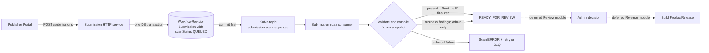

# Submission Module Feature Spec

**Status:** Proposed for implementation
**Module group:** 03 — Product, Submission, Review, and Product Release
**Owner:** Backend; consumed by the Publisher Portal and Admin Review UI

## Overview

The Submission module freezes one exact Publisher working copy for automated checks and later Admin
review. It connects the existing mutable Product and Project Draft modules to the immutable Workflow
Revision module. It does not approve a Product, build a package, create a Product Release, or make a
Product visible in the Marketplace.

The implementation has two deliberately separate execution paths:

- the synchronous HTTP path authorizes the Publisher, locks the exact source records, freezes all
  Publisher-controlled snapshots with queued scan fields in one database transaction, then
  publishes a small Kafka message after commit;
- the background path consumes that message, validates and compiles only the frozen snapshot,
  finalizes Workflow Revision Runtime IR once, persists scan findings, and moves every completed
  business scan to `READY_FOR_REVIEW` for an Admin decision.



The HTTP response does not wait for graph validation, Runtime IR compilation, Runtime IR validation,
or policy scanning.
At the current 1–2 MiB workflow limits, snapshot construction and hashing remain bounded enough for
the request transaction. The more extensible and failure-prone validation pipeline runs after the
transaction so it can be retried without recreating the immutable Submission.

This specification is authoritative for Submission queue delivery. Older Product, Workflow
Revision, and database-design notes that mention a transactional outbox are superseded here: the
MVP publishes directly after commit and uses an idempotent create request, durable queued fields on
Submission, an idempotent consumer, and an explicit scan-retry API.

## 1. Purpose and domain boundary

A `Submission` is an immutable request to review one exact combination of:

- an existing Product working copy and its ordered ProductMedia rows;
- one exact current Project Draft version, frozen as a WorkflowRevision;
- requested release metadata;
- Publisher review instructions and known limitations.

The Submission row changes status, but its snapshots never change. Editing Product or Project Draft
after submission does not alter an existing Submission. A correction always creates a new
Submission from a newer Project Draft version.

This module owns:

- Submission create, owner/Admin list, and owner/Admin detail APIs;
- Publisher eligibility, ownership, lifecycle, completeness, and concurrency checks at submit time;
- atomic WorkflowRevision source snapshot and Submission creation, including initial queued scan
  state;
- post-commit publication of the scan request;
- scan-message consumption, authoritative Runtime IR compilation, write-once revision finalization,
  idempotency, retry classification, findings, and scan status changes;
- the transition from `PENDING_SCAN` to `READY_FOR_REVIEW` after a completed business scan; and
- recovery publication for a queued or technically failed scan.

This module does not own:

- Product creation or editing;
- Project Draft editing, preview compilation, or version history;
- Admin review decision endpoints and feedback authoring;
- Product Release creation, package building, encryption, publication, or rollback selection;
- Marketplace Product list/detail APIs;
- Asset upload or asset-bearing workflows; or
- category, tag, connector, pricing, offer, order, or entitlement behavior.

No Admin review decision is created when a Submission is created or when its scan completes. The
future Review module records the one terminal Admin decision directly on the reserved Submission
review fields.

## 2. Approved business decisions

- A Product already exists before submission. Submission never creates or edits Product.
- A Product in `DRAFT` or `ACTIVE` may be submitted. `SUSPENDED`, `ARCHIVED`, deleted, missing, and
  cross-owner Products cannot be submitted.
- The related Project must remain active and owned by the same Publisher.
- The request selects the exact current `ProjectDraft.version`. A stale version is rejected; the
  Backend never silently submits the latest version.
- Project Draft `runtimeIr` is a non-authoritative authoring cache. Submission ignores it and accepts
  a safely stored draft even when the cache is null, stale, or the Editor Graph later produces
  deterministic validation or compilation findings.
- One Project Draft version can produce at most one WorkflowRevision and one Submission.
- Product and ProductMedia remain editable after submission. Their frozen snapshot is authoritative
  for that Submission and any Product Release built from it.
- Submission approval alone does not activate Product. Product becomes `ACTIVE` only after the
  Product Release module successfully publishes the first release and sets `currentReleaseId`.
- An update Submission for an already active Product does not replace its current public release.
  The previous release remains official until a new release is published.
- Asset references are unsupported for this MVP. They are rejected before revision creation and
  checked again by the background scanner as defense in depth.
- Product Category and Tag are not part of the Submission snapshot.
- Submission validates requested version syntax but does not reserve a ProductRelease version.
  Product Release owns durable `(productId, version)` uniqueness when that module is implemented.
- The create route returns only `{ id }`. Reads own fetching the full Submission and its relations.
- Submission has no update, delete, cancel, archive, or restore API.
- Publisher-facing APIs never expose internal scan status, summary, findings, rule codes, or
  technical errors. Admin reads own those fields and Admin provides any actionable Publisher
  feedback through the future Review module.
- Direct Kafka publication is used after commit. No outbox table, relay, or generic job framework is
  added by this module.

## 3. Lifecycle

### 3.1 Submission status

```text
SubmissionStatus =
  PENDING_SCAN
  | READY_FOR_REVIEW
  | CHANGES_REQUESTED
  | APPROVED
  | REJECTED
```

Owned by this module:

```text
[create]       -> PENDING_SCAN
PENDING_SCAN   -> READY_FOR_REVIEW   # automated scan completed, whether PASSED or FAILED
```

Owned by the future Review module:

```text
READY_FOR_REVIEW -> CHANGES_REQUESTED
READY_FOR_REVIEW -> APPROVED
READY_FOR_REVIEW -> REJECTED
```

`CHANGES_REQUESTED`, `APPROVED`, and `REJECTED` are terminal for that immutable Submission. A
Publisher fixes mutable Product/Project Draft data after Admin feedback and creates another
Submission. The Review and Product Release specifications may read an approved Submission but must
not rewrite its snapshots.

A deterministic scan failure is not itself an Admin rejection. The scan becomes `FAILED`, its
findings remain Admin-only, and Submission becomes `READY_FOR_REVIEW` so an Admin can interpret the
result and provide controlled feedback. A technical scan failure leaves Submission `PENDING_SCAN`
and sets its internal scan status to `ERROR`, because no business result exists yet.

Only one open Submission may exist per Product while status is `PENDING_SCAN` or
`READY_FOR_REVIEW`. Once the current Submission reaches another terminal status, a newer Submission
may be created. This prevents two review candidates for one Product while still allowing an update
Submission after a previous approval.

### 3.2 Scan status

```text
SubmissionScanStatus = QUEUED | RUNNING | PASSED | FAILED | ERROR
```

- `QUEUED`: durable scan request exists but has not completed.
- `RUNNING`: a consumer claimed the scan request.
- `PASSED`: all required rules completed and no `ERROR` finding exists.
- `FAILED`: rules completed and at least one deterministic `ERROR` finding exists.
- `ERROR`: infrastructure or unexpected scanner failure prevented a business result.

Warnings do not fail a Submission. They remain visible to the Admin reviewer.

## 4. Data model

### 4.1 Submission

```text
Submission
  id UUID PK
  createdAt TIMESTAMPTZ, required
  updatedAt TIMESTAMPTZ, nullable
  deletedAt TIMESTAMPTZ, nullable
  createdById UUID FK User, required
  updatedById UUID FK User, nullable
  deletedById UUID FK User, nullable
  productId UUID FK Product, required
  workflowRevisionId UUID FK WorkflowRevision, required, unique
  number INTEGER, required, positive
  status SubmissionStatus, required, default PENDING_SCAN
  productSnapshot JSONB object, required
  releaseRequest JSONB object, required
  reviewContext JSONB object, required
  idempotencyKey VARCHAR(255), required
  requestHash VARCHAR(64), required
  scanAttempt INTEGER, required, default 1
  scanStatus SubmissionScanStatus, required, default QUEUED
  scannerVersion VARCHAR(100), nullable
  scanResult JSONB object, nullable
  reviewedAt TIMESTAMPTZ, nullable
  reviewFeedback JSONB object, nullable

  UNIQUE(productId, number)
  UNIQUE(createdById, idempotencyKey)
```

The Backend entity schema must be declared from the shared audit base:

```ts
export const Submission = BaseWithUserFields.extend({
  // Submission-specific fields
});
```

`createdAt` is the submission time and `createdById` is the submitting user. Separate
`submittedAt`/`submittedById` columns are intentionally omitted because they duplicate the shared
base fields. `updatedAt` changes when lifecycle status changes. `updatedById` identifies an Admin
retry/review action when a user-authorized operation changes the record. System scan transitions do
not invent a User actor and preserve the current nullable value. `deletedAt` and `deletedById` remain
nullable and unused because the MVP has no delete operation, but they stay present so the entity
conforms to `BaseWithUserFields`.

`requestHash` is lowercase SHA-256 over canonical JSON containing exactly the normalized request
body. It detects an `Idempotency-Key` reused with different input. It is not the WorkflowRevision
hash.

`number` provides the Product's ordered Submission history. A separate `previousSubmissionId` is
unnecessary because the preceding record is the same `productId` with `number - 1`.

The scan fields hold only the current automated scan. Technical retry history remains in structured
logs. `scanResult` is populated only for a completed `PASSED` or `FAILED` business scan and is
visible only through unrestricted Admin projections. `reviewedAt` and `reviewFeedback` are reserved
for the later Review module; `reviewFeedback` contains only Admin-authored content intentionally
shown to the Publisher, never internal scan findings.

Required heavy-read index:

```sql
CREATE INDEX "Submission_status_createdAt_idx"
ON "Submission" (status, "createdAt" DESC);
```

The existing `UNIQUE(productId, number)` index already supports Product submission-history reads in
both directions; do not add a duplicate Product/number index. The Backend validates snapshot object
shapes, request-hash format, allowed lifecycle transitions, and soft-delete field consistency.
Foreign keys use `NO ACTION`. Submission snapshots are immutable even though the shared base
contains nullable soft-delete fields. No Submission API may set those deletion fields in the MVP.

Concrete MVP SQL:

```sql
CREATE TYPE "SubmissionStatus" AS ENUM (
    'PENDING_SCAN',
    'READY_FOR_REVIEW',
    'CHANGES_REQUESTED',
    'APPROVED',
    'REJECTED'
);

CREATE TYPE "SubmissionScanStatus" AS ENUM (
    'QUEUED',
    'RUNNING',
    'PASSED',
    'FAILED',
    'ERROR'
);

CREATE TABLE "Submission" (
    id UUID PRIMARY KEY DEFAULT gen_random_uuid(),
    "productId" UUID NOT NULL
        REFERENCES "Product" (id) ON DELETE NO ACTION,
    "workflowRevisionId" UUID NOT NULL UNIQUE
        REFERENCES "WorkflowRevision" (id) ON DELETE NO ACTION,
    number INTEGER NOT NULL,
    status "SubmissionStatus" NOT NULL DEFAULT 'PENDING_SCAN',
    "productSnapshot" JSONB NOT NULL,
    "releaseRequest" JSONB NOT NULL,
    "reviewContext" JSONB NOT NULL,
    "idempotencyKey" VARCHAR(255) NOT NULL,
    "requestHash" VARCHAR(64) NOT NULL,
    "scanAttempt" INTEGER NOT NULL DEFAULT 1,
    "scanStatus" "SubmissionScanStatus" NOT NULL DEFAULT 'QUEUED',
    "scannerVersion" VARCHAR(100),
    "scanResult" JSONB,
    "reviewedAt" TIMESTAMPTZ,
    "reviewFeedback" JSONB,

    -- BaseWithUserFields
    "createdAt" TIMESTAMPTZ NOT NULL DEFAULT now(),
    "updatedAt" TIMESTAMPTZ,
    "deletedAt" TIMESTAMPTZ,
    "createdById" UUID NOT NULL
        REFERENCES "User" (id) ON DELETE NO ACTION,
    "updatedById" UUID
        REFERENCES "User" (id) ON DELETE NO ACTION,
    "deletedById" UUID
        REFERENCES "User" (id) ON DELETE NO ACTION,

    UNIQUE ("productId", number),
    UNIQUE ("createdById", "idempotencyKey")
);

CREATE INDEX "Submission_status_createdAt_idx"
ON "Submission" (status, "createdAt" DESC);
```

The database intentionally does not enforce scan transitions, review transitions, JSON shapes,
positive counters, timestamp pairing, or soft-delete pairing. The Backend owns those rules. The
primary keys, foreign keys, and three uniqueness contracts remain database-enforced because they
protect identity and concurrent create idempotency.

### 4.2 Product snapshot

The Backend builds this object from the Product and ProductMedia rows locked in the submit
transaction. The client cannot supply it.

```ts
type ProductSubmissionSnapshotV1 = {
  schemaVersion: 1;
  productId: string;
  publisherAccountId: string;
  projectId: string;
  name: string;
  slug: string;
  shortDescription: string;
  description: string;
  usageInstructions: string | null;
  media: Array<{
    id: string;
    staticId: string;
    type: "ICON" | "COVER" | "GALLERY";
    sortOrder: number;
    altText: string | null;
  }>;
};
```

Media is ordered by `type`, then `sortOrder`, then `id`, matching the Product contract. The snapshot
contains no R2 object key, signed URL, public URL, image bytes, Publisher private profile fields, or
mutable Product lifecycle metadata.

Publishing completeness requires non-empty `name`, `slug`, `shortDescription`, and `description`.
`usageInstructions` and media remain optional for the MVP; the Marketplace UI may use a default
visual when no icon exists. When media is present, every reference must still resolve in one
set-based query to a completed, non-deleted Static image that passed the image pipeline, with at
most one `ICON` and one `COVER` as required by the Product contract.

### 4.3 Release and review-context snapshots

The API accepts unversioned input fields. The Backend writes `schemaVersion: 1` into each immutable
stored snapshot.

```ts
type ReleaseRequestSnapshotV1 = {
  schemaVersion: 1;
  version: string; // valid SemVer, maximum 100 characters
  changelog: string; // trimmed, 1..5,000 characters
  minimumLauncherVersion: string; // valid SemVer, maximum 100 characters
  minimumRuntimeVersion: string; // valid SemVer, maximum 100 characters
};

type SubmissionReviewContextV1 = {
  schemaVersion: 1;
  purpose: string; // trimmed, 1..2,000 characters
  testInstructions: string; // trimmed, 1..5,000 characters
  knownLimitations: string[]; // maximum 20 unique items, each 1..500 characters
};
```

The review context is always written and read as one Publisher-authored snapshot. It helps the Admin
understand and test the submitted workflow but is not validation evidence. The scanner independently
evaluates machine-checkable rules, and the Admin remains responsible for the review decision.

### 4.4 Embedded scan result

The Submission has one current automated scan. Provider delivery retries and Admin recovery do not
create child rows; they reuse the same Submission and increment `scanAttempt` only for a new Admin
recovery generation.

```ts
type SubmissionScanResultV1 = {
  schemaVersion: 1;
  summary: {
    totalRules: number;
    passed: number;
    warnings: number;
    errors: number;
    truncated: boolean;
  };
  findings: Array<{
    code: string;
    severity: "INFO" | "WARNING" | "ERROR";
    message: string;
    nodeId?: string;
    details?: Record<string, unknown>;
  }>;
};
```

Array order is the deterministic finding order; no `sortOrder` field is needed. The Backend enforces
named maximum finding count, serialized result size, message length, and details size. The existing
diagnostic limit of 100 is the initial finding-count limit. Findings must never contain credentials,
complete node configuration, full Editor Graph, Runtime IR, tokens, or private URLs.

`scanResult` is null for `QUEUED`, `RUNNING`, and technical `ERROR`. It is present for `PASSED` and
business `FAILED`. Technical exception details stay in structured logs correlated by Submission ID,
trace ID, and `scanAttempt`.

There is no `SubmissionScan`, `SubmissionScanFinding`, or `SubmissionReview` table in this module.
The future Review module writes the one terminal Admin decision into `Submission.status`,
`reviewedAt`, `reviewFeedback`, `updatedAt`, and `updatedById`. A separate append-only review table is
deferred until multiple review rounds or compliance-grade decision history is required.

## 5. Responsibility split

### 5.1 Synchronous HTTP/request-response responsibility

The HTTP implementation owns only work required to commit a coherent immutable request:

1. Authenticate the user and authorize the exact route permission.
2. Require `Idempotency-Key` and validate the strict request body.
3. Resolve `publisherAccessPolicy.assertActivePublisher(userId)`.
4. Check for an existing `(createdById, idempotencyKey)` before doing snapshot work.
5. Start one database transaction.
6. Lock the owned Product, then its Project, then the exact ProjectDraft row in the documented lock
   order.
7. Verify Product/Project lifecycle, ownership, publishing completeness, media eligibility, source
   draft version/hash, basic bounded JSON storage shape, asset-free restriction, and source snapshot
   size limits. Do not require or trust Project Draft Runtime IR.
8. Call `WorkflowRevisionService.createFromDraft(...)` within the same transaction to freeze the
   Editor Graph, Input Schema, advisory validation summary, and available Node Definitions with
   `runtimeIr = null` and `contentHash = null`.
9. Build the Product, release request, and combined review-context snapshots.
10. Allocate the next per-Product Submission number.
11. Create Submission with `status = PENDING_SCAN`, `scanAttempt = 1`,
    `scanStatus = QUEUED`, and `scanResult = null`.
12. Commit the transaction.
13. Publish `submission.scan.requested.v1` after commit.
14. Return only `{ id }` after publication succeeds.

The handler does not run cloud graph validation, Runtime IR compilation or semantic validation,
capability policy, credential scanning, Admin review logic, or package construction. It does not
call Kafka, Redis, R2, Runtime, or another network service while the transaction is open.

The bounded synchronous work includes JSON canonicalization, SHA-256 hashing, set-based node/media lookups, and construction of at most a 2 MiB WorkflowRevision. This is acceptable at the expected Submission frequency and current limits. If measured transaction time later becomes unsafe, the architecture may move snapshot construction behind a reservation state, but that is not part of this MVP.

### 5.2 Background scan responsibility

The consumer owns all work whose result can be retried independently of Submission creation:

1. Strictly validate the message type, key, and payload identifiers.
2. Load Submission and compare the payload `scanAttempt` with its current counter.
3. Return `SUCCESS` for a lower stale attempt, reject a higher impossible attempt to DLQ, and
   continue only when the values match.
4. Return `SUCCESS` immediately if `scanStatus` is already `PASSED` or `FAILED`.
5. Claim matching `QUEUED`, retryable `ERROR`, or redelivered `RUNNING` work by setting
   `scanStatus = RUNNING` in a short transaction.
6. Load the frozen Workflow Revision source and Submission snapshots outside a database transaction.
7. Run the existing Workflow Validation service against the frozen Editor Graph.
8. When validation permits compilation, invoke the shared compiler with the frozen Editor Graph,
   Input Schema, and Node Definition manifest, then strictly validate its Runtime IR output.
9. On successful compilation, conditionally write `runtimeIr` and final `contentHash` together only
   when both are null. A retry that finds both already finalized compares the canonical result and
   hash, then continues without overwriting them; a mismatch is a technical invariant error.
10. Build one bounded `scanResult` object in memory. A deterministic validation or compilation
    failure is an Admin-only business finding and leaves the revision compilation fields null.
11. If no `ERROR` finding exists, persist `scanStatus = PASSED` and `scanResult`.
12. If an `ERROR` finding exists, persist `scanStatus = FAILED` and the Admin-only `scanResult`.
13. For either completed business result, conditionally move Submission from `PENDING_SCAN` to
    `READY_FOR_REVIEW` so an Admin—not the scanner—makes the review decision.
14. Return `SUCCESS` for both completed business outcomes.

For an unexpected database, catalog, or scanner failure, the handler records scan status `ERROR`
when possible and returns `RETRY`. After the queue provider exhausts delivery retries, the original
message is copied to the configured dead-letter topic and its Kafka offset is committed. The
Submission remains `PENDING_SCAN`; Admin can increment `scanAttempt` and requeue it.

The consumer never edits WorkflowRevision source fields, Product, ProductMedia, Project Draft, or
Publisher-authored Submission snapshots. Its only Workflow Revision mutation is the atomic first
write of compiled `runtimeIr` and `contentHash`. It does not create Admin review or Product Release
records.

### 5.3 Why the split is mandatory

- A successful HTTP transaction always leaves a complete immutable source snapshot, Submission, and
  durable scan intent, even when Kafka is temporarily unavailable.
- Kafka receives only identifiers; large workflow JSON is read from PostgreSQL by the consumer.
- At-least-once delivery may repeat work, so database state—not Kafka delivery count—is the source
  of truth.
- Business-invalid content is a successful scan outcome and must not be retried or sent to DLQ.
- Technical failures are retriable and must not falsely mark Publisher content invalid.

## 6. API contract

All routes are protected. No Submission route uses `@IsPublic()`. The displayed `/api/v1` prefix is
the current deployment value; controller decorators and implementation logic use the configured
`API_PREFIX` rather than hard-coding it.

Successful responses use the existing global envelope:

```ts
type SuccessResponse<T> = {
  data: T;
  statusCode: number;
};
```

Errors use the existing global error shape. Request bodies, params, and query objects are strict;
unknown fields return `422`. UUIDs use the canonical UUID format. Timestamps are UTC ISO 8601.

### 6.1 Create Submission

```http
POST /api/v1/submissions
Authorization: Bearer <access-token>
Idempotency-Key: <UUID>
Content-Type: application/json
```

Permission contract:

```text
method = POST, path = ${API_PREFIX}/submissions, scope = null -> PUBLISHER
```

The `null` permission scope grants access to the route; the service still requires an active
Publisher and derives ownership from Product. It never permits submitting another Publisher's
Product.

```ts
type CreateSubmissionInput = {
  productId: string; // UUID
  sourceDraftVersion: number; // positive safe integer
  releaseRequest: {
    version: string;
    changelog: string;
    minimumLauncherVersion: string;
    minimumRuntimeVersion: string;
  };
  reviewContext: {
    purpose: string;
    testInstructions: string;
    knownLimitations: string[];
  };
};

type CreateSubmissionOutput = {
  id: string; // Submission UUID
};
```

Success returns `201 Created` with only the Submission ID. The client calls the detail route to
observe the coarse Submission status and fetch its snapshots.

The service returns exactly `{ id }`; therefore the global interceptor produces:

```json
{
  "data": { "id": "submission-uuid" },
  "statusCode": 201
}
```

Create must not return the created Submission, Product, WorkflowRevision, media, or scan fields.
This follows the Backend convention that create returns the new record ID, while update/delete/status
actions return `SUCCESS_RESPONSE` through `MessageResDTO`. Submission exposes no update or delete
endpoint; its scan-retry action follows the mutation success-response convention.

Idempotency behavior:

- the first request claims `(createdById, Idempotency-Key)`;
- the same key and same normalized request returns the existing Submission ID;
- if `scanStatus` is still `QUEUED`, the service republishes the current
  `(submissionId, scanAttempt)` message after the read;
- the same key with different normalized input returns
  `409 Error.SubmissionIdempotencyKeyReused`;
- concurrent requests are resolved by database uniqueness, not a pre-check or Redis lock.

If the database commit succeeds but Kafka publication fails, the API returns
`503 Error.SubmissionScanPublishFailed` with a safe retryable indicator. The Submission and its
queued scan state remain committed. Retrying the same request with the same idempotency key
republishes the same attempt and returns the same Submission ID. The client must not generate a new
key for this retry.

### 6.2 List Submissions for management/review

```http
GET /api/v1/submissions?page=1&limit=10&status=READY_FOR_REVIEW&productId=<UUID>
Authorization: Bearer <access-token>
```

Permission contracts:

```text
method = GET, path = ${API_PREFIX}/submissions, scope = OWN  -> CUSTOMER, PUBLISHER
method = GET, path = ${API_PREFIX}/submissions, scope = null -> ADMIN
```

```ts
type GetSubmissionListInput = {
  page?: number; // positive integer, default 1
  limit?: number; // positive integer, default 10, bounded by shared pagination limit
  status?: SubmissionStatus;
  productId?: string; // UUID
};

type SubmissionListItem = {
  id: string;
  productId: string;
  workflowRevisionId: string;
  number: number;
  status: SubmissionStatus;
  product: {
    name: string;
    slug: string;
    iconStaticId: string | null;
  };
  requestedVersion: string;
  createdAt: string;
  updatedAt: string | null;
  createdById: string;
};

type AdminSubmissionListItem = SubmissionListItem & {
  scanAttempt: number;
  scanStatus: SubmissionScanStatus;
  scannerVersion: string | null;
  scanSummary: {
    totalRules: number;
    passed: number;
    errors: number;
    warnings: number;
    truncated: boolean;
  } | null;
};

type SubmissionOwnerListOutput = {
  items: SubmissionListItem[];
  total: number;
  page: number;
  limit: number;
  totalPages: number;
};

type SubmissionAdminListOutput = Omit<SubmissionOwnerListOutput, "items"> & {
  items: AdminSubmissionListItem[];
};
```

`OWN` access returns only Submissions whose Product belongs to the caller's non-deleted Publisher
account. Admin unrestricted access returns all accessible records and uses `status` to populate the
review queue. Ordering is `createdAt DESC, id DESC`. List output is projected from immutable
snapshots and excludes workflow JSON. Only the Admin projection includes scan status/counts. The
Publisher projection must not reveal whether the server-side scan passed, failed, produced warnings,
or encountered a technical error.

### 6.3 Get Submission detail

```http
GET /api/v1/submissions/{submissionId}
Authorization: Bearer <access-token>
```

Permission contracts:

```text
method = GET, path = ${API_PREFIX}/submissions/:submissionId, scope = OWN  -> CUSTOMER, PUBLISHER
method = GET, path = ${API_PREFIX}/submissions/:submissionId, scope = null -> ADMIN
```

```ts
type SubmissionOwnerDetailOutput = {
  id: string;
  productId: string;
  workflowRevisionId: string;
  number: number;
  status: SubmissionStatus;
  productSnapshot: ProductSubmissionSnapshotV1;
  releaseRequest: ReleaseRequestSnapshotV1;
  reviewContext: SubmissionReviewContextV1;
  reviewedAt: string | null;
  reviewFeedback: Record<string, unknown> | null;
  workflowRevision: {
    id: string;
    projectId: string;
    sourceDraftVersion: number;
    sourceDraftContentHash: string;
    contentHash: string | null;
    editorGraph: Record<string, unknown>;
    runtimeIr: Record<string, unknown> | null;
    inputSchema: Record<string, unknown>;
    nodeDefinitionManifest: Record<string, unknown>;
    capabilityManifest: Record<string, unknown>;
    validationSummary: Record<string, unknown>;
    createdAt: string;
  };
  createdAt: string;
  createdById: string;
  updatedAt: string | null;
};

type SubmissionAdminDetailOutput = SubmissionOwnerDetailOutput & {
  scanAttempt: number;
  scanStatus: SubmissionScanStatus;
  scannerVersion: string | null;
  scanResult: SubmissionScanResultV1 | null;
  updatedById: string | null;
};
```

The authorized detail endpoint exposes the Publisher's own frozen Product/workflow snapshots to the
owning Publisher and Admin reviewer. Response selection depends on the resolved permission scope:

- `OWN` returns `SubmissionOwnerDetailOutput` and must not select the internal scan columns;
- unrestricted Admin returns `SubmissionAdminDetailOutput`, including the current attempt, summary,
  and bounded findings needed for review.

Neither projection includes Static object keys, credentials, tokens, queue headers, idempotency
keys, request hashes, soft-delete fields, or internal Kafka offsets.

### 6.4 Retry/requeue a technical scan

```http
POST /api/v1/submissions/{submissionId}/scan-retry
Authorization: Bearer <access-token>
```

Permission contracts:

```text
method = POST, path = ${API_PREFIX}/submissions/:submissionId/scan-retry, scope = null -> ADMIN
```

The route has no body. It is valid only when Submission is `PENDING_SCAN` and `scanStatus` is:

- `QUEUED`, in which case the current `(submissionId, scanAttempt)` message is republished without
  incrementing the counter; or
- `ERROR`, in which case one transaction locks Submission, increments `scanAttempt`, clears
  `scannerVersion` and `scanResult`, sets `scanStatus = QUEUED`, records the Admin in `updatedById`,
  commits, and publishes the new attempt.

`RUNNING` returns a conflict. `PASSED` or `FAILED` is already a completed business result and cannot
be retried. A Publisher cannot call or infer this operational recovery route. Admin uses scan
findings when deciding whether to approve, reject, or request Publisher changes.

Success follows the existing mutation convention and returns the standard success message. If the
new/queued message cannot be published, return `503 Error.SubmissionScanPublishFailed`; the durable
`QUEUED` state remains available for another retry.

### 6.5 Permission records

Permission uniqueness follows the existing `(method, path, scope)` contract. Stored paths use the
resolved configured prefix used by the permission seed.

| Permission name           | Module     | Method | Stored path                                          | Scope  | Assigned roles          |
| ------------------------- | ---------- | ------ | ---------------------------------------------------- | ------ | ----------------------- |
| Create Submission         | Submission | `POST` | `${API_PREFIX}/submissions`                          | `null` | `PUBLISHER`             |
| List Own Submissions      | Submission | `GET`  | `${API_PREFIX}/submissions`                          | `OWN`  | `CUSTOMER`, `PUBLISHER` |
| List All Submissions      | Submission | `GET`  | `${API_PREFIX}/submissions`                          | `null` | `ADMIN`                 |
| Read Own Submission       | Submission | `GET`  | `${API_PREFIX}/submissions/:submissionId`            | `OWN`  | `CUSTOMER`, `PUBLISHER` |
| Read Any Submission       | Submission | `GET`  | `${API_PREFIX}/submissions/:submissionId`            | `null` | `ADMIN`                 |
| Retry Any Submission Scan | Submission | `POST` | `${API_PREFIX}/submissions/:submissionId/scan-retry` | `null` | `ADMIN`                 |

The existing permission seed automatically discovers controller routes and syncs permissions to
Admin. Publisher/Customer assignments must preserve every existing role-permission ID and must not
be inferred merely from the existence of a PublisherAccount.

## 7. Authorization and ownership

- Create requires `publisherAccessPolicy.assertActivePublisher(userId)`: active User, active
  Publisher role, active non-deleted PublisherAccount, and acceptance of current Publisher Terms.
- Create derives Publisher and Project ownership from Product. It never accepts
  `publisherAccountId`, `projectId`, `createdById`, or lifecycle status from the request.
- `OWN` list/detail reads resolve the caller's non-deleted Publisher account without requiring it to
  remain active. A blocked former Publisher may inspect owned Submission history through Customer
  read permission, matching the Product read policy.
- `OWN` repository predicates join Submission to Product and filter by the resolved
  `publisherAccountId`.
- Admin unrestricted reads and scan retry do not resolve the Admin's Publisher account.
- Only unrestricted Admin access may select internal scan fields or know
  whether the server-side scan passed, failed, warned, errored, retried, or entered DLQ.
- Missing IDs and cross-owner `OWN` access return the same `404 Error.SubmissionNotFound`.
- Admin Project/Product access does not grant the ability to create a Submission on behalf of a
  Publisher.
- The consumer is an internal queue adapter. It does not use an HTTP user permission, but every
  state change is constrained by message/record identity and expected statuses.

## 8. Transaction, concurrency, and idempotency

### 8.1 Create transaction

The lock order is mandatory:

```text
Product -> Project -> ProjectDraft -> latest Submission for Product
```

WorkflowRevision creation uses the already locked Project/ProjectDraft context and must not acquire
the same rows in a conflicting order. Product media and node definitions are loaded in set-based
queries. The transaction creates exactly:

```text
WorkflowRevision + Submission(scanAttempt=1, scanStatus=QUEUED)
```

It does not change Product, ProductMedia, Project, ProjectDraft, or prior Submissions.

The Product lock serializes per-Product number allocation and the Backend's one-open-Submission
check. That rule does not require a partial database index. Durable uniqueness remains authoritative
only for:

- one WorkflowRevision per `(projectId, sourceDraftVersion)`;
- one Submission per WorkflowRevision;
- one Submission number per Product;
- one request per `(createdById, idempotencyKey)`.

Known unique violations are translated to stable domain errors. They are not treated as transient
queue failures and must not be retried indefinitely.

### 8.2 Direct-publication reliability boundary

Kafka publication occurs after commit because a network call must not hold database locks. Without
an outbox there is an accepted gap where the database commit succeeds but process termination occurs
before publication. Recovery is provided by:

- durable `scanStatus = QUEUED` plus a deterministic message ID derived from Submission and attempt;
- idempotent replay of the create request;
- the explicit scan-retry API; and
- Admin operational visibility of `PENDING_SCAN` with `scanStatus = QUEUED | ERROR`.

This design intentionally does not claim atomic database-and-Kafka delivery. A future reliability
requirement may introduce an outbox without changing immutable Submission semantics, but it is not
required for this MVP.

### 8.3 Consumer idempotency

Kafka delivery is at least once. The consumer uses `(submissionId, scanAttempt)` as its durable
idempotency identity:

- a lower message attempt than the stored attempt is stale and returns `SUCCESS`;
- a higher message attempt than the stored attempt is invalid and returns `FAILED` for DLQ;
- terminal `scanStatus` returns `SUCCESS` without replacing the stored result;
- `RUNNING` redelivery may safely recompute from immutable content;
- final persistence writes one bounded `scanResult` only for the matching attempt;
- Submission status changes use `WHERE status = 'PENDING_SCAN'`;
- a missing Submission is rejected to DLQ and never mutates unrelated data.

The consumer performs no database operation inside a node/rule loop. It loads required relations in
bounded queries, evaluates in memory, and persists the single result object once.

## 9. Queue contract

The module uses the existing `MessageProvider` abstraction and existing topic constants:

```text
topic: submission.scan.requested
dead letter: submission.scan.requested.dlq
```

The provider applies `KAFKA_TOPIC_PREFIX`; callers use the unprefixed constants. Topic auto-creation
remains disabled.

```ts
type SubmissionScanRequestedV1 = MessageEnvelope<{
  submissionId: string;
  scanAttempt: number;
}> & {
  type: "submission.scan.requested.v1";
};
```

Publication rules:

- `message.id = "submission-scan:" + submissionId + ":" + scanAttempt`;
- Kafka key is `submissionId` so attempts for one Submission remain ordered;
- `occurredAt` is Submission creation time for attempt 1 and retry update time for later attempts;
- `traceId` is copied from the initiating request when available;
- payload contains identifiers only, never graph, Runtime IR, Product snapshots, credentials, or
  media metadata; and
- no message is published before the database transaction commits.

Subscription rules:

```text
groupId: submission-scan-v1
topic: submission.scan.requested
deadLetterTopic: submission.scan.requested.dlq
maxAttempts: named module constant
retryDelayMs: named module constant
```

The consumer returns:

- `SUCCESS` for an already completed scan, `PASSED`, or deterministic `FAILED` result;
- `RETRY` for transient/unexpected infrastructure failure; and
- `FAILED` only for a permanently invalid or identity-mismatched message that must enter DLQ.

The Kafka provider's retry count does not increment `Submission.scanAttempt`. Consumer code must log
and persist the technical `ERROR` before returning `RETRY` when possible. Only the Admin recovery
endpoint increments the durable counter.

For the MVP, the consumer may be registered as a separate lifecycle provider in the same NestJS
application and share the existing Kafka consumer group. HTTP controllers/services and consumer
services must remain separate classes so the consumer can move to a dedicated worker process later
without changing domain contracts. When Kafka is disabled, unrelated API modules may boot, but
Submission create/retry cannot report success and the scan subscription is not registered.

## 10. Automated scan rules

The scanner evaluates only the frozen Workflow Revision source and immutable Submission snapshots.
Its output is deterministic for the same inputs. The successful compile result finalizes the two
server-derived Workflow Revision fields once.

Required rule groups:

1. **Frozen source integrity**
   - require `runtimeIr` and `contentHash` to be both null or both present;
   - verify source hash format and frozen snapshot object shapes;
   - verify the Submission, Product snapshot, Project, and WorkflowRevision identities agree.
2. **Editor Graph validation**
   - call the existing reusable `WorkflowValidationService.validate(editorGraph)`;
   - map its deterministic errors/warnings into the bounded `scanResult.findings` array;
   - preserve safe node/edge/path details without storing the whole graph in a finding.
3. **Runtime IR compilation and validation**
   - compile from frozen `editorGraph`, `inputSchema`, and `nodeDefinitionManifest`, never from the
     mutable Project Draft or its cached Runtime IR;
   - strictly validate the accepted Runtime IR v1 contract and supported format version;
   - validate graph identity/topology, bindings, input references, retry/error policy, timeouts, and
     bounded document limits required by the accepted Runtime contract;
   - confirm Runtime IR required capabilities agree with the frozen capability manifest;
   - atomically write Runtime IR and recomputed revision `contentHash` once on success;
   - do not execute the workflow or contact a device.
4. **Frozen Node Definition consistency**
   - validate every Runtime IR node against the frozen Node Definition manifest, not mutable current
     catalog rows;
   - confirm handler/type and required capability references are internally consistent.
5. **MVP policy restrictions**
   - reject asset references;
   - reject embedded raw credentials, tokens, secrets, or private storage URLs in supported credential-bearing locations;
   - reject unsupported connector/capability usage when a configured Marketplace policy disallows
     it.
6. **Product/release snapshot integrity**
   - validate stored snapshot schema versions and required Product presentation fields;
   - validate release/minimum version strings and review-context bounds;
   - confirm ordered media snapshot rules without re-snapshotting mutable ProductMedia.

The existing cloud Workflow Validation service covers Editor Graph contract, topology, catalog,
ports, and static config. The shared compiler owns Runtime IR construction and strict output
validation. `READY_FOR_REVIEW` must not be emitted until compilation either finalizes the revision or
produces a deterministic business failure. Reusing the accepted Runtime IR contract and its fixtures
is preferred over inventing a second wire format.

Rule messages must be safe for Admin display. They are never returned through Publisher-scoped
responses. `details` may contain bounded paths, expected/actual scalar metadata, or identifiers, but
never credentials, full node config, full graph, Runtime IR, tokens, or private URLs.

## 11. Stable failure semantics

### 11.1 HTTP failures

| Condition                                                                            | Result                                                                     |
| ------------------------------------------------------------------------------------ | -------------------------------------------------------------------------- |
| Missing/invalid authentication                                                       | `401` existing authentication error                                        |
| Missing route permission or insufficient scope                                       | `403` existing authorization error                                         |
| Inactive/ineligible Publisher for create                                             | Existing Publisher policy error                                            |
| Missing, deleted, or cross-owner Product                                             | `404 Error.ProductNotFound`                                                |
| Product is `SUSPENDED`                                                               | `409 Error.ProductSuspended`                                               |
| Product is `ARCHIVED`                                                                | `409 Error.ProductArchived`                                                |
| Product publishing fields/media are incomplete or invalid                            | `422 Error.SubmissionProductIncomplete`                                    |
| Related Project is archived or unavailable                                           | `409 Error.ProjectArchived` or safe existing not-found error               |
| Requested Project Draft version is stale                                             | `409 Error.WorkflowRevisionDraftVersionConflict` with safe current version |
| Draft hash, source snapshot size, or asset rule fails                               | Existing WorkflowRevision stable error                                     |
| Another open Submission already exists                                               | `409 Error.SubmissionAlreadyOpen`                                          |
| Draft version was already submitted                                                  | `409 Error.WorkflowRevisionAlreadyExists`                                  |
| `Idempotency-Key` missing/invalid                                                    | `422 Error.SubmissionIdempotencyKeyRequired`                               |
| Same idempotency key with different request hash                                     | `409 Error.SubmissionIdempotencyKeyReused`                                 |
| Post-commit Kafka publication fails                                                  | `503 Error.SubmissionScanPublishFailed`                                    |
| Missing/cross-owner Submission detail, or missing Admin retry target                 | `404 Error.SubmissionNotFound`                                             |
| Retry requested while scan is running or business-complete                           | `409 Error.SubmissionScanNotRetryable`                                     |
| Invalid params/query/body/unknown fields                                             | `422` global Zod validation error                                          |

### 11.2 Background outcomes

| Condition                                         | Scan/Submission result                        | Queue result                              |
| ------------------------------------------------- | --------------------------------------------- | ----------------------------------------- |
| Required rule produces one or more error findings | `FAILED` / `READY_FOR_REVIEW`                 | `SUCCESS`                                 |
| Validation or compilation produces deterministic findings | `FAILED`, Runtime IR remains null / `READY_FOR_REVIEW` | `SUCCESS`                     |
| Rules pass with no error findings                 | `PASSED` / `READY_FOR_REVIEW`                 | `SUCCESS`                                 |
| Scan already `PASSED` or `FAILED`                 | unchanged                                     | `SUCCESS`                                 |
| Temporary database/scanner failure                | scan `ERROR`, Submission stays `PENDING_SCAN` | `RETRY`                                   |
| Permanently invalid/mismatched message            | no unrelated mutation                         | `FAILED` to DLQ                           |
| Delivery retries exhausted                        | latest scan remains `ERROR` or `QUEUED`       | provider publishes DLQ and commits offset |

## 12. Security, privacy, and logging

- Never log Product snapshot JSON, Editor Graph, Runtime IR, bindings, input schema, node config,
  review-context content, credentials, tokens, Static keys, or Kafka message values.
- Error logs may include trace ID, Submission ID, WorkflowRevision ID, message ID, scan attempt,
  status, safe rule code, and chained error message.
- Do not add routine success logs for create/list/detail. The consumer may log scan start/completion
  identifiers and counts because these are operational background-job events, but not content.
- Propagate the HTTP trace ID into the queue envelope. Background logs start a context using that
  trace ID plus message/scan identifiers so a publication and consumer failure can be correlated.
- Findings are returned only through unrestricted Admin APIs and contain safe deterministic
  explanations. Publisher-scoped queries must not select them from the database.
- Queue consumers trust no message merely because it came from Kafka; they re-check all record
  relationships and expected statuses.
- Authorization filters belong in service/repository access predicates, not in controller-only role
  name checks.

## 13. Efficiency and operational limits

- Reuse the existing 1 MiB Editor Graph and 2 MiB WorkflowRevision limits.
- Keep one Node Definition query for distinct node types and one Static query for all Product media.
- Do not query per media item, node, rule, finding, or Submission list row.
- List endpoints use the shared pagination helper and select only list fields.
- Detail may return the complete authorized immutable revision; it is never embedded in list output.
- Product presentation/media and scan findings are embedded in bounded Submission JSON snapshots, so
  Admin detail needs only Submission plus WorkflowRevision and Publisher detail does not select scan
  columns.
- Scanner computation occurs outside database transactions. Claim and final persistence transactions
  remain short.
- Finding count is bounded by the existing validation diagnostic cap plus named per-stage/global scan
  caps. When capped, summary records truncation rather than growing `scanResult` without a bound.
- Kafka payload size remains small because messages carry identifiers only.
- The initial consumer concurrency remains the queue provider default. Increase it only after
  measuring scan latency, database load, and partition behavior.

## 14. Implementation mapping

### 14.1 HTTP and synchronous snapshot slice

| File                          | Responsibility                                                      |
| ----------------------------- | ------------------------------------------------------------------- |
| `submission.controller.ts`    | Protected create/list/detail/retry adapters only                    |
| `submission.model.ts`         | Strict input/output and snapshot schemas                            |
| `submission.dto.ts`           | Zod DTO adapters and OpenAPI response DTOs                          |
| `submission.service.ts`       | HTTP use-case orchestration and post-commit publication             |
| `submission.repo.ts`          | Access-scoped reads, locks, snapshot queries, and persistence       |
| `submission-access.policy.ts` | Convert permission scope and Publisher identity to typed predicates |
| `submission.error.ts`         | Stable HTTP/domain exceptions                                       |
| `submission.constant.ts`      | Statuses, limits, queue type, and retry constants                   |
| `submission.module.ts`        | Providers, controller, WorkflowRevision and queue integration       |

The service calls the existing Product snapshot and WorkflowRevision contracts rather than copying
their hashing/eligibility logic into the controller.

### 14.2 Background scan slice

| File                                     | Responsibility                                                       |
| ---------------------------------------- | -------------------------------------------------------------------- |
| `submission-scan.consumer.ts`            | Subscribe, validate envelope identity, map outcome to handler result |
| `submission-scan.service.ts`             | Claim, load, scan, and atomically persist Submission scan fields     |
| `submission-scanner.service.ts`          | Deterministic validation/compiler pipeline and result assembly       |
| shared workflow compiler service         | Compile frozen Editor Graph and Node Definitions into strict Runtime IR |
| `scanner/runtime-ir.validator.ts`        | Strict Runtime IR v1 validation for submission admission             |
| `scanner/submission-policy.validator.ts` | Asset, credential, capability, and snapshot policy rules             |
| `scanner/submission-scan.model.ts`       | Internal rule/finding/summary contracts                              |

The consumer may be registered by `SubmissionModule`, but it must not call controller methods or
reuse HTTP response DTOs as queue contracts.

### 14.3 Database work

Use the repository SQL-first Prisma workflow:

1. create a forward SQL migration for the Submission/scan enums, single Submission table, required
   uniqueness, foreign keys, and Admin review-queue index;
2. do not apply or deploy the migration on behalf of the user;
3. after the user applies it, introspect with Prisma and generate the client; and
4. never hand-edit generated Prisma output.

The migration must account for any earlier partially created Submission types/tables rather than
assuming a clean database.

## 15. Acceptance criteria

### HTTP/snapshot behavior

- An eligible Publisher can submit an owned `DRAFT` or `ACTIVE` Product using an exact current draft
  version and receives only the new Submission ID.
- WorkflowRevision, immutable snapshots, Submission, and initial queued scan fields either commit
  together or all roll back.
- Product and Project Draft remain unchanged after submission.
- Project Draft cached Runtime IR is ignored; successful background compilation finalizes the
  Workflow Revision fields exactly once.
- Concurrent creates cannot allocate duplicate numbers, reuse one draft version, or create two open
  Submissions for one Product.
- Same-key same-input create retry returns the same ID and can safely republish the queued scan;
  same-key different-input retry is rejected.
- Owner and Admin list/detail results enforce the documented scopes and never leak cross-owner data.
- Owner responses contain no scan attempt, outcome, summary, finding, rule code, retry, or technical
  failure field; only unrestricted Admin responses expose scanner evidence.
- Kafka failure after commit returns a retryable error without deleting the committed Submission.

### Background behavior

- A Submission reaches `READY_FOR_REVIEW` only after every required scan stage completes. The scan
  is `PASSED` when every required rule passes and `FAILED` when it produces error findings; both
  outcomes require an Admin decision.
- Deterministic validation errors persist bounded Admin-only findings and move the Submission to
  `READY_FOR_REVIEW` without Kafka retry; they never automatically expose a rejection reason to the
  Publisher.
- Technical failure leaves Submission `PENDING_SCAN`, records scan `ERROR` when possible, and enters
  provider retry/DLQ behavior.
- Duplicate delivery does not duplicate findings or alter a terminal business result.
- The Admin-only retry route republishes `QUEUED` work or creates exactly one next attempt for
  `ERROR` work.
- No scan path creates `SubmissionReview`, ProductRelease, package, or Marketplace activation.

### Verification expectations

When implementation is approved, verification should cover service/repository transaction behavior,
authorization scopes, idempotency/concurrency mappings, queue outcome classification, duplicate
delivery, scan retry, deterministic findings, build/type-check, and migration review. Live Kafka and
PostgreSQL behavior must be reported as unverified unless actually exercised against those services.

## 16. Deferred work

- Admin Review decision API and permissions, which will write the reserved `reviewedAt`,
  `reviewFeedback`, `status`, `updatedAt`, and `updatedById` fields on Submission.
- Approval-triggered `product-release.build.requested` publication.
- ProductRelease build, package encryption, R2 storage, publication, and current-release selection.
- Asset snapshots, asset scanning, and large-file delivery.
- Catalog, Offer, pricing, Order, Entitlement, and Marketplace APIs.
- A transactional outbox or periodic automatic repair dispatcher if direct-publication recovery is
  no longer sufficient.
- Dedicated scan-worker deployment and independent autoscaling if measured workload requires it.
- Advanced malware/package analysis after package construction exists.
