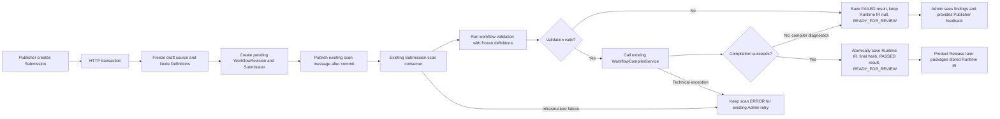

# Stage 4 — Submission Runtime IR Compilation

## Overview

The primary change in Stage 4 is integrating the existing `WorkflowCompilerService` into the
existing Submission scan consumer. Stage 4 does not create another compiler or another background
job. The HTTP request freezes publisher-authored source and the exact Node Definitions, commits the
Submission, and publishes the existing scan message. The consumer validates that frozen source
first. Only a valid workflow is passed to `WorkflowCompilerService.compileWorkflow()`. A successful
compilation atomically stores the authoritative Runtime IR, final Workflow Revision hash, scan
result, and review-ready state. Validation or compilation failure stores Admin-visible findings but
no Runtime IR.



This stage owns the consumer-to-compiler integration and Workflow Revision finalization. Admin approval and
Product Release building remain owned by their existing/later modules. It does not add another
queue, outbox, build record, or public compilation endpoint.

## 1. Existing implementation

The current Backend already provides:

- Submission creation with idempotency, Product and Project locking, snapshots, one open
  Submission rule, and post-commit Kafka publication.
- `WorkflowRevisionService.createFromDraft()`, called inside the Submission transaction.
- A Submission scan consumer with attempt checks, `QUEUED -> RUNNING -> PASSED|FAILED`, technical
  `ERROR`, Admin retry, bounded findings, and Admin-only full scan details.
- `WorkflowValidationService` and the reusable `WorkflowCompilerService.compileWorkflow()`.
- A frozen Node Definition and capability manifest on `WorkflowRevision`.

The current behavior that Stage 4 replaces is:

1. `WorkflowRevisionService` requires non-null `ProjectDraft.runtimeIr`.
2. Revision creation copies that draft Runtime IR immediately.
3. Revision creation calculates the final `contentHash` before the scan runs.
4. The scanner validates the Editor Graph against the live Node Catalog.
5. The scanner does not validate or generate Runtime IR, but may still promote the Submission to
   `READY_FOR_REVIEW`.

Consequently, Studio currently has to copy preview Runtime IR into the cloud draft. That is a
temporary bridge and must no longer be required after this stage.

## 2. Scope

### Included

- Freeze a pending Workflow Revision without Runtime IR or final content hash.
- Inject and call the existing `WorkflowCompilerService` from the existing Submission scan
  consumer after workflow validation succeeds.
- Use the frozen Node Definition manifest, never mutable catalog rows, during the scan.
- Atomically finalize the Workflow Revision and Submission scan outcome.
- Preserve existing Submission message, attempt, retry, visibility, and review behavior.
- Update response contracts to allow a pending or failed revision to have null compiled fields.

### Excluded

- Admin review decision APIs.
- Product Release package building.
- Product Offer, Order, payment, or entitlement behavior.
- A second Kafka topic, outbox, build table, or scheduled job.
- Compiler versioning, Runtime version redesign, assets, or capability-manifest redesign.
- Removing legacy `ProjectDraft.runtimeIr` columns in this stage.

## 3. Data model changes

Create one forward Prisma migration, but do not apply it as part of implementation:

```prisma
model WorkflowRevision {
  // unchanged frozen source fields
  editorGraph            Json
  inputSchema            Json
  nodeDefinitionManifest Json
  capabilityManifest     Json
  validationSummary      Json

  // pending until a successful scan compilation
  runtimeIr              Json?
  contentHash            String? @db.VarChar(64)
}
```

No new table, status, index, or constraint is required. Existing timestamps and user fields remain
unchanged. `Submission.scanStatus` owns scan lifecycle; null compiled fields are not a separate job
state.

The generated migration must only make the two columns nullable. Migration deployment remains a
manual operator action.

## 4. Submission HTTP transaction

The public API contract and create response remain unchanged. Creation still returns only:

```json
{ "id": "submission-uuid" }
```

Inside the existing transaction:

1. Resolve active Publisher access and lock the owned Product using the existing lock order.
2. Validate Product status and ordered Product media, then build the existing snapshots.
3. Lock the Product's Project and exact `ProjectDraft`.
4. Require `draft.version == sourceDraftVersion`.
5. Recalculate and verify the Project Draft source hash. It covers `editorGraph + inputSchema`.
6. Validate the asset-free MVP restriction.
7. Extract distinct node types and load all active Node Definitions once.
8. Fail creation if any referenced definition is unavailable.
9. Freeze `editorGraph`, `inputSchema`, Node Definition manifest, capability manifest,
   `validationSummary`, source draft version, and source draft hash.
10. Create `WorkflowRevision` with `runtimeIr = null` and `contentHash = null`.
11. Create the Submission in `PENDING_SCAN / QUEUED`.
12. Publish the existing scan message only after commit.

The handler must not compile, perform Runtime work, or contact Kafka while database locks are held.
It must no longer reject a draft because `ProjectDraft.runtimeIr` is null.

## 5. Frozen Node Definition contract

The consumer must compile with `WorkflowRevision.nodeDefinitionManifest`. It must not query the
current Node Catalog, because catalog activation or edits after Submission must not change the
result of a retry.

At the consumer boundary:

- Strictly parse the manifest envelope and every definition.
- Convert stored `capabilityCodes` to compiler `capabilities` without changing order or content.
- Reject duplicate or missing node types as a technical frozen-data integrity failure.
- Require every Editor Graph node type to have exactly one frozen definition.

Malformed system-owned manifests are technical failures and follow the existing scan `ERROR` retry
path. Publisher-authored graph or binding problems are deterministic scan findings.

## 6. Consumer pipeline

The existing Submission scan handler and message remain the entry point. This section is the core
of Stage 4: validation gates a call from the consumer into the existing compiler service.

For the current attempt:

1. Load the Submission and frozen Workflow Revision.
2. Apply existing stale, future, terminal, and claim checks.
3. Parse frozen source and manifests.
4. Run the existing pure Editor Graph validation rules with the frozen definitions. Do not call the
   repository-loading `WorkflowValidationService.validate()` path.
5. If validation returns any error finding:
   - do not call the compiler;
   - persist the deterministic `FAILED` outcome described below; and
   - leave `WorkflowRevision.runtimeIr` and `contentHash` null.
6. Only when validation succeeds, call the existing compiler service:

```ts
workflowCompilerService.compileWorkflow(
  revision.editorGraph,
  revision.inputSchema,
  frozenDefinitions,
);
```

7. Pass only the frozen `editorGraph`, frozen `inputSchema`, and parsed frozen Node Definitions.
   The consumer must not reimplement Graph-to-IR mappings.
8. If the compiler returns deterministic diagnostics, persist `FAILED`, leave the compiled fields
   null, and expose the bounded findings only through the Admin scan projection.
9. If compilation succeeds, calculate the final Workflow Revision hash using the existing revision hash
   composition, now with the compiled Runtime IR.
10. Persist the compiled Runtime IR, final hash, and successful scan outcome atomically as described
    below.

The compiler must never read `ProjectDraft.runtimeIr`. Preview Runtime IR and Studio validation are
not compilation authorities.

The compiler call is therefore ordered strictly as:

```text
load frozen revision
  -> validate frozen source
  -> stop with FAILED when invalid
  -> compile with WorkflowCompilerService when valid
  -> stop with FAILED on compiler diagnostics
  -> atomically finalize Runtime IR and PASSED scan result
```

## 7. Atomic persistence

Extend the existing transactional scan outcome write. For a successful scan, one database
transaction must:

1. Conditionally write `WorkflowRevision.runtimeIr` and `contentHash` only when both are null.
2. Write `Submission.scanStatus = PASSED`, scanner version, and bounded scan result for the same
   `scanAttempt`.
3. Move `Submission.status` from `PENDING_SCAN` to `READY_FOR_REVIEW` for that same attempt.

For deterministic invalid content, the same transaction must:

1. Leave both Workflow Revision compiled fields null.
2. Write `scanStatus = FAILED` and the findings.
3. Move the Submission to `READY_FOR_REVIEW` so Admin can inspect findings and reject with useful
   feedback.

If the attempt was superseded, no revision or Submission result may be written. Do not leave a
successful Runtime IR committed separately from its scan result.

## 8. Idempotency and retries

- A terminal `PASSED` or `FAILED` attempt returns the existing `ALREADY_DONE` outcome.
- A stale attempt performs no writes.
- A crash before the final transaction commits leaves both the revision and scan unfinished; Kafka
  redelivery safely repeats validation and compilation from immutable inputs.
- A successful finalization uses a conditional null-to-value update. It never overwrites an
  existing authoritative Runtime IR.
- Concurrent delivery may perform duplicate in-memory computation, but only one identical
  finalization may win; no additional builder record or lock is introduced.
- A technical exception leaves the revision pending and uses the current `scanStatus = ERROR`
  recovery path.

## 9. Failure classification and visibility

### Deterministic business failure (`FAILED`)

Examples:

- Invalid Editor Graph, topology, port, binding, or input schema.
- Unsupported asset usage.
- Runtime IR exceeds its contract limit.
- Compiler returns publisher-content diagnostics.

Store bounded findings in the existing `Submission.scanResult`. Full findings remain visible only
through the Admin detail projection. The Publisher sees review state and later Admin-authored
feedback, not private server scan details.

### Technical failure (`ERROR`)

Examples:

- Database or Kafka infrastructure failure.
- Malformed frozen system-owned Node Definition manifest.
- Failure to atomically persist the final outcome.

These failures are retryable through the existing Admin retry operation and must not create a
business scan result.

## 10. API contract adjustments

No new endpoint is added. Existing Submission endpoints remain protected by their current access
rules.

While a scan is pending or failed, detail serialization must allow:

```ts
workflowRevision.runtimeIr: object | null;
workflowRevision.contentHash: string | null;
```

Owner projections must continue omitting `scanResult`, `scannerVersion`, and internal attempt
fields. Admin projections retain them. List endpoints must not preload Runtime IR.

## 11. Implementation mapping

| Area | Required change |
|---|---|
| Prisma migration and schema | Make `WorkflowRevision.runtimeIr` and `contentHash` nullable |
| `workflow-revision.model.ts` | Pending snapshot/output types accept null compiled fields |
| `workflow-revision.util.ts` | Split source snapshot preparation from final hash calculation |
| `workflow-revision.service.ts` | Remove draft Runtime IR requirement; create pending revision |
| `workflow-revision.repo.ts` | Insert null compiled fields; add conditional finalization method |
| `submission.model.ts` | Detail response accepts null revision Runtime IR/hash |
| `submission.repo.ts` | Load frozen manifests; atomically finalize revision and scan outcome |
| `submission-scanner.service.ts` | Validate frozen input, then inject and call `WorkflowCompilerService`; never duplicate compiler logic |
| `submission-scan.service.ts` | Carry compiled Runtime IR/final hash into transactional persistence |
| Module wiring | Import/export `WorkflowCompilerModule` where the scan consumer needs it |

Do not duplicate compiler logic in Submission code.

## 12. Verification

Required automated coverage:

- Submission creation succeeds when `ProjectDraft.runtimeIr` is null.
- Revision creation freezes the exact requested draft version and definitions.
- Missing frozen node definition prevents Submission creation.
- Invalid workflow validation does not call `WorkflowCompilerService` and leaves Runtime IR null.
- Valid workflow validation calls `WorkflowCompilerService` exactly once with frozen source and
  frozen definitions.
- Scan compilation succeeds and stores Runtime IR plus final hash.
- Compiler diagnostics produce `FAILED`, null compiled fields, and Admin findings.
- Technical compiler/manifest exceptions produce `ERROR` without a business result.
- A stale attempt cannot finalize a revision.
- Redelivery after a pre-commit crash safely recompiles.
- Terminal redelivery returns `ALREADY_DONE` without rewriting Runtime IR.
- Publisher detail omits private scan findings; Admin detail includes them.
- Existing create idempotency and one-open-Submission behavior remain unchanged.

Run focused Workflow Revision, Submission service, scanner, consumer-handler, compiler, build, lint,
and migration validation checks. Do not apply the migration.

## 13. Completion criteria

Stage 4 is complete when:

- Studio no longer needs to save preview Runtime IR before Submission.
- Submission creation commits a pending immutable Workflow Revision and publishes the existing scan
  request.
- The existing scan consumer calls the existing compiler service only after frozen-source
  validation succeeds.
- The compiler receives only frozen source and frozen definitions; Submission code contains no
  duplicate Graph-to-IR transformation.
- `READY_FOR_REVIEW` cannot contain a passed scan with null Runtime IR or final hash.
- Invalid publisher content reaches Admin review with private findings and no authoritative Runtime
  IR.
- Retries cannot overwrite a finalized revision or apply a stale attempt.
- No new queue architecture or Product Release behavior was introduced.

