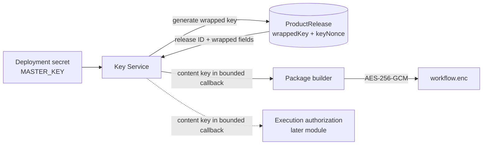

# Key Service Module Feature Spec

**Status:** Proposed for implementation

**Owner:** Backend security infrastructure; consumed internally by Product Release and later
Production Execution Authorization

## Overview

Key Service is a small, stateless NestJS service that protects the random content key used to
encrypt each Product Release workflow. It is not a microservice and has no controller. It uses
Node's built-in `node:crypto` and one deployment secret named `MASTER_KEY`.

Each Product Release receives its own random content key. Key Service wraps that key with
`MASTER_KEY`; ProductRelease stores only the wrapped bytes and wrapping nonce. Plaintext keys exist
only inside a bounded callback while Product Release encrypts Runtime IR or a later authorization
flow wraps the same key for Runtime.



The MVP implements only generation, wrapping, unwrapping, bounded plaintext-key use, configuration
validation, and safe failure handling. Multiple master-key versions, rotation, rewrapping jobs, and
external KMS/HSM providers are deferred until the product requires them.

## 1. Purpose and boundary

This module owns:

- generating one random 256-bit content key per Product Release;
- wrapping and unwrapping content keys with authenticated encryption;
- validating and retaining the configured master key in process memory;
- bounded callback access to plaintext content keys; and
- crypto-specific validation, cleanup, and safe internal errors.

This module does not own:

- ProductRelease persistence, transactions, or lifecycle;
- Runtime IR serialization, workflow encryption, manifest, ZIP, or R2 upload;
- Submission, Review, Product, Offer, Order, or Entitlement rules;
- execution leases or Runtime key envelopes;
- an HTTP controller, queue topic, public DTO, repository, or database table; or
- master-key rotation or cloud-provider integration.

Product Release owns storage of the wrapped fields. The later execution-authorization module may
use those same fields but cannot replace them.

The system-wide inventory remains in
[Cryptographic Keys and Security Credentials](../../../specifications/cryptographic_key_security.md).
This document is authoritative for Key Service implementation.

## 2. MVP decisions

- Key Service runs in-process only in Backend processes that import `KeyModule`.
- Node's built-in `node:crypto` is the only cryptographic runtime dependency.
- Every Product Release has a separate random 32-byte content key.
- One separate 32-byte `MASTER_KEY` wraps all MVP release content keys.
- ProductRelease stores `wrappedKey` and `keyNonce`; it never stores plaintext key bytes.
- The Release ID is authenticated context, so wrapped fields cannot be moved between Releases.
- Wrapped fields become immutable once assigned.
- Plaintext keys never enter controllers, DTOs, repositories, database rows, logs, or messages.
- Losing or changing `MASTER_KEY` makes existing Releases unreadable. Deployment must back it up and
  treat it as immutable for the MVP.

## 3. Cryptographic contract

### 3.1 Constants

```text
CONTENT_KEY_BYTES = 32
MASTER_KEY_BYTES = 32
NONCE_BYTES = 12
TAG_BYTES = 16
WRAPPED_KEY_BYTES = 48
ALGORITHM = AES-256-GCM
```

These constants live in `key.service.ts` unless another approved key use needs to share them.

### 3.2 Authenticated context

The exact UTF-8 additional authenticated data is:

```text
release:{releaseId}
```

`releaseId` is the lowercase canonical ProductRelease UUID. The context is reconstructed and not
stored. Changing the Release ID, wrapped bytes, nonce, or master key causes authentication failure.

### 3.3 Generate and wrap

Given:

```text
K   = random 32-byte Product Release content key
MK  = configured 32-byte master key
N   = random 12-byte key nonce
AAD = UTF8("release:" + releaseId)
```

Key Service performs:

```text
(ciphertext, tag) = AES-256-GCM-Encrypt(MK, N, K, AAD)
wrappedKey = ciphertext || tag
```

`ciphertext` is 32 bytes, `tag` is 16 bytes, and `wrappedKey` is exactly 48 bytes. Binary values are
stored as PostgreSQL `BYTEA`, not Base64.

### 3.4 Unwrap and use

1. Validate the Release UUID and exact wrapped-key/nonce lengths.
2. Reconstruct AAD from the Release ID.
3. Split the final 16 bytes of `wrappedKey` as the authentication tag.
4. Decrypt and authenticate with AES-256-GCM and `MASTER_KEY`.
5. Require the result to be exactly 32 bytes.
6. Invoke the authorized callback exactly once.
7. Overwrite the local plaintext buffer with zeroes in `finally` as far as Node permits.

Authentication failure is an internal integrity/security failure, never an empty result.

## 4. Environment configuration

```text
MASTER_KEY=<canonical padded Base64 for exactly 32 random bytes>
```

`MASTER_KEY` is injected by the deployment secret facility. It must never appear as a usable value
in source control, Docker Compose defaults, frontend configuration, logs, configuration errors, or
health responses.

The shared config schema exposes it as optional so processes unrelated to release encryption do not
require the secret. `KeyModule` requires and validates it when loaded:

- canonical padded RFC 4648 Base64;
- decodes to exactly 32 bytes; and
- cannot be empty or generated automatically.

Development, staging, and production use different values. `.env.example` may contain an empty
placeholder. Production deployment must back up the value separately from the database and R2.

## 5. ProductRelease storage contract

Key Service adds no table. ProductRelease owns these nullable build fields:

```text
wrappedKey BYTEA
keyNonce BYTEA
```

Both fields are null before allocation and both are present afterward. Backend code validates exact
lengths and never exposes them through Publisher, Admin, Marketplace, or download responses.

A database check keeps the pair structurally consistent:

```sql
CHECK (
  ("wrappedKey" IS NULL AND "keyNonce" IS NULL)
  OR
  ("wrappedKey" IS NOT NULL AND "keyNonce" IS NOT NULL)
)
```

No index is required. Key access already loads ProductRelease by its primary key.

## 6. Internal service contract

```ts
type WrappedKey = Readonly<{
  wrappedKey: Buffer;
  keyNonce: Buffer;
}>;

interface KeyService {
  generate(releaseId: string): WrappedKey;

  withKey<T>(
    releaseId: string,
    wrappedKey: Buffer,
    keyNonce: Buffer,
    operation: (contentKey: Buffer) => Promise<T>,
  ): Promise<T>;
}
```

`generate` creates a content key, wraps it, zeroes the temporary plaintext key, and returns only
protected persistence data.

`withKey` validates and unwraps the supplied fields, invokes the callback exactly once, and zeroes
its local plaintext buffer in `finally`. The callback must not retain, copy, return, cache, or log
the supplied Buffer.

There is no plaintext-key getter, key-list API, export method, generic decrypt endpoint, or database
access inside Key Service.

## 7. Product Release integration

### 7.1 Allocate idempotently

1. Call `KeyService.generate(releaseId)` before opening a transaction.
2. In one short transaction, lock ProductRelease by ID.
3. If both stored fields already exist, reuse them and discard the new wrapped candidate.
4. If both are null, store the candidate fields together.
5. If only one field exists, fail as inconsistent data.
6. Commit before package construction or R2 access.

Concurrent callers may generate different candidates, but the row lock chooses one pair. The losing
candidate is protected ciphertext only and is discarded. A crash before commit stores nothing; a
crash after commit leaves reusable wrapped fields for retry.

### 7.2 Encrypt the package workflow

```ts
await keyService.withKey(
  releaseId,
  wrappedKey,
  keyNonce,
  async (contentKey) => {
    return packageBuilder.encryptRuntimeIr(contentKey);
  },
);
```

Key Service does not receive Runtime IR, workflow nonce, manifest, package, R2 object key, or Product
metadata. The detailed `workflow.enc` format remains authoritative in
[Product Release](../product_submission_release/product_release.md).

## 8. Failure contract

| Condition                               | Stable internal result  | Product Release handling           |
| --------------------------------------- | ----------------------- | ---------------------------------- |
| Missing/invalid `MASTER_KEY` at startup | `KEY_CONFIG_INVALID`    | process not ready; do not consume  |
| Secure random generation fails          | `KEY_GENERATION_FAILED` | `RETRY`                            |
| Stored fields have invalid shape/length | `KEY_DATA_INVALID`      | `BUILD_FAILED`; integrity incident |
| GCM authentication/decryption fails     | `KEY_DATA_INVALID`      | `BUILD_FAILED`; integrity incident |
| Authorized callback fails               | caller error            | caller classifies                  |

Raw crypto, Buffer, environment, or database errors never cross an HTTP boundary. No user-facing
response reveals key configuration or authentication details.

## 9. Security and efficiency

- Key Service is imported only by trusted internal modules and has no controller.
- Logs may contain operation, Release ID, duration, and stable outcome only.
- Logs must not contain master/content keys, wrapped bytes, nonces, AAD, environment values,
  workflow/package content, or complete stack data containing secrets.
- Master key remains in process memory for process lifetime. This is the accepted provider-independent
  MVP trade-off; host and process access must be restricted.
- Buffer zeroing is best-effort because JavaScript may create internal copies. Avoid string
  conversion, unnecessary Buffer copies, and long plaintext lifetimes.
- Generation and unwrap are constant-size local operations with no database or network call.
- No plaintext-key cache is allowed.

## 10. Implementation mapping

```text
src/key-service/
  key.module.ts
  key.service.ts

src/shared/config.ts
.env.example
.env.production.example
src/routes/product-release/...
prisma/migrations/<timestamp>_add_product_release/
```

`KeyModule` exports `KeyService` and is imported by ProductReleaseModule/consumer now and Production
Execution Authorization later. It is not global and is not imported by Cron unless Cron later owns a
key operation.

Expected Key Service implementation size is approximately 70–100 lines plus an 8–12 line module.
Product Release integration, config, and migration changes add approximately 50–85 handwritten
lines. No new npm dependency is required.

## 11. Verification requirements

Focused tests should cover:

- generate/unwrap round trip;
- distinct Releases producing distinct random protected fields;
- wrong Release ID, nonce, ciphertext, tag, or master key failing authentication;
- invalid/missing master-key configuration preventing KeyModule readiness;
- exact documented byte lengths;
- callback execution and best-effort plaintext-buffer clearing; and
- errors/logs excluding configured and generated key material.

Product Release integration should verify first allocation, repeated allocation reusing stored
fields, concurrent allocation keeping one complete pair, and transaction rollback storing neither
field. No cloud service is required.

## 12. Acceptance criteria

- Key Service has no controller, repository, table, queue handler, or key-export surface.
- Configuration requires one canonical Base64 value decoding to exactly 32 bytes.
- Every Product Release receives a separate random content key.
- ProductRelease stores only `wrappedKey` and `keyNonce`, never plaintext key bytes.
- Wrapped fields are immutable, paired, hidden from APIs, and authenticated to the Release ID.
- Product Release encrypts only inside `withKey`.
- Tampering with Release ID, nonce, ciphertext, tag, or master key fails closed.
- Plaintext content/master keys never enter business payloads, logs, DTOs, or messages.
- Implementation uses built-in `node:crypto` and adds no provider dependency.

## 13. Deferred work

- Multiple master-key versions and online rotation.
- Rewrapping existing Release keys without rebuilding packages.
- External KMS/HSM integration.
- Detailed Production Execution Authorization integration.
- Key-access audit records beyond structured operational logs.

Adding rotation later requires an explicit schema/config migration. Until then, deployment must not
replace `MASTER_KEY` while any encrypted Product Release must remain usable.
