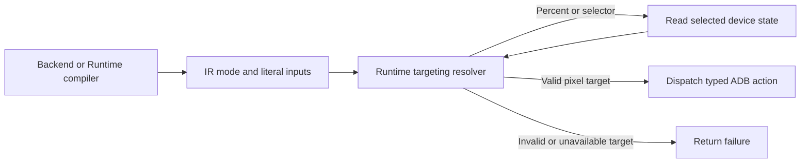

# Android targeting contract

**Status:** Planned compilation and execution contract. Compilation belongs to
Runtime C7–C9, target resolution and execution belong to F/G, and Studio client
integration belongs to I1.

## Overview

The Backend compiler copies one explicit targeting mode and its literal fields
into authoritative Runtime IR; the Runtime local compiler applies the same
mapping for Studio Test Run. Studio supplies source data but does not implement
the mapping. The Runtime targeting component resolves those inputs against the
selected Android device and dispatches a fixed command. Verify the component
independently before integrating workflow admission and Studio Test Run.

## Compilation

Studio discovers available modes and their authoring fields from the Backend
Node Definition `editorHints.targeting.modes`; it does not maintain a separate
`TARGET_FIELDS` map. Backend authoritative compilation uses the frozen Node
Definition selected for the Workflow Revision. Runtime local compilation uses
the equivalent immutable C7 installed contract and never accepts definitions
or defaults from Studio. Runtime validation and execution cannot depend on a
live catalog request. Cross-language compiler and validation fixtures keep the
installed Runtime rules aligned with the published catalog contract.

Keep the node ID and handler identity. Copy the required
`config.targetMode`. Map each Editor Graph binding
`{"kind":"LITERAL","value":100}` to the same field in IR `inputs` as
`{"source":"LITERAL","value":100}`. Preserve the value type. Every targeting
node must carry exactly the fields for its selected mode. Missing modes,
extra fields, and non-literal binding sources fail admission.

| Node | Absolute pixels | Screen percentage | Selector ID | Additional input |
|---|---|---|---|---|
| Tap | `x`, `y` | `xPercent`, `yPercent` | `selector_id` | None |
| Swipe | `startX`, `startY`, `endX`, `endY` | `startXPercent`, `startYPercent`, `endXPercent`, `endYPercent` | Unsupported | `durationMs` |
| Long Press | `x`, `y` | `xPercent`, `yPercent` | `selector_id` | `durationMs` |

Mode names are `ABSOLUTE_PIXELS`, `SCREEN_PERCENT`, and `SELECTOR_ID`.
Pixel coordinates are integers from 0 to 100,000. Percentages are integers
from 0 to 100. Durations are integers from 1 to 60,000 ms and must fit within
the attempt timeout to finish. Selector IDs use the full Android resource ID.

## Resolution and dispatch

- Pixels go straight to dispatch. Percentage targeting reads the current
  default display size and rounds each axis as
  `round(percent × (dimension − 1) / 100)`. Swipe uses one size snapshot.
- Selector targeting reads the current hierarchy, requires exactly one
  resource-ID match, and dispatches to the center of its screen-clipped
  bounds. Missing, ambiguous, hidden, malformed, or empty bounds fail before
  dispatch. The ADB adapter uses a Runtime-generated temporary device path
  with bounded output and best-effort cleanup.
- Dispatch uses the selected serial and fixed arguments. Long Press uses an
  Android input swipe with identical endpoints and the hold duration. These
  gestures expose an empty workflow output. Adapter errors carry no raw ADB
  output or hierarchy contents.

## Integration gates

Runtime must wire this component to the device inventory, executable IR
admission, handler registry, workflow runner, and checkpoints. Runtime owns the
C7–C9 local compiler and F/G target resolution. Studio owns authoring, source
snapshot capture, API invocation, and cache freshness; it does not implement
the mapping. Backend and Launcher keep capability gating tied to the Runtime
build verified on real devices. Catalog presence alone is authoring
availability. Real-device checks must cover current display and hierarchy
output on the supported Android versions before enabling Test Run.
