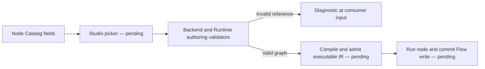

# Workflow bindings and Flow variables

## Overview

Stage 3 lets publishers reuse a declared node output directly or save a value
under a name for later nodes. Backend and local Runtime validate the authoring
contract. Studio integration and variable execution follow separately.



## Editor Graph v1 binding extension

The new binding forms use the existing `bindings` object. The graph envelope
and schema version stay the same. Studio needs a Runtime with Stage 3
authoring support before exposing these forms.

| Source | Editor Graph binding | Validation |
|---|---|---|
| Prior output | `{"kind":"NODE_OUTPUT","nodeId":"capture","field":"artifactId"}` | The producer must declare the field as required in its output schema. The field type must match the consumer's declared input type. Every path to the consumer must cross a success edge from the producer. |
| Flow read | `{"kind":"FLOW_VARIABLE","name":"lastScreenshot"}` | The destination must be a declared input. The name is case-sensitive and matches `^[A-Za-z_][A-Za-z0-9_]{0,99}$`. Existence and value type are checked at execution. |
| Global read | `{"kind":"GLOBAL_VARIABLE","name":"bestScore"}` | Same name and binding checks as Flow. The value comes from the current RunGroup. |
| Literal in Set Variable | `{"kind":"LITERAL","value":0}` | String, safe integer, or boolean. |
| Workflow input in Set Variable | `{"kind":"WORKFLOW_INPUT","inputName":"message"}` | Validate the name shape at authoring time. The project input schema and supplied value are checked at executable admission. |

There is one Set Variable node type, `flow.set_variable`. Its
`config.scope` selects `FLOW` for the current device execution or
`RUN_GROUP` for Global within the current run. Omission means `FLOW`.
`config.name` is required and follows the same name rule.
Its sole binding, `bindings.value`, can use any source in the
table. This special input accepts any supported scalar type, so Studio
uses a dedicated editor instead of the Catalog's flat typed input form.
Set Variable exposes success/error control ports and no output data fields.

For other nodes, authoring validation checks `NODE_OUTPUT`, `FLOW_VARIABLE`,
and `GLOBAL_VARIABLE`
forms. Other binding kinds keep their existing validation. Android targeting
fields continue to use Stage 1's literal-only checks. Each rejected value
binding produces `NODE_VALUE_BINDING_INVALID` at the consumer's binding path.

## Studio handoff

List required, compatible output fields from the Catalog and show the
producer's canvas label. Save the producer ID and field name. Explain
unavailable choices where a path skips the producer or can follow its error
edge. Tap, Swipe, and Long Press expose no data fields. Screenshot exposes
`artifactId`. The validators cache one success-edge bypass analysis per
referenced producer, so multiple bindings to that producer reuse the result.

## Switch authoring

`flow.switch` defines one to 32 ordered rules in `config.rules`. Each rule
has exactly an `id` and an `operator`. The ID matches
`^rule_[A-Za-z0-9_]{1,64}$`, is unique within the Switch, and is also its
source port ID. Reordering rules changes priority while preserving edges.

```json
{
  "config": { "rules": [{ "id": "rule_low", "operator": "LTE" }] },
  "bindings": {
    "value": { "kind": "FLOW_VARIABLE", "name": "score" },
    "rule_low": { "kind": "LITERAL", "value": 100 }
  }
}
```

The left operand is `bindings.value`. Each binary rule uses its ID as the
right operand's binding key. Both operands use the Stage 3 binding forms.
`EQ` and `NE` compare matching types. `LT`, `LTE`, `GT`, and `GTE`
compare integers. `IS_EMPTY` checks for an empty string and has no right
operand. Authoring validates statically known operand types. Executable
admission and evaluation check values whose types are unknown at authoring.

Require exactly one outgoing edge for each rule port and for `default`.
Require exactly one `error` edge with `ERROR_BRANCH`. With `STOP`,
the error port is unavailable. Unknown ports produce
`EDGE_SOURCE_PORT_NOT_FOUND`. Missing or duplicate routes produce
`SWITCH_PORT_EDGE_COUNT_INVALID`. Switch exposes no bindable output fields.

Studio owns the ordered rule editor and instance port rendering. Phase G
will resolve the left operand once and evaluate rules top to bottom,
following the first match or Default. A binding or comparison failure
uses the configured error policy. Phase D records the selected transition.

## Later execution phases

Phase D specifies how a successful Set Variable write commits with the
node checkpoint. Phase G owns exact Runtime IR forms and admission,
per-device output and variable lookup, and unset or incompatible-value
errors. Flow variables belong to a single device execution. The first
write creates a key and later writes replace it. Global variables belong to
one RunGroup on one Runtime Agent. Phase D owns atomic checkpoint writes,
Phase G owns scope-aware reads and writes, and Phase H owns sharing across
device workers. Global writes become visible after commit, and the last
committed write wins. A Switch followed by Set Variable remains two operations.

### Wait for Variable

`flow.wait_variable` waits for a named Global key in the current RunGroup.
Its config has exactly `name` and `timeoutMs`. Use the Set Variable name
rule and an integer timeout from 1 to 600,000 milliseconds. Bindings are
empty. The node has success and error ports and no data output. Studio
supplies a Global key and timeout form. The future compiler maps the
configured timeout to the IR attempt deadline.

Phase G succeeds immediately when the key exists. Values such as `false`,
`0`, and the empty string count as present. Timeout follows the node's
error policy, and run cancellation cancels the wait. Phase H coordinates
the existence check with waiter registration so a concurrent commit cannot
be missed. A waiting execution releases its worker slot and becomes runnable
after the producing checkpoint commits. Phase D records the outcome.
Verify an already-present value, timeout, cancellation, and the two-device
handoff with only one worker slot.
