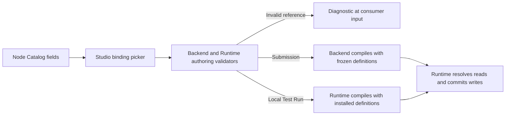

# Workflow bindings and Flow variables

## Overview

Publishers can reuse a declared node output directly or save a value under a
name for later nodes. Backend and local Runtime validate the authoring contract;
the Backend authoritative compiler and Runtime local compiler map the accepted
forms into the same executable Runtime IR. Studio only constructs source data
and calls the Runtime compiler.



## Editor Graph v1 binding extension

The new binding forms use the existing `bindings` object. The graph envelope
and schema version stay the same. Studio needs a Runtime with Stage 3
authoring support before exposing these forms.

| Source | Editor Graph binding | Validation |
|---|---|---|
| Prior output | `{"kind":"NODE_OUTPUT","nodeId":"capture","field":"artifactId"}` | The producer must declare the field as required in its output schema. The field type must match the consumer's declared input type. Every path to the consumer must cross a success edge from the producer. |
| Flow read | `{"kind":"FLOW_VARIABLE","name":"lastScreenshot"}` | The destination must be a declared input. The name is case-sensitive and matches `^[A-Za-z_][A-Za-z0-9_]{0,99}$`. Existence and value type are checked at execution. |
| Global read | `{"kind":"GLOBAL_VARIABLE","name":"bestScore"}` | Same name and binding checks as Flow. The value comes from the current RunGroup. |
| Literal in Set Variable | `{"kind":"LITERAL","value":0}` | String, finite number, or boolean. |
| Workflow input in Set Variable | `{"kind":"WORKFLOW_INPUT","inputName":"message"}` | Validate the name shape at authoring time. The project input schema and supplied value are checked at executable admission. |

There is one Set Variable node type, `flow.set_variable`. Its
`config.scope` selects `FLOW` for the current device execution or
`RUN_GROUP` for Global within the current run. Studio defaults it to `FLOW`, saves it explicitly,
and Backend rejects omission or any other value. `config.name` is required and follows the same name rule.
Its sole binding, `bindings.value`, can use any source in the
table. Its Node Catalog `inputSchema.value` property publishes each allowed kind and the fields
saved for that kind.
Set Variable exposes success/error control ports and no output data fields.

The Backend Node Catalog exposes this as a normal required input property:

```json
{
  "value": {
    "bindingKinds": {
      "LITERAL": {
        "fields": {
          "value": { "types": ["string", "number", "boolean"] }
        }
      },
      "WORKFLOW_INPUT": { "fields": ["inputName"] },
      "NODE_OUTPUT": { "fields": ["nodeId", "field"] },
      "FLOW_VARIABLE": { "fields": ["name"] },
      "GLOBAL_VARIABLE": { "fields": ["name"] }
    }
  }
}
```

Studio renders that input contract but saves only `config.name`, explicit `config.scope`, and
`bindings.value` in the Editor Graph. The compiler preserves the config and maps the binding to
Runtime IR `inputs.value`; it does not persist the input schema in Runtime IR. Authoring validation is
implemented independently of execution support. G16 RAM storage and G17's execution-bound
read path are implemented. G18 live-store ownership, the Set Variable handler, and
checkpoint-confirmed publication are implemented and Linux-verified; waiting/control follows in H.

For other nodes, authoring validation checks `NODE_OUTPUT`, `FLOW_VARIABLE`,
and `GLOBAL_VARIABLE`
forms. Other binding kinds keep their existing validation. Android targeting
fields continue to use Stage 1's literal-only checks. Each rejected value
binding produces `NODE_VALUE_BINDING_INVALID` at the consumer's binding path.

## Studio handoff

List required, compatible output fields from the Catalog and show the
producer's canvas label. Save the producer ID and field name. Explain
unavailable choices where a path skips the producer or can follow its error
edge. Tap, Swipe, and Long Press expose no data fields. Screenshot exposes
`artifactId`. The validators cache one success-edge bypass analysis per
referenced producer, so multiple bindings to that producer reuse the result.
Studio sends `editorGraph` and `inputSchema` to the authenticated Runtime local
compilation API. It may cache the returned Runtime IR, but does not implement
the mapping below or supply trusted Node Definitions.

## Runtime IR mapping

The compiler replaces Editor Graph `kind` with Runtime IR `source` and preserves
the remaining source fields:

| Editor Graph binding | Runtime IR input source |
|---|---|
| `{"kind":"LITERAL","value":7}` | `{"source":"LITERAL","value":7}` |
| `{"kind":"WORKFLOW_INPUT","inputName":"message"}` | `{"source":"WORKFLOW_INPUT","inputName":"message"}` |
| `{"kind":"NODE_OUTPUT","nodeId":"capture","field":"artifactId"}` | `{"source":"NODE_OUTPUT","nodeId":"capture","field":"artifactId"}` |
| `{"kind":"FLOW_VARIABLE","name":"score"}` | `{"source":"FLOW_VARIABLE","name":"score"}` |
| `{"kind":"GLOBAL_VARIABLE","name":"bestScore"}` | `{"source":"GLOBAL_VARIABLE","name":"bestScore"}` |

`flow.set_variable` retains its validated `config` and compiles
`bindings.value` to `inputs.value`. Runtime writes the resolved scalar only
after the node succeeds. A `FLOW` write belongs to the current device execution;
a `RUN_GROUP` write becomes visible to other executions only after its checkpoint
commits.

## Switch authoring

`flow.switch` defines one to 32 ordered rules in `config.rules`. Each rule
has exactly a Studio-generated UUID `id` and an `operator`. The UUID is never publisher-editable, is
unique within the Switch, and is also its operand binding key and source port ID. Reordering rules
changes priority while preserving IDs, bindings, and edges.

```json
{
  "config": {
    "rules": [
      {
        "id": "bfbb31bc-d4b5-44ec-b9eb-a09d68e74083",
        "operator": "LTE"
      }
    ]
  },
  "bindings": {
    "value": { "kind": "FLOW_VARIABLE", "name": "score" },
    "bfbb31bc-d4b5-44ec-b9eb-a09d68e74083": {
      "kind": "GLOBAL_VARIABLE",
      "name": "maximumScore"
    }
  }
}
```

The left operand is `bindings.value`. Each binary rule uses its UUID as the right operand's binding
key. Both operands accept `LITERAL`, `WORKFLOW_INPUT`, `NODE_OUTPUT`, `FLOW_VARIABLE`, and
`GLOBAL_VARIABLE`.

| Operators | Operand count | Required resolved type |
|---|---:|---|
| `EQ`, `NE` | 1 | matching string, number, or boolean values |
| `LT`, `LTE`, `GT`, `GTE` | 1 | numbers compared as floating-point values |
| `CONTAINS`, `NOT_CONTAINS`, `STARTS_WITH`, `ENDS_WITH` | 1 | strings |
| `IS_EMPTY`, `IS_NOT_EMPTY` | 0 | string left value |
| `IS_TRUE`, `IS_FALSE` | 0 | boolean left value |

Unary rules must not have `bindings[rule.id]`. Authoring validates statically known operand types.
Executable admission and evaluation check values whose types are unknown at authoring. Range
operators, regex, null checks, object-key checks, nested conditions, and fall-through are not part of
this contract.

Require exactly one outgoing edge for each rule port and for `default`.
Require exactly one `error` edge with `ERROR_BRANCH`. With `STOP`,
the error port is unavailable. Unknown ports produce
`EDGE_SOURCE_PORT_NOT_FOUND`. Missing or duplicate routes produce
`SWITCH_PORT_EDGE_COUNT_INVALID`. Switch exposes no bindable output fields.

The Node Definition publishes operator type/operand metadata, the shared value binding contract,
`dynamicInputs.ruleOperand`, and UUID-derived dynamic ports. Studio owns the ordered rule editor and
visible port labels. The compiler preserves rule order and maps `bindings.value` plus rule operand bindings into
Runtime IR inputs. Runtime resolves the left operand once and evaluates rules
top to bottom, following the first match or `default`. A binding or comparison
failure uses the configured error policy.

## Execution semantics

Flow variables belong to a single device execution. The first
write creates a key and later writes replace it. Global variables belong to
one RunGroup on one Runtime Agent. Values live only in Runtime RAM. A successful
assignment becomes visible after its existing node checkpoint is confirmed and
before readers or continuation are released. Global writes use
last-committed-write-wins. A Switch followed by Set Variable remains two operations.
Variables survive Pause/Resume while Runtime stays alive; exit/crash loses them.
Restart recovery interrupts old work instead of restoring or continuing it.

### Runtime variable implementation boundaries

The authoring and compilation contracts above are accepted. G16 storage and G17 internal
read bindings plus G18 public run store ownership and Set Variable execution are implemented
and Linux-verified. Runtime integration must preserve these decisions:

1. The validation/compiler registry may recognize `flow.set_variable`, `FLOW_VARIABLE`, and
   `GLOBAL_VARIABLE` before they are executable. This must not register a handler or claim execution
   support.
2. Runtime Info `supportedNodes` contains only exact `{type, runtimeHandler}` pairs from the
   executable handler registry. Studio may author, autosave, and Cloud Sync a Set Variable node, but
   must block Test Run until `flow.set_variable` is advertised there.
3. `FLOW` state is owned by one `DeviceExecution`. `RUN_GROUP` state is owned by one `RunGroup` on
   one Runtime Agent. Neither scope is a permanent account-wide or cross-run store.
4. The binding resolver resolves `inputs.value` before the Set Variable handler writes anything. A
   missing variable, unavailable node output, invalid workflow input, or unsupported value fails the
   node through its configured error policy and creates no variable mutation.
5. G18 holds the RAM candidate under the store gate while confirming the existing successful node
   checkpoint, then publishes before releasing readers or continuation. No reader or waiter observes
   an unconfirmed candidate. Variable values/maps are not stored in that SQLite transaction, events,
   or checkpoint read-back. No migration or variable repository is required.
6. The first committed write creates a name and a later committed write replaces it. A committed
   `RUN_GROUP` write becomes visible to other device executions only after commit. Concurrent writes
   use last-committed-write-wins for the MVP.
7. Runtime must never log variable values. Events may contain bounded identifiers and state changes,
   but not the resolved scalar or protected workflow input.
8. Phase G owns executable admission, variable-source resolution, the Set Variable handler, and the
   checkpoint-confirmed RAM publication. Phase H owns cross-device RunGroup visibility and Wait Variable
   scheduling.

The [G16 storage specification](../g_workflow_engine/g16_scoped_variable_storage.md)
and [execution-state extension](execution_state_v1.md#9-scoped-variable-state)
define the representation and lifecycle. G16 storage and G17 internal variable reads are
implemented and Linux-verified, together with G18 live store ownership and writer integration.
G16 supplies bounded RAM scopes, compact scalar JSON, synchronized lookup, publication,
and cleanup. Limits are 64 KiB per raw/encoded value, 512 names, and 1 MiB of name/value
bytes per scope: 2 MiB for one device or `(N + 1) MiB` for N admitted devices,
plus Go overhead/copies. Variable membership follows the full admitted group
with no fixed count ceiling; membership checks are aligned in code. There is no variable persistence, database table, migration,
repository method, or durable value history.

G17 connects variable-source reads through the optional execution-bound view. G18
provides views from its live run-owned store and executes the single Set Variable node,
publishing each assignment after confirmation of the existing node checkpoint. Keep maps during live
Pause/Resume; close them after terminal settlement and joined workers. Runtime exit
loses them, and a new run starts empty. This RAM-only policy applies to Development and
future Production. Do not enable a handler or broaden current capability claims merely
to complete authoring or local compilation.

### Wait for Variable

**Deferred — 2026-11-22.** H6–H8 and executable `flow.wait_variable` support
are postponed while the Backend node contract is unfinished. Continue Runtime
controls from H9 for current executable nodes; no waiter implementation or
capability claim is required now. The following describes the future contract.
See the [deferral and return checklist](../phases/phase_h.md#wait-variable-deferral--approved-2026-11-22).

`flow.wait_variable` waits for a named Global key in the current RunGroup.
Its config has exactly `name`. Use the Set Variable name rule. Bindings are
empty. The node has success and error ports and no data output. Studio supplies
the Global key and the node-level optional `timeoutMs`; the compiler uses the
Node Definition default when the node does not provide one. The effective
Runtime IR `timeoutMs` is the wait deadline.

Runtime succeeds immediately when the key exists. Values such as `false`,
`0`, and the empty string count as present. Timeout follows the node's
error policy, and run cancellation cancels the wait. Runtime coordinates
the existence check with waiter registration so a concurrent commit cannot
be missed. A waiter becomes eligible to continue after the producing checkpoint
is confirmed and its RAM value is published, subject to pause/cancel authority.
The execution remains owned and joinable while suspended. Membership-derived
capacity already permits sibling devices to run; reassess H7 before introducing
slot release/reacquisition. No one-worker-slot requirement or device ceiling is
implied. On resumption, verify an already-present value, concurrent publication,
timeout/cancellation, pause/notification ordering and cross-device wakeup.
