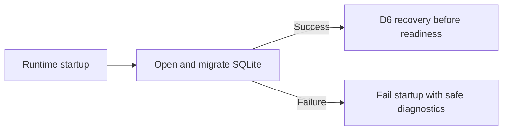

# D1 — SQLite schema and migrations

## Overview

Runtime needs durable local storage for accepted runs, per-device progress,
attempt results, and reconnectable history. D1 defines the schema used by D2–D6.

**Status:** Implemented. File-backed and process startup checks passed on
Linux. Windows amd64 cross-build passed. Native Windows locking and reopen
checks remain open.

| Record | Identity and constraints |
|---|---|
| RunGroup | Primary ID, unique immutable request ID, A5 lifecycle timestamps and status. A partial unique index enforces one active group across RUNNING and PAUSED. |
| DeviceExecution | Primary ID, parent RunGroup, unique serial within the group, A5 status, timestamps, next node, and safe terminal error. |
| NodeAttempt | Primary ID, parent DeviceExecution, unique per-device sequence and unique device/node/attempt number. At most one RUNNING attempt per device. Store only validated output and safe errors. |
| ExecutionEvent | Runtime-wide monotonic cursor, run and optional device/attempt references, event kind, timestamp, and bounded A6 payload. Index replay by cursor. |
| Artifact | Opaque ID, owning attempt, controlled file reference, byte length, media type, and PNG dimensions. |

Use A5 state and timestamp conventions. Enable foreign keys on every
connection. Enforce status and ownership invariants in the schema where
expressible and enforce transition rules in transactional writes. Use a
Runtime-controlled per-user database location. Acquire exclusive agent
ownership of that store before migration and recovery, and hold it until
shutdown. A second agent must fail before touching live execution state.
Use the driver and durability settings in section 4. Keep one serialized write
path and short transactions. Apply ordered embedded migrations before
recovery, fail on a newer unsupported schema, and preserve data on failure.

For the first runnable MVP, retain execution history and request IDs. Use
one bounded event retention policy with D3's durable watermark. Document
storage growth and handle full-store writes as failures. History pruning and artifact
retention can follow under an explicit product policy.

The variable and Switch extensions require an A5 contract decision before
their migrations. Add them when the corresponding nodes become executable.

**Acceptance:** Fresh install and reopen succeed. Unsupported or failed
migration prevents readiness. Tests prove uniqueness, foreign keys,
transaction rollback, preservation of existing records, and rejection of a
second agent targeting the same store.

## 1. Responsibilities and entry points

D1 is a Runtime-owned local store. It defines the database path, exclusive
process ownership, connection policy, initial schema, and migration lifecycle.
Its caller is the B3 supervisor. D2 owns repository behavior and D6 owns
recovery transitions. No HTTP endpoint takes a database path or migration
parameter.

The smallest checkout is a temporary per-user data directory. Start the store,
migrate it, write a representative run, close it, and reopen it. A second
agent attempting to use the same directory must fail while the first is active.

## 2. Store location and ownership

| Item | Proposed contract |
|---|---|
| Database file | Fixed application-owned filename under a resolved local Runtime data directory. |
| Store lock | OS-backed exclusive lock scoped to the canonical store location. Hold the lock through recovery, serving, and connection close. |
| Data directory | Per-user writable storage with permissions restricted to the owning account where supported. Separate from the transient connection file. |
| Filesystem | Local filesystem supported by the selected SQLite configuration. Reject unsupported locations rather than relying on remote filesystem locking. |
| Lock failure | Fail startup with a bounded, sanitized diagnostic. A second agent must leave the first agent's database and connection handoff untouched. |

The lock protects recovery ownership. SQLite write serialization alone
would allow another process to obtain a write transaction later and mark
live work as interrupted. The lock is released when the process exits.
A leftover lock filename is insufficient evidence that an agent is alive.

Resolve paths once at startup. Neither a Publisher workflow nor a client
request can select the SQLite file, artifact directory, or migration location.
Include database companion files in the same protection boundary. Redact
absolute paths and SQL values from client errors and ordinary logs.

## 3. Proposed relational model

Use the names below. Keep internal storage representation
independent of the wire representation.

| Table | Required columns beyond the primary key | Cardinality and purpose |
|---|---|---|
| `run_groups` | `request_id`, `status`, `created_at`, `finished_at` | Parent of all devices in a run. Request ID is globally unique within this Runtime store. |
| `device_executions` | `run_group_id`, `adb_serial`, `admission_ordinal`, `status`, `next_node_id`, `created_at`, `started_at`, `finished_at`, `terminal_error_json` | One selected serial per run. Attempt sequence is scoped here. |
| `node_attempts` | `device_execution_id`, `sequence`, `node_id`, `attempt_number`, `status`, `started_at`, `finished_at`, `output_json`, `error_json` | One actual invocation attempt. Sequence and retry identity have separate uniqueness rules. |
| `execution_events` | `cursor`, `event_type`, `run_group_id`, optional `device_execution_id`, `node_attempt_id` and `node_id`, `occurred_at`, `payload_json` | Ordered durable A6 events. Cursor is the integer primary key. |
| `event_stream_state` | `last_committed_cursor`, `replay_floor` | Exactly one row. Pruning cannot reset cursor state. |
| `goose_db_version` | Managed by Goose | Sole migration ledger. Application migrations do not define this table. |

D5 adds `artifacts` with its first migration if Screenshot is delivered
later. The first schema excludes mutable workflow variables and route-port
fields pending the A5 extension. Store derived counts in query results only.

Use signed INTEGER Unix milliseconds for timestamps. Convert to A1 UTC
millisecond strings at the projection boundary. Keep A5 lifecycle enums authoritative. Enforce
positive sequence and attempt numbers and terminal timestamp presence. Use
parameterized JSON writes through validated domain operations. SQLite can
enforce simple relationships and shapes. D2/D4 own the consistency of
state, output, error, and event payloads.

### Migration 001 column and constraint specification

All columns are NOT NULL except those explicitly marked nullable. Use
STRICT tables. IDs, node IDs, serials, status, and JSON are TEXT.
Validate UUIDs and node identifiers at the repository boundary. SQL checks
below are additional invariants.

| Table | Column types, nullability and checks |
|---|---|
| `run_groups` | `id TEXT PRIMARY KEY`, `request_id TEXT UNIQUE`, `status TEXT` limited to A5 RunGroupStatus, `created_at INTEGER`, nullable `finished_at INTEGER`. Finish is present exactly for terminal states and is at least creation time. |
| `device_executions` | `id TEXT PRIMARY KEY`, `run_group_id TEXT REFERENCES run_groups(id)`, `adb_serial TEXT`, `admission_ordinal INTEGER CHECK >= 0`, `status TEXT` limited to A5 DeviceExecutionStatus, nullable `next_node_id TEXT`, `created_at INTEGER`, nullable `started_at INTEGER`, `finished_at INTEGER`, `terminal_error_json TEXT`. Ordinal is unique within the run. Terminal states require a finish time and null next position. Nonterminal states require a next position and null finish time. Terminal errors, when present, belong to FAILED or INTERRUPTED. |
| `node_attempts` | `id TEXT PRIMARY KEY`, `device_execution_id TEXT REFERENCES device_executions(id)`, `sequence INTEGER CHECK > 0`, `node_id TEXT`, `attempt_number INTEGER CHECK BETWEEN 1 AND 3`, `status TEXT` limited to A5 NodeAttemptStatus, `started_at INTEGER`, nullable `finished_at INTEGER`, `output_json TEXT`, `error_json TEXT`. RUNNING has no finish or payload. Terminal rows require finish at or after start. Only SUCCEEDED has output. FAILED, TIMED_OUT and INTERRUPTED require error. |
| `execution_events` | `cursor INTEGER PRIMARY KEY CHECK > 0`, `event_type TEXT` limited to the four A6 kinds, `run_group_id TEXT REFERENCES run_groups(id)`, nullable `device_execution_id TEXT REFERENCES device_executions(id)`, `node_attempt_id TEXT REFERENCES node_attempts(id)`, `node_id TEXT`, `occurred_at INTEGER`, `payload_json TEXT`. D3 verifies references and exact payload shape before insert. |
| `event_stream_state` | `id INTEGER PRIMARY KEY CHECK (id = 1)`, `last_committed_cursor INTEGER`, `replay_floor INTEGER`, with `0 <= replay_floor <= last_committed_cursor`. Migration inserts `(1, 0, 0)`. |

The STRICT and column rules above apply to Runtime tables. Goose creates and
manages its own ledger separately. Each migration's changes and applied
version are committed together.

Use foreign keys with RESTRICT deletion in this slice. No public delete
path exists. For each JSON column, require a valid JSON object when
present. Validate exact shapes and sizes before issuing SQL. D2 and D4
verify cross-row ownership and lifecycle transitions.

### Uniqueness and query paths

- A unique index on `run_groups.request_id` backs A7 request replay.
- A partial unique index over a constant key for RUNNING and PAUSED groups
  enforces the single active run even if two write callers race.
- A unique index on `(run_group_id, adb_serial)` prevents duplicate devices.
- A unique index on `(device_execution_id, sequence)` supports attempt paging.
  Another on `(device_execution_id, node_id, attempt_number)` protects retry
  identity. A partial unique index permits one RUNNING attempt per device.
- Event replay uses its primary cursor index. Avoid extra indexes until a
  required query warrants one.
- Set foreign keys so a device cannot outlive its group or an attempt outlive
  its device. Public operations do not delete individual state rows.
  Retention work must define deletion ordering and idempotency implications.

## 4. Connection and migration flow

1. Resolve and validate the application data directory, then acquire the lock.
2. Open SQLite. Apply foreign-key enforcement and a bounded busy timeout on
   each connection before use. Verify settings at checkout.
3. Check the applied Goose migration history against the migrations embedded
   in this build. An unknown, newer, or out-of-order applied version fails
   closed before applying migrations or running recovery.
4. Run Goose's SQLite provider against the existing `database/sql` handle
   and embedded migration filesystem. Apply pending migrations in order
   using `Up`. Keep each migration transactional. A partial migration
   cannot advance the ledger. Fail startup if migration or schema
   verification fails.
5. Verify the store is usable, then pass it to D6. Publish readiness only
   after recovery commits.
6. On shutdown, stop admissions and producers, close storage, and release
   store ownership. B3 supplies the shared shutdown deadline.

### Goose migration management

- Embed the versioned SQL with `go:embed`. Use sequential filenames such as
  `00001_initial_execution_store.sql` and the `-- +goose Up` directive.
  Keep released migration files immutable and apply fixes in a new version.
- Use `github.com/pressly/goose/v3` as a library. Agent startup needs no
  installed Goose CLI. Keep SQLite connection settings in D1 setup, outside
  migration files. Do not use `NO TRANSACTION` or run automatic down
  migrations.
- Keep the D1 OS file lock around migrations, recovery, and the lifetime
  of the store. Goose manages schema versions. The OS lock protects the
  live Runtime from a second process attempting recovery.
- D1 pins Goose `v3.22.1` and the SQLite driver `v1.49.1`.

Use `database/sql` with the pure-Go `modernc.org/sqlite` driver. Pin a
Go-toolchain-compatible version in the D1 implementation review. Verify
Windows and Linux builds, file locking, cancellation, and crash durability.
Use one database connection for the first slice and keep all queries short.
Set WAL, synchronous FULL, foreign keys ON, and a 2-second busy timeout.
Verify WAL activation and apply connection-scoped settings on every
connection including replacements. Fail startup when required settings
cannot be applied. In-memory SQLite cannot establish reopen behavior.

Use `$XDG_STATE_HOME/a2matex/runtime` on Linux when the variable is
absolute, otherwise `$HOME/.local/state/a2matex/runtime`. Use
`%LOCALAPPDATA%\\A2MaTeX\\Runtime` on Windows. Resolve the current user's
directory through the OS or process environment. Refuse startup if the
fallback cannot be resolved. The store filename is `execution.sqlite3`
and the lock file is `execution.lock`. Use nonblocking exclusive
`flock` on Linux and exclusive fail-immediately `LockFileEx` on Windows.
Keep the locked handle open, and leave the lock filename in place after
release. Use mode 0700 for new Unix directories and 0600 for new private
files. On Windows use the private per-user directory and inherited ACLs.
Do not place durable state in the transient connection directory.

| Decision | Proposed initial policy | Evidence before acceptance |
|---|---|---|
| Reader/writer concurrency | One connection with short reads and serialized writes | A snapshot observes a coherent state while writes contend |
| Durability | File-backed WAL and synchronous FULL | Termination after commit and reopen retain the attempt and events. Document host-specific limits. |
| Migration bookkeeping | Embedded Goose migrations and its version table | An interrupted migration cannot leave the ledger ahead of the schema |
| Initialization | Acquire ownership, migrate, recover, then publish readiness | Concurrent-process, migration-failure, and restart checks |

## 5. Capacity and retention

For the initial slice, preserve run groups, device attempts, and request IDs.
A bounded event window can expire independently because snapshots use
execution records. D3 defines its fixed retention and prune policy.
Keep the first schema compatible with whole-run cleanup later.
Deleting a group would also delete its idempotency evidence unless a separate
policy preserves it.

Defer proactive free-space admission checks and quotas. Treat SQLite
disk-full during admission as a failed write. Treat a disk-full checkpoint
as a failed checkpoint and stop dispatch under D4.

## 6. Failure and logging contract

| Failure | Startup or runtime result | Evidence to retain |
|---|---|---|
| Lock already held | Refuse the second startup | Safe reason and no database mutation |
| Incompatible schema version | Refuse readiness | Supported and observed version, without SQL or paths |
| Failed migration or corrupted store | Refuse readiness and retain files | Migration version and classified failure |
| Storage busy or full during run | Return bounded error to persistence caller | Safe operation class and run correlation |
| Failed shutdown close | Report through B3 | Component status and ownership release outcome |

Do not reset a database automatically. Operational logs are distinct from
durable A6 events.

## 7. Proposed implementation mapping

| Package responsibility | Suggested scope |
|---|---|
| Store lifecycle | Internal SQLite store component, connection setup, ownership, open/close |
| Schema | Embedded Goose SQL migrations and compatibility checks |
| Configuration | B2-backed Runtime data directory and bounded storage settings |
| Composition | Inject store into repository and startup recovery before HTTP publication |

Keep database-specific details out of the A5 domain contract. Package
names and internal helper names may follow the existing Runtime conventions.

## 8. Verification and acceptance

| Case | Pass condition |
|---|---|
| Fresh directory | Schema created and version recorded once |
| Existing database | Reopen preserves records and does not rerun migrations |
| Transaction interrupted | Migration ledger and schema agree on restart |
| Unsupported newer version | No migration, recovery, or readiness publication |
| Two processes, same path | First owner stays live. Second performs no recovery |
| Duplicate request or serial | Store rejects the conflicting write |
| Concurrent active groups | At most one commits |
| Invalid parent references | All relevant connections enforce foreign keys |
| File-backed storage on supported hosts | Close/reopen and locking behavior confirmed |

D1 is accepted after schema review and file-backed tests. Device dispatch,
SSE, screenshot capture, and variable execution are integration gates.

### Implementation evidence

The agent starts the SQLite store as a supervised component before starting
HTTP and publishing connection discovery. Migration 001 is embedded in the
binary. The Runtime suite checks reopen and data preservation, ownership
contention, rejection of an unsupported version, rollback of a failed
migration, and schema constraints. A Linux process check verified startup
ordering and rejection of a second agent using the same store. D6 adds
interruption recovery to this startup sequence later.
