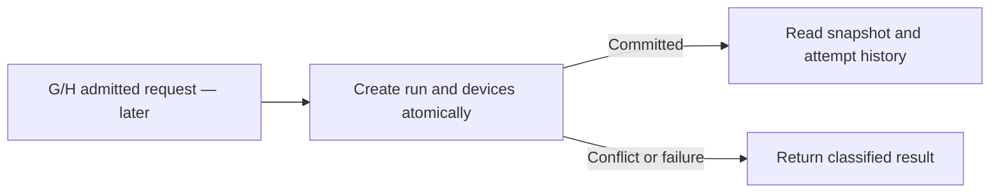

# D2 — Execution repository

## Overview

Runtime needs one authoritative view of admitted work and the latest
checkpoint. D2 provides transaction-aware persistence for later execution.



**Status:** Implemented in the Runtime SQLite store. Depends on D1.

- Admit a validated request by creating its group and devices in a single
  write transaction, including the A6 admission events through D3. Resolve a
  repeated request ID before the active-run conflict. Return the existing
  group for an admitted ID and never create a duplicate. A new ID during an
  active run returns the agreed busy error.
- Reads provide the active run, a known run with devices and derived counts,
  and per-device history ordered by attempt sequence with the A7 page limit.
  Read snapshots and their event watermark within one read transaction.
- Expose context-aware operations and a shared transaction boundary for D3,
  D4, and D6. Conditional writes check expected state. Roll back on
  cancellation or failure before commit. Keep device commands and event
  delivery outside database transactions.
- Persist selected serials, execution position, safe errors, and validated
  output. Workflow inputs and protected Runtime IR stay in process memory.
  Keep storage errors and SQL details out of client responses.

**Acceptance:** Concurrent admissions preserve the active-run invariant.
A repeated request cannot create new work. Failed writes leave no partial
records. History paging and snapshot reads remain stable under concurrent
checkpoint writes. The later API maps missing and busy results to A7.

## 1. Responsibility and inputs

D2 is the internal repository for A5 records. It supplies the transaction
boundary used by D3, D4, and D6. A7 translates its results into HTTP. G1 and
device preflight determine whether a new request is eligible. The repository
receives already validated IDs, selected serials, and initial node IDs.
It never interprets a workflow or runs ADB.

| Operation | Input | Result |
|---|---|---|
| Find admitted request | Normalized A7 request ID | Existing run ID or missing |
| Admit validated work | Request ID, run ID, selected devices, entry node, timestamp | Created or already admitted run, busy, or storage failure |
| Read active run | Read context | Current active snapshot or missing |
| Read known run | RunGroup ID | Snapshot with related devices and derived counts |
| List attempts | DeviceExecution ID, sequence boundary, limit | Ordered history and continuation when applicable |
| Open transaction | Context plus purpose | A transaction-scoped repository and event appender |

Use immutable record identifiers rather than database row identifiers in
caller contracts. Keep read results detached from the database transaction.
No repository call returns an open iterator to a client.

### Internal interface

Use A5 records and A7 projections. Return classified results for expected
outcomes and errors for storage, cancellation, or unknown commit results.

```text
LookupRequest(ctx, requestID) -> RunGroupID | Missing, error
Admit(ctx, Admission) -> Created(RunGroupID) | Existing(RunGroupID) | Busy, error
ActiveSnapshot(ctx) -> Snapshot | Missing, error
SnapshotByID(ctx, runGroupID) -> Snapshot | Missing, error
Attempts(ctx, deviceExecutionID, afterSequence, limit) -> AttemptPage | Missing, error
WithWriteTx(ctx, callback(Tx)) -> error

Admission   = {requestID, runGroupID, now, devices[]}
Device      = {deviceExecutionID, adbSerial, entryNodeID}
Snapshot    = {cursor, runGroup, orderedDeviceExecutions, derivedSummary}
AttemptPage = {attempts, nextAfterSequence}
```

Device list order supplies the admission ordinal. `Admit` owns its
transaction. A D4/D6 `Tx` exposes reads, conditional writes, and D3
append, with commit owned by `WithWriteTx`. Snapshot and history have
their own bounded read transactions. A known device with no attempts
returns an empty page. An unknown device returns Missing. Attempt paging
uses `sequence > afterSequence` and fetches at most `limit + 1` rows.

## Device-capacity revision — implemented; H2 owns configuration removal

Admission requires a non-empty unique selection, without a fixed device-count
ceiling. Snapshots read every stored member in admission order; neither a
retired constant nor current concurrency is a query LIMIT or record-validity
bound. Lowering concurrency cannot truncate or reject an older larger group.
Keep paginated attempt-history limits separate from group membership.
Admission/state/event changes remain atomic. Process larger event sets in
bounded append batches within one transaction, never partial admission commits.
Large-group reads/writes remain context-aware and byte/operation bounded.

## 2. Admission and idempotency

1. A7 validates enough of the request envelope to identify the request ID.
   If a run is already admitted for it, return that run's current snapshot.
   Do not re-admit or reinterpret replacement workflow content.
2. For a new request, G1 and device preflight run before the transaction.
   An invalid workflow or device leaves no durable state.
3. In the write transaction recheck the request ID first, then check for an
   active run. The unique request index and active-run index are the
   final concurrency guard.
4. Insert the RunGroup as RUNNING and one QUEUED DeviceExecution for each
   selected serial. Assign the entry node as each initial position. Append
   the corresponding A6 events using the same transaction.
5. Commit once. Return the created identity and allow the scheduler to
   consume only committed work. A lost response leaves a replayable ID.

| Concurrent condition | Required outcome |
|---|---|
| Two valid requests share an ID | One new group. Both can obtain the same group identity. |
| Different IDs contend for the active slot | One admits. The other receives busy unless the first is already terminal at its check. |
| A known terminal run is retried while another is active | Return the known terminal run. |
| A child insert or event append fails | Roll back parent, children, and events together. |
| Client disconnects after commit | The committed run and request ID remain authoritative. |

D2 returns a distinction between created and existing so the HTTP layer
can apply A7's response status and so the scheduler never enqueues twice.

In the [shared fixture](../phases/phase_d.md#shared-run-and-restart-fixture),
drop the initial HTTP 201 after admission commits. Retry the same ID
with a different body. Expect HTTP 200 with the existing group's current
snapshot, one group, one device, and exactly one admission event batch.

## 3. Snapshots and history

Read the group, its devices, derived counts, and D3 watermark in one read
transaction. Order devices by admission ordinal and then ID, since their
creation timestamps may be equal. Returning a
snapshot that combines old state with a newer watermark would skip the event
needed to reconcile the two. Returning old state and its matching older
watermark is safe because the client can replay later changes.

Use A7 attempt history pagination and order by sequence. Fetch a bounded
number of rows and return the next sequence boundary when another page is
available. Output belongs to a successful attempt. Preserve the distinction
between empty output, absent output, and error. Terminal status and its
timestamp travel together.

For example, a device has a completed attempt at sequence 1 and a RUNNING
attempt at sequence 2. A request with `afterSequence=1` returns sequence 2
when it is visible in the read transaction. After the group finishes,
the known-run read still returns its snapshot and attempt history even
though the active-run read may return not found.

An active read that races with completion can return a valid older view or
a later missing result. A read by known run ID still returns terminal state
subject to the retained history policy. Derived counts must use the same
snapshot as the device rows.

## 4. Transaction ownership and mutation rules

Use one serialized write path. The outer use case owns the transaction.
D3 writes events through that transaction. D4 writes state and events
through it. D6 may use batched statements inside its recovery transaction.
Repository helpers participating in an existing transaction cannot start a
second independent write transaction or commit on their own.

Check state and ownership before mutation. Use conditional updates that
include the expected status or attempt identity, and verify affected row
counts. A zero-row update must be classified before advancing the engine.
A successful state transition changes the record once. Preserve A5's
terminal-state immutability.

An API cancellation can cancel an uncommitted admission, but a node
checkpoint needs the execution/supervisor lifetime appropriate to its
operation. Phase G defines the attempt context. A completion checkpoint
must have a bounded opportunity to record a cancelled or timed-out attempt
even after that attempt context is cancelled. Never allow cancellation
handling to bypass the commit-before-dispatch rule.

## 5. Error and exposure contract

| Repository result | Consumer behavior |
|---|---|
| Missing | Map to the appropriate A7 resource-not-found response where exposed |
| Already admitted | Return existing snapshot and avoid scheduling again |
| Active run conflict | Map to the A6/A7 busy result |
| Stale expected state | Reject transition. Re-read durable state before acting |
| Cancellation before commit | Roll back and surface cancellation to the owning use case |
| Storage error or unknown commit result | Suppress SQL details. Reconcile by request or attempt identity before retrying |

Persist the selected serial only in its owning device record. A7 controls
which read projections expose it. Keep authorization material, workflow
inputs, protected IR, and raw process output out of the repository. Logs
may identify the operation and safe execution identifiers.

## 6. Efficiency and implementation mapping

Use D1 indexes for request lookup, active-run lookup, and attempt history.
Batch admission device inserts or keep all inserts inside the same bounded
transaction. Avoid a database round trip per device during snapshot
construction. Keep all reads bounded by the admitted device count or the
A7 attempt page size.

| Package | Responsibility |
|---|---|
| `internal/execution` | Storage-independent records, results, and repository interface |
| `internal/platform/sqlitestore` | D1 store lifecycle, platform locking, and migrations |
| `internal/repositories` | Concrete D2 admission and history queries, adapter transactions, and repository tests |

The adapter implements the execution interface. The SQL-facing transaction
stays on the adapter side for persistence collaboration in D3/D4/D6.
Future execution and transport consumers use the execution interface.

Runtime validates input shape, workflow policy, output schemas, and
lifecycle decisions in memory. Pure admission validation runs before
opening the write transaction. The repository still checks the existing
request ID before rejecting replacement input. Keep database checks that
depend on committed state in the transaction, including request identity,
the active-run slot, and expected-state updates. Keep uniqueness and
foreign keys as storage integrity guards. The existing migration keeps
its current checks. Any removal of redundant SQLite checks belongs in a
separately reviewed schema change.

## 7. Verification and checkout

| Test | Expected observation |
|---|---|
| Repeated ID, different body | Same run and no extra children or admission events |
| New ID rejected by preflight | No rows created |
| Child/event insertion failure | No visible group or child rows |
| Two admission transactions | Unique request and active-run rules hold |
| Snapshot during commit | State and watermark come from one view |
| Paged attempts with concurrent append | Stable sequence boundary with no repeated history |
| Stale lifecycle update | No record mutation and no event append |
| Context cancelled during a write | Rollback or a reconciled already-committed result |

D2 accepts after file-backed repository tests. Run API wiring and device
scheduling remain later integration work.

### Implementation evidence

The store implements request lookup, admission, active and known snapshots,
attempt history, and a shared write transaction. Admission uses the D1
event tables to commit its initial A6 event batch and watermark. D3 will
provide the shared event repository, retention, and replay. File-backed
tests cover request replay, concurrent admission, event-write rollback,
device ordering, keyset pagination, stale conditional writes, and rollback
after cancellation. G and H still supply admitted work and drive execution.
