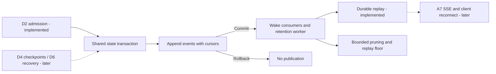

# D3 — Execution event repository

## Overview

Clients can disconnect during a run. D3 gives them a committed sequence of
events and a way to recover when older events have expired.

**Status:** Implemented. Shares D2 transactions and the supervised D1 store.
File-backed SQLite and simulated publisher tests cover the D3 repository and
retention lifecycle. A7 SSE transport and actual client reconnect remain later
integration work.

- Allocate cursors inside the SQLite write transaction. Cursor values
  increase across restarts and retention and are exposed as opaque decimal
  strings. Keep a durable last-committed watermark even when all event rows
  have been pruned.
- Append only the A6 event types and sanitized payloads. Page by cursor in
  ascending order. A wakeup or live notification only signals committed
  data. The durable query remains the replay authority.
- Prune only a contiguous oldest prefix. In the prune transaction advance
  the durable replay floor to the highest removed cursor. A request below
  the floor expires. A request at the floor can replay later rows. Keep one
  bounded retention policy and test it with small limits.
- A7 owns SSE transport, heartbeat, authentication, and slow-client
  handling. Subscribe and read with a handoff that cannot lose a commit
  between replay and live delivery. A snapshot watermark supports recovery
  when the cursor expires.

**Acceptance:** Rollback publishes nothing. Cursor order survives restart
and pruning. Tests cover multiple commits, expiry at the floor boundary,
fully pruned history, and a write between snapshot and replay.

## 1. Responsibilities

D3 owns append, ordered replay, cursor state, and pruning. It serves the
D2/D4/D6 write paths and the later A7 SSE publisher. It does not own
socket lifetimes, heartbeat timing, authorization, or operational logs.

| Operation | Contract |
|---|---|
| Append | Accept a validated A6 event batch and an existing write transaction. Assign cursors and return their ordered identities. |
| Watermark | Return the highest committed cursor visible in the caller's snapshot. An empty store starts at zero internally. |
| Replay page | Return events strictly after a cursor in ascending order, subject to a bounded limit. |
| Replay floor | Return the highest cursor removed by retention, initially zero. |
| Prune | Delete a bounded prefix and advance the replay floor in the same transaction. |
| Notify | Signal that a committed event may be available. A signal carries no authoritative payload. |

## 2. Event content and ownership

The existing A6 event types cover run status, device status, node attempts,
and retry scheduling. Keep the event envelope and size limits from A6.
A record can reference its run, device execution, and attempt where the
event type allows them. Validate that these references agree with the
same ownership chain used by the committed state.

Attempt-start and completion events follow D4. Admission events follow D2.
Recovery events follow D6. Producers derive payloads from the states they
actually write and append them in an explicitly ordered batch. Event
consumers must use the cursor, rather than comparing timestamps or assuming
that two updates committed in timestamp order.

Internal variable writes and selected Switch ports do not add new public
event types in the first slice. A later projection requires explicit
review. Never expose variable values, workflow inputs, protected IR,
raw process output, filesystem paths, or stack traces as event data.

## 3. Cursor semantics

Use a positive SQLite-compatible integer internally and encode it as a
decimal string at the A6 boundary. Never compare cursor strings
lexicographically. Cursor allocation and event insertion occur in the
same serialized write transaction. An uncommitted cursor cannot be observed
by a reader. A committed cursor is never reused after pruning or restart.

Maintain the latest committed cursor independently of retained event rows.
On append, advance it in the transaction. A rollback leaves that watermark
unchanged. Cursors are strictly increasing and consumers must tolerate gaps.
When the numeric range is exhausted, reject the write and surface a
persistence failure rather than wrap.

Example: events 1 through 8 committed and retention removed 1 through 4.
The replay floor is 4 and the latest committed watermark is 8.

| Requested cursor | Result |
|---|---|
| 3 | Expired, even if no retained row happens to refer to the same run |
| 4 | Replay retained events 5 through 8 |
| 6 | Replay 7 and 8 |
| 8 | Wait for a later commit |
| Greater than 8 | Return FutureCursor. A7 responds with HTTP 400 and `INVALID_REQUEST`. |

Reject malformed, negative, and overflowing cursors before querying.
Use the A7 invalid-request path for malformed values. Explicit cursors
are positive decimal strings. Zero is an internal sentinel only. When no events
remain, the floor and watermark still distinguish expired from current.

## 4. Replay, live handoff, and snapshot recovery

A7 can implement the initial stream using the table as its source for
both replay and live delivery:

1. Authenticate and parse the cursor.
2. Register for commit wakeups before the first replay query. For an
   omitted cursor, capture the connection-time watermark and start there.
3. Read the floor and one bounded page from the same database view.
4. Write each event in ascending order and advance the connection cursor
   only after a successful send.
5. Drain additional pages immediately. Once caught up, requery on wakeup
   or after a 1-second fallback timer. Release read transactions before
   waiting or writing to the network.
6. If the client is too slow, follow A7's disconnection policy. If its
   cursor expires after streaming begins, close the stream. On reconnect
   the normal expiry response directs it to a fresh snapshot.

For a client that receives the expiry response before stream start, D2
returns the run snapshot and watermark from one read transaction. The
client resubscribes after that watermark. A commit between the snapshot
and the subscription will then appear in the durable query.

The notification layer is an implementation detail. The protocol does
not assume one signal per event or delivery of each signal to each
consumer. A stream can recover from a missed wakeup because its last
cursor and the database are authoritative.

## 5. Retention and backpressure

Prune a contiguous prefix in bounded transactions. Advancing the floor
and removing rows in separate commits can falsely report missing data as
available. Retain the latest 10,000 committed events, with a replay page
limit of 100 and a prune batch limit of 512. Run pruning at startup and
after event commits through a coalesced maintenance signal. Yield between
batches. Retention is an asynchronous target and may be temporarily
exceeded while maintenance catches up. Test with smaller injected limits.

Run pruning outside node checkpoints. Pruning never changes run state,
attempt history, or the request ID index. Never block a checkpoint on
subscriber delivery. Use a bounded signal, bounded query pages, and
A7 write deadlines. Defer separate subscriber tables and per-device cursors.

## 6. Failure behavior and implementation mapping

| Failure | Behavior |
|---|---|
| Event payload rejected | Abort the enclosing state write and emit no notification |
| Append or cursor-state update fails | Roll back event and state changes together |
| Commit succeeds and process exits before notifying | Recover the committed event by replay after reconnect |
| Prune fails | Keep the old floor and retained rows, then report a bounded operational error |
| Reader sees an expired cursor | Return the expiry result or terminate an already-started stream as above |

Use an internal event repository that shares the SQLite transaction handle
with its caller. Keep cursor parsing and the HTTP stream adapter outside
the repository. Use B4 logging for failure summaries and metrics without
payload dumps.

## 7. Verification and checkout

| Test | Required evidence |
|---|---|
| Concurrent append callers | Ordered unique committed cursors and valid state ownership |
| Rollback after event insert | No visible row, no advanced watermark, no wakeup |
| Reopen with pruned rows | Monotonic allocation and retained replay floor |
| Cursor on either side of floor | Correct replay and expiry decisions |
| Prune all rows | Correct latest watermark and acceptance at the floor |
| Write between snapshot and subscription | Event is replayed after the snapshot cursor |
| Write between empty replay and wait | Wakeup or durable recheck delivers the event |
| Slow or disconnected client | Checkpoints continue and reconnect resumes from last cursor |

D3 checkout requires repository-level tests with real SQLite and a
simulated publisher. A7 SSE endpoint and real Studio/Launcher reconnect
remain integration work.

## 8. Implemented package mapping and caller contract

| Location | Responsibility |
|---|---|
| Runtime `internal/execution/events.go` | Event envelope, pending event input, replay page, storage-independent reader and retention interfaces, and explicit cursor parsing. |
| Runtime `internal/execution/event_validation.go` | In-memory A6 type, correlation, payload, error shape, and event-size validation. |
| Runtime `internal/repositories/execution_events.go` | Append using the existing write transaction, batched ownership checks, durable watermark, and consistent replay pages. |
| Runtime `internal/repositories/execution_event_retention.go` | One bounded prefix deletion and atomic replay-floor advancement. |
| Runtime `internal/repositories/execution_transaction.go` | Publish wakeups only after a successful commit containing appended events. |
| Runtime `internal/services/event_retention.go` | Supervised asynchronous startup and post-commit pruning, cancellation, and sanitized failure logging. |
| Runtime `pkg/constants/execution.go` and `pkg/x-error/execution.go` | Shared limits, event names, and expired/future-cursor errors. |

`Tx.AppendEvents` accepts at most 100 pending events per batch. The caller
must return an append error from its enclosing `WithWriteTx` callback so that
state, events, and cursor changes roll back together. Event shape checks run
in memory. One batched SQL insert checks that the run/device/attempt references
belong to the same ownership chain; there are no per-event database queries.
The enclosing admission, checkpoint, or recovery service owns state-transition
rules, node-output validation, retry-policy agreement, and error sanitization.
Payloads are derived from the state that service writes. Size validation
reserves the widest SQLite cursor when checking the 16 KiB envelope ceiling.

`ReplayEvents` accepts an internal numeric cursor and a page limit of 0–100;
zero selects the default page size of 100. It returns the visible floor and
watermark with the page and a `More` flag. `EventWatermark` supports the initial
connection-time watermark for an omitted API cursor. Explicit API cursor
parsing rejects zero, signs, whitespace, non-decimal values, and overflow.
An empty replay page has an empty array, rather than null.

`EventWakeup` returns a broadcast channel closed by a committed append. A
consumer obtains that channel **before** reading each replay page. After it
observes a closed channel, it obtains a new one before querying again. Signals
can coalesce and carry no event data. The A7 adapter must still recheck the
durable query on its 1-second fallback timer and release its read transaction
before network writes or waits. There is no subscriber registration table or
per-subscriber buffer to retain after disconnection.

The retention service starts after SQLite and before HTTP, and stops before
SQLite closes. It schedules a startup pass and consumes a coalesced maintenance
signal after event commits. Each transaction removes at most 512 rows; the
worker yields between full batches. A failed pass logs a fixed operational
summary and waits for the next commit signal instead of spinning. Producers
never wait for pruning or subscriber delivery.

The D3 tests exercise the four event types, unknown and oversized payloads,
ownership mismatch, rollback, cursor overflow, concurrent commits, multiple
subscribers, snapshot/replay handoff, empty-page/wakeup handoff, replay-floor
boundaries, full pruning and reopen, atomic prune failure, startup backlog,
and retention shutdown. HTTP expiry responses, heartbeat timing, fallback
timer integration, write deadlines, and real slow-client disconnection are
verified with the later A7 transport implementation.
