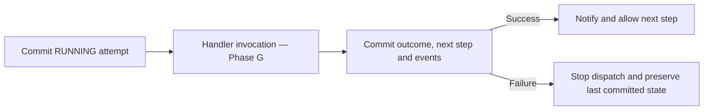

# D4 — Atomic checkpoint writer

## Overview

A client must never see a node result that disagrees with the next
execution position. D4 saves the result, state, and events together.

**Status:** Implemented for the A5 execution state contract. File-backed
SQLite tests exercise D2 transactions and D3 event publication with a
simulated handler. Phase G supplies actual handlers and execution decisions.

1. Commit the RUNNING attempt and applicable events before the handler can
   dispatch. Execute the handler outside the write transaction.
2. The caller supplies the classified outcome and chosen next position.
   Verify ownership and expected state. In one transaction finalize the
   attempt, persist validated output or a safe error, update device and
   affected group state, and append the A6 events. Retry attempts get new
   records. A stale or repeated completion must not append duplicate events.
3. Only after commit can a caller advance execution or notify clients.
   If a checkpoint cannot be confirmed after a possible device side effect,
   stop further dispatch and reconcile from durable state. Keep the RUNNING
   attempt for D6 when completion cannot be recovered.

For the first linear run, implement the existing A5 checkpoint. Before
enabling Set Variable, extend the accepted state contract to define private
Flow keys per device, Global keys per RunGroup, lifetime, value limits, and
sensitive-data policy. Commit a successful assignment with the attempt
result. Notify Phase H waiters after commit. Before enabling Switch,
persist the selected port with the checkpoint, including when two ports
point to the same target. Keep these internal state additions out of
public payloads until the projection is specified.

**Acceptance:** Inject a failure after each write and verify whole-transaction
rollback. Simulate a side effect followed by failed persistence and verify
that no further command or automatic retry runs. Later extension tests
must verify variable visibility and distinct routes to the same target.

## 1. Responsibility and dependencies

D4 controls the durable boundaries around a node attempt. It consumes
D2 transaction operations and D3 event append. G supplies the execution
decision and attempt outcome. F supplies validated handler results through
G. D4 never invokes a handler or resolves a binding.

| Operation | Inputs | Outcome |
|---|---|---|
| Begin attempt | DeviceExecution ID, expected current node and state, attempt identity, timestamp | Committed RUNNING attempt or classified rejection |
| Finish attempt | Attempt identity, outcome, output or safe error, expected state, next position, retry decision | Committed terminal attempt and corresponding state/events |
| Observe commit | Committed identities and cursor | Signal observers and allow the scheduler to continue |
| Reconcile | Run and attempt identities | Determine durable outcome following an uncertain commit |

Use `BeginAttempt(ctx, request)` and `FinishAttempt(ctx, request)`.
Both return a disposition and the committed cursor when available.
Dispositions are Committed, AlreadyFinalized (finish only), and Stale.
Storage failure or unresolved commit returns a persistence error.
Only a newly committed start authorizes dispatch. AlreadyFinalized
never authorizes a second advance or notification.

## 2. Start boundary

1. Read the group and device inside the transaction. Require group
   RUNNING, device QUEUED or RUNNING, matching next node, and no active
   attempt. Require attempt number 1 for a first invocation. A retry
   supplies the previous attempt ID. It must match the latest failed
   or timed-out attempt at that node with a retryable A6 error and
   request number +1 within the admitted limit. G supplies the retry
   decision and timing. Replay retention does not affect retry eligibility.
2. Allocate the next per-device attempt sequence. Insert the RUNNING
   attempt with the requested attempt number and timestamp. Use D1
   constraints to stop a duplicate or concurrent attempt.
3. Move a QUEUED device to RUNNING and set its start time if absent.
   Append that device event first, then the attempt-start event.
   For an already RUNNING device append only the attempt-start event.
4. Commit. Only a confirmed committed start grants the caller permission
   to dispatch the handler.

If start fails, invoke no handler. If the commit result is uncertain, read
durable state and stop dispatch unless the engine can establish that the
committed start belongs to this invocation and has never been dispatched.
Do not adopt an arbitrary preexisting RUNNING attempt.

## 3. Completion boundary

The completion caller supplies the result from the actual attempt and the
next-node decision. Give the final checkpoint up to 5 seconds, bounded
by the supervisor shutdown deadline if active. This persistence context
outlives a cancelled or timed-out handler context.

1. Match attempt, device, run, and node identities. The attempt must
   be RUNNING and the latest sequence on that device. The device must
   be RUNNING at that node and the group RUNNING. A matching already
   terminal attempt returns AlreadyFinalized. Any other mismatch is Stale.
2. Validate result invariants. Successful output is present and conforms
   to its approved contract. Failures contain safe A6 errors as required.
   Cancellation has no error payload where A6 specifies none.
3. Finalize the attempt and update the device's next node and state.
   Update the RunGroup only if the authoritative aggregate state changes.
4. Append events in this order: terminal attempt, retry scheduled if
   applicable, device state if status or next position changed, and
   group state if status changed. Derive payloads from the writes.
5. Commit once, then notify observers and release the next step.

| Outcome | Durable position and result |
|---|---|
| Success with successor | Successful attempt, validated output, successor as next position |
| Success at workflow end | Successful attempt and terminal device state with null next position |
| Eligible retry | Terminal failed/timed-out attempt, same next node, retry event as applicable. A later invocation creates a new attempt. |
| Failure routed to error successor | Terminal failed/timed-out attempt with safe error, error successor as next position |
| Failure with no allowed successor | Terminal device state and null next position |
| Cancellation | Cancelled attempt/device where applicable and no further dispatch |
| Duplicate or stale completion | Existing durable result remains intact. No repeated mutation, event, or scheduling |

### Completion fixtures

Each variant starts at the shared fixture's event 7. Use a fixed clock
and the same transaction timestamp for attempt finish and emitted events.

| Variant | Rows after commit | Events |
|---|---|---|
| Retryable failure | A2 FAILED with a safe retryable error. D RUNNING at tap_01. G RUNNING. | 8 attempt FAILED, 9 retry scheduled for attempt number 2 with the admitted delay |
| Routed failure | A2 FAILED. D RUNNING at the configured error successor. G RUNNING. | 8 attempt FAILED, 9 device RUNNING at error successor |
| Unrouted failure | A2, D, and G FAILED. D next node null. | 8 attempt FAILED, 9 device FAILED with null next node and safe error, 10 group FAILED |
| Group cancellation with only D active | A2, D, and G CANCELLED. D next node null. | 8 attempt CANCELLED without error, 9 device CANCELLED with null next node, 10 group CANCELLED |
| Stale completion | A2 RUNNING and D at tap_01. Supply a mismatched identity. | No events, cursor remains 7 |

The retry fixture uses a command start failure before dispatch. The next
begin creates a new attempt ID and sequence with attempt number 2. The
routed failure fixture adds an admitted error successor before event 7.
Phase H owns cancellation arbitration. D4 owns its atomic write.

Phase G determines retry eligibility and the selected route. D4 enforces
one completion and the persistence boundary. It cannot make a device
action transactional with SQLite.

## 4. Crash and failure matrix

| Cut point | Durable view | Required next behavior |
|---|---|---|
| Before start commits | No RUNNING attempt | No command was allowed |
| After start, before handler dispatch | RUNNING | D6 interrupts after process loss. Runtime cannot prove from the row alone that no command ran. |
| After dispatch, before completion commit | RUNNING or previous committed state | Stop further dispatch on persistence failure. Preserve evidence and never auto-replay the uncertain command. |
| During completion writes | Entire transaction commits or rolls back | Reconcile by attempt ID before any continuation |
| After completion commits, before notifying | Completed attempt and events | Replay recovers visibility. A notification failure does not change the attempt result. |
| After notification | Same committed state | Client can verify against snapshot and replay |

For an ambiguous commit, first read the durable attempt, execution position,
and cursor. If committed, return that result without a second transition.
For this slice, issue one read-back within the checkpoint deadline.
If it does not confirm the completion, stop run dispatch and report
a fatal persistence error to B3. Shut down the agent and let D6
interrupt unfinished work on next startup. Do not automatically retry
a completion write or rerun the handler.

## 5. Extensions for executable variables and Switch

The first checkout implements the accepted A5 checkpoint. The later
contract change must define the following before enabling these nodes.

| Extension | Required persistence decision |
|---|---|
| Flow | Keyed by DeviceExecution and case-sensitive variable name. Isolate other devices. Define terminal cleanup and safe value types and bounds. |
| Global | Keyed by RunGroup and name. Create or replace within the same successful attempt transaction. Define lifetime, restart handling, and sensitive-data policy. |
| Switch | Record the chosen source port as well as the next node so two rules with one destination remain distinguishable. |
| Wait | Record terminal outcome through the same attempt lifecycle. Phase H wakes waiters only after commit. |

The planned Global guarantee is last committed write wins. A Switch and
a following Set Variable are separate checkpoints. A failed write leaves
the old value in place. Notify waiters after commit and keep scheduling
outside the transaction. A failed or cancelled Set attempt does not apply
its value.

The A5 extension must decide whether and how variable values can be stored
safely if they originate in protected inputs. Public snapshots and events
remain limited to their approved projections. Do not add provisional
tables or emit value-bearing events before settling these rules.

## Device-capacity revision — implemented; H2 owns configuration removal

Sibling-state queries and group aggregation must cover all admitted members,
without a fixed device maximum or LIMIT derived from current concurrency.
A large group and an older group created under different settings remain valid.
Use every relevant persisted device state when deriving the final group result.
Cancellation/recovery event sets may span bounded append batches within their
single state/event transaction. Retain commit-before-publication, expected-row
checks and deadlines; no early subset commit or side-effect replay is allowed.

## 6. Efficiency and implementation mapping

Use one internal checkpoint service with two explicit operations, begin
and finish. Both open bounded write transactions through D2 and pass the
same transaction to D3. Keep SQL in repositories and assemble state/event
batches in one place. No database transaction spans ADB, file writes,
network I/O, subscriber delivery, or wait scheduling.

Record sanitized execution identifiers and failure categories through B4.
Keep raw inputs and command output out of SQL errors and logs.

## 7. Verification and acceptance

| Test | Required result |
|---|---|
| Failure after each state/event write | Previous state remains intact and subscribers receive nothing |
| Duplicate finish | One terminal row transition and one matching event batch |
| Stale attempt or wrong device | Rejected without modifying any other execution |
| Start cancelled before commit | Handler is not dispatched |
| Handler timed out | Bounded completion persists timeout even though attempt context expired |
| Side effect then storage failure | No next dispatch or automatic command replay |
| Commit succeeded before notifier failure | Snapshot and replay agree on the result |
| Later variable and route extensions | Atomic visibility, cross-device isolation, rollback of writes, and distinction between ports sharing a target |

Checkout requires real SQLite with a simulated handler and fault
injection. Actual gesture semantics and Studio monitoring are separate
integration gates.

## 8. Implemented boundary

| Runtime location | Responsibility |
|---|---|
| `internal/execution/checkpoint.go` | Requests, committed dispositions, and the checkpoint repository interface. |
| `internal/services/checkpoint*.go` | Expected-state checks, retry and aggregate rules, event assembly, deadlines, and one durable read-back after an uncertain commit. |
| `internal/repositories/execution_checkpoint.go` | Reads and conditional writes on the D2 transaction, plus a consistent attempt, position, and watermark view for read-back. |
| `internal/supervisor/supervisor.go` | Receives fatal checkpoint errors and shuts down through B3. |

Both operations use the existing SQLite tables. Begin is bounded by its
caller context and a five-second cap. Finish has its own five-second cap
and uses the earlier shutdown deadline when the scheduler supplies one.
That deadline covers the write and the single read-back. The service
serializes checkpoint calls through read-back so a duplicate invocation
cannot supply the durable state used to confirm an uncertain commit. This
guard covers persistence only. A handler can run independently on each
admitted device after its start commits.

The returned cursor is the last event of a newly committed checkpoint.
`AlreadyFinalized` returns the attempt sequence and grants no second
continuation. A failed finish write or unresolved commit stops checkpoint
dispatch and reports a fatal error to the supervisor. A positively
reconciled commit wakes D3 observers without rewriting events.

The SQLite tests cover the 13-event Start–Tap–End fixture, retry after
pruning, group aggregation, routed failure, cancellation, handler timeout,
and a shorter shutdown deadline. Fault injection covers attempt, device,
group, event, and watermark writes. Tests simulate both durable outcomes
of an uncertain commit and verify that an unresolved finish cannot grant
another dispatch.
