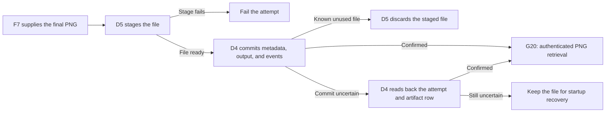

# D5 — Screenshot artifact store

## Overview

D5 keeps a screenshot available after its workflow finishes. F7 supplies the
full-screen or cropped PNG. D5 stages the file beside the execution database.
D4 records its metadata, the successful attempt, and the attempt's events in
one SQLite transaction. A7 can then open the PNG by its artifact ID.

**Status** — Core storage is implemented and Linux-verified. The existing
artifact migration/repository, PNG file service, D4 atomic publication/read-back,
and startup reconciliation are implemented. G19 now connects F7 to real
workflow execution and verifies modes, metadata, rollback/read-back, and
stop/crash recovery using real PNGs, SQLite, and controlled ADB output.
Windows cross-compilation passes; native Windows and remaining live-device
acceptance are unverified. G20 now implements authenticated HTTP retrieval;
real HTTP and built-agent checks verify exact bytes, missing files, integrity
errors, cancellation, and historical downloads without ADB.
See [G19 execution](../g_workflow_engine/g19_screenshot_execution.md),
[D1 storage](d1_sqlite_schema.md), and [D4 checkpoints](d4_atomic_checkpoint.md).

## 1. Ownership and handoff

| Owner | Responsibility |
|---|---|
| F7 | Supply the final bounded PNG and call the attempt-scoped staging callback. For a region, supply only the cropped PNG. |
| G | Bind the callback to the active Screenshot attempt. Keep the stage record in that attempt's scope and submit it to D4 on success. Track it until D4 and D5 settle the outcome, including cancellation after staging. |
| D5 | Validate and stage the image, own the file and metadata, open committed content by ID, and clean up confirmed orphans. |
| D4 | Check the attempt identity and state, commit the record with the attempt outcome, and confirm an uncertain commit using persisted evidence. |
| A7 | Authenticate the download request and stream the opened file. |

F7's callback returns a provisional ID. It delegates to D5 with the trusted
attempt identity from G and retains the complete stage record on G's side.
The stage record contains metadata only. D4 receives it as an internal
optional part of the finish request. G supplies the effective node type
from the admitted workflow alongside the attempt reference. Require the
stage record for a successful Screenshot attempt and verify that its output
contains exactly the matching `artifactId`. Reject a mismatched attempt or
artifact ID. Successful
non-Screenshot attempts and failed, cancelled, timed-out, or interrupted
attempts carry no artifact record. G retains any file already staged by an
unsuccessful attempt until cleanup can be settled.

## 2. Storage and metadata

Use `<D1 resolved state directory>/artifacts`, beside `execution.sqlite3`.
Use the same canonical state directory and exclusive D1 lock for the database
and the artifact root. An independent artifact directory override is deferred
for this MVP. The test fixture may supply an isolated state directory and
file-backed database together. Runtime owns the directory and file
permissions. Workflow and API requests cannot supply any part of a path.

Add a forward Goose migration for a strict `artifacts` table.

| Field | Rule |
|---|---|
| Artifact ID | Runtime-generated canonical lowercase UUIDv4. Primary key and opaque to clients. |
| Attempt ID | Required unique foreign key to `node_attempts.id`, with restricted deletion. One row per successful Screenshot attempt. |
| File key | Exact filename `<artifactId>.png`. Validate it against the ID before opening. Never expose it to clients. |
| Media type | Fixed `image/png`. |
| Byte length | Actual encoded file length in bytes. |
| Width and height | Verified dimensions of the stored image. |
| Digest | Lowercase SHA-256 hex of the stored bytes. |
| Creation time | UTC Unix milliseconds recorded during staging. |

Use `.stage-<artifactId>.tmp` for the temporary file. Create it exclusively
inside the artifact root. A temporary or final filename collision fails
staging and preserves the existing entry. Cleanup may remove only files
created by the failed operation or confirmed unreferenced during recovery.

## 3. Validation and publication

1. Accept the final PNG from the attempt-scoped callback. Check the context
   and the encoded byte length before decoding. The byte limit is **16 MiB**.
   The capture path in F7 uses the same byte limit.
2. Check the PNG header for positive dimensions of at most **4,096** per axis
   and at most **12,000,000** pixels total. Decode the bounded image to reject
   malformed or truncated content. The metadata records the dimensions
   of the supplied image, including a crop.
3. Write the exact bytes to a restricted temp file and compute their SHA-256
   digest. Check the write, sync, and close results. Publish the final name
   within the same directory and fail if the destination exists.
4. Return the stage record only after the filesystem publication steps
   succeed. If staging fails after creating a file, attempt best-effort cleanup.
   Leave an unremoved file to startup recovery. Sanitized staging I/O failures
   use `PERSISTENCE_FAILED`. Input image failures follow the F7 command error
   rules.

### Publish on supported hosts

| Host | Publication procedure |
|---|---|
| Linux | Use `renameat2` with `RENAME_NOREPLACE` relative to the verified artifact directory. Sync the directory after publication. When creating the artifact directory, sync its parent as well. [renameat2](https://man7.org/linux/man-pages/man2/renameat2.2.html) · [fsync](https://man7.org/linux/man-pages/man2/fsync.2.html) |
| Windows | Flush the temp file, then use a same-directory `MoveFileExW` move with `MOVEFILE_WRITE_THROUGH`. Leave the replace and cross-volume copy flags unset. Reject reparse points in the artifact root or target. Verify the move and restart behavior on the Windows filesystem used for release. [MoveFileExW](https://learn.microsoft.com/en-us/windows/win32/api/winbase/nf-winbase-movefileexw) · [FlushFileBuffers](https://learn.microsoft.com/en-us/windows/win32/api/fileapi/nf-fileapi-flushfilebuffers) |

A failed sync or unsupported publication operation fails staging. A separate
existence check followed by an overwrite-capable rename is insufficient.
Test durability across abrupt Runtime termination on both native hosts.
Any stronger host power-loss guarantee requires separate native evidence.

## 4. Commit and settle the staged file

D4 checks the current attempt and binds the stage record to that attempt.
Insert the artifact metadata in the existing finish transaction alongside
the successful attempt output, state changes, and A6 events. Perform PNG
validation, writes, and flushes before opening the transaction. Publish the
output or signal committed events only after commit is confirmed.

Extend D4's uncertain-commit read-back to verify the artifact row in the same
SQLite read snapshot as the attempt and event watermark. Compare the attempt
identity and terminal result, its output ID, and the staged metadata against
the committed row. A row alone, or matching attempt output without a
matching artifact row, is insufficient evidence of success.

| Outcome | File handling and observable result |
|---|---|
| Commit confirmed, including matching read-back | Keep the file. G may expose the ID and A7 may open it. Use D4's existing recovered-commit notification. |
| Confirmed rollback, cancellation before publication, or stale finish | Publish no new reference. D5 discards the stage after D4 establishes that the staged ID has no committed row. If absence cannot be confirmed, defer cleanup to startup. |
| Duplicate of a finalized attempt | Keep the original result. Preserve a stage that matches its committed artifact. If the duplicate supplied another staged ID, remove only that file after confirming its ID has no committed row. |
| Commit uncertain and read-back cannot confirm it | Keep the staged file and follow D4's existing fatal checkpoint behavior. G publishes no successful result. Reconcile on the next startup. |

Run discard outside the write transaction. A discard must be idempotent if the
file is already absent. Audit only operation, reason, and safe outcome.
Keep image bytes, local paths, and raw filesystem errors out of the public
failure and execution-event payloads.

## 5. Open by ID

A7 accepts the opaque artifact ID and authorizes the session before resolving
it. A syntactically invalid ID returns `400 INVALID_REQUEST`. A valid ID
with a missing row or missing file returns `404 RESOURCE_NOT_FOUND`.
A read or integrity failure such as an unsafe file type or length mismatch
returns a sanitized `500 PERSISTENCE_FAILED` and an operational error.

Look up the row by ID and close the SQLite read before streaming. Require
the canonical stored file key to match the ID. Open only a regular,
non-link file under the verified artifact directory. Check the opened
handle's attributes and byte length, then stream from that same handle.
The platform open must prevent following a symlink or reparse-point target
during lookup. Do not reopen a checked path.

Return `Content-Type: image/png`, the recorded content length, and
`Cache-Control: no-store`. Close the handle on completion or cancellation.
Per-download rehashing is deferred. See the
[A7 artifact route](../contracts/local_api_v1.md#11-artifact-retrieval).

## 6. Startup recovery and retention

With the D1 lock held, run reconciliation after migrations and D6 execution
recovery, before HTTP readiness. Use the same verified root as staging and
retrieval. No screenshot writer runs during this scan.

- Read the committed artifact IDs from SQLite as a set before any deletion.
  If the read fails, stop reconciliation and fail startup through B3. An
  incomplete read cannot establish that a file is orphaned.
- Scan only the dedicated directory. Recognize canonical D5 temp and final
  names and remove only regular non-link entries. Remove stale temp files
  and final files whose IDs are absent from the committed set. Preserve
  referenced files, unknown entries, and unsafe entries.
- Log a bounded diagnostic for skipped unsafe entries or failed deletions.
  A failed deletion allows readiness and is retried at the next startup.
- Preserve attempt history when a committed file is missing. Retrieval returns
  not found. Recovery does not recreate a screenshot or rerun the attempt.

The MVP keeps committed artifacts alongside their run records and handles
disk-full failures when staging. Proactive capacity checks, automatic
retention, listing, upload, export, and remote sync are deferred.

## 7. Implementation and acceptance

| Deliverable | Expected evidence |
|---|---|
| Goose migration and metadata repository | Upgrade an existing D1 database. Enforce one row per attempt. Commit metadata, outcome, and events together. |
| Internal file store | Stage and open a valid PNG. Reject oversized, malformed, or truncated content and excessive dimensions. A destination collision preserves the original bytes. |
| Platform filesystem code | Reject an unsafe root or substituted file. Simulate sync or publication failure. Run native Linux and Windows tests for collision and abrupt Runtime termination. |
| D4 publication and cleanup | Test mismatched records, rollback, duplicate and stale finishes, matching uncertain commit, and read-back failure. A second stage cannot delete or replace the committed image. |
| D6 startup integration | Restart with a stale temp file, orphan, committed screenshot, and unknown file. Remove only the stale and orphaned entries. Simulate metadata-read failure and verify that no files are deleted. |
| A7 and F7 integration | Exercise authenticated PNG retrieval, missing files, and stored-length mismatch. Capture a full frame and a crop from a real device and retrieve the expected bytes. |

Use synthetic PNGs and file-backed SQLite for D5 implementation tests.
The [F7 spec](../f_device_commands/f7_screenshot.md) owns real capture, and
A7 owns the authenticated route. Their combined verification is the
end-to-end Screenshot acceptance gate.
