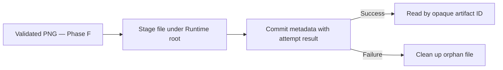

# D5 — Screenshot artifact store

## Overview

Runtime needs to preserve a screenshot for later inspection and expose it
through a stable artifact ID. Store PNG bytes on disk and metadata in SQLite.

**Status:** Proposed. Depends on D1 and D4. Phase F supplies the real capture.

- Accept bounded PNG content and verify format, byte size, and dimensions
  before publication. Use the same limits at the screenshot capture boundary.
  Allocate a Runtime-owned ID and filename. Use a temporary file and rename
  within the same controlled filesystem. Verify durability for supported
  hosts before committing a successful screenshot result.
- D4 commits metadata together with the successful attempt's
  `artifactId` reference. A filesystem write and SQLite commit have separate
  failure boundaries. A failed commit can leave an orphan file. Attempt
  cleanup and reconcile stale files under the controlled root at startup.
- Retrieve by ID through metadata and open only the controlled file.
  A missing row or file maps to the A7 not-found response. Protect against
  path traversal and symlink substitution. Keep filenames and paths out of
  client payloads and workflow input.
- Keep PNG storage and lookup only. Use the same capacity policy as D1.
  Schedule D5 with Screenshot rather than delaying the first non-capture run.

**Acceptance:** Round-trip a PNG, reject invalid and oversized inputs, and
simulate write, rename, and commit failures. Verify orphan cleanup, missing
content behavior, and rejection of unsafe paths. Real-device capture and
authenticated artifact retrieval are separate integration gates.

## 1. Responsibility and boundary

D5 owns controlled PNG storage, metadata, and open-by-ID. Phase F obtains
bytes from the selected device and Phase G owns handler invocation. D4
publishes a screenshot reference with the successful attempt. A7 owns the
authenticated retrieval endpoint.

| Input | Output |
|---|---|
| Attempt identity and bounded screenshot bytes | Staged file and verified metadata, or safe failure |
| Validated stage record inside D4 | Metadata associated with the successful attempt |
| Opaque artifact ID from A7 | Controlled read handle and content length, or not found |
| Startup inventory and committed metadata | Reconciled orphan files within the artifact root |

The Publisher workflow cannot pick the filename, extension, destination,
root, or retrieval path. Screenshot returns the approved `artifactId`
field and leaves the image bytes outside workflow JSON.

## 2. File and metadata model

| Field | Owner and rule |
|---|---|
| Artifact ID | Runtime-generated opaque identifier. Unique in the store. |
| Attempt ID | Foreign key to the producing NodeAttempt. One screenshot artifact per successful Screenshot attempt. |
| File key | Runtime-controlled relative key, derived from the artifact identity. Never exposed publicly. |
| Media type | Fixed PNG media type for this slice. |
| Byte length | Measured bounded count from the validated file. |
| Width and height | Verified image dimensions. Use these to reject disproportionate decode cost. |
| Digest | Lowercase SHA-256 hex of stored bytes. Compute during staging. Per-download rehashing is deferred. |
| Creation time | Runtime timestamp tied to the producing attempt. |

Use a dedicated per-user artifact root and a fixed naming convention.
Store the temp file under the same root and filesystem as the final file
so publish-by-rename is supported. Creation must never overwrite an
existing artifact. Preserve the prior artifact if an ID collides.

## 3. Validation and publication

1. Validate that the request is tied to the active Screenshot attempt.
   Apply the agreed capture byte limit before allocating or writing large
   buffers. Stop reading once the limit is exceeded.
2. Limit encoded bytes to 16 MiB, each dimension to 4,096 pixels, and
   total pixels to 12,000,000. Check dimensions before full decode.
   Reject malformed or truncated images after bounded decode. Phase F
   applies the same encoded-byte limit during capture.
3. Write a fresh restricted temp file, record its verified size and
   digest, sync it, and close it. Publish the final name using the
   supported host's same-filesystem rename and durability procedure.
4. Pass metadata to D4. D4 commits the metadata and successful
   NodeAttempt output together, with the corresponding A6 events.
5. On confirmed rollback, remove the unreferenced file if safe. On an
   ambiguous commit, reconcile metadata by ID before deleting anything.
   If cleanup cannot finish, leave the file for startup reconciliation.

File staging happens before the SQLite transaction. The design prevents
a successful result from referencing an artifact whose file staging
already failed. It cannot make file and database writes one atomic
operation. A file may remain after an interrupted commit. The next
startup reconciles that case.

## 4. Retrieval contract

Resolve the artifact by opaque ID and open only the associated controlled
file. Do not trust an absolute path or traversal sequence in metadata.
Guard against symlink or equivalent filesystem substitution. Read the
opened file through the same handle used to verify its attributes.
Use a regular file and a verified content length. A missing row or file
returns the A7 resource-not-found result. Storage or integrity failures
are sanitized and recorded separately in operational logs.

A7 authorizes the request and returns binary PNG with the agreed
content type, length, and cache policy. Do not expose file keys, directory
paths, or host filenames. Close the handle when streaming finishes or is
cancelled. Long-running client downloads cannot hold a SQLite transaction.

## 5. Recovery and retention

Run cleanup only while holding D1's exclusive store ownership.
Scan only the dedicated root and recognize names produced by D5.
Retain unknown files and log a bounded warning. Remove known stale
temporary files and final files with no committed metadata. If database
metadata cannot be read reliably, stop cleanup. Never infer absence
from a failed query. On metadata read failure, fail startup through B3.
A failed file removal emits one bounded warning and allows readiness.
Retry cleanup on the next startup. Preserve unknown files.

If a committed row points to missing content, preserve the attempt
history and return not found for retrieval. Do not silently recreate a
screenshot or replay the producing action. Keep the run and artifact
records together until a later retention policy defines removal.

The first slice handles disk-full outcomes at write time. A proactive
capacity guard is deferred with D1.
No automatic image conversion, general media store, upload, listing,
export, or remote sync belongs to this slice.

## 6. Failure matrix and implementation mapping

| Failure point | Expected durable effect |
|---|---|
| Oversized, invalid, or truncated PNG | No published file or artifact row |
| Temp write or final rename fails | No successful screenshot attempt with this reference |
| File published and process dies before commit | No committed artifact row. Startup cleans the orphan. |
| D4 returns ambiguous commit result | File remains until database evidence establishes whether it is referenced |
| Crash after successful commit | Metadata and file remain retrievable under the supported durability policy |
| File missing on read | A7 not found. Durable attempt history remains. |

Implement a small internal store with stage, open, and reconcile operations.
Keep the metadata repository transaction-aware. Phase F owns the capture
source and size limit for the ADB subprocess. D5 applies its own boundary
to the bytes it receives. Use an injected temporary root in tests and
file-backed SQLite for publication tests.

## 7. Verification and acceptance

| Test | Evidence |
|---|---|
| Valid PNG staging and commit | Metadata, reference, and file bytes agree |
| Wrong format, oversized, corrupted, and huge dimensions | Rejected before successful publication |
| Directory traversal or substituted symlink | No file outside the controlled root is opened |
| Failed rename or failed commit | No exposed success reference. Cleanup respects commit evidence. |
| Reopen after orphan creation | Owned orphan removed. Known referenced and unknown files preserved. |
| Concurrent open and shutdown | Handle closes and no transaction stays open |
| Real Screenshot through Studio | Valid PNG is retrievable via authenticated A7 artifact route |

Repository and filesystem tests establish D5 component readiness.
Actual ADB capture and client retrieval establish Screenshot acceptance.
