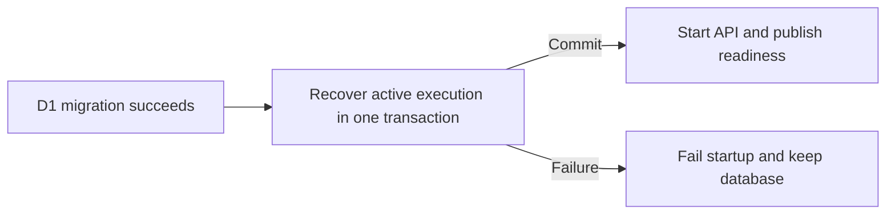

# D6 — Startup recovery

## Overview

A device command may have run before the agent stopped. Recovery preserves
durable progress and makes unfinished work visibly interrupted.

**Status:** Implemented. Runs synchronously after D1 and before retention,
HTTP startup, or connection publication. Depends on D2–D4.

- Run recovery before accepting run requests or publishing the connection
  handoff. In one transaction, mark non-terminal groups and their non-terminal
  devices `INTERRUPTED`. Finalize only RUNNING attempts as `INTERRUPTED`.
  Use one recovery timestamp, clear next positions on interrupted devices,
  attach the safe A6 `EXECUTION_INTERRUPTED` error to interrupted attempts
  and applicable device records, and append matching
  A6 events through D3.
- Preserve terminal records, committed outputs, and request identities.
  Never re-dispatch an interrupted attempt. The user can start a distinct
  run with a new request ID when admission allows it.
- Recovery is idempotent. A failure rolls back all recovery writes and
  prevents readiness. D5 may reconcile filesystem artifacts separately.
  Later variable support follows its approved retention policy and does
  not restore workers or waiters from interrupted runs.

**Acceptance:** Reopen a database containing active, paused, and terminal
work. Verify exactly one transition per affected record, replayable
interruption events, and no second set of events on another restart.
Simulate a failed recovery transaction and verify that startup stays closed.

## 1. Responsibility

D6 runs after D1 opens and migrates an exclusively owned store. It repairs
lifecycle visibility before B3 publishes readiness. Recovery consumes A5
state rules and appends A6 events through D3. Phase G and H own live
execution and scheduling.

A recovery transition records interruption. A RUNNING attempt is evidence
that dispatch was permitted before process loss. The row alone cannot
establish whether the Android operation completed, failed, or never began.

## 2. Startup sequence

1. Acquire the store lock and open the database through D1.
2. Apply migrations and verify the schema.
3. Run one recovery transaction before any API or worker accepts run work.
4. If D5 is installed, run its controlled artifact reconciliation. Keep its
   failure policy separate from lifecycle recovery.
5. Start the API and publish the connection handoff through B3.
6. Allow admissions after readiness. A new run must have a new request ID
   if the client intends to run again.

Recovery must not overlap a live writer from a different Runtime process.
Exclusive store ownership is a prerequisite, not a retry strategy.
If recovery fails, close the storage component under the supervisor's
shutdown policy and release ownership. Preserve the database for diagnosis.

## 3. Transition matrix

| Record before restart | Recovery result |
|---|---|
| Group RUNNING or PAUSED | Mark INTERRUPTED and set finish time |
| Device QUEUED, RUNNING, or PAUSED in that group | Mark INTERRUPTED, clear next node, set finish time, retain start time if it exists |
| RUNNING attempt under affected execution | Mark INTERRUPTED, set finish time, attach safe A6 interruption error, leave output absent |
| Terminal attempt, device, or group | Preserve status, output, and timestamps |
| Prior committed event, cursor, or request ID | Preserve identity and history subject to D3 retention |
| No affected records | Commit no recovery transitions or events |

A run with one completed device and one active device becomes interrupted
as a group. The completed device still reports its original outcome.
A queued or paused device may have no RUNNING attempt. Record its own
interruption and do not fabricate an attempt.

An impossible ownership or lifecycle combination is a storage integrity
failure. Use a classified startup error and preserve evidence. A broad
repair routine that overwrites contradictory terminal history is outside
the first slice.

## 4. Transaction and ordering

Take one UTC recovery timestamp. Read the affected groups, devices,
and attempts through the same write transaction. Finalize affected attempts,
then devices, then groups, using conditional transitions from allowed
states. Append the matching events in a deterministic order. Sort within
each level by stable stored identifiers so the same inputs have a
predictable order. A6 cursors record that order.

Commit the updates and event batch together. The first client snapshot
after restart includes the new watermark. A client that reconnects using
its earlier cursor can see the interruption events, or recover from
expiry through a snapshot. No SSE client needs to be present at recovery
time for the events to exist.

If a write or event append fails, roll back the complete recovery.
If the commit result cannot be established, fail startup. Reopening can
rerun recovery safely because terminal state is preserved and the
transaction either committed as a whole or rolled back.

## 5. Interaction with later phases

- **G:** Treat interruption as terminal. Do not automatically dispatch a
  previous attempt. The current retry policy applies to a live run only.
- **H:** Pause and cancellation state are not reconstructed as live
  workers. Later Global waiters are process-local scheduling state.
- **D5:** Missing or orphaned artifact files follow the artifact
  contract. Artifact cleanup cannot turn a failed or interrupted attempt
  into a successful one.
- **Variables and Switch:** Preserve only data covered by the eventual
  state contract and retention policy. Recovery never reapplies a
  variable assignment or recomputes a branch.
- **Studio and Launcher:** Expose an interrupted status through the
  authenticated read projection. Keep user-facing error text safe and
  stable. A repeated admitted request ID returns the previous run
  according to A7.

## 6. Diagnostics and efficiency

Log one bounded recovery summary through B4 after commit, including counts
of transitioned records. Record failures by category and safe component
context. Avoid per-row success logs and payload dumps. Use set-based reads
and writes where possible and maintain stable ordering for emitted events.
Because D1 enforces a single active group and A7 bounds device count,
scope the transaction to unfinished work. Avoid scanning terminal history.

The supervisor starts `execution_recovery` immediately after
`execution_store`. The service uses D2 conditional state operations and D3
event append through one transaction. The standalone `make migrate-up`
command opens and verifies the schema without running startup recovery.

## 7. Verification and acceptance

Use the [shared Tap crash fixture](../phases/phase_d.md#shared-run-and-restart-fixture)
for running work. Add a second fixture with one PAUSED group containing a
PAUSED device and a previously SUCCEEDED device. The paused device has
no RUNNING attempt. Recovery appends exactly two events in order,
device INTERRUPTED with a null next node and group INTERRUPTED. The
successful device and its attempts remain unchanged. For a QUEUED
device in a RUNNING group with no attempts, assert the same two event
kinds and keep its start time null. Each fixture must be a separate
database so the single-active-group invariant still holds.

| Scenario | Observable result |
|---|---|
| Clean store | No changes or recovery events |
| Queued, running, and paused devices | Affected records transition once, with no fabricated attempts |
| Mixed terminal and active work | Terminal history stays byte-for-byte equivalent in its projection |
| Inject failure after a state write or event append | No partial recovery and no readiness publication |
| Restart twice | First recovery commits. Second recovery creates no duplicate events. |
| Another agent owns the store | No mutation, recovery, or replacement connection file |
| Interrupted command in later integrated run | Client sees INTERRUPTED and the fake or real device records no automatic second dispatch |

D6 checkout requires a file-backed reopen test and startup lifecycle
verification. The real command and client reconnect scenario belongs to
the integrated run gate.

### Implementation evidence

The repository reads the active group's devices and uses the partial index
for `RUNNING` attempts. It checks that those attempts belong to an affected
device and match its current node and latest sequence. Conditional bulk
updates and the ordered event batch share one transaction. If the host clock
moved backward, the recovery timestamp is raised to the latest applicable
creation or start time to preserve timestamp ordering.

File-backed tests cover clean startup, queued and paused work, preservation
of completed history, a restart with Tap in flight, repeated restarts, and
rejection of inconsistent running attempts. The composed-agent test injects
an event append failure and verifies rollback, lock release, and failure
before HTTP or the connection handoff.
