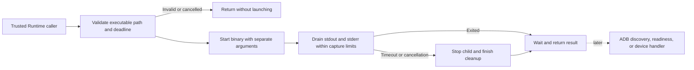

# E1 — Safe process runner

## Overview

E1 gives Runtime one internal way to invoke a trusted local executable and
collect a bounded result. E2 will supply the selected ADB executable. E3 and
E4 will use the runner for discovery and readiness. Phase F will use it for
typed device commands. E1 can be verified with a test executable before ADB
or a device is available.

**Status:** Implemented and verified on Linux. The Runtime and E1 test binary
cross-build for Windows. Native Windows verification remains pending.

## 1. Scope and ownership

| Owner | Responsibility |
|---|---|
| E1 runner | Spawn one process, manage its lifetime, collect bounded output, and return a classified result. |
| E2–E4 ADB adapter | Resolve the ADB path, choose fixed arguments, set discovery or readiness budgets, parse text output, and map errors to the device contract. |
| F dispatcher | Build ADB arguments from typed commands and attach the selected serial. |
| G/H execution | Decide if an operation can be retried, commit the outcome, and manage workflow cancellation. |

The runner is an internal Go adapter. It has no HTTP route or SQLite writes.
A process exit code describes the local invocation. For example, a zero exit
code for a device input command does not establish that an Android app
completed the user's business operation.

## 2. Invocation contract

| Input | Required behavior |
|---|---|
| Caller context | Propagate cancellation and any earlier deadline. A cancelled context at entry starts no process. |
| Executable | An explicit absolute path supplied by trusted Runtime code. Pass it directly to the OS process API. A relative path or bare name fails request validation. Resolution and version checks belong to E2. |
| Arguments | An ordered list of distinct arguments. Preserve empty strings, spaces, and Unicode. Use the platform process API and its argument quoting, without shell interpretation. |
| Timeout | A positive duration supplied by the caller. The effective execution deadline is the earlier of this timeout and the caller's deadline. A missing or nonpositive duration fails request validation. |

E1 provides no workflow-controlled executable, raw command string, custom
environment, working directory, or stdin. The child uses the Runtime
environment and working directory. Managed Runtime ownership pipes and local
API credentials must not be inherited by tool subprocesses. Keep executable
and argument construction inside Runtime, including any later commands that
ADB asks Android to run. See [A4](../contracts/typed_device_command_v1.md).

## 3. Result contract

| Field | Meaning |
|---|---|
| Outcome | Success, nonzero exit, start failure, timeout, cancellation, or runner failure. An invalid request is reported separately before launch. |
| Exit code | The OS exit code when one is available. Absence is distinct from exit code zero. |
| Stdout and stderr | Separate raw byte buffers, each capped independently. Partial output can be returned after a nonzero exit, timeout, or cancellation. |
| Truncation | A flag per stream. A stream that exceeds its cap retains its leading bytes and is marked truncated. |
| Duration | Elapsed monotonic time from the start attempt through collection and cleanup. |

Callers distinguish outcomes by type or code. They do not infer success from
stderr, nor use a truncated response as complete discovery data. Classification
as `ADB_UNAVAILABLE` or another A6 error belongs to the calling adapter.
E1 never retries a process. Keep raw stdout, stderr, and arguments out of
routine logs, API errors, workflow outputs, and persisted execution records.
Operational diagnostics may record the outcome, exit code, elapsed duration,
and truncation flags using B4 conventions.

## 4. Execution, cancellation, and cleanup

1. Validate the request and check the effective context before spawning.
2. Drain stdout and stderr concurrently. Use bounded capture writers that
   continue accepting and discarding excess bytes so an output limit does not
   block or terminate the child. Keep bytes opaque, including binary output.
3. Wait for the started child exactly once. A completed process returns its
   observed exit outcome. While a process is still running, a deadline returns
   timeout and explicit context cancellation returns cancellation.
4. On cancellation or timeout, stop the child and bound the time spent
   waiting for exit and closing the output streams. Inherited output handles
   in descendants must not make the runner wait indefinitely. A cleanup
   failure is surfaced and must not become a successful invocation.

E1 manages the process it starts. ADB may use a separate long-lived host
server. Cancelling an ADB client must not issue `adb kill-server` or stop
unrelated processes. Stopping the local client also does not establish
whether a device command already reached Android.

**E1 defaults:** retain up to 64 KiB per stream for ordinary
commands and allow up to one second for cleanup beyond the execution deadline.
Use shared constants and test both limits. A later screenshot path may need
a separate bounded binary sink. It should establish that contract with F7/D5
rather than raising the capture limit for every command.

## 5. Implementation mapping

Place the process adapter under `internal/platform/processrunner`. Use Go's
standard process APIs for explicit binary launch, context cancellation, and
bounded waits. Keep any platform-specific process handling in the adapter.
E1 can be exercised directly. Wire it into the composed agent when an ADB
consumer needs it. Behaviour and result classification should agree on Linux
and Windows. Run the helper tests with
`go test ./internal/platform/processrunner` from the Runtime checkout.

## 6. Acceptance checks

| Scenario | Expected result |
|---|---|
| Successful invocation | Exit code zero, correct separate streams, duration recorded. |
| Nonzero exit | Exact exit code and bounded diagnostic bytes. |
| Executable path containing spaces and separate literal arguments | Helper receives every argument as supplied, including a blank argument and shell metacharacters. |
| Relative, missing, or invalid executable | Invalid input or classified start failure, with no successful result. |
| Already cancelled context | Helper never starts. |
| Caller deadline earlier than runner timeout | Caller deadline governs the invocation. |
| Running child times out or caller cancels | Correct classification, child stopped, and bounded cleanup. |
| Both streams exceed the cap | Child finishes, capture is bounded, and both truncation flags are set. Also check that output exactly at the cap is not truncated. |
| Descendant retains an output handle | Collection returns within the cleanup budget with a classified failure if output cannot be fully collected. |
| Supported hosts | Run helper-process checks on Linux and native Windows. A Windows cross-build verifies compilation only. |

The E1 checkout requires no real device. The Phase E gate later exercises
discovery and readiness on a physical Android device and an ADB-visible
emulator.
