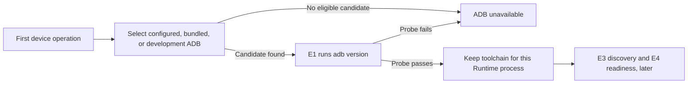

# E2 — ADB toolchain resolver

## Overview

E2 selects and verifies the host ADB executable that Runtime will use. A
packaged installation finds ADB beside the installed Runtime executable.
Developers can point Runtime at a local Platform Tools installation or
explicitly allow a `PATH` search. E2 gives later device operations one
verified absolute path, independent of the directory from which Studio or
Launcher started Runtime.



**Status:** Implemented. Resolver and configuration tests run on Linux. Native
Windows verification and smoke tests with packaged Platform Tools remain pending.

## 1. Scope and ownership

| Owner | Responsibility |
|---|---|
| E2 | Read Runtime's ADB settings, resolve the host executable, validate it using E1, and retain the successful selection for this process. |
| E1 | Launch the chosen executable with explicit arguments, timeouts, cancellation, and bounded output. |
| Runtime packaging | Place the correct host build of Platform Tools and its required companion files in the agreed installation layout. |
| E3–E7 and Phase F | Use the selected executable for device operations and translate failures at the device or API boundary. |

E2 makes no device, SQLite, or Local API changes. It does not discover or
connect devices, install Platform Tools, download binaries, or manage the
ADB server. The [A1 resolution policy](../phases/phase_a.md#a1--contract-decision-register)
sets the source order.

## 2. Runtime configuration

E2 adds two optional settings through the existing Runtime configuration
loader. Use the established environment-over-YAML precedence. These are local
operator settings. Studio and Launcher supply neither the executable path
nor its arguments through a Local API request.

| YAML key | Environment variable | Default and validation |
|---|---|---|
| `adb.executable_path` | `A2MATEX_RUNTIME_ADB_EXECUTABLE_PATH` | Empty means no override. A supplied value must be an absolute file path. On Windows it must name an `.exe`. |
| `adb.allow_path_fallback` | `A2MATEX_RUNTIME_ADB_ALLOW_PATH_FALLBACK` | `false`. Developers explicitly enable it when using Platform Tools from `PATH`. |

```yaml
adb:
  executable_path: 'C:\Android\platform-tools\adb.exe'
  allow_path_fallback: false
```

Run the focused checks with `go test ./internal/config ./internal/platform/adb`
from the Runtime checkout.

On Linux, an example override is `/opt/android/platform-tools/adb`.
Configuration loading checks the setting types and path syntax. Filesystem
and process checks take place when a device operation first needs ADB. Use
the path as a file path directly. Shell expansion, executable arguments
inside the setting, and resolution relative to the working directory are
outside this contract.

## 3. Candidate selection

| Priority | Source | Selection and failure behavior |
|---|---|---|
| 1 | Explicit override | Use the configured file. A missing, inaccessible, or incompatible override fails resolution. |
| 2 | Runtime bundle | Resolve the installed Runtime executable location, including symlinks, and look in `platform-tools` beside that executable. A missing bundled executable allows the development fallback if enabled. A present but unusable bundle fails resolution. |
| 3 | Development `PATH` | Search absolute `PATH` directories in order, using the platform's exact executable name. Skip empty and relative entries so a launch directory cannot silently supply ADB. Use the first matching candidate and validate it. |
| — | No candidate | Return an unavailable toolchain result. |

Once a source supplies a candidate, validate that candidate and surface its
failure. The resolver must not switch to a different installation because a
probe fails. Resolve the selected path to an absolute regular file before
launching it. For the bundled source, the resolved ADB file must stay within
the resolved Runtime installation's `platform-tools` directory. A failure
to determine the installed Runtime location is a resolver failure when the
bundle needs to be checked.

### Installed layout

| Host | Bundle path relative to the Runtime executable |
|---|---|
| Linux | `platform-tools/adb` with executable permissions |
| Windows | `platform-tools\adb.exe` with matching companion DLLs beside it, including `AdbWinApi.dll` and `AdbWinUsbApi.dll` for the packaging layout discussed for E2 |

The release package must match the supported host OS and CPU architecture.
Packaging verifies the companion files against the Platform Tools build it
ships. E2 launches the executable in place and uses the version probe to
detect unusable installations. The exact Platform Tools release and
distribution terms are packaging decisions.

## 4. Version probe and process lifetime

1. Resolve the candidate and call E1 with its absolute path and the single
   argument `version`. Use a default probe timeout of three seconds, subject
   to an earlier caller deadline and the E1 cleanup budget.
2. Require a successful process exit and untruncated stdout containing an
   `Android Debug Bridge version` line followed by a dotted numeric version
   such as `1.0.41`. Accept LF and CRLF output and allow additional version
   lines. Keep the parsed version for internal diagnostics. E2 does not set a
   minimum version floor with this probe. Device and command prerequisites
   are checked in the corresponding phases.
3. Publish the absolute executable path, selected source, and parsed version
   together only after verification. Reuse the same immutable selection
   until Runtime exits. Configuration and installation changes take effect
   on the next Runtime process.
4. Concurrent first-use calls share one resolution attempt. The initiating
   call supplies the probe context. Waiting callers can cancel their own wait
   independently. A failed or cancelled attempt publishes no toolchain, and
   callers still waiting receive that outcome. The next explicit device operation may retry resolution within
   its own budget. If a verified executable later fails or disappears, report
   the operation failure and require a restart to select another executable.

Resolution is deferred until the first ADB-dependent operation. Health,
Runtime Info, workflow validation, and compilation remain usable before ADB
is installed. The `version` probe verifies the host executable. E4 determines
whether a particular device is ready.

## 5. Failure and diagnostics

| Condition | Result |
|---|---|
| Missing tool, invalid candidate, failed launch, nonzero exit, malformed or truncated version output | Return a classified resolver failure. Later ADB-dependent APIs map it to `ADB_UNAVAILABLE`. |
| Probe's own timeout or E1 cleanup failure | Return a classified resolver failure within the E1 time budget. |
| Caller cancellation or earlier caller deadline | Stop waiting or probing and propagate the caller's context outcome. |
| Discovery succeeds with no devices | E3 reports a successful empty discovery. E2 has already verified the toolchain. |

Safe operational logs may include the selected source, parsed version, and
failure category. Keep raw output, environment values, and host paths out of
API responses and routine logs. A successful probe creates no new
`runtime-info` field or API capability.

## 6. Implementation mapping and acceptance

Place the resolver beside E1 under `internal/platform/adb`. Keep configuration
parsing in `internal/config` and use the E1 runner for the version probe.
Keep path selection and probe validation independently testable with a
temporary installation and a controlled process result. Wire the resolver
into the composed device subsystem when its first consumer is added.

| Check | Expected observation |
|---|---|
| Override and bundle both exist | The override is probed. A broken override never starts the bundle. |
| Bundled installation is launched from a different working directory | The resolver finds the executable beside Runtime. Test both host names and a Windows path with spaces. |
| Bundle is absent and fallback is disabled | Resolution fails even when ADB exists on `PATH`. |
| Fallback is enabled | An absolute `PATH` entry can supply ADB. Empty and relative entries cannot. A broken bundled executable surfaces its own failure. |
| Candidate is a directory or escapes the bundled directory through a link | Resolution fails before the version probe. |
| Probe returns successful LF or CRLF output | The toolchain is cached and reused. Concurrent first use invokes one probe. |
| Probe fails, times out, or produces invalid output | No toolchain is cached. A subsequent request can succeed after a repair. |
| Runtime starts without ADB | Health and authoring APIs still work. The first ADB-dependent operation surfaces the toolchain failure. |
| Packaged Linux and native Windows smoke test | Run the actual bundled `adb version` from another working directory. Hardware is unnecessary for E2. |

The E2 checkout uses no attached Android device. ADB discovery and real
device readiness are verified under E3 and E4.
