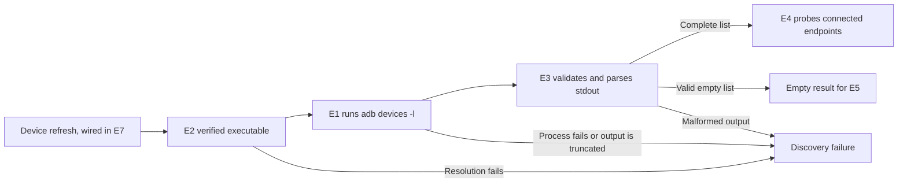

# E3 — ADB device discovery

## Overview

E3 runs `adb devices -l` once through E1 using the executable verified by
E2. It turns the response into a fresh list of opaque serials and ADB
connection states. A connected endpoint is eligible for E4 readiness checks.
The result can represent a successful empty list or a failed discovery.



**Status:** Implemented and verified on Linux using a controlled executable.
The test binary cross-builds for Windows. Native Windows verification is pending.

## 1. Responsibility and invocation

Expose an internal discovery operation that accepts a caller context and
returns a list of discovered endpoints or a classified error. Keep the
parser pure so it can be tested directly from captured output.

1. Ask E2 for the verified toolchain. Propagate caller cancellation or
   deadline while resolving.
2. Run its absolute executable through E1 with exactly two arguments,
   `devices` and `-l`. Use a five-second command timeout, subject to any
   earlier caller deadline and the E1 cleanup budget. E2's first-use version
   probe has its own budget under the same caller context.
3. Require E1 success, exit code zero, and untruncated stdout. Parse stdout
   only. Successful ADB invocations may write daemon notices to stderr.
4. Return the parsed result as one unit. One operation performs one
   discovery invocation. Retry and refresh scheduling belong to callers.

E3 discovers all transports with the same command on Linux and Windows.
ADB can start or contact its host daemon as part of the command. E3 does not
start, restart, or kill the daemon separately.

## 2. Parse the output

A typical response is:

```text
List of devices attached
R58M000000A    unauthorized  usb:1-2 transport_id:1
emulator-5554  device        product:sdk_gphone model:sdk_gphone transport_id:2
192.0.2.10:5555 offline      transport_id:3
```

- Accept UTF-8 with LF or CRLF line endings and an optional final newline.
  Skip blank lines. The first nonblank stdout line must be
  `List of devices attached`, allowing surrounding horizontal whitespace.
  Header-only output represents zero endpoints. Bare empty stdout, a second
  header, or unexpected text before the header fails discovery.
- Each row starts with a nonempty serial token, then spaces or tabs and a
  nonempty state. Preserve the serial exactly, including case, colons, or
  IPv6 punctuation. Reject invalid UTF-8, control characters in a serial,
  and repeated serials. Rows are matched by serial, never by model or
  transport ID.
- The state starts at the next token. State tokens use ASCII letters, digits,
  hyphens, or underscores. The ADB phrase `no permissions` maps to Other
  unavailable. Ignore the remaining descriptive text. A missing state or a metadata token such as `model:Pixel` in the
  state position is a malformed row.
- A syntactically valid unfamiliar state is unavailable. Keep the serial so
  the user can see the endpoint. Discard metadata such as product, model,
  device name, USB path, and transport ID. Discovery never infers what kind
  of device a serial represents.
- A malformed row fails the entire result. Do not publish a partial list.
  Sort the successful result lexically by serial for deterministic use by
  E4 and E5.

## 3. Result and readiness boundary

Each internal endpoint contains `adbSerial` and one normalized connection
state. Later phases translate connection state to the A7 inventory response.

| ADB state | E3 state | Downstream handling |
|---|---|---|
| `device` | Connected | E4 probes boot and readiness before exposing `READY`. |
| `offline` | Offline | Expose `UNAVAILABLE` with `DEVICE_OFFLINE`. |
| `unauthorized` | Unauthorized | Expose `UNAVAILABLE` with `DEVICE_UNAUTHORIZED`. |
| `no permissions`, `bootloader`, `recovery`, or other valid state | Other unavailable | Expose `UNAVAILABLE` with `DEVICE_NOT_READY`. |

E3 never returns `READY`. E5 owns the in-memory snapshot and E7 owns the
authenticated HTTP response. A3 permits discovery from the currently selected
ADB installation only. E3 does not persist a Device record, reconnect an
endpoint, or determine whether another tool is using it.

## 4. Failure and diagnostic behavior

| Condition | E3 result |
|---|---|
| Caller cancels or its deadline expires during resolution or execution | Propagate the caller context error. |
| E2 cannot resolve ADB, E1 fails or times out, or stdout exceeds E1's capture cap | Discovery failure. Later API wiring maps it to `ADB_UNAVAILABLE`. |
| Missing header, malformed row, or duplicate serial | Discovery failure, with no partial endpoint list. |
| Valid header with no rows | Success with zero endpoints. |

A failed call never masquerades as a successful empty snapshot. E5 can
therefore keep the previous snapshot on refresh failure. Log only a safe
failure category and optional process timings or counts. Keep serials, raw
stdout and stderr, and reported metadata out of logs and API error messages.

## 5. Implementation and acceptance

Place the discovery adapter and parser in `internal/platform/adb` alongside
E2. Reuse `Resolver.Resolve` and the E1 runner. Keep parsing bounded by E1's
stdout cap, with one pass over rows and one sort. Wire discovery into the
application when an inventory consumer is available.

| Check | Expected result |
|---|---|
| Header-only LF and CRLF responses | Successful empty result. |
| Mixed connected, offline, unauthorized, and other states | Sorted endpoints with exact serials and normalized states. Long-list metadata is discarded. |
| Wi-Fi serial, tabs and spaces, and missing final newline | Serial is preserved and row parses. |
| Linux permissions message | Endpoint remains visible and unavailable. |
| Invalid UTF-8, absent or repeated header, missing state, or duplicate serial | Entire discovery fails. |
| Nonzero exit, command timeout, or truncated stdout with valid-looking rows | Failure with no partial list. Benign stderr on success does not affect parsing. |
| Resolution and execution via a controlled tool | E3 uses the E2 executable and exact arguments, and propagates caller cancellation. |
| Linux and Windows | Run the same parser fixtures and exercise the process handoff on both hosts. |

Run `go test ./internal/platform/adb` from the Runtime checkout to verify
E3 with controlled output and the Linux helper executable. The Phase E
gate later exercises discovery and readiness together on a physical device
and an ADB-visible emulator.

Related contracts: [A3 selection](../phases/phase_a.md#a3--session-device-selection-rules),
[A6 errors](../contracts/event_error_v1.md), and
[A7 inventory](../contracts/local_api_v1.md#7-session-device-inventory).
