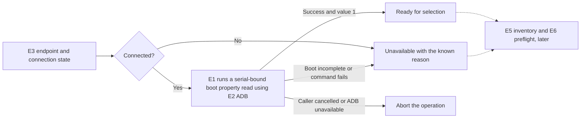

# E4 — Android device readiness probe

## Overview

E3 reports which Android endpoints ADB can see. E4 checks whether an endpoint
reported as connected has finished booting and can answer a read-only Android
shell command. E5 will use the result to build the device inventory. E6 will
run the check again for a selected device before admitting a run.



**Status:** Implemented. Linux tests passed, and the Runtime probe returned
`READY` on a running Waydroid instance. The agent and ADB test binary
cross-build for Windows. Native Windows verification remains pending.

## 1. Probe contract

The internal probe accepts a caller context and one endpoint from a successful
E3 discovery. It returns the same serial and a readiness result, or an error
if the operation could not be completed. For an unavailable endpoint, include
a stable A6 reason code with a safe message. A ready endpoint has no error
detail. E7 owns the eventual HTTP projection.

Check the caller context first. Return the known reason for an offline,
unauthorized, or other unavailable endpoint without issuing a device command.
An empty serial or an unknown internal connection state is invalid input.
Pass the discovered serial unchanged as a single host argument after `-s`.
Use the same E2-selected executable as E3 and run it through E1.

```text
adb -s <serial> shell -T getprop sys.boot_completed
```

The exact argument list is `["-s", serial, "shell", "-T", "getprop",
"sys.boot_completed"]`. `-T` disables pseudo-terminal allocation. Keep the
remote command fixed. The serial selects the transport on the host and is
never interpolated into the remote command.

The check has two prerequisites for `READY`:

1. E1 reports success, with exit code zero and complete stdout.
2. After trimming surrounding ASCII spaces, tabs, CR, and LF, stdout is
   exactly `1`. Accept LF or CRLF; reject extra lines or other text.

One invocation verifies both the shell request and Android's boot-completion
property. A result of `READY` means the device is eligible for selection at
that moment. Screen unlock, app availability, and action-specific
prerequisites belong to the later operation that needs them.

References: [ADB device targeting and shell commands](https://developer.android.com/tools/adb)
and [Android's boot-completion test](https://android.googlesource.com/platform/test/vts/+/o-preview/utils/python/controllers/android_device.py).

## 2. Outcomes and failure handling

| Observation | Result |
|---|---|
| E3 state is Offline | `UNAVAILABLE` with `DEVICE_OFFLINE`. |
| E3 state is Unauthorized | `UNAVAILABLE` with `DEVICE_UNAUTHORIZED`. |
| E3 state is Other unavailable, such as recovery or no permissions | `UNAVAILABLE` with `DEVICE_NOT_READY`. |
| Successful probe, complete stdout exactly `1` after trimming | `READY`. |
| Successful probe with empty, non-`1`, or truncated stdout | `UNAVAILABLE` with `DEVICE_NOT_READY`. |
| E1 command times out within the probe's own budget | `UNAVAILABLE` with `DEVICE_NOT_READY`. |
| The ADB process exits nonzero | Refresh the transport state once using E3 within the same probe budget. If the serial is absent, return `UNAVAILABLE` with `DEVICE_NOT_FOUND`. If its state changed, use the corresponding E3 reason. If it remains connected, return `UNAVAILABLE` with `DEVICE_NOT_READY`. |
| The follow-up discovery fails while the probe and caller budgets remain active | Propagate the discovery failure for the caller to map to `ADB_UNAVAILABLE`. Do not infer that the serial disappeared. |
| E2 cannot resolve ADB, or E1 cannot start the process or reports a runner failure | Return an operation failure for the caller to map to `ADB_UNAVAILABLE`. |
| Caller cancels or its deadline expires at any stage | Propagate the caller context error without returning a readiness result. |

Use the fresh E3 result to distinguish a disappeared endpoint from a
failed shell request. Raw ADB stderr varies across releases and is not the
source of the error code. The follow-up checks the original serial only.
It does not probe another device or retry the boot command. During preflight
a missing serial prevents admission. Loss after a run has already admitted
the serial belongs to execution and its `DEVICE_DISCONNECTED` handling.

## 3. Bounded execution and data handling

Use a **five-second per-endpoint budget** shared by the boot read
and any follow-up discovery. A shorter caller deadline takes precedence.
Start this budget before E2 resolution for a connected endpoint. Pass the
same probe context to E2, E1, and any E3 follow-up. E1's bounded process cleanup may extend completion beyond
the command deadline. If the local probe budget expires, classify the endpoint
as `DEVICE_NOT_READY` unless the caller context has also ended, in which
case propagate the caller's context error. Use a shared timeout constant.

E4 checks one endpoint per call. It does not poll for boot completion.
A later refresh or admission recheck obtains a fresh observation. E5 owns any
batch concurrency and the inventory lifecycle. Keep raw output, transport
metadata, and serials out of routine logs. Return serials only as part of
the internal endpoint result and the eventual authenticated inventory.
Do not write readiness to SQLite.

## 4. Implementation and acceptance

Place the readiness adapter under `internal/platform/adb` beside E2 and E3.
Reuse the resolver and E1 runner. Keep the outcome mapping independent of HTTP,
workflow execution, and inventory storage. Runtime boot and authoring requests
do not need an ADB probe.

| Check | Expected observation |
|---|---|
| Connected endpoint returns `1\n` or `1\r\n` | Ready with the exact serial; helper receives only the fixed argument list. |
| Boot property is empty, `0`, or accompanied by extra text | Not ready. |
| Offline, unauthorized, or recovery endpoint | Correct unavailable reason and no shell invocation. |
| Command exits nonzero and selected serial disappears | Exactly one follow-up discovery and `DEVICE_NOT_FOUND`. Other endpoints are ignored. |
| Command exits nonzero and endpoint is still connected | Not ready. A follow-up discovery error surfaces as an operation failure. |
| Tool cannot start, or command output is truncated | Operation failure for start failure; unavailable for truncated successful output. |
| Probe timeout, earlier caller deadline, or caller cancellation | Local timeout yields not ready. Caller deadline or cancellation propagates. |
| Linux and Windows | Run the same controlled readiness cases on both hosts. Verify the fixed command on a running Waydroid instance or another ADB-visible Android guest. Phase E's integrated gate also covers a physical Android device. |

For a manual Waydroid check, use the serial shown by `adb devices -l`. For
example:

```bash
adb -s 192.168.240.112:5555 shell -T getprop sys.boot_completed
```

A fully booted instance should print `1`. This verifies the device-side
command. Run `go test ./internal/platform/adb` from the Runtime checkout to verify
how E4 interprets the result and classifies failures.

Related contracts: [A3 selection](../phases/phase_a.md#a3--session-device-selection-rules),
[A6 errors](../contracts/event_error_v1.md), and
[A7 inventory](../contracts/local_api_v1.md#7-session-device-inventory).
