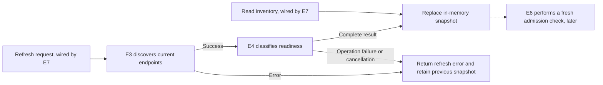

# E5 — Session device inventory

## Overview

E5 keeps the latest successful discovery and readiness results in memory for
the lifetime of one Runtime process. Before the first refresh, the inventory
is empty. During a refresh, readers continue to see the last complete list.
When the refresh succeeds, Runtime replaces that list in one operation. When
it fails, the previous list remains available.

**Status:** Implemented and verified by Linux service tests. The service
tests cross-build for Windows. Native Windows execution and E7 integration
verification are pending.

## 1. Scope and ownership

| Owner | Responsibility |
|---|---|
| E3 | Discover the current ADB endpoints using the verified toolchain. |
| E4 | Check each endpoint's readiness and distinguish an unavailable device from a failed probe operation. |
| E5 | Coordinate refreshes, assemble one sorted list, and publish the latest complete result in memory. |
| E6 | Recheck requested serials before run admission. |
| E7 | Expose authenticated read and refresh routes and map operation failures to the A7 response. |

Create one inventory service per Runtime process. Start it empty and refresh
on demand. The service requires no ADB call at agent startup and no
background polling. Restarting Runtime clears it. Execution history still
belongs to Phase D and retains serials used in admitted runs.

## 2. Internal operations

| Operation | Contract |
|---|---|
| Read the current inventory | Return an independent copy of the last successfully published snapshot. Before the first successful refresh, return an empty list. Run no ADB command. |
| Refresh with a caller context | Discover once with E3, evaluate the result with E4, and publish the complete replacement on success. Return a copy of the exact snapshot produced by this refresh. On error, return the failure without publishing. |

Each entry contains the exact `adbSerial`, status `READY` or
`UNAVAILABLE`, and a reason code and safe message for unavailable devices.
A ready entry has no reason. E7 supplies the A7 error envelope and wire
fields. Sort entries lexically by serial. A snapshot contains no model, alias,
provider, device UUID, occupancy, or historical records.

Consumers can modify their returned list without changing the service state.
If entries retain pointer-backed readiness reasons, copy those too. Keep
synchronization around the in-memory snapshot and refresh state. Release the
lock before filesystem, process, or ADB calls.

## 3. Refresh sequence

1. Check the caller context. If no refresh is running, create one and use
   the initiating caller's context with the refresh budget. Concurrent
   callers join the same operation and can cancel their own wait. Callers
   still waiting receive the original operation's result or error.
2. Run E3 discovery once for the candidate list. A valid empty response
   results in an empty replacement snapshot.
3. Pass the discovered endpoints through E4. E4 returns immediately for
   already unavailable states. Probe connected endpoints with at most four
   evaluations in flight across the refresh. A single E4 evaluation may run
   its own follow-up discovery under the E4 contract.
4. Collect the results without publishing intermediate entries. A
   `DEVICE_NOT_FOUND` result from E4 means the serial disappeared after the
   initial discovery. Omit that entry. Retain offline, unauthorized, and
   not-ready entries with their reasons. A device first seen by an E4
   follow-up can appear on a later explicit refresh.
5. Once all evaluations finish, check cancellation and publish the sorted
   list atomically. Wake callers waiting on this refresh. A cancellation
   observed before publication retains the old snapshot. Cancellation
   after publication does not roll back the completed refresh.

Use a **20-second overall refresh budget** and **up to four concurrent E4
evaluations** as the MVP defaults. The earlier caller deadline
takes precedence. E3 and E4 retain their own command budgets, and E1 retains
its bounded process cleanup. On an operation failure, cancel outstanding
evaluations and wait for their bounded cleanup before completing the refresh.
A later request can start a new attempt.

## 4. Failure and snapshot behavior

| Observation | Refresh outcome |
|---|---|
| E3 finds no endpoints | Success. Replace the previous list with an empty list. |
| E4 reports that a device is offline, unauthorized, or still booting | Success if the other evaluations complete. Keep that device with its unavailable reason. |
| E4 confirms the serial disappeared | Omit that device from this replacement snapshot. |
| E3 discovery or any E4 operation fails | Return the operation failure. Keep the previous snapshot. A device-level unavailable result remains a normal result. |
| Initiating caller cancels or the overall deadline expires | Return the context outcome to callers still waiting. Keep the previous snapshot if publication has not occurred. |
| An individual waiting caller cancels | Its wait ends. The shared refresh continues under the initiating caller's context. |

For example, suppose the last snapshot contains a ready Waydroid device. If
ADB itself fails on refresh, a read still returns that last observation. If a
successful refresh finds zero devices, a read returns an empty list. A caller
must use the refresh outcome and E6's fresh preflight before treating a serial
as selectable for admission. E5 does not reserve a device or detect use by an
external ADB client.

## 5. Implementation and acceptance

`internal/services/device_inventory.go` implements `DeviceInventory` with
`Snapshot` and `Refresh` operations. Its source interface exposes only E3
discovery and E4 readiness. Keep the
service independent of HTTP and SQLite. E7 owns route registration and
composition into the agent. Routine logs may record duration, result counts,
and a safe failure category. Keep serials and raw ADB output out of logs.

| Check | Expected result |
|---|---|
| Fresh service, repeated reads | Empty snapshot and zero ADB calls. |
| Successful refresh with mixed states and out-of-order completion | Sorted list with the original serials and correct reasons. Reader changes cannot mutate service state. |
| Read while refresh is running | Previous complete list remains available without waiting for ADB. |
| Successful empty refresh after a nonempty result | Empty list replaces the old result. |
| Endpoint disappears while E4 evaluates it | Missing serial is omitted. Other results are published normally. |
| Discovery failure, probe operation failure, cancellation, or overall deadline | No partial replacement. Waiters receive the appropriate failure and a subsequent refresh can succeed. |
| Multiple refresh callers and one cancelled waiter | One initial discovery, one shared result, and no cancelled waiter blocking the refresh. |
| More than four connected endpoints | At most four E4 evaluations in flight. |
| New service after process restart | Empty inventory without reading or modifying existing execution history. |

Run `go test -race ./internal/services` from the Runtime checkout. The tests
use controlled discovery and readiness results. Verify the eventual HTTP behavior with E7 on Linux and Windows.
See [A3 selection](../phases/phase_a.md#a3--session-device-selection-rules) and
[A7 inventory](../contracts/local_api_v1.md#7-session-device-inventory).
