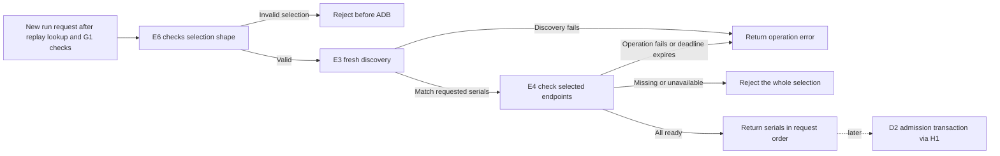

# E6 — Device selection preflight

## Overview

E6 checks the exact devices requested for a new run. A device can disappear,
go offline, or lose authorization after Studio or Launcher displayed it.
E6 obtains a fresh ADB device list, checks only the selected serials, and
accepts the selection only when every device is ready. Later admission uses
the accepted serials to create the run.

**Status:** Implemented and verified by Linux service tests. The service tests
cross-build for Windows. Native Windows execution and run admission integration
are pending.

## 1. Scope and input

The internal operation accepts a caller context and the requested ADB serials.
A7 owns parsing of the run request, while G1 owns workflow and per-device
input validation. E6 operates on serials only.

- Accept a non-empty selection with no fixed device-count ceiling. Check the
  caller context, serial shape and duplicates before ADB. Keep payload byte
  checks at A7/G12. This revised capacity policy requires code alignment.
- A serial is an opaque, case-sensitive value from E3. Apply the same
  token rules as discovery. Reject empty values, invalid UTF-8, whitespace,
  and control characters. Preserve punctuation such as `:5555` and IPv6
  brackets. Compare exact strings without trimming or case conversion.
- Reject duplicate serials, even if their associated run input values differ.
  Report invalid input by its zero-based position when applicable. This is a
  request validation failure, with no discovery or readiness commands.

## 2. Preflight sequence

1. Call E3 once for a fresh list and index the result by exact serial. A
   missing serial produces `DEVICE_NOT_FOUND`, including when E3 successfully
   returns an empty list. A discovery error is a failure to observe the
   devices and leaves their individual availability unknown.
2. For each selected serial present in the list, call E4. It returns the
   existing reason immediately for unavailable states and runs its fixed
   probe only for connected endpoints. It can rediscover once after a
   nonzero exit under its existing rules. Unselected devices receive no
   readiness checks.
3. Collect unavailable selections in request order. Each entry includes the
   zero-based selection index, original serial, stable A6 reason, and safe
   message. Return all such entries when assessment finishes successfully.
   If any selection is unavailable, return no accepted serials. Return the
   full ordered selection only if all devices pass.
4. Check the caller context before returning approval. Later admission pairs
   each accepted serial with the original inputs by request index. A change
   in ADB state or in the E5 snapshot never substitutes another device.

Each preflight checks current state independently of the E5 inventory and
leaves its snapshot untouched. E5 remains the source for the displayed list.
There is no device reservation from a successful probe.

## 3. Bounded execution and outcomes

The MVP defaults are a **20-second overall budget** and **up to four E4
evaluations in flight per preflight**, matching the E5 refresh defaults.
An earlier caller deadline takes precedence. Keep E3's discovery timeout
and E4's per-endpoint timeout within the overall context. E1's bounded
process cleanup can extend completion beyond the command deadline. Run one
preflight per new admission attempt, with no automatic retries. On an
operation failure, cancel outstanding probes and wait for their cleanup.

| Observation | Internal outcome |
|---|---|
| All selected serials pass | Accepted serials in request order. |
| Empty selection, duplicate or invalid serial | Invalid selection before ADB. |
| Serial absent from fresh discovery or confirmed missing by E4 | Unavailable selection with `DEVICE_NOT_FOUND`. |
| E4 reports offline, unauthorized, or not ready | Unavailable selection with the E4 reason. Other selected endpoints can still be assessed for feedback. |
| E3 discovery or an E4 probe operation fails | Return the operation failure. Later admission maps ADB failures to `ADB_UNAVAILABLE`. Return no partial selection outcome. |
| Caller cancels or the overall budget expires | Return the context error and no selection outcome. An E4 timeout confined to its own budget can still produce `DEVICE_NOT_READY`. |

Keep raw ADB output and serials out of routine logs. The later client
boundary owns HTTP status, diagnostic projection, and Development versus
Production disclosure.

Large selections remain subject to operation/caller deadlines and readiness
probe concurrency. Neither is a supported-device count maximum. Expiry is a
timeout with no partial accepted subset, never a too-many-devices error. H4
must test larger selections under appropriate operation budgets without
silently dropping or replacing members.

## 4. Run admission boundary

A7 and D2 check whether the request ID already identifies an admitted run.
A replay of that ID returns the existing run's snapshot without running E6.
For a new run, complete G1 and E6 before opening the D2 write transaction.
A rejected selection creates no RunGroup, DeviceExecution, or event, and
dispatches no workflow command. D2 rechecks request ID and the active-run
slot inside its transaction.

A device can still disconnect after preflight. Later execution uses the
accepted explicit serial and handles loss after admission through A5/A6.
E6 provides no run endpoint and makes no SQLite writes.

## 5. Implementation and acceptance

`internal/services/device_preflight.go` implements `DevicePreflight.Check`.
It shares the E3/E4 source interface and bounded readiness evaluation with E5. Keep HTTP, request-ID lookup, and run
persistence in their existing owning layers. E6 can be implemented and tested
before the run API exists.

| Check | Expected observation |
|---|---|
| Empty selection, duplicate or malformed serial | Reject with zero discovery/probe calls. Accept controlled valid selections above 32, such as 33 and 64, preserving every serial; these are samples, not maxima. |
| Two selected devices pass with an unselected device present | One initial discovery and one readiness evaluation per selected endpoint. Return serials in request order even when discovery order differs. |
| E5 held a ready serial that is now absent or offline | Reject the selection using the fresh reason and leave E5 unchanged. |
| Device disappears during E4 | Preserve `DEVICE_NOT_FOUND` and reject the whole selection. |
| Several selected devices are unavailable | Return reasons in caller order with no accepted subset. |
| Discovery fails or a readiness operation fails while other probes are running | Preserve the operation error, cancel and join remaining probes, and return no partial outcome. |
| Concurrent evaluations, cancellation, and deadline | At most four probes per preflight. A shorter caller deadline wins. No accepted result after observed cancellation. |
| Later admission integration | A rejected selection produces no persisted run. A replayed request ID does not call E6. |

Run `go test -race ./internal/services` from the Runtime checkout to exercise
E6 using a controlled device source.
The Phase E integration gate later covers a physical device and an
ADB-visible emulator. The run integration gate checks the handoff to D2.

Related contracts: [A3 selection](../phases/phase_a.md#a3--session-device-selection-rules),
[A7 run admission](../contracts/local_api_v1.md#8-run-admission-and-idempotency), and
[D2 admission and idempotency](../d_persistence/d2_execution_repository.md#2-admission-and-idempotency).
