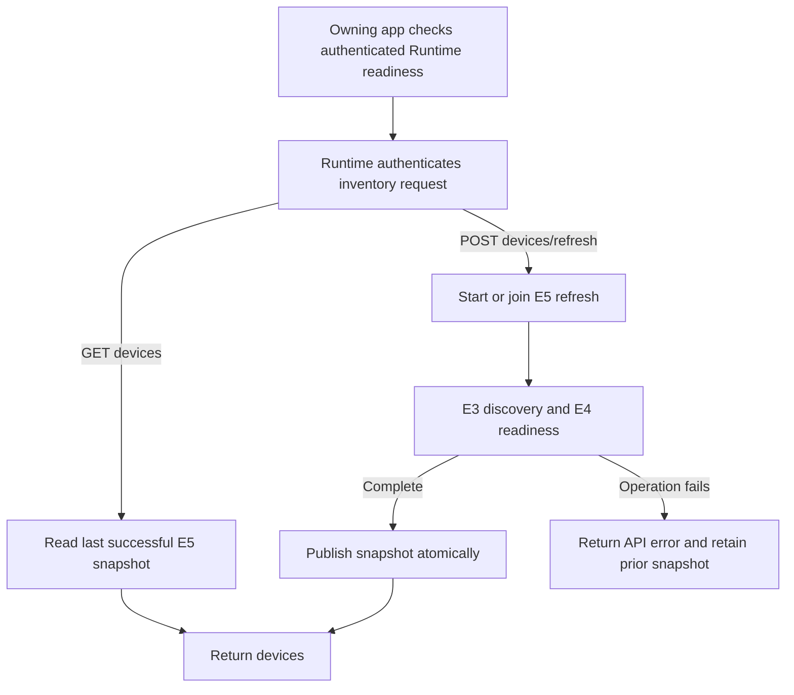

# E7 — Local device inventory API

## Overview

E7 exposes the session inventory to Studio and Launcher. The app that owns
Runtime authenticates to its own child and can read the last successful
snapshot or request a fresh scan. The device picker uses the result to show
available endpoints and explain why other endpoints cannot be selected.



**Status** — Implemented and verified on Linux with managed HTTP requests.
The Windows agent cross-build passed. See the
[Phase E integration evidence](../phases/phase_e.md#integration-evidence) for
live-device and native Windows acceptance status.

## 1. Scope and ownership

| Component | Responsibility |
|---|---|
| Local API | Authenticate, reject unsupported request inputs, invoke E5, and encode A7 responses. |
| [E5 inventory](e5_session_inventory.md) | Hold the snapshot in process memory and coordinate refresh, budgets, discovery, readiness, and publication. |
| Studio and Launcher | Use the owned Runtime session, trigger refresh, and render device status and selection. |
| [E6 preflight](e6_selection_preflight.md) | Recheck selected serials against live ADB during future run admission. |

Runtime startup and its readiness check must work without resolving ADB or
discovering devices. The initial snapshot is empty and is lost on process
exit. Both API routes use the same inventory instance. E7 adds no SQLite
writes, connection management, background polling, occupancy reporting, or
run admission. An inventory entry describes ADB readiness at the time of the
last successful refresh.

## 2. Request contract

| Method and path | Operation | Success |
|---|---|---|
| `GET /api/v1/devices` | Read the last committed snapshot. Never resolve or invoke ADB and never wait for an active refresh. | `200` with `devices` |
| `POST /api/v1/devices/refresh` | Start or join an E5 refresh and wait for its result. | `200` with the snapshot produced by that refresh |

Both routes require `Authorization: Bearer <local-session-token>` and use
the common [A7 transport rules](../contracts/local_api_v1.md#2-common-transport-rules).
Authentication precedes request validation. Send an empty body and no query
parameters. Any body content, including `{}` or whitespace, or any query
parameter returns `400 INVALID_REQUEST` before calling E5. Bound body
inspection to detecting whether content exists. No request `Content-Type` is
required. Responses use JSON and `Cache-Control: no-store`.

## 3. Response contract

```json
{
  "devices": [
    {
      "adbSerial": "192.0.2.10:5555",
      "status": "UNAVAILABLE",
      "error": {
        "code": "DEVICE_OFFLINE",
        "message": "device is offline",
        "retryable": true
      }
    },
    {
      "adbSerial": "emulator-5554",
      "status": "READY"
    }
  ]
}
```

| Field | Contract |
|---|---|
| `devices` | Always an array. Use `[]` before the first successful refresh and after a successful refresh with no devices. Order entries lexically by `adbSerial`. |
| `adbSerial` | Exact, case-sensitive ADB routing identifier. Preserve it as a string, including the port when present. |
| `status` | `READY` or `UNAVAILABLE`. |
| `error` | Required for `UNAVAILABLE` and omitted for `READY`. Use the A6 `RuntimeError` shape. |

| Unavailable code | Meaning | Safe message |
|---|---|---|
| `DEVICE_OFFLINE` | ADB sees the transport as offline. | `device is offline` |
| `DEVICE_UNAUTHORIZED` | Android has not authorized this ADB host. | `device has not authorized ADB` |
| `DEVICE_NOT_READY` | ADB or its boot probe could not confirm readiness. | `device is not ready` |

These per-device errors carry `retryable: true` because rescanning is safe.
Clients should give the user a chance to reconnect, authorize, or wait for
boot before refreshing. Render logic uses the codes. A serial confirmed to
have disappeared during refresh is omitted by E5. One unavailable device
can appear alongside ready devices in an HTTP `200` response.

## 4. Refresh lifecycle and failure handling

1. Pass the HTTP request context to E5. Its 20-second refresh budget and
   readiness concurrency limit apply to the shared attempt. A request joining
   the attempt can stop waiting independently. Cancellation of the request
   that started the attempt cancels that attempt for its waiters.
2. On success, return the snapshot from `Refresh`, including a successful
   empty result. `GET` calls during the refresh can continue reading the
   previous snapshot until E5 publishes its replacement.
3. On failure or cancellation before publication, E5 retains the previous
   snapshot. Return the operation error for a live HTTP caller. A disconnected
   caller may receive no response. If publication already completed, a later
   caller can read the committed result with `GET`.

| HTTP status | Code | When | Retryable |
|---|---|---|---|
| `400` | `INVALID_REQUEST` | Unexpected query or body. | `false` |
| `401` | `UNAUTHORIZED` | Missing or invalid local bearer token. | `false` |
| `503` | `ADB_UNAVAILABLE` | ADB cannot be resolved or used, discovery or an operation-level probe fails, or the shared refresh ends early due to cancellation or deadline while this caller is still connected. | `true` |
| `500` | `INTERNAL_ERROR` | Unexpected Runtime failure. | `false` |

For `503`, return the common A7 envelope with code `ADB_UNAVAILABLE` and
message `unable to refresh Android devices`. Error responses carry no
`devices` field. Use safe messages and keep raw ADB command output, executable
paths, and local session tokens out of public response bodies.

## 5. Runtime implementation boundary

- Register the routes in the authenticated `/api/v1` group. Follow the existing
  response DTO, request validation, and error-envelope conventions.
- Wire a single E5 inventory backed by the shared ADB resolver, discovery,
  and readiness services through the Runtime composition root. Keep the
  handlers independent of ADB command construction and persistence.
- Map typed E5 and ADB outcomes to public codes without matching human-readable
  error strings. Keep the existing E5 refresh and publication semantics.
- Use the existing listener and managed ownership protocol. With default
  settings the HTTP write timeout is 30 seconds, covering E5's 20-second
  refresh budget and process cleanup. When configuring a shorter listener
  timeout, a client may see a transport failure before a refresh error can
  be delivered.

## 6. Verification and handoff

| Check | Expected result |
|---|---|
| Start the managed Runtime with no usable ADB | Existing Runtime Info and workflow routes work. The first authenticated read returns `{"devices":[]}`. Refresh returns `503 ADB_UNAVAILABLE`. |
| Send invalid tokens, bodies, and query parameters | Authentication takes precedence. Invalid requests invoke neither inventory operation. |
| Refresh with ready, offline, unauthorized, and not-ready endpoints | The response contains lexical order, exact serials, and the documented shapes and reason codes. |
| Block discovery and issue concurrent reads and refreshes | Reads return the previous snapshot immediately. The refresh requests share one discovery attempt and return its result. |
| Fail or time out a refresh after a prior success | The refresh returns `503` to live callers. A subsequent read returns the prior snapshot. Cancelled refreshes do not publish partial results. |
| Successfully refresh with an empty set after a prior success | Refresh and subsequent reads return `{"devices":[]}`. |
| Restart the managed child | The new session starts with an empty inventory and a new local token. Existing execution history remains intact. |
| Exercise the admitted serial boundary | An endpoint shown ready by E7 that disappears before E6 preflight is rejected by E6. No run route is required to test this boundary. |

Run handler tests with controlled inputs, then exercise authenticated requests
against a managed Runtime on Linux and Windows. Confirm a real ADB-visible
emulator and physical Android device through the same routes. Record controlled
results, native-host results, and live-device results independently. Use the
[shared API examples](../integration/managed_runtime.md#device-inventory-api),
[Studio flow](../integration/studio.md#android-device-picker), and
[Launcher flow](../integration/launcher.md#android-device-picker)
for handoff once the corresponding behavior has been verified.
