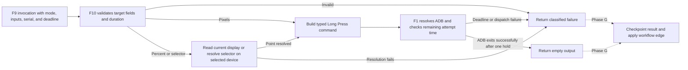

# F10 — Long Press on a selected Android device

## Overview

Long Press holds one point on the selected Android device for the requested
duration. F10 turns a pixel, percentage, or selector target into one pixel
point, then sends a typed command to F1. The dispatcher uses Android's swipe
operation with identical start and end points to perform the hold.



**Status** — All three targeting modes, typed command, gesture-budget
checks, and shipped F9 registration are implemented. Linux automated checks
and Windows cross-compilation pass. Native Windows and the remaining
live-device acceptance checks are pending. Phase G owns workflow admission,
invocation in graph order, and checkpointing.

## 1. Implementation order

| Step | Location                                                         | Change                                                                                                                                                                                                                  |
| ---- | ---------------------------------------------------------------- | ----------------------------------------------------------------------------------------------------------------------------------------------------------------------------------------------------------------------- |
| 1    | `pkg/constants/adb.go` and `internal/platform/adb/dispatcher.go` | Define the 60,000 ms Long Press execution limit and add `LongPressCommand` to the closed dispatcher. Verify the argument mapping and deadline check with a controlled process.                                          |
| 2    | `internal/handlers/longpress/long_press.go`                      | Implement `NewLongPress(device)` and `(*LongPress).Invoke(ctx, call)`. Use a narrow device dependency with `DefaultDisplaySize`, `SelectorPoint`, and `Dispatch`. Reuse the existing `targeting` helpers and ADB reads. |
| 3    | F10 handler tests and the local `test_demo/f-smoke` registry     | Exercise the exact F9 pair with the real handler and a controlled device dependency. Then invoke the real dispatcher from the local smoke runner and observe the result on Android.                                     |
| 4    | `cmd/agent/handlers.go` and composition wiring                   | Enable the pair in the shipped registry after native adapter and live acceptance pass for all three modes. Reuse the Phase E resolver and regenerate Wire if provider inputs change.                                    |

## 2. Inputs and output

| Item                 | Contract                                                                                                                                                                                      |
| -------------------- | --------------------------------------------------------------------------------------------------------------------------------------------------------------------------------------------- |
| Type and handler key | Both are `android.long_press`.                                                                                                                                                                |
| Capability           | `android.device.control`. The installed catalog declares minimum Runtime version `0.1.0`.                                                                                                     |
| Config               | Exactly `targetMode`, an explicit string from the table below.                                                                                                                                |
| Resolved inputs      | Exactly the fields for the selected mode, including `durationMs`. Phase C preserves literal bindings in Runtime IR. The handler receives the decoded input map through `registry.Invocation`. |
| Attempt ownership    | Use `call.ADBSerial` and the caller's context for every device read and the final dispatch.                                                                                                   |
| Result               | Successful dispatch returns `{}`. Failure returns a classified error with no success output. Phase G applies the admitted `STOP` or `ERROR_BRANCH` policy.                                    |

| `targetMode`      | Exact fields                         | Point validation                                                                                                                            |
| ----------------- | ------------------------------------ | ------------------------------------------------------------------------------------------------------------------------------------------- |
| `ABSOLUTE_PIXELS` | `x`, `y`, `durationMs`               | Integer coordinates from 0 through 100,000.                                                                                                 |
| `SCREEN_PERCENT`  | `xPercent`, `yPercent`, `durationMs` | Integer percentages from 0 through 100.                                                                                                     |
| `SELECTOR_ID`     | `selector_id`, `durationMs`          | Full Android resource ID such as `com.example.demo:id/hold_target`. Match exactly, including case, using the existing selector syntax rule. |

For all modes, accept integer durations from **1 through 60,000 ms** at
execution. Accept integral JSON numbers such as `800.0`. Reject unknown or
missing modes, mixed or extra fields, missing values, nulls, numeric strings,
fractions, and out-of-range values before any device I/O. Reject invalid
selector syntax at the same boundary. Forward valid resource IDs verbatim to
the local selector matcher.

Backend and Phase C authoring currently accept any positive safe integer for
Long Press. The [A4 command contract](../contracts/typed_device_command_v1.md#3-field-rules)
limits execution to 60,000 ms. A node with `durationMs: 60001` can pass
[C4 validation](../local_workflow_validation/c4_node_contract_validator.md#explicit-targeting)
and still fail F10 with `COMMAND_INPUT_UNSUPPORTED` before any device read.
Future G1 admission must enforce the execution range before creating a run.

## 3. Resolve one point on the selected device

1. Check cancellation, the presence of an attempt deadline, and the serial.
   Validate the complete config and input shape, including the hold duration.
2. For pixels, use the supplied `x` and `y` directly. Pixel mode requires
   zero display or hierarchy reads.
3. For percentages, call `DefaultDisplaySize(ctx, serial)` once. Use
   `targeting.PercentPixel` on each positive dimension of the current default
   display. On a 1080 × 1920 display, `50%, 80%` resolves to `(540, 1535)`
   using `round(percent × (dimension − 1) / 100)`.
4. For a selector, call `SelectorPoint(ctx, serial, resourceID)` once. Reuse
   F3's current default-display read, bounded hierarchy capture, exact unique
   resource-ID match, and center of clipped bounds. The lookup and its
   best-effort cleanup use the same serial and attempt budget. A missing,
   duplicate, hidden, or unusable match fails before the hold.
5. After a successful resolution, recheck cancellation and validate the
   resolved pixel point against A4 bounds. Build one command and dispatch once.

Each invocation resolves its own target. Percentage and selector observations
are local to one attempt, so another device or a later attempt can see a
different display or hierarchy. See [F3 targeting](f3_tap.md#3-screen-percentage).

## 4. Dispatch and deadline

```go
type LongPressCommand struct {
    X          int
    Y          int
    DurationMS int
}
```

Implement the `deviceCommand()` marker and validate the point and duration
again in the dispatcher before ADB resolution. Convert all numbers to decimal
arguments. The fixed argument vector is shown below in shell notation. F1
supplies the executable and `-s <serial>` and passes separate arguments to E1.

```text
adb -s <serial> shell -T input swipe <x> <y> <x> <y> <durationMs>
```

Use the requested hold as the minimum duration in the shared F1 dispatch path.
After ADB resolution and before starting the gesture process, return
`context.DeadlineExceeded` if the remaining time is less than or equal to the
hold. Display reads, hierarchy cleanup, ADB resolution, and dispatch all
consume the same attempt budget. Preserve the requested duration exactly.

For example, a 40,000 ms hold cannot start with the catalog's default
30,000 ms timeout. An explicit `timeoutMs: 50000` makes the attempt eligible
to dispatch if more than 40,000 ms still remain at the process boundary.
An ADB zero exit confirms command completion. Observing a context menu or
other UI response is a separate acceptance check.
See [F1 dispatch](f1_command_dispatcher.md#3-dispatch-sequence) and the
[Runtime IR node matrix](../contracts/runtime_ir_v1.md#9-current-node-matrix).

## 5. Failure and logging

| Condition                                                   | Result                                                                                                                                    |
| ----------------------------------------------------------- | ----------------------------------------------------------------------------------------------------------------------------------------- |
| Invalid mode, fields, value, or duration                    | `COMMAND_INPUT_UNSUPPORTED`, non-retryable. No device read or hold.                                                                       |
| Missing deadline or invalid execution-owned serial          | `INTERNAL_ERROR` under F1's invocation rules.                                                                                             |
| Display or hierarchy cannot establish a usable point        | Preserve the F3 observation failure. A missing, ambiguous, or unusable point is `COMMAND_FAILED`. No hold.                                |
| ADB resolution, process launch, or process exit fails       | Preserve the F1 classification.                                                                                                           |
| Attempt cancelled, expired, or has insufficient hold budget | Propagate `context.Canceled` or `context.DeadlineExceeded`. G7 maps the attempt outcome. A gesture already sent may have affected the UI. |

Return once per invocation. F10 performs no retry, fallback targeting, or
device substitution. Use the existing contextual error path with safe
operation labels such as `validate_inputs` and `resolve_long_press_point`.
Preserve specific labels from display, selector, and dispatcher failures.
Keep serials, selector values, raw ADB output, hierarchy content, and
generated paths out of error details and logs.

## 6. Acceptance and release gate

| Check                                 | Expected evidence                                                                                                                                                                                                                                                                                                                   |
| ------------------------------------- | ----------------------------------------------------------------------------------------------------------------------------------------------------------------------------------------------------------------------------------------------------------------------------------------------------------------------------------- |
| Pixel target `(540, 1535)` for 800 ms | Zero reads. Exactly one process invocation for the selected serial with `shell -T input swipe 540 1535 540 1535 800`. Output is `{}`.                                                                                                                                                                                               |
| Percentage and selector               | Percentage mode reads one current size, including after rotation. Selector mode holds the center of the one clipped match. Unavailable or ambiguous targets produce zero hold invocations.                                                                                                                                          |
| Input boundaries                      | Cover 1 and 60,000 ms, then reject 0, 60,001, fractional and string values. Cover missing and mixed fields, malformed selector values, and unknown modes with zero device calls.                                                                                                                                                    |
| Deadline and failures                 | Exercise budget equal to the hold, time spent in ADB resolution, cancellation during target reads, and cancellation or failure after process start. A rejected attempt launches no gesture. A started gesture is invoked at most once.                                                                                              |
| Registry and regression               | Invoke the real handler through the exact F9 type/key pair. Check Tap and Swipe still construct their own commands. Verify Runtime Info lists Long Press once it is enabled and that requesting Runtime Info itself performs zero device I/O.                                                                                       |
| Native and real-device acceptance     | Run adapter checks on Linux and Windows. On an ADB-visible emulator and a physical Android device, use a test view with distinct tap and long-press behavior. Observe the hold for each targeting mode. Use a unique accessible resource ID for the selector case and verify that a missing or duplicate ID triggers zero gestures. |

F9 advertises only the complete type/key pair, so enable it after all three
modes pass acceptance. Phase G adds executable admission, per-device
invocation, and persisted results. Studio and Launcher use the advertised
capability as part of their integration with the verified Runtime build.

## 7. Local smoke example

After the smoke runner registers Long Press, add this step to a local fixture
with the exact ADB serial and executable path. Open a target with an observable
long-press action in Waydroid. Adjust the percentage to place the point on that
target and run `go run . long_press.json` from `test_demo/f-smoke`.

```json
{
  "type": "android.long_press",
  "config": { "targetMode": "SCREEN_PERCENT" },
  "inputs": { "xPercent": 50, "yPercent": 80, "durationMs": 800 }
}
```

Use `{"x":540,"y":1535,"durationMs":800}` with `ABSOLUTE_PIXELS` only
when that point suits the actual display. For `SELECTOR_ID`, substitute the
unique resource ID from the current test view and include `durationMs`.
