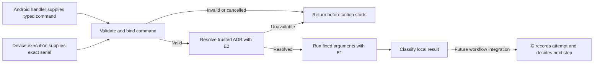

# F1 — Typed ADB command dispatcher

## Overview

F1 connects an Android node handler to the ADB executable already managed by
Phase E. The handler supplies a typed command and the execution supplies its
selected device serial. The dispatcher validates both, builds fixed ADB
arguments, and returns a classified result for that one invocation. During
Phase F, a test caller can exercise this boundary without a workflow run.

**Status** — Implemented using the shared E1 runner and E2 resolver. Linux
automated dispatch and failure checks pass, and Windows cross-compilation
passes. Native Windows and the remaining live-device acceptance checks are
pending. Phase G owns invocation during workflow execution.

## 1. Ownership and dependencies

| Owner | Responsibility |
|---|---|
| [A4](../contracts/typed_device_command_v1.md) | Defines the closed command variants, trusted inputs, and workflow-visible outcomes. |
| [E1](../e_device_subsystem/e1_process_runner.md) and [E2](../e_device_subsystem/e2_adb_toolchain_resolver.md) | Run a bounded subprocess and supply the verified local ADB executable. |
| [E6](../e_device_subsystem/e6_selection_preflight.md) and future H1 admission | Validate the selected serial and carry the accepted value into the device execution. |
| F1 | Validate dispatch inputs, attach the execution's serial, invoke one typed action, and classify the result. |
| F2–F7 and F10 | Define each Android action's argument construction and success criteria. F3, F4, and F10 resolve targets before issuing the final gesture. |
| F9 and later G/H | Register callable node handlers, supply the attempt deadline, and decide and persist lifecycle transitions. |

The dispatcher is an internal Go boundary. E7 continues to expose only device
inventory. A workflow or HTTP client cannot call the dispatcher directly.

## 2. Dispatch inputs

| Input | Rule |
|---|---|
| Attempt context | Supply a positive remaining budget through a context deadline. Under Phase G this is the effective node-attempt deadline. A Phase F test caller sets its own bounded deadline. |
| Target serial | Supply the current execution's `adbSerial` separately from the command. Reuse E3's serial validation and preserve exact case and punctuation, including the port for TCP endpoints. |
| Command | Use a member of the closed A4 command set with concrete typed fields. Reject a missing or unknown variant before resolving ADB. |
| Executable | Obtain the absolute path from the shared E2 resolver. The caller cannot override it at dispatch. |

The command variants cover Launch App, Tap, Swipe, Long Press, Input Text,
Back, Home, and Screenshot. Reuse the A4 field constraints at the dispatch
boundary. In particular, gesture inputs contain resolved integer pixel
coordinates. Percentage conversion and resource-ID lookup belong to the
targeting handlers. The dispatcher accepts neither a raw argument list nor a
generic shell command. It leaves a known variant unavailable until its
operation adapter exists and treats invocation of such a variant as an
internal wiring failure.

## 3. Dispatch sequence

1. Check the attempt context and time budget. Validate the target, command,
   and adapter-specific input representation before launching the action.
2. Resolve ADB via the same E2 resolver used for discovery and readiness.
   E2 can perform its initial version probe and then reuses the verified
   toolchain. F1 adds no discovery or boot probe per action.
3. Build the action arguments in Runtime. Prefix every device-scoped invocation
   with the two separate arguments `-s` and the exact serial. The adapter
   supplies the remaining fixed command tokens and the validated data values.
   ADB selects only that serial, even when several devices are connected.
4. Recheck context before action dispatch. Pass the remaining budget to E1.
   Resolver time and any targeting reads charged to the same attempt context
   reduce the budget available for the final action. E1's bounded cleanup can
   extend the time spent returning the result.
5. Invoke the action once and classify the result. A failed or interrupted
   local ADB process can leave the Android-side effect uncertain. F1 never
   repeats the action, substitutes another serial, or restarts the ADB server.

Separate host process arguments protect the host launch. `adb shell` can
still interpret Android-side shell syntax. Each operation spec must define
how its data reaches the Android command safely. Use fixed command tokens
and validated numeric or constrained values where possible. F5 owns text
representation and rejects text that cannot be delivered safely and exactly.

## 4. Results and failure mapping

Use the [A6 RuntimeError contract](../contracts/event_error_v1.md#5-runtimeerror)
for classified failures. The caller consumes typed outcomes and codes. Keep
raw process diagnostics internal and use fixed, sanitized messages.

| Condition | Result | Retryability |
|---|---|---|
| A recognized command carries invalid fields or unsupported input representation | `COMMAND_INPUT_UNSUPPORTED`. No action dispatch. | `false` |
| Missing or unknown command variant, invalid execution-owned serial, missing required deadline, missing adapter, or unexpected E1 request rejection | `INTERNAL_ERROR`. No action dispatch. | `false` |
| E2 cannot resolve or verify ADB, with the attempt still active | `ADB_UNAVAILABLE`. No action dispatch. | `true` |
| E1 confirms the action process could not start | `COMMAND_START_FAILED`. | `true` |
| The attempt deadline expires before the action starts, including during resolution | Return the parent deadline outcome. G records `NODE_TIMED_OUT` when it owns the attempt. | `false` |
| An adapter-specific command budget expires while the parent attempt is active | `COMMAND_TIMED_OUT`. | `false` |
| The parent deadline ends an already-started action | Preserve the parent deadline outcome for G to record as `NODE_TIMED_OUT`. The action may already have reached Android. | `false` |
| Caller cancels | Propagate cancellation so G/H can settle `CANCELLED`. An already completed process retains its observed result for the caller to settle. | No automatic replay |
| Nonzero exit, ambiguous runner failure, or unusable adapter response after possible dispatch | `COMMAND_FAILED`, unless a more specific failure has been established through a typed observation. | `false` |
| Adapter confirms successful dispatch | Empty command result for ordinary actions. Screenshot has a separate trusted capture result under F7. | Not applicable |

F1 starts with the attempt deadline and introduces no second default timeout.
If an operation later defines a shorter command budget, it still respects
the parent deadline. Classify device loss only when a trusted observation
establishes it. A generic ADB nonzero exit or a stale E5 snapshot alone cannot
establish that the selected device disconnected. G independently checks the
attempt's retry policy and remaining attempts before scheduling a retry.
Cancellation follows A6 lifecycle handling and carries no synthetic command
error.

An exit code of zero with the expected adapter result confirms dispatch at
the ADB boundary. It does not confirm that the intended screen displayed or
that an app completed a business operation. Keep serials, command arguments,
workflow text, raw stdout/stderr, and artifact bytes out of error messages,
routine logs, and execution events. [B4 logging and redaction](../runtime_process_foundation/b4_logging_and_redaction.md)

## 5. Implementation boundary

- Keep ADB argument construction and dispatch under `internal/platform/adb`,
  alongside the existing adapter. Reuse `adb.ValidSerial`, E2 resolution,
  and `processrunner.Run`. Inject the existing dependencies at the Runtime
  composition boundary when a consumer is wired.
- Keep the command variants and outcomes typed and package-internal to
  Runtime. One dispatcher can serve multiple executions because each call
  carries its own serial and context. Avoid mutable default targets.
- Retain E1's 64 KiB per-stream diagnostic capture. F7 and D5 define the
  separate bounded binary capture and artifact path for Screenshot. The
  first dispatcher implementation needs no binary capture or history schema.
- Exercise F1 directly from tests until a real handler calls it. Keep node
  registration and capability advertisement under F9, action-specific
  details under their subphases, and sequencing and persistence under G/H.

## 6. Acceptance checks

| Scenario | Expected evidence |
|---|---|
| Controlled executable receives commands for two different serials | Each action receives `-s` followed by its own exact serial and only the expected operation arguments. A TCP serial preserves its port. |
| Invalid serial, invalid typed values, unknown command, or missing adapter | Reject before the action process starts. The executable never receives workflow-controlled argv. |
| Resolver failure or process start failure | Distinct `ADB_UNAVAILABLE` and `COMMAND_START_FAILED` outcomes, both without an Android action. |
| Cancelled or expired before dispatch | No action process starts. Preserve cancellation or parent deadline classification. |
| Process exits nonzero or stops after dispatch due to a deadline or cancellation | Classified result, bounded cleanup, and no duplicate process launch or fallback device. |
| Successful action and failed action with sensitive text in process output | Ordinary success yields an empty result. Failure uses a safe error without raw process output or arguments. |
| Native Linux and Windows | Controlled executable checks pass on both. A Windows cross-build establishes compilation only. |

After a real handler is available, verify one harmless command on an
ADB-visible emulator or physical test device using an explicit serial.
Where two devices are available, observe that only the selected device acts.
Record that evidence separately from portable dispatcher tests. Each actual
Android action still needs its own acceptance case under Phase F.
