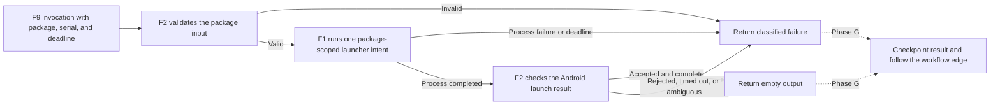

# F2 — Launch an app on a selected Android device

## Overview

Launch App asks Android to open the launcher entry for a package on the
selected device. The handler validates the package name, then F1 runs one
package-scoped Activity Manager command. The adapter checks Android's launch
result before returning an empty node output.



**Status** — Handler, typed command, launch-result parser, and shipped F9
registration are implemented. Linux automated checks and Windows
cross-compilation pass. Native Windows and the remaining live-device
acceptance checks are pending. Phase G owns run admission, binding
resolution, and checkpointing.

## 1. Invocation contract

| Item | Contract |
|---|---|
| Node type and handler key | Both are `android.launch_app`. |
| Capability | `android.device.control`. Minimum Runtime version `0.1.0`. |
| Config | Empty object. An empty or absent internal map represents that object. |
| Resolved inputs | Exactly one field, `packageName`. G2/G4/G17 supply the resolved value from the admitted binding. A direct Phase F test can supply the value directly. |
| Device and deadline | Use `registry.Invocation.ADBSerial` and the caller's attempt context throughout. The catalog default is 30,000 ms. |
| Output and routing | Return `{}` on success. On failure, return no success output. G applies the admitted `STOP` or `ERROR_BRANCH` policy. |

`packageName` must be a JSON string, 3–255 ASCII characters, and match
`^[A-Za-z][A-Za-z0-9_]*(?:\.[A-Za-z][A-Za-z0-9_]*)+$` exactly. Preserve
case. Reject missing fields, unknown fields, null, non-string values,
whitespace, component names, URI syntax, and shell punctuation. The Runtime
uses the same pattern as the installed catalog and checks it defensively at
both the handler and typed dispatcher boundaries.
See the [Runtime IR node matrix](../contracts/runtime_ir_v1.md#9-current-node-matrix)
and [A4 field rules](../contracts/typed_device_command_v1.md#3-field-rules).

## 2. Implementation order

| Step | Location | Change |
|---|---|---|
| 1 | `pkg/constants/adb.go` and `internal/platform/adb/dispatcher.go` | Add shared package-name limits and a typed `LaunchAppCommand{PackageName string}`. Reject an invalid command before ADB resolution. Route its result to the F2 parser. |
| 2 | `internal/platform/adb/launch.go` | Construct the fixed launch arguments and interpret the bounded result. Reuse `runDevice`, E2 resolution, and the E1 runner. |
| 3 | `internal/handlers/launchapp/launch_app.go` | Implement `NewLaunchApp(device)` and `(*LaunchApp).Invoke(ctx, call)` with one `Dispatch` dependency. Check context, serial, deadline, config, and input before invoking the command. |
| 4 | F2 tests and local `test_demo/f-smoke` | Register the exact F9 pair in a test registry, cover the result parser and real argument dispatch with a controlled executable, and add `launch_app.json` for Android acceptance. |
| 5 | `cmd/agent/handlers.go` and composition wiring | Enable the shipped pair after native and live acceptance. Reuse the existing resolver and regenerate Wire if provider inputs change. |

## 3. Dispatch one launcher intent

Validate the execution context, serial, and input before device I/O.
Pass the typed command, selected serial, and original context to F1. F1
resolves the verified ADB executable, supplies `-s <serial>`, checks the
remaining budget, and sends this fixed argument vector to E1.

```text
adb -s <serial> shell -T am start -W --user current -a android.intent.action.MAIN -c android.intent.category.LAUNCHER -p <packageName>
```

The adapter supplies all tokens except the validated package name. It sends
separate host arguments. The restricted package alphabet also keeps the
workflow value safe at the Android shell boundary. Android chooses the
launcher activity in the requested package for the current Android user.
Use the selected execution serial throughout. F2 performs no package scan,
activity pre-resolution call, screen read, device readiness probe, or
force-stop. A cold ADB resolver can still run its existing version probe.
See the [Android ADB reference](https://developer.android.com/tools/adb#am)
and [F1 dispatch sequence](f1_command_dispatcher.md#3-dispatch-sequence).

## 4. Decide what Android reported

First honor the existing F1 process classification. Only parse a result
after E1 reports a successful process and a zero exit code. Use E1's normal
64 KiB limit per stream. A truncated stream cannot establish a complete
launch result. Parse case-sensitive whole markers after trimming line-edge
whitespace. Support LF and CRLF.

| Complete result | F2 decision |
|---|---|
| Exactly one `Status: ok` followed by exactly one terminal `Complete`, with no rejection | Success. If Android includes `Activity:`, require exactly one well-formed `package/class` value for the requested package or the Android permission prompt described below. Android can omit the activity field. |
| Task brought to front or intent delivered to the running top instance, with the same success markers | Success. A fresh process is not required. |
| Exactly one `Status: timeout` followed by `Complete`, with no contradictory result | `COMMAND_TIMED_OUT`, non-retryable. Android's wait expired before it could confirm launch. |
| Explicit `Error:` or `Error type` diagnostic in either stream, or Android says it retained the current activity or returned the intent to the caller | `COMMAND_FAILED`, non-retryable, even when the process exits zero or reports an `ok` status. |
| Missing or duplicate markers, conflicting statuses, an unrelated activity, malformed activity line, or truncated output | `COMMAND_FAILED`, non-retryable. An app chooser or a different permission-controller activity is an unrelated activity. |

During startup, Android can report
`com.android.permissioncontroller/.permission.ui.GrantPermissionsActivity`
as the activity it reached. Accept that exact package and class, including
the fully qualified class name, when the normal success markers are present.
For example, Waydroid reported this activity during a cold launch of
`org.lineageos.etar` before Calendar came to the foreground. The permission
decision belongs to the user. A prompt that stays visible can still affect
later workflow steps.

The `Activity:` field is a sanity check when available. F2 returns only the
Android command result. A later observation establishes whether the app is
visible or a particular business screen is ready. On some Android versions,
an unresolved intent reports an error and exits zero. Android can also emit
the success markers for Activity Manager outcomes that retain the current
activity. These are the reasons to check both the markers and explicit
rejections. [AOSP Activity Manager shell implementation](https://android.googlesource.com/platform/frameworks/base/+/a42e14ce6379/services/core/java/com/android/server/am/ActivityManagerShellCommand.java)

## 5. Timeout, errors, and logging

| Condition | Result |
|---|---|
| Invalid config or package input | `COMMAND_INPUT_UNSUPPORTED`, non-retryable. Zero device calls. |
| Bad execution-owned serial or absent attempt deadline | `INTERNAL_ERROR`, non-retryable. Zero device calls. |
| Resolver fails or E1 cannot start the process | Preserve `ADB_UNAVAILABLE` or `COMMAND_START_FAILED` with its F1 retryability. |
| Package is absent, has no launcher entry, or Android rejects the launch | `COMMAND_FAILED`, non-retryable. Share the same safe classification when Android cannot distinguish those cases. |
| Caller cancellation or attempt deadline | Preserve `context.Canceled` or `context.DeadlineExceeded`. G owns settlement and records the node timeout. |

Use one attempt budget, including resolution, process startup, Android's
wait, and interpreting its bounded output. F2 sends at most one launch and
does not restart, force-stop, or replay an action whose result is uncertain.
Use contextual operations such as `validate_inputs` and `parse_launch_result`.
Preserve more specific F1 errors. Return fixed messages without including the
input package, serial, activity name, raw stdout, or raw stderr. The caller
logs the result once. See [F1 failure mapping](f1_command_dispatcher.md#4-results-and-failure-mapping).

## 6. Acceptance and registration

| Check | Expected evidence |
|---|---|
| Contract and exact F9 pair | The exact pair resolves to the handler. Accept valid package names at the 3 and 255 character limits and preserve case. Reject extra fields, component names, shell punctuation, and invalid package shapes before dispatch. |
| Typed dispatch | Verify one process invocation with the exact serial and argument vector. Check resolver failure, start failure, exit failure, pre-cancellation, and attempt expiry with no second launch. |
| Output parser | Cover cold and warm outputs, missing optional activity, CRLF, zero-exit error, blocked warning with `Status: ok`, timeout, missing and conflicting markers, unrelated activities, and truncated stdout or stderr. Verify that the exact Android permission prompt still requires the normal success markers. Check that diagnostics exclude input and raw output. |
| Emulator and physical Android | From the launcher, start a known test app and observe it open. Put the existing task in the background and repeat. Verify a syntactically valid absent package fails. Include an installed package without a launcher activity when the test environment provides one. |
| Native adapter and Runtime Info | Run adapter checks on Linux and Windows. After live and native acceptance, register the verified `android.launch_app` pair. The existing Runtime Info response advertises that pair without starting ADB. |

Phase G1 uses the enabled registry for admission. G2/G4/G17 resolve the package
binding. G3 checks output, and G6–G9 own invocation, outcome normalization,
retry policy, and checkpoint integration.
F2 provides no standalone launch endpoint.

## 7. Local smoke fixture

After the local smoke runner registers Launch App, save this as
`launch_app.json`. Use the absolute platform-tools path and exact serial
from `adb devices -l`. On Windows the executable is `adb.exe`.

```json
{
  "adbPath": "/absolute/path/to/platform-tools/adb",
  "adbSerial": "YOUR_DEVICE_SERIAL",
  "steps": [
    { "type": "flow.start" },
    { "type": "flow.delay", "inputs": { "durationMs": 1000 } },
    { "type": "android.launch_app", "inputs": { "packageName": "com.android.settings" } },
    { "type": "flow.end" }
  ]
}
```

With the Waydroid launcher visible, run `go run . launch_app.json` from
`test_demo/f-smoke` and observe Settings open. Press Home to background
Settings and run the fixture again. The console should show Start, Delay,
Launch App, and End for each successful run. An absent package fails at
Launch App so the smoke runner stops before End.
