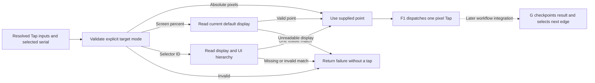

# F3 — Tap on a selected Android device

## Overview

F3 turns the inputs of an `android.tap` node into one point on the Android
device selected for the execution. Pixel targets already provide that point.
Percentage and selector targets require a fresh observation from the same
device. Once a point is resolved, F3 calls the existing F1 pixel Tap
dispatcher. The workflow receives a success or failure result with no
bindable output fields.

**Status** — Specified. F1 already provides the pixel command. The F3 node
handler and the device reads for percentage and selector modes are pending.

## 1. Handler contract

| Item | Contract |
|---|---|
| Identity | `type: android.tap`, `runtimeHandler: android.tap` |
| Capability | `android.device.control` |
| Attempt context | Use the context and deadline supplied by the caller. The current catalog default is 30 seconds, and executable Runtime IR carries the effective `timeoutMs`. |
| Device | Use the exact `adbSerial` from the current device execution for every read, the final Tap, and cleanup. |
| Success | Return `{}` on the `success` port when F1 confirms dispatch. |
| Failure | Return a classified failure to the caller. Phase G applies the configured error policy and records the result. |

Studio authoring and Phase C compilation retain the selected mode and its
literal values. G1 validates the executable IR and G2 supplies resolved
inputs to the handler. F3 receives the explicit `config.targetMode` and the
typed values for that mode. A Phase F test caller can supply those directly.
Reuse the existing [Android targeting contract](../contracts/android_targeting.md#compilation)
and [Runtime IR contract](../contracts/runtime_ir_v1.md).

| `targetMode` | Exact fields | Validation |
|---|---|---|
| `ABSOLUTE_PIXELS` | `x`, `y` | Integers from 0 through 100,000. |
| `SCREEN_PERCENT` | `xPercent`, `yPercent` | Integers from 0 through 100. |
| `SELECTOR_ID` | `selector_id` | Full Android resource ID such as `com.example.demo:id/confirm`. Use the installed targeting contract's syntax rule. Match the ID exactly, including case. |

An absent or unknown mode, missing field, extra field from another mode,
incorrect type, or invalid value fails before any device read or Tap. Do not
coerce numeric strings, trim selector values, or infer a mode from the fields.

## 2. Absolute pixels and the first implementation slice

Use the supplied point as-is in `adb.TapCommand`. Dispatch it through F1 with
the selected serial and attempt context. Pixel mode performs no display or
hierarchy query, so Runtime does not adjust or clip absolute coordinates to
the device's current display. The authored coordinate must suit the intended
device and screen.

The pixel slice is enough to exercise the registry interface and the first
controlled `Start → Tap → End` workflow. The other two modes remain explicit
unsupported inputs in a pixel-only implementation. F9's capability response
advertises a type and handler pair with no targeting-mode field. Wait for all
three modes and their acceptance checks before advertising `android.tap` as
fully supported to Studio or Launcher.

## 3. Screen percentage

1. Read the selected device's current logical dimensions for the default
   display (`0`). Use one snapshot for both axes. Interpret the dimensions
   in the coordinate space that Android input uses, including the current
   orientation and any active size override.
2. Resolve each axis with `round(percent × (dimension − 1) / 100)`. Round
   half values up. For nonnegative inputs, integer arithmetic with wide
   intermediates can use `(percent × (dimension − 1) + 50) / 100`.
3. Check that the resulting point fits the A4 pixel range. Dispatch once.

For a `1080 × 1920` display, `(50%, 25%)` becomes `(540, 480)`, and
`(100%, 100%)` becomes `(1079, 1919)`.

The initial ADB adapter should use the default display's `cur=<width>x<height>`
entry in the fixed `dumpsys window displays` command. Parse the entry within
the display `0` block so secondary displays cannot supply the dimensions.
Reject missing, ambiguous, invalid, or truncated output. Keep the parser
limited to supported Android formats and use fixtures from verified devices.
`wm size` alone supplies initial and base size information and cannot serve as
the observed current logical dimensions for a rotated screen.
See [Android 13 Window Manager display dump](https://android.googlesource.com/platform/frameworks/base/+/refs/heads/android13-release/services/core/java/com/android/server/wm/DisplayContent.java#3392)
and [Android Window Manager shell size command](https://android.googlesource.com/platform/frameworks/base/+/bc56632da95b/services/core/java/com/android/server/wm/WindowManagerShellCommand.java).

Read on demand. Keep the display result local to the attempt so a prior
rotation, size override, or connection cannot leak into the next Tap. Expose
the typed display read for F4 and F10 to reuse when those handlers are added.

## 4. Selector ID

### Read the active hierarchy

- Read the current default-display dimensions and obtain one active-window
  XML hierarchy from the same serial using the fixed `uiautomator dump`
  operation. Use the uncompressed dump so the adapter can examine the
  visible resource IDs provided by Android. See the
  [Android hierarchy dumper](https://android.googlesource.com/platform/frameworks/base/+/31fd8b3fa1eef849a4d5cfb6072d50606e3ba799/cmds/uiautomator/library/core-src/com/android/uiautomator/core/AccessibilityNodeInfoDumper.java).
- Create a fresh Runtime-owned device directory under `/data/local/tmp`
  with an unpredictable, shell-safe name and mode `0700`. Dump to a fixed
  filename inside it. Require directory creation to succeed before use.
  Read the new file through a fixed command. Command arguments contain only
  the serial and Runtime-generated path components. The selector is compared
  locally and never passed to a device shell.
- Apply a **1 MiB hierarchy byte limit** to the read and parser. Use bounded
  capture specific to the hierarchy read through the existing process runner
  boundary. Keep E1's default 64 KiB per-stream diagnostic limit for ordinary
  commands and stderr. Treat oversized, incomplete, malformed, or unsupported
  XML as a failed observation. Do not search partial output.
- On success or failure, attempt to remove the known file and directory
  within the remaining attempt budget, using at most one second total for
  cleanup. Skip new cleanup invocations after cancellation or deadline.
  Cleanup failure alone does not change a resolved target or trigger a new
  observation. A later attempt always uses a new directory. Keep XML, paths,
  and raw output out of normal logs, errors, events, and SQLite.

### Resolve a single target

1. Parse exactly one hierarchy document. Compare `resource-id` values by
   exact equality. Require exactly one matching node in the observed tree.
   Duplicate IDs fail even if one candidate looks preferable. An explicit
   hidden state fails. Standard dumps can omit hidden nodes altogether, in
   which case the result is no match.
2. Parse the match's bounds as integer corners `[left,top][right,bottom]`.
   Require `right > left` and `bottom > top`, then intersect with the
   half-open display rectangle `[0,width) × [0,height)`. Reject an empty
   intersection or unsupported bounds.
3. Calculate `x = left + (right − left) / 2` and
   `y = top + (bottom − top) / 2` using integer division and the clipped
   corners. Validate the resulting pixel point and dispatch once through F1.

For example, bounds `[-40,20][120,100]` on a `1080 × 1920` display resolve to
`(60, 60)` after clipping. Resource ID lookup targets the Android hierarchy.
Coordinate modes, text search, OCR, and other windows are outside selector
matching. Observations are snapshots. The UI or orientation can change
between lookup and dispatch, so success still reports the ADB action and
does not confirm which view handled it.

## 5. Failure, timeout, and retry behavior

| Condition | Result |
|---|---|
| Invalid mode or fields, or a valid mode unavailable in the pixel slice | `COMMAND_INPUT_UNSUPPORTED`, `retryable: false`, with no device read or Tap. |
| Display or hierarchy observation cannot establish a usable point | `COMMAND_FAILED`, `retryable: false`, with a fixed sanitized message. Missing matches, duplicate matches, and invalid bounds can use distinct safe messages under this code. No Tap is dispatched. |
| Known ADB resolver or process start failure | Preserve the applicable F1/A6 classification. Use `ADB_UNAVAILABLE` or `COMMAND_START_FAILED` for the established cause. |
| Attempt is cancelled or its deadline expires | Stop further reads and dispatch. Propagate the context outcome for G/H. A Tap already sent may still take effect. |
| Final dispatcher returns a failure | Preserve its F1 classification. F3 performs no retry, second tap, or fallback to another targeting mode. |

Validate before external I/O and charge all reads, cleanup, and dispatch to
one attempt deadline. A genuine device-state classification requires a
trusted observation. Do not infer device loss from a generic nonzero exit.
Keep raw ADB output, serials, resource IDs, UI text, and generated paths out
of public errors. [F1 error mapping](f1_command_dispatcher.md#4-results-and-failure-mapping)
and [A6 retryability](../contracts/event_error_v1.md#7-retryability) define
how Phase G interprets the result.

## 6. Implementation and acceptance

Keep the handler in the Runtime's internal node-handler layer and use fixed,
typed ADB operations under `internal/platform/adb`. Reuse F1 for the final
mutation. Keep XML parsing and coordinate calculations testable without a
device. Pass the narrow handler dependency to F9 when the registry is
introduced. Phase F uses direct internal tests. Workflow admission, retry
policy, routing, and persistence remain in G/H.

| Stage | Required evidence |
|---|---|
| Pixel slice | Boundary coordinates work. Invalid shapes and values cause zero ADB calls. A valid request issues exactly one Tap for the given serial and performs no display or hierarchy read. |
| Percentage | Test `0%`, `100%`, and half rounding. Test portrait, landscape, size override, secondary-display output, and malformed or truncated output. A valid Tap uses one current default-display observation. |
| Selector | Test a unique exact match, missing and duplicate IDs, hidden and clipped bounds, empty bounds, malformed or oversized XML, cancellation, and best-effort cleanup. Failed resolution causes zero Tap calls. |
| Dispatcher boundary | Verify safe propagation of launch failure, nonzero exit, timeout, and cancellation, with neither a second Tap nor another device selected. |
| Native and live acceptance | Run adapter checks on Linux and Windows. On a real Android device and an ADB-visible emulator, use a test screen and separately observe that a pixel, percentage, and selector Tap activate the intended view. For percentage, verify both orientations. For selector, verify a missing or ambiguous resource ID sends no Tap. |

Record F3 device acceptance independently of F1 subprocess tests. A fake
ADB executable verifies argument and failure handling. It cannot establish
that Android actually activated a view.
