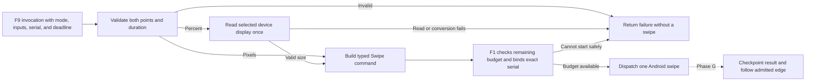

# F4 — Swipe on a selected Android device

## Overview

F4 converts the start and end of an `android.swipe` node into two pixel
points, then asks F1 to dispatch one swipe on the selected device. Pixel
inputs already supply the points. Percentage inputs use one current
display measurement for both points. Once Android accepts the command,
Swipe returns an empty output to the workflow runner.



**Status** — Specified. F1 dispatch, F3 display reads, and the F9 callable
boundary are available. The Swipe command and handler are pending.

## 1. Files and implementation order

| Step | File or package | What to implement |
|---|---|---|
| 1 | `pkg/constants/adb.go` and `internal/validation/nodecontract/targeting.go` | Share the existing Swipe duration maximum of 60,000 ms between authoring validation and dispatch. Keep the accepted bounds unchanged. |
| 2 | `internal/platform/adb/dispatcher.go` | Add a typed `SwipeCommand` to the existing A4 variants. Convert it to fixed ADB arguments, use the shared serial and deadline path, and verify it with a controlled executable. |
| 3 | `internal/handlers/targeting/` | Move Tap's bounded JSON integer decoding and percentage-to-pixel calculation into a small shared package. Update Tap to use those two helpers and rerun its tests. Keep mode selection, field names, and selector handling in the node packages. |
| 4 | `internal/handlers/swipe/swipe.go` and its tests | Implement `NewSwipe(device)` and `(*Swipe).Invoke(ctx, call)`. The device interface needs only `DefaultDisplaySize` and `Dispatch`. Use the existing `registry.Invocation` so F9 can register the method directly. |
| 5 | `cmd/agent/handlers.go` | Add `android.swipe` to F9 after both modes pass live acceptance. Use the ADB resolver already wired for Phase E when constructing the dispatcher. Regenerate Wire if provider inputs change. |

While implementing, use a controlled F9 registry to call the actual Swipe
handler directly. For manual testing, the existing local smoke runner can
register Swipe in its demo-only list. Neither test needs a production
handler registration or a new HTTP endpoint.

## 2. Handler inputs and output

| Item | Contract |
|---|---|
| Type and handler key | Both are `android.swipe`. |
| Capability | `android.device.control`. |
| Config | Exactly one key, `targetMode`, containing `ABSOLUTE_PIXELS` or `SCREEN_PERCENT`. |
| Resolved inputs | Exactly the five fields for the selected mode. Phase C and G1 enforce literal targeting bindings. The handler receives the resolved JSON values. |
| Device and deadline | Use `call.ADBSerial` for the optional display read and for dispatch. Use the caller's attempt context throughout. |
| Result | Return `{}` on success. On error, return no success output and preserve the classified error. Phase G owns transitions and honors the admitted `STOP` or `ERROR_BRANCH` policy. |

| Mode | Exact fields | Limits |
|---|---|---|
| `ABSOLUTE_PIXELS` | `startX`, `startY`, `endX`, `endY`, `durationMs` | Coordinates are integers in 0–100,000. Duration is an integer in 1–60,000 ms. |
| `SCREEN_PERCENT` | `startXPercent`, `startYPercent`, `endXPercent`, `endYPercent`, `durationMs` | Percentages are integers in 0–100. Duration uses the same limit. |

Validate the entire invocation before reading the screen or starting a
gesture. Reject missing or unknown modes, `SELECTOR_ID`, mixed field sets,
extra keys, null values, numeric strings, fractions, and out-of-range
numbers. Accept integral JSON numbers such as `300.0` under the existing
node validation rules. Identical start and end coordinates satisfy the
current Swipe schema. Do not infer a mode, reorder the points, scale pixel
coordinates, or add a new schema restriction.
See the [Android targeting contract](../contracts/android_targeting.md#compilation)
and [Runtime IR node matrix](../contracts/runtime_ir_v1.md#9-current-node-matrix).

## 3. Resolve the points once

1. Check the invocation context, deadline, and exact serial using the
   existing Runtime conventions. Read the selected mode and validate
   `durationMs` and all coordinates.
2. With pixels, use the four coordinates directly. Do not read the display
   or clip the points to the screen. With percentages, call the existing
   `DefaultDisplaySize(ctx, serial)` once. It reads the current logical
   dimensions of default display `0` in its current orientation.
3. Use `round(percent × (dimension − 1) / 100)` independently on each axis.
   Reuse that same width and height for both points. Check the resulting
   coordinates against the A4 pixel bounds before building the command.
4. Pass one typed `SwipeCommand` and the same attempt context and serial
   to F1.

For example, on a **1080 × 1920** display, the percentage inputs
`(50, 80) → (50, 20)` resolve to `(540, 1535) → (540, 384)`. The same
formula uses a different measurement on another device or after rotation.
The measurement is local to one attempt. F4 keeps no RunGroup or
per-device display cache.
See the [F3 display read](f3_tap.md#3-screen-percentage).

## 4. Build and dispatch the ADB command

Add this shape to the typed dispatcher alongside Tap:

```go
type SwipeCommand struct {
    StartX     int
    StartY     int
    EndX       int
    EndY       int
    DurationMS int
}
```

Implement the existing `deviceCommand()` marker. Defensively check the
pixel coordinate and duration bounds at the dispatcher boundary as well.
After F1 supplies the trusted executable and exact serial, it invokes this
fixed operation with separate arguments:

```text
adb -s <serial> shell -T input swipe <startX> <startY> <endX> <endY> <durationMs>
```

Use decimal strings for all five values. The handler supplies numbers
and no command text. F1 supplies `-s`, resolves the executable through
E2, and runs the process through E1. A zero exit code confirms command
completion at the ADB boundary. To confirm scrolling or another UI
effect, observe the device separately.
See the [A4 typed command contract](../contracts/typed_device_command_v1.md)
and [Android swipe implementation](https://android.googlesource.com/platform/frameworks/base/+/8417c7bb1cbb/services/core/java/com/android/server/input/InputShellCommand.java).

### Attempt deadline

The catalog default is **30,000 ms**, and the Swipe field permits up to
**60,000 ms**. A long swipe requires a larger explicit IR attempt timeout
if it is to finish. Display observation, toolchain resolution, process
startup, and Android command overhead consume time in that same attempt.

At the final F1 process-start boundary, after ADB resolution, compare the
remaining deadline budget with the requested gesture duration. If the
remaining time is less than or equal to the duration, return
`context.DeadlineExceeded` before starting the swipe process. Keep this
check in the existing dispatch path and use zero minimum gesture duration
for operations without a known duration. Do not cap the requested gesture
duration or introduce a second timeout.

For example, `durationMs: 40000` with the 30-second default returns a
deadline failure before a swipe is dispatched. An explicit
`timeoutMs: 50000` gives the gesture room to run. Even when the initial
budget is sufficient, a later timeout or cancellation can leave the
Android-side effect uncertain. F4 never retries the swipe or changes the
device. F1 preserves the context outcome for G/H.

## 5. Failure mapping

| Condition | Result |
|---|---|
| Invalid config, unsupported mode, invalid coordinate fields, or invalid duration | `COMMAND_INPUT_UNSUPPORTED`, `retryable: false`. No screen read or swipe for invalid authored inputs. |
| Missing attempt deadline or invalid execution-owned serial | `INTERNAL_ERROR` under F1's invocation rules. |
| Display output cannot be parsed, dimensions are invalid, or converted points exceed the A4 range | `COMMAND_FAILED`, `retryable: false`. No swipe. |
| ADB resolution or command start fails | Preserve the F1 error, including `ADB_UNAVAILABLE` or `COMMAND_START_FAILED` when established. |
| Attempt cancelled, expired, or budget too short for the gesture | Preserve the context outcome. G classifies deadline failures as `NODE_TIMED_OUT`. If dispatch already started, the gesture may have taken effect. |
| Nonzero exit or ambiguous result after possible dispatch | Preserve F1's `COMMAND_FAILED`. Do not treat stderr as proof of device loss or retry safety. |

Return fixed, sanitized error messages. Keep raw ADB output, serials,
and workflow data out of public errors and persisted attempt messages.
See [F1 failure mapping](f1_command_dispatcher.md#4-results-and-failure-mapping).

## 6. Verify the implementation

| Check | Expected evidence |
|---|---|
| Pixel inputs `(540,1535) → (540,384)`, duration `300` | No display read. One process receives `-s`, the exact serial, and `shell -T input swipe 540 1535 540 384 300`. Result is `{}`. |
| Percent inputs `(50,80) → (50,20)` on a `1080 × 1920` test display | One display read and the same command. Check 0% and 100%, half rounding, landscape, and a size override. |
| Second attempt with a different display size or serial | Recalculate both endpoints from the second device's current size. The first attempt's measurement has no effect. |
| Bad mode, mixed inputs, missing endpoint, invalid duration | Zero device calls. Check duration boundaries of 1 and 60,000, modes without fields from the other mode, and unsupported selectors. |
| Unreadable display, cancellation after reading, or insufficient remaining gesture budget | Zero swipe invocations. Include the equality boundary and time consumed by ADB resolution. |
| Action fails, times out, or is cancelled after start | Classified result and no second invocation. |
| Regression checks for Tap | Pixel Tap remains read-free, percent Tap still rounds as before, and selector Tap still resolves the same point. |
| Native and live acceptance | Run adapter checks on Linux and Windows. On a physical Android device and an ADB-visible emulator, open a scrollable test screen and observe movement with pixel and percentage inputs. Repeat percentage input after rotating the device. A successful controlled ADB test establishes arguments only. |

## 7. Example for the local smoke runner

Use this step in the Git-ignored demo after its local registry includes
the Swipe handler. Open a scrollable list on the selected test device
and use coordinates that stay inside the list.

```json
{
  "type": "android.swipe",
  "config": {"targetMode": "SCREEN_PERCENT"},
  "inputs": {
    "startXPercent": 50,
    "startYPercent": 80,
    "endXPercent": 50,
    "endYPercent": 20,
    "durationMs": 300
  }
}
```

The smoke runner verifies that the handler reaches Android and shows the
result. Phase G later verifies the same command inside an admitted workflow,
with success and failure checkpoints.
