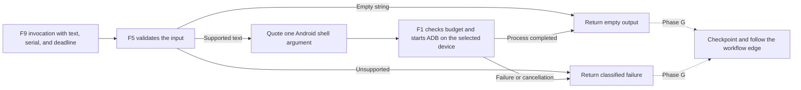

# F5 — Type text into the focused Android field

## Overview

Input Text types a string into the field already focused on the selected
Android device. F5 checks that ADB can carry the string exactly, quotes the
text as one Android shell argument, and sends one `input text` command through
F1. A workflow can focus a field with Tap before calling this node.



**Status** — Handler, text validation and quoting, Windows command-length
guard, and shipped F9 registration are implemented. Linux automated checks
and Windows cross-compilation pass. Native Windows and the remaining
live-device acceptance checks are pending. Phase G owns binding resolution,
workflow order, and attempt records.

## 1. Invocation contract

| Item | Contract |
|---|---|
| Type and handler key | Both are `android.input_text`. |
| Capability | `android.device.control`. Minimum Runtime version `0.1.0`. |
| Configuration | Empty object. An empty or absent internal map represents that object. |
| Resolved inputs | Exactly one `text` field containing a JSON string. The catalog accepts 0–10,000 characters. G2 supplies the value from the admitted binding. |
| Device and deadline | Use the execution-owned `registry.Invocation.ADBSerial` and the original attempt context. The catalog default is 30,000 ms. |
| Success | Return `{}` on success. For empty text, return `{}` after validation with zero device calls. |
| Failure | Return a classified error and no success output. Phase G applies the admitted `STOP` or `ERROR_BRANCH` policy. |

Resolve the input before the F5 call. Validate the attempt context, serial,
and deadline first, then reject extra config keys, missing or extra input
keys, null, and non-string values. Apply the catalog length and F5
representation checks at the handler boundary before dispatch. An empty
string still requires a valid invocation. See the [Runtime IR node matrix](../contracts/runtime_ir_v1.md#9-current-node-matrix).

## 2. Text supported by this adapter

| Input | Decision |
|---|---|
| Printable ASCII, `U+0020` through `U+007E` | Preserve every character, including leading, trailing, and repeated spaces. |
| Quotes, ampersands, dollar signs, backticks, percent signs, and backslashes | Accept as literal printable characters, subject to the `%s` rule. |
| A literal `%s` anywhere in the string | Reject before dispatch. Android's `input text` treats this sequence as a space after the shell has decoded the argument. |
| Non-ASCII text or control characters | Reject before dispatch. This includes accented letters, Vietnamese text, emoji, tab, newline, carriage return, and NUL. |
| More than 10,000 characters or a command line that exceeds a known host limit | Reject with an actionable input error. Keep the text intact. |

These checks specify which values the F5 ADB adapter can represent. The
catalog still accepts strings within its existing schema, which also serves
authoring and compilation. Android's `input text` turns the argument into
key events using its virtual keyboard character map. F5 limits this adapter
to printable ASCII and confirms visible input during device acceptance.
Broader Unicode support needs a separately specified text input path.
[Android input implementation](https://android.googlesource.com/platform/frameworks/base/+/a41d75968d7d5b0468cb01276d108b73823d7cb3/services/core/java/com/android/server/input/InputShellCommand.java)

## 3. Encode one argument and dispatch

1. Build an internal `InputTextCommand{Text string}` from the validated
   value. Check the command bounds and representability again in the adapter.
   A typed command containing empty text also completes without device I/O.
2. Wrap the string in single quotes for the Android shell. For each embedded
   apostrophe, close the quoted section, escape the apostrophe, and reopen the
   quoted section. The encoding is `"'" + strings.ReplaceAll(text, "'", "'\\''") + "'"`
   in Go notation. Keep spaces as spaces. Other printable characters remain
   inside the single-quoted argument.
3. Run the command below through F1 with the exact execution serial. Pass
   the quoted text as the final element in the host argument array. ADB
   sends those quote characters to Android's shell. The Runtime starts ADB
   directly through E1 on Linux and Windows.

```text
adb -s <serial> shell -T input text <one quoted Android shell argument>
```

| Authored text | Final host argument supplied to ADB |
|---|---|
| `Hello world` | `'Hello world'` |
| `O'Reilly & $5` | `'O'\''Reilly & $5'` |
| Two leading spaces followed by `Hello` | `'  Hello'` |

The adapter supplies all other tokens. The selected field belongs to the
current Android window. F5 leaves focus changes and screen observation to
the workflow. It sends at most one text command and keeps the same attempt
deadline through ADB resolution and dispatch. E2 can run its existing
version probe if the executable has yet to be resolved.
See [ADB shell argument handling](https://developer.android.com/tools/adb#shellcommands)
and [F1 dispatch sequence](f1_command_dispatcher.md#3-dispatch-sequence).

### Windows launch length

After E2 resolves the executable, check the complete Windows command line
using the same argument escaping as Go's process launch. Count its UTF-16
code units, including the executable, argument separators, escaping, and
terminating NUL. A command line exceeding the `CreateProcessW` limit of
32,767 code units produces `COMMAND_INPUT_UNSUPPORTED` before the text
process starts. Reuse a platform-specific size check at the ADB process
boundary. The same authored text can take different space after quoting.
Keep one command throughout and reject text that cannot fit.
[Windows process API](https://learn.microsoft.com/en-us/windows/win32/api/processthreadsapi/nf-processthreadsapi-createprocessw)

## 4. Results and safe diagnostics

| Condition | Result |
|---|---|
| Invalid invocation fields, unsupported text, or encoded command too large | `COMMAND_INPUT_UNSUPPORTED`, non-retryable. Explain the applicable restriction in plain language. |
| Missing deadline or invalid execution-owned serial | `INTERNAL_ERROR`, non-retryable. |
| ADB is unavailable or the process cannot start | Preserve the F1 error code and retryability. |
| Nonzero exit or ambiguous process outcome | Preserve F1's `COMMAND_FAILED`. A field can contain partial input if Android started sending key events. |
| Deadline or cancellation | Preserve the context outcome. The already-started command can have affected the field. |
| ADB exits zero | Return `{}`. Observe the field separately when exact visible text matters. |

Attach operation and reason context without including the text, its encoded
argument, raw stdout or stderr, or the device serial. The smoke runner or
workflow boundary logs the result once. F5 performs no retry, replacement,
or automatic clearing of the focused field. ADB receives the text in its
process arguments. Secure credential entry is outside the F5 contract.
See [F1 failure mapping](f1_command_dispatcher.md#4-results-and-failure-mapping).

## 5. Implementation order and acceptance

| Location | Change |
|---|---|
| `internal/platform/adb/command.go` and `internal/platform/adb/input_text.go` | Add the typed command, exact quoting, and representation checks. Reuse the existing dispatcher and E1 process runner. |
| `internal/handlers/inputtext/input_text.go` | Implement the F9 invocation adapter using one `Dispatch` dependency. Return the empty-string result directly after validation. |
| Handler and adapter tests | Verify the exact type/key pair, one argument vector, and failure propagation. Use a controlled executable to check the remote shell argument round trip with only test strings. |
| `test_demo/f-smoke` | Register the local handler and add the fixture below. Verify the field contents on live Android. |
| `cmd/agent/handlers.go` and composition wiring | Register the shipped pair after native and live acceptance. Reuse the Phase E resolver and regenerate Wire if provider inputs change. |

| Check | Expected evidence |
|---|---|
| Exact supported text | Test spaces, apostrophes, double quotes, backslashes, shell metacharacters, standalone percent signs, and a leading hyphen. The Android shell receives exactly one text argument. |
| Input and limits | Test empty text with zero device I/O, the 10,000-character boundary, and one over the limit. Reject `%s`, Unicode, controls, wrong types, and extra fields with zero text commands. |
| Process and host boundaries | Check short and over-limit encoded Windows command lines, including a long string of quotes. Verify native Linux and Windows argument passing, exact serial, cancellation, deadline, and one dispatch per valid attempt. |
| Emulator and physical Android | Focus a plain editable field and observe the exact result for spaces and punctuation. Verify rejection leaves the field unchanged for unsupported Unicode and `%s`. |

See [F9 registration](f9_handler_registry.md#3-wire-the-registry-into-runtime-info)
for how the verified `android.input_text` pair appears in Runtime Info.
F5 runs through the node handler. Phase G owns workflow admission and
execution records.

## 6. Local smoke fixture

Use the installed platform-tools executable and the exact serial from
`adb devices -l`. Focus a disposable text field in Waydroid, then run
`go run . input_text.json` from `test_demo/f-smoke` once the handler is
registered locally.

```json
{
  "adbPath": "/absolute/path/to/platform-tools/adb",
  "adbSerial": "YOUR_DEVICE_SERIAL",
  "steps": [
    { "type": "flow.start" },
    { "type": "flow.delay", "inputs": { "durationMs": 1000 } },
    { "type": "android.input_text", "inputs": { "text": "A2MaTeX 'demo' & $5" } },
    { "type": "flow.end" }
  ]
}
```

Verify that the field displays `A2MaTeX 'demo' & $5` exactly after the four
steps complete. For the rejection check, replace the test text with `a%sb`
and verify that Input Text fails before End and leaves the field unchanged.
