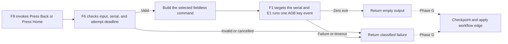

# F6 — Press Back and Press Home on a selected Android device

## Overview

F6 implements the two Android navigation nodes in the installed catalog.
Each handler checks its empty inputs and asks F1 to send one fixed key event
to the selected Android device. This gives the workflow separate actions for
going Back and returning Home, with an empty output on successful dispatch.



**Status** — Specified. The catalog, the F1 dispatch path, and the F9 callable
boundary are available. Both key handlers and their adapter cases are pending.
Phase G will invoke them in workflow order, persist outcomes, and apply the
node's error policy.

## 1. Node and invocation contracts

| Node type and handler key | A4 command | Fixed key |
|---|---|---|
| `android.press_back` | `PRESS_BACK` | `KEYCODE_BACK` |
| `android.press_home` | `PRESS_HOME` | `KEYCODE_HOME` |

Both nodes declare `android.device.control`, minimum Runtime version `0.1.0`,
and a default attempt timeout of 30,000 ms. The effective `timeoutMs` comes
from compiled Runtime IR. Both nodes accept empty `config` and `inputs`
objects, return `{}` on successful dispatch, and have `success` and `error`
ports. The supported error policies are `STOP` and `ERROR_BRANCH`.
See the [Runtime IR node matrix](../contracts/runtime_ir_v1.md#9-current-node-matrix).

At the handler boundary, an absent or empty internal map represents an empty
object. Reject any present entry, including a key code, repeat count, duration,
modifier, or device override. Use the supplied `registry.Invocation.ADBSerial`
and the attempt context for the entire operation. The handler needs one
`Dispatch` dependency and performs zero display or hierarchy reads.

## 2. Implementation order

| Step | Location | Change |
|---|---|---|
| 1 | `internal/platform/adb/dispatcher.go` | Add `PressBackCommand` and `PressHomeCommand` as separate fieldless `DeviceCommand` types. Add an explicit adapter case for each. |
| 2 | `internal/handlers/keyevent/key_events.go` | Add two `registry.Handler`-compatible methods, `PressBack` and `PressHome`, with a shared validation and dispatch helper. Each method selects its own command. |
| 3 | F6 handler and ADB dispatcher tests | Exercise both exact type/key pairs through a local F9 registry. Verify each emits its own fixed command and preserves failure classifications. |
| 4 | Local `test_demo/f-smoke` runner | Register both methods and provide separate `press_back.json` and `press_home.json` fixtures. Run them from different Android starting screens so each result can be observed independently. |
| 5 | `cmd/agent/handlers.go` and composition wiring | Enable each pair after its native adapter and real-device acceptance pass. Reuse the existing E2 resolver and regenerate Wire if provider inputs change. |

## 3. Validate and dispatch

1. Return the context outcome immediately if the attempt is already cancelled
   or expired. Require an attempt deadline and a valid execution-owned serial.
2. Check that both invocation maps contain zero entries. On invalid input,
   return `COMMAND_INPUT_UNSUPPORTED` before ADB resolution or process startup.
3. Invoke `Dispatch` once with the command chosen by the handler. F1 resolves
   ADB using E2, attaches the exact `-s` target, rechecks the remaining attempt
   time, and calls E1 once for the action. An uncached ADB resolver may perform
   its version probe first.
4. Return `{}` when F1 reports success. Preserve its classified error or
   context outcome on failure.

The command types carry no fields. The adapter constructs the following
argument vectors and uses zero minimum gesture duration in the shared F1
path. The attempt deadline still applies before and during dispatch.

```text
adb -s <serial> shell -T input keyevent KEYCODE_BACK
adb -s <serial> shell -T input keyevent KEYCODE_HOME
```

The key name is a constant selected by the adapter case. The executable
comes from E2 and the serial comes from the invocation. Neither node accepts
an argument list or a shell command. The adapter uses one key event with no
flags, modifiers, repeats, or long-press behavior. An exit code of zero
confirms ADB command completion. The effect of Back depends on the current
Android window, and the effect of Home is observed separately in acceptance.
See [A4 command variants](../contracts/typed_device_command_v1.md#2-command-variants)
and [F1 dispatch](f1_command_dispatcher.md#3-dispatch-sequence).

## 4. Failure and logging

| Condition | Result |
|---|---|
| Extra config or input field | `COMMAND_INPUT_UNSUPPORTED`, non-retryable. Zero ADB calls. |
| Invalid execution serial or absent deadline | `INTERNAL_ERROR`, non-retryable. Zero ADB calls. |
| ADB cannot be resolved or the process cannot start | Preserve `ADB_UNAVAILABLE` or `COMMAND_START_FAILED` and its F1 retryability. |
| Nonzero exit or ambiguous outcome | Preserve F1's `COMMAND_FAILED`. F6 never sends a second key event. |
| Cancellation or deadline before or during execution | Preserve the context outcome. An event already sent may have reached Android. Phase G classifies the attempt and owns future retry decisions. |

Return validation errors with `validate_inputs` and preserve more specific
operation context supplied by F1. Keep the serial, workflow data, and raw ADB
output out of diagnostics. F6 returns its error to the caller so the smoke
runner or workflow execution boundary can log the failure once.
See [F1 failure mapping](f1_command_dispatcher.md#4-results-and-failure-mapping).

## 5. Acceptance and registration

| Check | Expected evidence |
|---|---|
| Exact registry pairs and command mapping | Each exact pair invokes its own handler. A mismatched pair is unavailable. On success, an executable test double receives the exact serial and fixed argument vector for a single key event. The result is `{}`. |
| Empty payload and invalid invocation | Accept empty maps. Extra fields, a bad serial, a missing deadline, and pre-cancellation each cause zero ADB calls. |
| Process error paths | Verify ADB availability, launch failure, nonzero exit, timeout, and cancellation. An expired attempt produces zero new key events. An attempted action never retries within F6. |
| Back on Waydroid or another Android emulator | Open an Android Settings subpage with a known parent. Dismiss any keyboard or dialog. Run the Back fixture and observe the parent screen. |
| Home on Waydroid or another Android emulator | Open Android Settings. Run the Home fixture and observe the launcher. Reopen Settings separately for a repeat check. |
| Native and physical acceptance | Run adapter checks on Linux and Windows. Repeat Back and Home on a physical Android device and record the observed screen change for each. |

Use [F9 registration](f9_handler_registry.md#3-wire-the-registry-into-runtime-info)
to publish the verified type/key pairs. Registry construction and Runtime
Info read the enabled capability list without contacting ADB. Phase G1
consults the same registry before creating a run. F6 exposes these commands
through node handlers only.

## 6. Local smoke fixtures

Use these fixture shapes once the local runner includes F6. Replace `adbPath`
and `adbSerial` with the actual platform-tools executable and the exact serial
shown by `adb devices -l`. On Windows use the absolute path to `adb.exe`.

`press_back.json`

```json
{
  "adbPath": "/absolute/path/to/platform-tools/adb",
  "adbSerial": "YOUR_DEVICE_SERIAL",
  "steps": [
    { "type": "flow.start" },
    { "type": "flow.delay", "inputs": { "durationMs": 1000 } },
    { "type": "android.press_back" },
    { "type": "flow.end" }
  ]
}
```

`press_home.json`

```json
{
  "adbPath": "/absolute/path/to/platform-tools/adb",
  "adbSerial": "YOUR_DEVICE_SERIAL",
  "steps": [
    { "type": "flow.start" },
    { "type": "flow.delay", "inputs": { "durationMs": 1000 } },
    { "type": "android.press_home" },
    { "type": "flow.end" }
  ]
}
```

From `test_demo/f-smoke`, run `go run . press_back.json` after preparing the
Back starting screen, or `go run . press_home.json` after preparing the Home
starting screen. Both runs print Start, the one-second Delay, the selected key
event, and End in order. Verify the Android screen change as a separate check.
