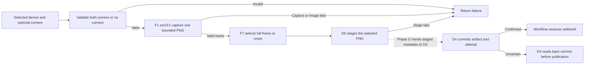

# F7 — Capture a full screen or percentage region

## Overview

Screenshot captures a PNG from the Android device selected for the current
execution. The publisher can leave the region empty for a full-screen
capture or supply its top-left and bottom-right corners as percentages.
ADB captures one full frame. For a region, Runtime crops that frame in
memory and gives D5 only the cropped PNG. The workflow receives an
`artifactId` after D4 commits the successful attempt.



**Status** — Specified. The existing node definition accepts full-screen
capture with empty inputs. The optional region contract, capture handler,
storage integration, and Studio controls are pending. Deliver F7 with
[D5](../d_persistence/d5_artifact_store.md).

## 1. Node contract

| Item | Requirement |
|---|---|
| Node type and handler key | Both are `android.screenshot`. |
| Capability | `android.screen.capture`. |
| Config | Empty. Use the presence of region fields to choose the operation. |
| Full screen | Empty `bindings` in Editor Graph and empty `inputs` in Runtime IR. |
| Region | Exactly four literal bindings corresponding to two points. Each value is an integer from 0 to 100 inclusive. |
| Context | The execution supplies the exact ADB serial and attempt deadline. The default node timeout is 30,000 ms. |
| Successful output | `{"artifactId":"<opaque ID>"}`. Width and height describe the stored image in D5 metadata. |
| Control flow | `success` and `error` ports with the existing `STOP` and `ERROR_BRANCH` policies. G applies the admitted policy. |

| Corner | X, measured from the left edge | Y, measured from the top edge |
|---|---|---|
| Top-left | `leftPercent` | `topPercent` |
| Bottom-right | `rightPercent` | `bottomPercent` |

Studio shows **Full screen** or **Region** and groups the four values into
two points. **Full screen** clears and omits all four bindings before
validation and save. **Region** requires both points. Studio persists
literal percentages and can show a rectangle preview using the same corner
ordering. A preview does not establish the size or orientation of the frame
the device will return during execution.

For `20%, 20%` to `40%, 30%`, Runtime IR carries these inputs. Editor Graph
uses `bindings` and `kind: "LITERAL"` for the same four values.

```json
{
  "leftPercent": { "source": "LITERAL", "value": 20 },
  "topPercent": { "source": "LITERAL", "value": 20 },
  "rightPercent": { "source": "LITERAL", "value": 40 },
  "bottomPercent": { "source": "LITERAL", "value": 30 }
}
```

The catalog declares the four optional integer fields. A Screenshot-specific
rule in Backend and Runtime validation enforces all-or-none, literal sources,
`leftPercent < rightPercent`, and `topPercent < bottomPercent`. Local and
Backend compilation preserve the field names and literal values. G admission
checks the same rule for supplied IR. F7 defensively rechecks the resolved
values before any ADB I/O. Reject partial or extra fields, nulls, strings,
non-integral numbers, out-of-range values, and equal or reversed edges.
Use the existing integral JSON number semantics, so `20.0` is accepted as
20. Existing empty-input workflows keep their full-screen behavior.

## 2. Capture one bounded frame

1. Check the attempt context, deadline, execution-owned serial, and resolved
   inputs. Invalid input stops before resolving or invoking ADB.
2. Use the `SCREENSHOT` operation from the [A4 typed device command
   contract](../contracts/typed_device_command_v1.md) with no workflow-provided
   arguments. F1 uses the E2-resolved executable, binds the exact serial,
   and runs the fixed argument vector through E1.

   ```text
   adb -s <serial> exec-out screencap -p
   ```

3. Capture stdout as binary PNG data with a **16 MiB** limit. Reuse E1's
   bounded stdout capture and truncation signal. Keep the ordinary command
   output and screenshot stderr on their existing diagnostic limits. Reject
   truncated stdout even when ADB exits zero. Empty stdout and unsuccessful
   process outcomes fail the attempt. Keep the same deadline through tool
   resolution, capture, image processing, and staging.
4. Read PNG dimensions before full decode. Require each dimension to be at
   most **4,096** and the frame to contain at most **12,000,000 pixels**.
   For a region, decode the bounded source image before cropping. For full
   screen, pass through the original bytes and use D5's full PNG validation
   before staging. D5 applies its own limits to the image it stores.

F7 never makes a separate `wm size` call. Dimensions and orientation come
from the PNG captured by this attempt, including for devices of different
sizes in one run group. The full frame stays in memory for a region capture.
The existing per-device execution and group concurrency limits bound how
many captures can be active. Release capture and decoded image references
after staging or failure. See [E1 process boundaries](../e_device_subsystem/e1_process_runner.md)
and [D5 PNG validation](../d_persistence/d5_artifact_store.md#3-validation-and-publication).

## 3. Convert corners to a pixel rectangle

Treat percentages as image edges. The left and top edges are inclusive.
The right and bottom edges are exclusive. Round the leading edges down
and the trailing edges up so the crop includes the pixels it overlaps.
With integer division, the formulas are:

```text
x0 = (width  * leftPercent) / 100
y0 = (height * topPercent) / 100
x1 = (width  * rightPercent + 99) / 100
y1 = (height * bottomPercent + 99) / 100
```

Apply the formulas relative to the decoded image's top-left and require
the resolved rectangle to fit its bounds and have positive width and
height. Pixel index conversion used by Tap and Swipe is a separate rule.
Here, a trailing edge at 100% equals the image dimension. `(0, 0)` to
`(100, 100)` covers the whole frame.

| Captured frame | Percentage points | Pixel bounds `(x0,y0)` to `(x1,y1)` | Stored PNG |
|---|---|---|---|
| 1920 × 1080 | `(20,20)` to `(40,30)` | `(384,216)` to `(768,324)` | 384 × 108 |
| 1080 × 1920 | `(20,20)` to `(40,30)` | `(216,384)` to `(432,576)` | 216 × 192 |
| 7 × 5 | `(20,20)` to `(40,30)` | `(1,1)` to `(3,2)` | 2 × 1 |

Encode the rectangle as PNG with its own dimensions. Bound encoded bytes
to 16 MiB and check the attempt context before and after decode and encode,
before staging, and before returning a staged result. Leave the captured
source bytes out of the artifact directory, database, logs, and events.
Cropping reduces stored and downloaded bytes for typical regions. The
full ADB capture still must fit the source limits.

## 4. Stage, commit, and retrieve

Use a Screenshot staging callback supplied by G for the active attempt
through the internal F9 invocation. Its contract is
`StageScreenshot(ctx, pngBytes) → (artifactID, error)`. The callback calls
D5 with the runtime-owned attempt identity and retains the staged metadata
in that attempt's execution scope. Validate that the callback is present
before capture in the execution path. F7 uses the returned ID as provisional
handler output. This leaves existing handlers' return types intact.

G sends the stage record and the matching output ID to D4. D4 commits the
metadata, successful attempt output, and events in the same SQLite
transaction. G exposes the output to later nodes only after D4 confirms
the commit. D5 and D4 own disposal after failed or stale finishes and
read-back after uncertain commits. If cancellation occurs after staging,
G still owns the stage record and must settle or reconcile it. D5 also owns
the stored size and dimensions, which describe the crop in region mode.

The client uses authenticated `GET /api/v1/artifacts/{artifactId}` to open
the committed PNG. D5 resolves the ID under the Runtime-controlled storage
root. Studio uses the existing route for both capture options. See the
[D5 publication rules](../d_persistence/d5_artifact_store.md#3-validation-and-publication)
and [A7 artifact retrieval](../contracts/local_api_v1.md#11-artifact-retrieval).

## 5. Failures

| Condition | Required outcome |
|---|---|
| Invalid corners, fields, or config | `COMMAND_INPUT_UNSUPPORTED`, non-retryable. No ADB or storage I/O. |
| Missing execution serial, deadline, or staging callback | `INTERNAL_ERROR`. Stop before capture. |
| Resolution or process failure | Preserve the existing F1 classification and retryability. F7 makes at most one capture per attempt. |
| Empty, oversized, invalid, or truncated PNG, invalid dimensions, or crop encoding failure | `COMMAND_FAILED`, non-retryable. Leave no artifact. |
| D5 stage rejects image content | `COMMAND_FAILED`, non-retryable. Leave no successful output. |
| D5 cannot stage the validated image | `PERSISTENCE_FAILED`. Publish no output or artifact reference. |
| D4 commit failure or uncertainty | Use D4's existing failure and read-back path with the D5 artifact evidence. No workflow success while the commit is unconfirmed. |
| Cancellation or timeout | Preserve the attempt outcome. G settles the attempt and any staged file using the D4/D5 lifecycle. |

Return safe operation and reason information. Logs and persisted errors
exclude raw PNG bytes, ADB stdout and stderr, local paths, and device serials.

## 6. Implementation and integration order

| Order | Owner | Deliverable |
|---|---|---|
| 1 | Backend, Runtime validation, Studio | Define the fields and cross-field checks in the Backend catalog and validators and sync the installed Runtime definition. Add Editor Graph and Runtime IR parity fixtures for empty, valid, partial, and reversed regions. Update the node matrix and Screenshot action example. Studio exposes Region after the matching catalog and Runtime build are available. |
| 2 | D5 and D4 | Implement PNG staging, metadata, recovery, and atomic attempt publication. Verify with synthetic PNGs before adding ADB as a dependency. |
| 3 | F1 and F7 | Add the bounded binary Screenshot path under `internal/platform/adb` and the F7 handler under `internal/handlers/screenshot`. Use a controlled executable and an injected staging callback to exercise full-screen and region capture. |
| 4 | G, F9, and A7 | Supply the attempt-scoped staging callback, pass metadata into the finish checkpoint, and enable artifact retrieval by ID. Register and advertise the shipped handler once these paths and native acceptance pass. |

Use the same graph and IR envelope versions. Publish the revised node
definition through the existing catalog release flow with the minimum
Runtime version that implements it. Keep frozen definitions for earlier
workflow revisions. Update [the node matrix](../contracts/runtime_ir_v1.md#9-current-node-matrix)
and [C4 validation documentation](../local_workflow_validation/c4_node_contract_validator.md)
with the catalog change. Defer pixel and selector regions, fractional
percentages, variable-driven corners, display selection, and multi-region
capture.

## 7. Acceptance

| Check | Expected evidence |
|---|---|
| Empty inputs and a valid region | Backend and Runtime agree. Existing full-screen graphs compile. The example region keeps all four literals in IR. |
| Partial corners, wrong binding source, equal or reversed edges, range and type errors | Validators reject the same cases. An invalid resolved call starts zero ADB processes. |
| Controlled ADB capture | One capture uses the exact serial and fixed `exec-out` arguments. PNG bytes reach F7 unchanged. Nonzero exit, cancellation, and stdout truncation publish no result. |
| Crop geometry | A color-coded test PNG proves the stored pixels come from the expected position. Verify landscape, portrait, odd dimensions, and a `(0,0)` to `(100,100)` region. |
| Capture and image limits | Exercise the encoded byte boundary, oversized source, malformed and truncated images, axis and pixel-count limits, and an encoded crop exceeding the store limit. |
| Persistence and recovery | Success opens the expected PNG by `artifactId`. File or checkpoint failure exposes no success reference. Uncertain commit and restart preserve the committed PNG and remove confirmed orphans. |
| Native and live acceptance | Verify binary ADB arguments and capture on Linux and Windows. On Waydroid and a physical Android device, retrieve both captures and compare visible content and dimensions. Rotate the device and repeat. Confirm the downloaded region is cropped and the full source was never stored for that region. |
