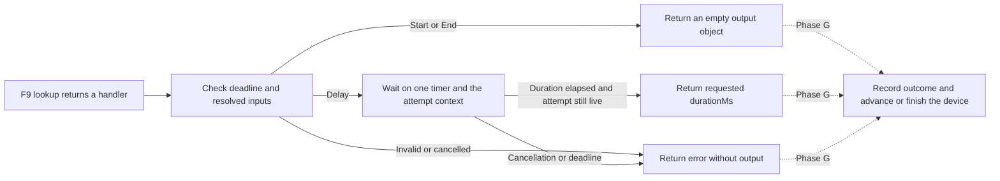

# F8 — Start, End, and Delay handlers

## Overview

F8 adds three functions to the F9 registry. Start returns immediately so
the workflow can proceed from its entry node. End returns immediately so
the engine can finish the current device execution. Delay waits for a
requested number of milliseconds and returns that number if the attempt
is still live. The handlers can be implemented and tested before Phase G
is available, without an Android device.



**Status** — Start, End, and cancellable Delay are implemented, tested, and
registered in the shipped F9 registry. Their local completion criteria are
met. Phase G owns graph transitions and persisted workflow integration.
Publisher-authored Log remains deferred pending its sensitive-data contract.

## 1. Files and implementation order

| Step | File or package | What to implement |
|---|---|---|
| 1 | `internal/handlers/flow/invocation.go` | Shared attempt check and the empty-input operation used by Start and End. |
| 2 | `internal/handlers/start/start.go` and `internal/handlers/end/end.go` | Two named functions that satisfy `registry.Handler` and share the empty-input behavior. Keep tests alongside each handler. |
| 3 | `cmd/agent/handlers.go` | Add the Start and End registrations to the existing F9 provider after those handlers pass their tests. Check the Runtime Info projection. |
| 4 | `internal/handlers/delay/delay.go` | Validate the duration, wait under the supplied context, and return the requested value. Add Delay to the same registry after its tests pass. |
| 5 | `pkg/constants/execution.go` | Define the shared Delay maximum of `300_000` ms for Go code. Use the same limit as the installed catalog. |

Use the existing F9 signature for each named function:

```go
func Invoke(ctx context.Context, call registry.Invocation) (map[string]any, error)
```

`call.Config` and `call.Inputs` are separate `map[string]json.RawMessage`
objects. At this boundary a nil or empty map represents an object with no
fields. The functions read their inputs without modifying them. They do
not use `call.ADBSerial`, so a direct test can leave it empty. G1 validates
the exact IR and G2/G4/G17 resolve bindings before calling the registered function.
See the [F9 registry spec](f9_handler_registry.md) and
[Runtime IR node matrix](../contracts/runtime_ir_v1.md#9-current-node-matrix).

## 2. Exact handler contracts

| Type and handler key | Config | Resolved inputs | Successful payload | Control ports | Default attempt timeout |
|---|---|---|---|---|---:|
| `flow.start` | `{}` | `{}` | `{}` | `success` | 1,000 ms |
| `flow.end` | `{}` | `{}` | `{}` | None. End is terminal. | 1,000 ms |
| `flow.delay` | `{}` | Only `durationMs`, an integer from 0 through 300,000 | Only `durationMs`, equal to the requested integer | `success`, `error` when the admitted policy allows it | 300,000 ms |

All three declare no execution capabilities. Start and End accept no
bindings. Delay accepts the resolved value from a literal, workflow input,
node output, Flow variable, or Global variable under the existing binding
contract. The handler needs no access to the source binding, variable store,
or workflow graph.

A handler returns a non-nil output object on success and `nil, err` on
failure. The object is node output data. Port selection, execution state,
timestamps, and IDs remain engine concerns. An empty successful output
serializes to `{}`.

## 3. Implement Start and End

Put the attempt check in the shared `flow` package. First return
`ctx.Err()` if the attempt is already cancelled or timed out. Then require
a context deadline. A missing deadline is an `INTERNAL_ERROR`. If the
deadline has already been reached, return `context.DeadlineExceeded`,
even if the context notification has yet to arrive.

Implement `flow.CompleteEmpty(ctx, call)` using that check and the
following steps:

1. Require both config and inputs to have zero keys. An unexpected key
   returns a non-retryable `COMMAND_INPUT_UNSUPPORTED`.
2. Recheck the attempt before returning success. Return
   `map[string]any{}, nil` if it is still live.

Both `start.Invoke` and `end.Invoke` delegate to `flow.CompleteEmpty`.
Their behavior differs when Phase G consumes the result:

- For Start, G follows the node's admitted `success` edge. G1 checks one
  Start at `entryNodeId`. Invoking Start creates no run or execution row.
- For End, G records a successful terminal result for the current device
  execution. End has no outgoing edge. Reaching it through a valid error
  branch still produces the End handler's normal success result. G computes
  the final device result and H later aggregates the RunGroup.

See the [IR graph rules](../contracts/runtime_ir_v1.md#7-edge-and-graph-contract).

## 4. Implement Delay

Use the shared attempt check before validation and again before starting
the timer. Require empty config and exactly one input key, `durationMs`.
Decode that key into a JSON number with the same integer semantics used
by existing node validation. In Go, decoding into `*float64` lets the
handler reject `null` as well as missing values. Require an integral
number in `[0, 300_000]` before converting it to an integer and multiplying
by `time.Millisecond`. Accept integral JSON numbers such as `1500.0`.
Reject a numeric string, fraction, boolean, null, extra field, or value
outside the range.

Use the duration and caller's existing deadline. The implementation shape
below starts after validation and a live attempt check:

```go
if durationMS > 0 {
    timer := time.NewTimer(time.Duration(durationMS) * time.Millisecond)
    defer timer.Stop()

    select {
    case <-ctx.Done():
        return nil, ctx.Err()
    case <-timer.C:
    }
}
if err := flow.CheckAttempt(ctx); err != nil {
    return nil, err
}
return map[string]any{"durationMs": durationMS}, nil
```

Zero completes immediately, subject to the same final attempt check. When
the timer and deadline are ready together, the final check prevents a
success output after expiry. Validation failures start no timer. An
attempt that times out before the full wait returns a deadline error.
The handler never reduces the requested duration. Use one standard timer
and no additional goroutine. A Delay occupies its current device worker
slot until completion or cancellation. Phase H's Wait for Variable
releases its slot under a separate contract.

### Follow one Delay attempt

1. F9 returns `delay.Invoke` for `("flow.delay", "flow.delay")`.
2. The caller gives it a live context with a 5,000 ms attempt timeout and
   resolved input `{"durationMs":1500}`.
3. After 1,500 ms, Delay returns `{"durationMs":1500}`. This is the
   requested duration. Phase G records actual attempt timing independently.
4. G validates and commits the result, then follows the success edge. With
   a 1,000 ms attempt timeout instead, Delay returns
   `context.DeadlineExceeded`, and G records `NODE_TIMED_OUT` and evaluates
   the node's admitted error policy.

The catalog maximum equals the default timeout. A 300,000 ms delay needs
an explicit timeout above 300,000 ms to leave room for attempt overhead
and scheduling. F8 does not extend the caller's deadline.

## 5. Register the functions and verify Runtime Info

Change the existing provider in `cmd/agent/handlers.go` from an empty list
to explicit registrations. The final F8 list is:

```go
return registry.New(catalog, []registry.Registration{
    {Type: "flow.start", RuntimeHandler: "flow.start", Run: start.Invoke},
    {Type: "flow.end", RuntimeHandler: "flow.end", Run: end.Invoke},
    {Type: "flow.delay", RuntimeHandler: "flow.delay", Run: delay.Invoke},
})
```

In the first slice add only Start and End. After Delay is verified, an
authenticated `GET /api/v1/runtime-info` must include these three
`supportedNodes` entries in this order, alongside any other enabled pairs:

```json
[
  {"type": "flow.delay", "runtimeHandler": "flow.delay"},
  {"type": "flow.end", "runtimeHandler": "flow.end"},
  {"type": "flow.start", "runtimeHandler": "flow.start"}
]
```

F9 already sorts the entries and drives the existing HTTP response. The
provider's signature stays the same. F8 introduces no endpoint for invoking
a handler directly. These capabilities can be published once their local
tests pass because these handlers require no Android adapter. Full workflow
execution still requires Phase G.

## 6. Failure handling and Phase G handoff

| Condition | F8 return | Engine consequence |
|---|---|---|
| No attempt deadline | `nil, INTERNAL_ERROR` | Internal invocation failure. |
| Malformed config or resolved input | `nil, COMMAND_INPUT_UNSUPPORTED` with a fixed message and `retryable: false` | Attempt failure. G applies the admitted error policy. |
| Attempt cancellation | `nil, context.Canceled` | G/H settle cancellation through the lifecycle. |
| Attempt deadline reached | `nil, context.DeadlineExceeded` | G maps to `NODE_TIMED_OUT`. Delay can take an eligible error edge under `ERROR_BRANCH`. |
| Success | Output data as specified above | G validates and persists output, then advances or finishes the device. |

Use the existing typed command error for classified failures and preserve
the context errors so callers can match them with `errors.Is`. Do not echo
input values in error messages. The handlers perform no retry, ADB request,
database write, event publication, or graph transition. Start and End
retain `STOP`. Delay accepts the admitted `STOP` or `ERROR_BRANCH`.
See [A6 errors and events](../contracts/event_error_v1.md).

## 7. Tests and completion criteria

| Test | Expected result |
|---|---|
| Start and End with empty and nil maps and a live deadline | Each returns a non-nil empty output. |
| Start and End with a config field or input field | Non-retryable `COMMAND_INPUT_UNSUPPORTED` and no success output. |
| Delay receives zero, 1,500, or 300,000 | Zero returns immediately. Positive durations complete no earlier than requested and return the exact requested value. Test the maximum with a timeout greater than the requested duration. |
| Delay receives missing, extra, null, fractional, negative, too large, quoted, or wrongly typed input | Returns `COMMAND_INPUT_UNSUPPORTED` without starting a wait. |
| Missing deadline, already cancelled or expired context | All three fail with the specified error and no success output. |
| Cancellation, timeout, or timer/deadline tie during Delay | Stops on cancellation or deadline and returns no duration. |
| Registry and authenticated Runtime Info | Look up each accepted function and verify the response lists the registered type/handler pairs in order. |
| Phase G integration | `Start → Tap → End` reaches a terminal checkpoint. `Start → Delay → End` proves committed success and the separate timeout error path. |

Use Go 1.25's `testing/synctest` for positive waits, long boundaries, and
cancellation/deadline ordering. Check the handler packages and the existing
API suite with the race detector. F8 checkout is complete when the named
functions are callable through F9 and Runtime Info advertises the accepted
entries. Persisted transitions are verified during Phase G integration.

## 8. Deferred nodes

The Backend catalog includes `utility.log`. Defer its executable handler
until the team approves supported inputs, audience, redaction, and whether
messages may be streamed or stored. Keep it out of F9 capabilities until
then. B4 continues to own Runtime operational logs.

Switch belongs to G15 routing. Set Variable belongs to G18 execution with a
Phase D checkpoint. Wait for Variable belongs to Phase H scheduling. See
[workflow bindings](../contracts/workflow_bindings.md).
