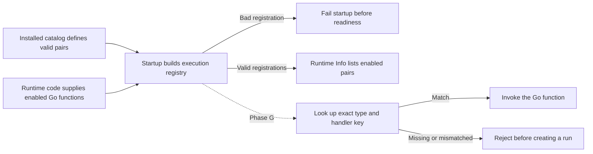

# F9 — Executable node handler registry

## Overview

F9 gives Runtime a way to answer two questions. Can this build execute a
node with this exact type and handler key? If it can, which Go function
should the workflow engine call? F9 builds that lookup at startup. The same
registrations populate `GET /api/v1/runtime-info`.



**Status** — Specified. F3 Tap already has a Go handler. F9 adds the lookup,
the Tap adapter, and Runtime Info wiring. F9 can be tested before Phase G
exists.

## 1. Put the map in `internal/handlers/registry/registry.go`

The installed catalog already tells Runtime that the type `android.tap`
uses the key `android.tap`. Its
`nodecontract.Registry.CompilationDefinition(nodeType)` method returns that
key. F9 supplies the callable. For instance, the catalog can describe
`android.swipe` even while the build has no Swipe function to register.

Use these Go types as the implementation shape.

```go
type Invocation struct {
    ADBSerial string
    Config    map[string]json.RawMessage
    Inputs    map[string]json.RawMessage
}

type Handler func(context.Context, Invocation) (map[string]any, error)

type Registration struct {
    Type           string
    RuntimeHandler string
    Run            Handler
}

type SupportedNode struct {
    Type           string
    RuntimeHandler string
}

type Registry struct {
    byHandler map[string]Registration
    supported []SupportedNode
}
```

Implement `New(catalog *nodecontract.Registry, entries []Registration)`.
For each entry, check that both IDs and the function are present. Read the
installed compilation definition for `entry.Type` and require its
`RuntimeHandler` to match `entry.RuntimeHandler`. Reject repeated types and
repeated handler keys. Then store the entry under `entry.RuntimeHandler`.

After validating the entries, sort the supported pairs lexically by `Type`.
`SupportedNodes()` returns a copy. Discard the partially constructed
registry on any validation error. An empty list is valid. Only Runtime's
composition code supplies registrations, and callers cannot mutate the
registry after construction.

Lookup takes the type as well as the key. The second argument finds the
map entry. The first confirms that the callable belongs to that node type.

```go
func (r *Registry) Lookup(nodeType, handlerKey string) (Handler, bool) {
    entry, ok := r.byHandler[handlerKey]
    if !ok || entry.Type != nodeType {
        return nil, false
    }
    return entry.Run, true
}
```

For example, `Lookup("android.tap", "android.tap")` returns the Tap function
in a registry where Tap is enabled. `Lookup("android.swipe", "android.tap")`
returns no function, even though the key exists. Identifiers are exact and
case-sensitive.

## 2. Adapt the existing Tap handler in `internal/handlers/tap/`

Add an adapter method on the existing `Tap` type. It accepts the common
invocation and extracts the mode from `Config["targetMode"]`. Reject missing,
null, or non-string modes using the same classified invalid-input failure
as Tap. For valid strings, return the existing call directly.

```go
return h.Run(ctx, call.ADBSerial, mode, call.Inputs)
```

Keep Tap's existing device dependency. The adapter passes through its
output or error, including cancellation. Tap continues to validate the
target and handle ADB. Local handlers such as Start and End can implement
the same callable shape without using the serial.

### Trace a real lookup in the first F9 test

1. Construct the real F3 Tap handler with a controlled device dependency.
   Register its adapter under `Type: "android.tap"` and
   `RuntimeHandler: "android.tap"`.
2. Look up the exact pair. Call the returned function with the test's
   attempt context and this invocation.

   ```text
   Serial   emulator-5554
   Config   {"targetMode":"ABSOLUTE_PIXELS"}
   Inputs   {"x":120,"y":300}
   ```

3. The adapter extracts `ABSOLUTE_PIXELS`. `Tap.Run` resolves the point,
   then calls the device dependency once for `emulator-5554` at
   `(120, 300)`. The successful result is `{}`.
4. Try the mismatched Swipe/Tap pair and verify no callable comes back.
   Also pass a typed error from the controlled device and verify the adapter
   preserves that error.

## 3. Wire the registry into Runtime Info

Create a small provider in `cmd/agent` that passes the already installed
catalog and the build's explicit list of enabled functions to `registry.New`.
Add the provider to `cmd/agent/wire.go` and regenerate Wire. The startup path
becomes:

```text
nodecontract.NewDefaultRegistry
  -> cmd/agent registry provider
  -> api.NewHandler / router
  -> foundation.RuntimeInfo
  -> supportedNodes in the existing response
```

In `internal/api/foundation`, map the registry's supported pairs onto the
existing response DTO once when constructing the route handler. Preserve
authentication, version fields, and the JSON shape. An empty registry
returns `"supportedNodes": []`. Registry construction and Runtime Info
perform no ADB operations. Invalid registrations fail startup before the
Runtime sends its readiness record.
See [A7 Runtime Info](../contracts/local_api_v1.md#get-runtime-info).

The first F9 checkout uses a test-only Tap registration. The shipped
registry can be empty until Tap passes
[F3 acceptance](f3_tap.md#6-implementation-and-acceptance) in all three modes.
Start, End, and Delay can then register as F8 delivers them. Log stays
conditional. Switch, Set Variable, and Wait for Variable belong to G/H.

## 4. What Phase G will do with this registry

G1 looks up the exact `type` and `runtimeHandler` from each admitted IR
node. If a pair is missing, it rejects the run before writing execution
records or sending device commands. For an accepted node, G2 resolves the
inputs and the attempt runner calls the function with that device's serial
and deadline. G validates the returned output and commits the transition.
For example, G follows Tap's success edge and treats End as terminal.
F9 does not create runs or choose edges.
See [Runtime IR compatibility](../contracts/runtime_ir_v1.md#8-capabilities-and-compatibility).

## 5. Verify the first checkout

| Test | Expected result |
|---|---|
| Register an unknown type, mismatched key, duplicate type or key, or nil callable | Constructor returns an error and exposes no partial registry. |
| Test the exact Tap pair and invoke its adapter | The real handler sends precisely one controlled Tap. The adapter preserves handler failures. |
| Look up a wrong type, unknown key, or different case | Returns no callable. |
| Read the registry concurrently and modify a returned capability list | Lookups and later capability lists remain unchanged. Race tests pass. |
| Call Runtime Info with empty and nonempty test registries | The JSON contains an empty array or exact pairs sorted by type. The request still requires authentication. |
| Start Runtime with no usable ADB | Runtime reaches readiness and answers Runtime Info without invoking ADB. |
