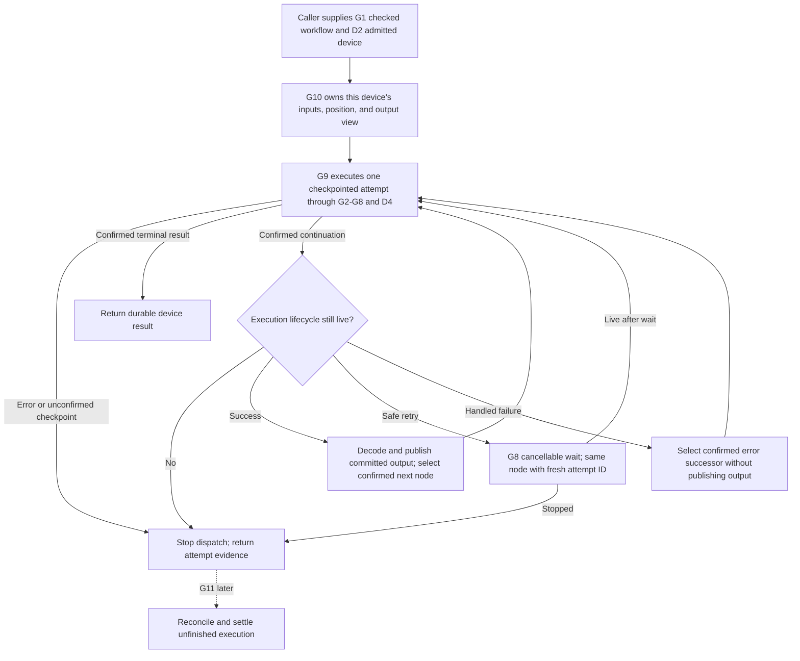

# G10 — Sequential device runner

## Overview

G10 runs one admitted workflow from Start to its terminal result on one selected
Android device. It supplies the loop around the implemented G9 coordinator:
choose the current node, execute one checkpointed attempt, retain successful
committed output, then follow the confirmed successor or wait for a safe retry.

For example, in `Start → Delay A → Delay B → End`, the publisher can bind
A's `durationMs` output to B's duration input. G10 makes that output
available only after A's successful checkpoint commits. Each device and
new execution has its own input/output view, even when node IDs are identical.



**Status** — Internal runner implemented and verified on Linux on 2026-11-18.
The agent, runner test package, and local smoke harness cross-compile for Windows
amd64. Native Windows execution and the real-ADB manual milestone remain pending;
ADB currently reports no connected devices. G9 provides the one-attempt
coordinator, and G10 supplies the synchronous workflow loop and committed-output
view. G11 still owns actual owner shutdown; G12–G14 and required H1/H2 coordination
connect admission, scheduling, and HTTP APIs.

The [Runtime IR graph rules](../contracts/runtime_ir_v1.md#7-edge-and-graph-contract),
[G1 checked-content contract](g1_runtime_ir_admission.md#2-internal-entry-point-and-result),
[G4 commit handoff](g4_previous_node_output_bindings.md#3-execution-local-view-and-commit-handoff),
[G8 retry handoff](g8_safe_retry_policy.md#6-checkpoint-handoff-and-cancellation-between-attempts),
and [G9 coordinator](g9_checkpointed_node_attempt.md) remain authoritative.

## 1. Scope and existing owners

| Owner                         | Responsibility                                                                                                               |
| ----------------------------- | ---------------------------------------------------------------------------------------------------------------------------- |
| G1                            | Validate the exact Runtime IR, installed executable pairs, graph, and per-device inputs before new admission.                |
| E6 / D2 / later G12 and H1/H2 | Check device readiness, commit identities and entry positions, and schedule admitted workers.                                |
| G10                           | Own one device's execution loop, input/output view, current node and retry counters; consume confirmed G9 results.           |
| G9 / G2–G8                    | Resolve inputs, invoke once with a deadline, validate/normalize output, choose a route or safe retry, and commit through D4. |
| D4                            | Allocate attempt sequence and atomically persist attempts, device/group state, and events; reconcile uncertain commits.      |
| G11                           | Supply accepted cancellation authority and settle stopped work, including boundaries with no active attempt.                 |
| D6                            | Interrupt unfinished executions on restart; never resume or replay an uncertain action.                                      |
| G15–G19 / Phase H             | Add Switch, variables, Screenshot integration, multi-device scheduling, and Pause/Resume under their own contracts.          |

One Run call owns one DeviceExecution until it reaches a confirmed terminal
result or stops with an error/handoff. It never admits work, opens a package,
compiles source, schedules another device, or exposes an API. It does not read
SQLite after every node to rediscover state already supplied by G9.

## 2. Callable API and construction

Use package `internal/execution/runner`. Construct the immutable workflow
runner once, then pass one admitted device to each Run call:

```go
type Dependencies struct {
    Bindings    *bindings.Resolver
    Invoker     *invocation.Invoker
    Outputs     *outputs.Validator
    Checkpoints attempts.Checkpoints
    Now         func() time.Time
}

type Request struct {
    RunGroupID        string
    DeviceExecutionID string
    ADBSerial         string
    WorkflowInputs    ir.Object
    Control           func() attempts.Control
}

type AttemptEvidence struct {
    Ref      execution.AttemptRef
    Began    bool
    Finished bool
    Sequence int64
    Cursor   string
}

type Result struct {
    DeviceStatus  string
    TerminalError *xerror.CommandError
    NextNodeID    string
    LastAttempt   AttemptEvidence
}

func New(
    ctx context.Context,
    document *ir.Document,
    dependencies Dependencies,
) (*Runner, error)

func (r *Runner) Run(ctx context.Context, request Request) (Result, error)
```

New builds a node-ID index and G5 routing index from the supplied checked
document, then constructs G9 with those routes and the injected dependencies.
Pass Now through to G9; nil preserves G9's time.Now default. Require its four
execution/checkpoint dependencies and reuse G9's constructor checks. Do not
introduce a registry factory, service locator, new clock framework, or second
handler-dispatch interface for application callers.

The document is the owned decoded document from a successful G1 result. New
borrows it immutably for the runner's lifetime; the caller must not mutate its
nodes, maps, slices, or policies while the runner exists. Copy node values into
the lookup index as needed, without serializing or copying the whole IR for
every device or node. No context or mutable execution state lives on Runner.

New checks the small trusted-entry invariants needed to build that index:
non-nil document, bounded nonempty nodes, unique valid node IDs, and an entry
ID present in the index. Reuse routing.New for its existing route checks.
G1 still owns whole-document contract, compatibility, reachability, and
acyclicity validation; New does not run G1 or a second compiler.

Callers must not supply a typed-nil checkpoint implementation. An unexported
consumer interface may be used internally to test G9 call ordering, but normal
construction always supplies the real G9 coordinator. No new dependency is
needed.

## 3. Admission and device-input pairing

The caller prepares a new execution in this order:

1. Obtain successful G1 checked content from the exact IR and device inputs.
2. Construct/reuse the matching G10 runner before admitting new work when
   practical, so constructor failure does not strand a new queued run.
3. Perform the existing E6 preflight and D2 atomic admission through the caller.
4. Invoke Run with the committed run/device IDs, exact admitted ADB serial,
   and the checked input map for that same device.

G1's `DeviceInputs[i]` corresponds to the original `devices[i]`. The caller
keeps that ordinal pairing when supplying `ir.Object(checked.DeviceInputs[i])`
to Run. G10 never selects an input map by map iteration order, sorts devices
and inputs independently, or shares another device's map.

Require canonical Runtime UUIDs for RunGroupID and DeviceExecutionID and a
nonblank serial. Validate only these request-shape invariants, not the contents
of the already checked input schema again. An empty non-nil workflow-input
object is valid; nil is invalid because successful G1 supplies a map even
when the schema has no inputs.

The caller keeps WorkflowInputs unchanged during entry copying. Run makes
one owned map with copied scalar JSON bytes, then uses it throughout that
execution. No partial copied view is used after cancellation. G10 cannot prove
from an input map alone that its serial/IDs belong together; the admission
caller owns that trusted pairing and D4 guards durable transitions.

Run starts only a newly admitted, not-yet-started device at Document.EntryNodeID.
There is no caller-supplied initial node, seeded committed-output map, existing
attempt ID, or resume flag. Request-ID replay belongs to G12 and must not call
Run again. D6-interrupted work requires a new user run with new identities.

Run uses the caller's execution-lifetime context synchronously. The later
scheduling caller must tie that context to the Runtime owner, not to the HTTP
request that admitted the work: closing that request must not cancel an admitted
run. G10 neither detaches the context nor creates a background worker itself.

## 4. Execution-local state and attempt identity

Keep the following state local to Run:

| State                 | Initial value and rule                                                                                                             |
| --------------------- | ---------------------------------------------------------------------------------------------------------------------------------- |
| Workflow inputs       | One owned checked input map for this device.                                                                                       |
| Committed outputs     | Fresh empty `map[string]ir.Object`; never shared with another Run call.                                                            |
| Current node          | Document.EntryNodeID, looked up through the once-built index.                                                                      |
| Expected device state | QUEUED for the first G9 call; RUNNING for later node/retry calls.                                                                  |
| AttemptNumber         | 1 on entry to each different node; increase only for a confirmed safe retry of that node.                                          |
| PreviousAttemptID     | Empty for a node's first attempt; the immediately preceding committed failed attempt ID for its retry.                             |
| Visited nodes         | Track ordinary node entry to prevent an invariant failure from revisiting a completed path node. Retries are not new path entries. |
| LastAttempt           | Evidence from the latest actual G9 call, including an unconfirmed begin/finish when it returns an error.                           |

Allocate a fresh canonical UUID v4 before every G9 call using the existing
UUID package. Prefer its error-returning generation function so entropy failure
stops before begin rather than panicking. Record an attempted identity only
when making that call; failure to generate one creates no dummy attempt.

AttemptNumber is not Sequence. For example, three successive nodes with no
retries all have AttemptNumber 1 while D4 assigns Sequence 1, 2, and 3. G10
never predicts, increments, or supplies D4's Sequence.

The caller serializes work for a DeviceExecution. The same immutable Runner
can serve different device executions concurrently because their mutable state
is local. G10 creates no goroutine pool or per-device scheduler. A competing
call cannot bypass D4 by supplying a new attempt ID, but a stale competing
call is not authorization to cancel the legitimate worker.

## 5. Loop ordering

The required loop is:

1. Check the actual parent context, including a reached deadline, and the
   latest accepted cancellation snapshot. At a stopped boundary, return a
   handoff without creating or invoking another attempt.
2. Find the current admitted node in the index. For a new path node reject a
   revisit before calling G9. Select its effective admitted policies unchanged.
3. Generate a fresh attempt identity, recheck lifecycle, and call G9 Run once.
   Supply the exact node, current expected device state, retry predecessor,
   serial, device-local values view, and the original Control callback.
4. Capture the call's AttemptRef and G9 confirmation metadata. On a Go error,
   return immediately through section 9; do not use any proposed outcome.
   A nil-error return must have Began and Finished true under G9's contract;
   missing confirmation is a runner invariant error, not usable continuation.
5. If the confirmed result has no next position, return its terminal device
   projection under section 8. That persisted terminal result is authoritative.
6. Otherwise check lifecycle before publication, waiting, or selecting the
   next invocation. For success, decode and publish the committed snapshot.
   For retry, perform section 7. For an ordinary successor, set current node
   to the confirmed NextNodeID and reset node-local retry state.
7. Continue from step 1. Never invoke the handler directly or call G5/G8 Decide
   again to replace G9's already committed route/retry decision.

A successor must exist in the admitted node index. A normal successor cannot
be the current node; same-node continuation requires G9's committed Retry
metadata. No node-order iteration, fan-out, graph traversal of every reachable
branch, or alphabetical node selection substitutes for this loop.

G1's acyclic graph and bounded retry policies bound the work: at most the
number of nodes on the selected path times MaxNodeAttemptNumber G9 calls.
A missing node, ordinary revisit, or inconsistent continuation is an internal
runner error. Stop before another dispatch, preserve the last confirmed
checkpoint, and hand off; never repair the graph or invent another route.

## 6. Committed output publication

Use `bindings.Values{WorkflowInputs: ownedInputs, CommittedOutputs: outputs}`
for every G9 call in this execution. The output view changes only between calls.

For a confirmed SUCCEEDED attempt with a continuation, decode the exact
G9 Outcome.Output bytes once into a non-nil ir.Object and insert under the
producer node ID before resolving the next node. Preserve json.RawMessage
scalar values; do not decode numbers to float64 or reconstruct output from
the handler's original mutable map. `{}` remains a valid empty object.

No output is inserted for failed, timed-out, cancelled, rejected, running, or
unconfirmed attempts. A safe retry failure also inserts nothing. Publication
must never overwrite a previously published producer: the admitted path is
acyclic and only one successful result per producer can exist in this view.
A duplicate publication is an invariant error, not a latest-output policy.

A decode failure after a confirmed success is an internal error. The successful
attempt is already durable; G10 cannot change it to FAILED, call FinishAttempt
again, re-invoke the producer, or continue with an empty map. Return the
finished-attempt evidence for G11 and preserve the committed next position.

For `Start → Delay A → Delay B → End`, B can resolve NODE_OUTPUT from A's
committed durationMs. A failed attempt of A is unavailable until a later retry
succeeds. A different device or a new run cannot see this output. An unavailable
producer follows G2/G4 and G9's existing input-failure checkpoint/error policy.

No consumer follows terminal End, so caching End's empty output is unnecessary.
Drop all execution-local maps on return, including error/handoff returns. SQLite
history is retained normally. These maps are not flow/global variable storage
and are not serialized into SQLite or a resume file.

## 7. Safe retry loop

G9 has already decided eligibility and committed the failed attempt, same-node
NextNodeID, and RetryDecision. G10 must consume that decision without inspecting
ADB output, making another readiness request, or deciding whether an uncertain
action is safe to replay.

1. Require the confirmed continuation to name the same current node and to
   remain within that node's admitted attempt limit. Require a failed ordinary
   outcome with Stop false and retry metadata matching the admitted MaxAttempts
   and DelayMS. Inconsistent metadata is a guard error; do not correct it or
   decide eligibility again. Keep the node's policy unchanged.
2. Check lifecycle before waiting, then call G8 Wait with the live execution
   context and the committed DelayMS. Accepted cancellation can precede the
   context signal; the lifecycle owner must also cancel the execution context
   promptly to wake an already running wait.
3. On any wait error, return the boundary handoff. Never begin another attempt.
4. After successful wait, recheck the parent and accepted cancellation before
   requesting another attempt. Set PreviousAttemptID to the failed attempt ID,
   increment AttemptNumber, and use a fresh attempt ID.
5. G9/D4 must confirm the new begin before G6 can invoke. The new attempt gets
   a fresh G6 timeout; the retry wait is not deducted from that node timeout.

The full fixed delay starts after the confirmed failed finish. G10 adds no
retry timer persistence, timer recovery, jitter, exponential backoff, hidden
retry, or retry around G9's Go errors. Zero-delay retry still uses the same
lifecycle checks. Exhaustion and unsafe retry have already selected the final
ordinary error route/terminal result through G9.

During waiting, the last attempt is FAILED and no new RUNNING attempt exists.
The DeviceExecution is still non-terminal at the same node. Cancelling now is
G11's no-active-attempt transaction; do not rewrite the failed attempt, create
a dummy CANCELLED attempt, or replay the action just to settle the execution.

## 8. Durable terminal result and Go error semantics

Nil Go error means Run reached a confirmed terminal DeviceExecution result.
It does not mean the workflow succeeded: inspect DeviceStatus and TerminalError.
G10 projects the final confirmed G9 result consistently with existing D4:

| Confirmed terminal attempt                                                  | Result.DeviceStatus | Result.TerminalError                                                     |
| --------------------------------------------------------------------------- | ------------------- | ------------------------------------------------------------------------ |
| SUCCEEDED at End                                                            | SUCCEEDED           | Nil.                                                                     |
| FAILED without continuation, including an internal Stop outcome saved by G9 | FAILED              | Safe error from that terminal outcome.                                   |
| TIMED_OUT without continuation                                              | FAILED              | Safe timeout error; TIMED_OUT is an attempt status, not a device status. |
| CANCELLED committed under accepted authority                                | CANCELLED           | Nil.                                                                     |

Terminal NextNodeID is empty. LastAttempt contains that call's confirmed Ref,
Began/Finished flags, Sequence, and finish Cursor. The cursor is that finish's
watermark, not a separate new event or necessarily the latest global watermark
when another device is also committing.

A node failure followed through ERROR_BRANCH may later reach End successfully.
Its earlier failure remains in SQLite history, while the terminal device result
is SUCCEEDED with no TerminalError. G10 does not retain an "ever failed" flag.

Reuse this small projection of D4's existing device semantics. Do not calculate
RunGroup status/summary, scan past attempts, write terminal state again, or add
a parallel final-result service. D4/repositories remain authoritative; G21
verifies their aggregate behavior later.

If cancellation arrives after G9 confirmed a terminal checkpoint, return that
terminal result. Do not replace success/failure with an optimistic CANCELLED
status, return a cancellation error solely because the context now signalled,
or try a second terminal finish. There is no remaining device work to cancel.

On a nonterminal stop/error, DeviceStatus is empty, TerminalError is nil, and
the Go error explains the stop through safe classification. NextNodeID is only
the last confirmed/expected position known to this call, not proof of current
storage state or permission to resume. LastAttempt carries metadata only;
never expose the output map, protected workflow, or raw handler output here.

## 9. Unfinished work and G11 handoff

| Stop point                                                              | Evidence returned / action forbidden                                                                                                                      |
| ----------------------------------------------------------------------- | --------------------------------------------------------------------------------------------------------------------------------------------------------- |
| Invalid constructor/request                                             | Return contextual guard error; perform no G9 call. Request guard failure returns empty Result.                                                            |
| Parent/accepted stop before first call                                  | Return context-classified error, entry position, and empty LastAttempt; G11 handles admitted queued work.                                                 |
| G9 error with Began false                                               | Include the exact attempted Ref and G9 flags; no dispatch or continuation. An uncertain begin may nevertheless have committed.                            |
| G9 error with Began true and Finished false                             | Include Ref and positive Sequence; no publication/continuation. Finish may have rolled back, committed without confirmation, or been finalized elsewhere. |
| Confirmed continuation, then cancellation before publication/next begin | Return finished evidence and committed next position; do not overwrite that attempt.                                                                      |
| Wait cancellation/deadline                                              | Return prior failed attempt's finished evidence and same-node position; no active attempt is invented.                                                    |
| Output/route invariant after confirmed finish                           | Return guard error with finished evidence; retain the durable outcome and stop before any next dispatch.                                                  |

G9's Began/Finished flags describe this call's confirmations. In particular,
Finished false does not prove that SQLite still has a RUNNING attempt, and
Began false does not prove that no row exists. G11 must use its authoritative
lifecycle/reconciliation path before settling storage. G10 adds no second
read-back, persistence retry, or direct cancellation write.

Preserve classified G9, checkpoint, and context errors through errors.Is/As.
Never turn a stale checkpoint, missing acknowledgement, or persistence failure
into a normal node failure/error route. A nonterminal G9 Stop cannot authorize
continuation merely because a NextNodeID was accidentally retained.

Check lifecycle before first work, before every G9 call, after nonterminal G9
return, before publication/wait, and after Wait. Sample accepted authority and
the actual context together; a stale cached "running" flag is insufficient.
Pass the original Control callback to G9 so it also sees the latest cancellation
and shutdown deadline. Control has the same trusted, nonblocking, synchronized
contract as G9; it must contain no database/network work.

G10 never claims that owner Stop and exit is integrated. G11 still has to supply
the real authority, settle queued/between-attempt cases, and close SQLite only
after settlement. A test can supply that authority to verify G10's stop behavior
without implementing the owner-managed lifecycle early.

## 10. Restart, persistence, and event boundaries

Only G9/D4 write attempt checkpoints. A normal attempt has its existing begin
and finish transactions; G10 adds no per-node snapshot query, output-view write,
terminal write, or event append. Events become visible through D3/D4 after the
corresponding state commit, not from an in-memory runner notification.

If Runtime exits after an Android action may have dispatched, its unfinished
checkpoint remains evidence for D6. On restart, existing ExecutionRecovery
interrupts unfinished devices/attempts before new requests. G10 does not recreate
its output view from history or restart at the stored next node. A completed
record remains user history; a new run uses new identities and fresh maps.

A crash during retry delay also ends that execution. D6 does not restore the
wait or run the next retry. Reuse the existing recovery implementation and
repository contracts; add only focused integration evidence for the runner.

## 11. Errors, logs, and confidentiality

Use a fixed-message ErrRunnerInvalid sentinel in `pkg/x-error/runner.go` for
trusted constructor/request/continuation/output invariants. Use operations
`configure_device_runner` and `run_device_workflow` with fixed details such as
`runner_dependencies_unavailable`, `runner_document_invalid`,
`runner_request_invalid`, `runner_transition_invalid`,
`runner_output_snapshot_invalid`, `runner_duplicate_output`, and
`runner_attempt_identity_unavailable`. Preserve a more specific existing
OperationError from G9 or G8 instead of replacing its operation.

Context errors remain context errors; accepted cancellation without a parent
signal returns a wrapped context.Canceled. No new public A6 error code, attempt
status, run status, or API response is introduced. Guard errors contain no
serials, workflow input names/values, IR, decoded output, or raw handler text.

G10 returns contextual errors to the calling execution/supervisor boundary.
That boundary logs one sanitized ERROR under B4 with approved correlation
metadata and safe classifications; it must not dump Result, the output cache,
RawIR, or an arbitrary wrapped error's text. Do not add per-node ready logs,
a second progress-event stream, or another logger dependency to the runner.

Production authorization/disclosure remains I2. Local plaintext inputs,
checked IR, and output bytes remain in the authorized in-memory lifetime and
existing D4 history rules; no new filesystem cache is created by G10.

## 12. Implementation mapping and efficiency

| Runtime file                                           | Responsibility                                                                                                          |
| ------------------------------------------------------ | ----------------------------------------------------------------------------------------------------------------------- |
| `internal/execution/runner/runner.go`                  | Public types, constructor/index/G9 composition, and sequential Run loop.                                                |
| `internal/execution/runner/state.go`                   | Execution-local input copying, output publication, retry/evidence and terminal projection helpers.                      |
| `pkg/x-error/runner.go`                                | One fixed guard sentinel; reuse existing classifications and OperationError.                                            |
| `internal/execution/runner/runner_test.go`             | Focused loop ordering, lifecycle boundaries, result/evidence semantics, output isolation, and invariant checks.         |
| `internal/execution/runner/runner_integration_test.go` | G1-to-D2-to-real-G9 workflows with file-backed SQLite, controlled handlers, retry/error paths, and D6 restart evidence. |
| `internal/execution/runner/testdata/workflow.json`     | One readable complete IR fixture; reuse existing G1 fixture conventions and avoid large duplicate fixtures.             |

Target 100–300 production lines in two or three production files; report tests
and docs separately. Keep substantial preparatory refactoring outside this
change rather than hiding it in the runner phase. No cmd/agent wiring, generated
Wire edits, repository changes, SQL migration, dependency, or public endpoint
is required to deliver this internal callable runner.

Build indexes once per immutable workflow, O(nodes + edges). Each iteration
performs O(1) position lookup plus G9's existing bounded work and at most one
successful snapshot decode. Copy inputs once per device call, not per node.
All maps are bounded by the admitted workflow/input limits. Successful output
bytes are bounded by MaxEventBytes per producer; up to RuntimeIRMaxNodes entries
have a conservative encoded-data ceiling of about 8 MiB per execution, plus
map/decoded-value overhead. Do not add a second whole-output byte cache.

Phase H must account for active-worker memory when choosing concurrency; G10
adds no global memory manager or new product limit. It uses no unbounded queue,
background goroutine, polling, database loop, whole-history scan, or transaction
around handler/wait work. Drop execution-local state on every return.

## 13. Verification and acceptance

| Scenario                              | Required evidence                                                                                                                                                                     |
| ------------------------------------- | ------------------------------------------------------------------------------------------------------------------------------------------------------------------------------------- |
| Complete ordinary path                | Start → Delay → End runs in edge order; each handler sees its own durable RUNNING begin; final device/group and attempt history agree with D4.                                        |
| Exact device inputs                   | G1 checks per-device values; Run uses the matching ordinal/serial and does not mutate the supplied input map.                                                                         |
| Previous output                       | A producer's committed scalar reaches a later consumer; failed/unconfirmed output never enters the view.                                                                              |
| Execution isolation                   | Separate device/run calls using identical node IDs cannot consume each other's workflow inputs or producer values.                                                                    |
| Error branch                          | A failed attempt followed by the admitted error successor can still reach successful End; no stale terminal error remains on the successful result.                                   |
| Unhandled failure                     | STOP failure returns nil Go error with durable FAILED device status and the final safe error; no successor is invoked.                                                                |
| Safe retry success/exhaustion         | Wait occurs after failed finish and before the next G9 call; fresh UUID, predecessor, node attempt number, and D4 Sequence are correct. Exhaustion follows the committed final route. |
| Timeout/unsafe replay                 | A timed-out node is not retried by G10; error-branch versus terminal behavior follows G9; terminal device status is FAILED, never TIMED_OUT.                                          |
| G9 Go error or unconfirmed checkpoint | No publication, wait, or next dispatch; returned evidence preserves the attempted identity and confirmation uncertainty.                                                              |
| Output/transition invariant           | Missing node, ordinary revisit, duplicate output, or invalid successful snapshot stops without a repair write or re-dispatch.                                                         |
| Lifecycle boundaries                  | Stop before first call, before publication, before/during/after retry Wait, and before another begin produces no later dispatch and returns the right handoff evidence.               |
| Terminal/cancellation race            | A confirmed terminal result survives later cancellation; a nonterminal committed attempt remains unchanged when G11 settlement is still needed.                                       |
| Concurrency                           | Different admitted device executions can use one immutable runner without races; competing calls for one device cannot duplicate dispatch through D4.                                 |
| Restart interruption                  | An action that may have dispatched is not repeated after process loss; reopening via D6 marks unfinished execution INTERRUPTED and retains prior committed results.                   |
| Scope and disclosure                  | No new API, handler registration, artifact stage, variable store, scheduler, protected-value log, or auto-resume behavior appears.                                                    |

Use real G1 validation, actual G9/G2–G8, migrated temporary file-backed SQLite,
D2 admission, and the real D4 service for workflow integration. Controlled F9
handlers may stand in for Android while inspecting durable begin state and
recording invocation order. Small unit seams must not replace the real-G9
integration gate. Keep SQLite I/O outside synthetic-time bubbles; use the
existing deterministic timer patterns only in isolated no-I/O checks.

For restart evidence, use a bounded child-process fixture or an equivalent
existing recovery fixture whose stop point is explicit: after RUNNING commits
and the simulated side effect occurs, before finish. Reopen that same temporary
store through existing recovery; verify INTERRUPTED and no second side effect.
Do not call this a real-device crash test when it uses controlled handlers.

Run focused runner checks, focused execution race checks, full Go regression
tests, vet, formatting, Linux build, Windows amd64 cross-compilation of the
agent and runner test package, and tracked/new-file whitespace checks. Record
actual evidence before marking implementation verified.

## 14. Manual runnable milestone and deferred work

The manual milestone is one complete `Start → Tap → End` workflow on a real
ADB-connected emulator/device, driven by the G10 callable runner. A readable
local smoke harness can load complete Runtime IR plus one device's inputs,
perform G1 and normal preflight/admission, and show the final device result,
attempt order, and SQLite records. Use a clear fixture rather than hidden
temporary code. Keep local experiments in the established ignored test_demo
area unless separately approved as committed tooling.

The same harness should demonstrate a handled error, unhandled error, timeout,
and an eligible controlled pre-dispatch failure. Do not provoke an uncertain
Android action and then repeat it to demonstrate retry. Automated controlled
handlers provide the repeatable failure-path evidence; real ADB confirms the
normal end-to-end dispatch path.

No HTTP start route is required for this milestone. Report native Windows and
real-device acceptance separately from Linux tests/Windows cross-compilation;
if the device environment is unavailable, leave that milestone explicitly
pending rather than claiming manual acceptance.

G11 still owns actual owner shutdown and all unfinished boundary settlement.
G12–G14 and required H1/H2 coordination integrate admission, snapshots, start,
and scheduling. G15–G19 add special execution paths; G20 exposes artifacts;
G21–G22 verify aggregate results and the combined engine. G10 does not change
Backend node definitions, Studio IR, Launcher authentication, or public API
contracts. Integration guides expand when the corresponding real API build
is implemented and verified.

## 15. Implementation and verification record

The core implementation adds 286 production lines across runner.go, state.go,
and pkg/x-error/runner.go. Two test files and one readable IR fixture are separate
from that production count. New composes the real G9 coordinator and once-built
G5 index; Run has no SQLite queries or writes beyond G9's checkpoint calls.
Constructor dependency errors retain G9's existing operation/classification;
runner-specific guards use ErrRunnerInvalid.

Verified on Linux:

- `go test ./internal/execution/runner` — loop contracts and real G1/D2/G9/SQLite
  workflows using installed contracts and actual Start/Delay/End handlers.
- `go test -race -count=1 ./internal/execution/...` — execution helpers and runner
  checks, including concurrent independent executions and competing calls.
- `go test -count=1 ./...` and `go vet ./...` — full regression and static checks.
- `make fmt build` — formatting and Linux agent build.
- Windows amd64, CGO-disabled compilation of cmd/agent, the runner test binary,
  and the ignored local smoke executable.
- Markdown formatting, local links/anchors, and tracked/new-file whitespace
  checks for changed files.

The child-process recovery fixture exits after a simulated side effect while
its attempt is durably RUNNING. Reopening the same file-backed store through D6
preserves the previous successful Start, marks the unfinished work INTERRUPTED,
and leaves exactly one side-effect marker. This is controlled-process recovery
evidence, not an Android device crash test.

The ignored local development demo is under `test_demo/g10-smoke` in the Runtime
checkout. It has main.go, demo.json, tap.json, and README.md. From that directory,
`go run .` executes the default workflow; `go run . tap.json` uses the configured
Android fixture. The default uses the normal Runtime SQLite location and prints
its exact path and admitted IDs. The same store lock excludes a running agent.
The smoke executable is a separate direct caller; cmd/agent is not wired to run
workflows in this phase.

Observed smoke results using isolated verification stores, read back directly
from SQLite:

| Scenario                                  | Observed committed result                                                                                |
| ----------------------------------------- | -------------------------------------------------------------------------------------------------------- |
| Default workflow                          | SUCCEEDED; four attempts; producer and consumer both persist durationMs 25.                              |
| One simulated pre-dispatch failure        | SUCCEEDED; five attempts; failed producer attempt 1 followed by successful attempt 2, consumer, and End. |
| Two simulated failures with maxAttempts 2 | FAILED; Start plus two failed producer attempts; no consumer or End.                                     |
| Producer timeout                          | FAILED device; Start plus TIMED_OUT producer carrying NODE_TIMED_OUT; no retry.                          |
| Timeout with error edge to End            | SUCCEEDED device; Start, TIMED_OUT producer, successful End; consumer skipped.                           |
| Unconfigured tap fixture                  | G1 accepts the complete IR; the demo rejects missing ADB configuration before admission or dispatch.     |

The demo's opt-in failure simulation wraps Delay only, labels its failures
explicitly, and changes no production handler or node contract. Its trusted
compatibility version is 0.1.0 for the current catalog; it is not an override of
the installed agent's build version. Verification stores were isolated from user
history; normal demo usage follows the standard platform state directory.

Real-device Start → Tap → End and native Windows acceptance remain explicitly
pending. No API, scheduler, owner-shutdown settlement, special handler, artifact
stage, repository, migration, dependency, or generated wiring was added.
