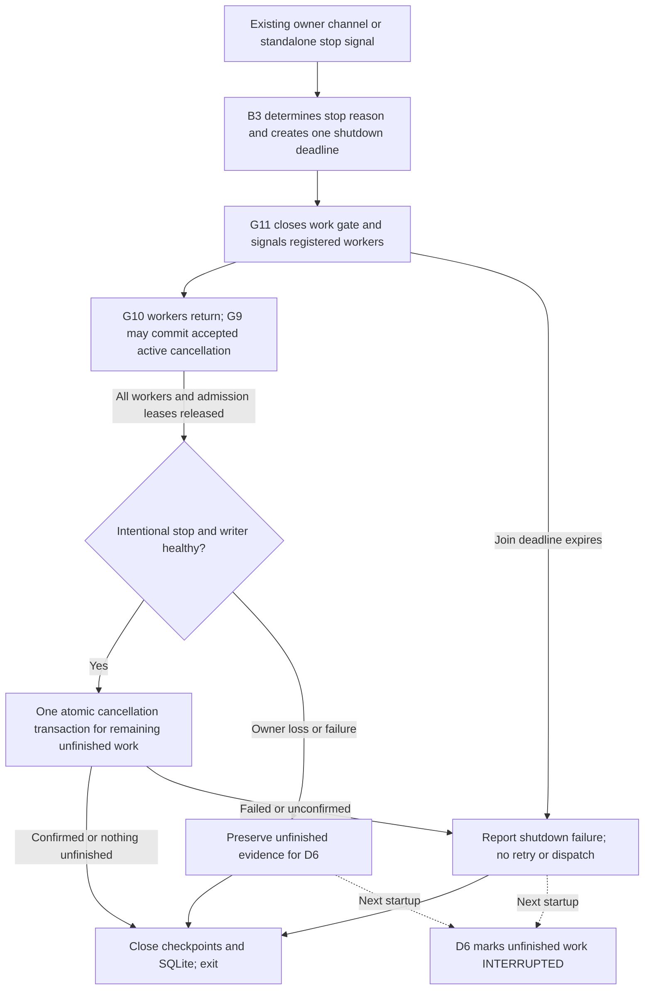

# G11 — Runner shutdown

## Overview

G11 makes **Stop and exit** safe while workflows are running. It connects the
existing B3 owner-managed process lifetime to G10 workers, gives G9 the accepted
cancellation authority and shared deadline, and settles unfinished SQLite state
before the checkpoint service and store close.

For example, the user closes Launcher while a workflow is waiting to retry.
The failed attempt is already committed and must stay FAILED. G11 prevents the
retry, joins the worker, and marks the unfinished device/run CANCELLED in one
transaction. A forced exit or unexpected owner loss can instead leave unfinished
work for D6 to mark INTERRUPTED on the next startup. Neither path replays an
uncertain Android command.



**Status** — Implemented and verified on Linux using real migrated SQLite,
G1/G9/G10 controlled workflows, inherited owner pipes, and the existing managed
agent HTTP harness. Full Go tests, race checks, vet, Wire generation, Linux build,
and Windows amd64 cross-compilation pass. Native Windows and live Android stop
acceptance remain unverified. G11 brings forward H6's intentional process-stop
settlement; Pause/Resume, scheduling, and run-control APIs remain later work.

Authoritative dependencies are [B3 ownership](../runtime_process_foundation/b3_supervisor.md),
[A5 execution states](../contracts/execution_state_v1.md),
[A6 events/errors](../contracts/event_error_v1.md),
[D4 checkpoint boundaries](../d_persistence/d4_atomic_checkpoint.md),
[D6 recovery](../d_persistence/d6_startup_recovery.md), and
[G10 handoff](g10_sequential_device_runner.md#9-unfinished-work-and-g11-handoff).

## 1. Current gaps and ownership

| Existing code                                                                               | Gap G11 closes                                                                                                                                                 |
| ------------------------------------------------------------------------------------------- | -------------------------------------------------------------------------------------------------------------------------------------------------------------- |
| Owner.Watch logs shutdown, EOF, or protocol failure and calls the same CancelFunc.          | Preserve the reason internally so only intentional stop acquires cancellation authority.                                                                       |
| Supervisor cancels its root context before cleanup and creates one bounded cleanup context. | Prepare execution shutdown with that exact deadline before draining components. Root cancellation can already have propagated; handle its safe G9/G10 handoff. |
| G10 can return before begin, with an unconfirmed attempt, or between completed attempts.    | Track worker lifetime and wait for it before deciding what durable work remains.                                                                               |
| D4 FinishAttempt finalizes one RUNNING attempt.                                             | Add atomic settlement for queued devices, retry gaps, and residual RUNNING rows after workers have joined.                                                     |
| SQLite closes after the checkpoint service in reverse component order.                      | Place execution lifetime between HTTP and checkpoints during shutdown; close the work gate before HTTP drain.                                                  |

G11 coordinates process-wide stop for the exclusively owned store. There is
at most one non-terminal RunGroup under D2. It does not create a scheduler or
start queued devices to cancel them. H1/H2 later consume its work gate, H3 uses
its worker wrapper, and H6 extends the live cancellation controls without
adding a second writer or conflicting process-shutdown policy.

## 2. Stop reasons and authority

Use a small typed stop reason in `pkg/constants`, with intentional stop,
owner loss, and failure values. It is internal, never an A6 status or HTTP DTO.

```go
type ExecutionStopReason string

const (
    ExecutionStopIntentional ExecutionStopReason = "intentional"
    ExecutionStopOwnerLost   ExecutionStopReason = "owner_lost"
    ExecutionStopFailure     ExecutionStopReason = "failure"
)
```

| Trigger                                                                    | Accepted GroupCancellation?                            | Shutdown behavior                                                                               |
| -------------------------------------------------------------------------- | ------------------------------------------------------ | ----------------------------------------------------------------------------------------------- |
| Exact existing private `shutdown\n` command                                | Yes.                                                   | Cancel/join workers, then settle unfinished records while the writer is healthy.                |
| Standalone SIGINT/SIGTERM or equivalent explicit parent cancellation       | Yes, when selected as the normal supervisor stop path. | Same bounded intentional shutdown.                                                              |
| Managed child receives a signal without a confirmed owner shutdown command | No.                                                    | Stop within bounds; do not infer user intent from a generic cancelled context.                  |
| Owner pipe EOF without shutdown command                                    | No.                                                    | Stop dispatch, cancel/join workers, close components; D6 handles unfinished rows.               |
| Malformed owner frame                                                      | No.                                                    | Fail closed with no intentional-cancellation claim; preserve existing protocol/error reporting. |
| Unexpected component termination or fatal persistence failure              | No new authority.                                      | Preserve the original failure, stop work, and avoid unsafe cancellation writes.                 |
| Shutdown deadline exceeded                                                 | No new transition authority.                           | Report failure; do not synthesize completed cancellation. D6 handles unfinished rows.           |

Retain owner reasons using `context.WithCancelCause` and fixed internal sentinel
causes: ErrOwnerShutdownRequested, ErrOwnerDisconnected, and ErrOwnerProtocol.
Adapt Owner.Watch to a CancelCauseFunc and keep existing startup monitoring.
App can retain the existing Publisher.IsManaged value when constructed to
distinguish managed and standalone stop policy; add no launch flag. Parent
context cancellation by itself must not turn owner EOF/protocol failure into
an intentional user stop. Unknown causes and parent deadline expiry take the
failure path rather than acquiring cancellation authority.

Supervisor component-result failures retain their priority over a secondary
cancellation signal. Preserve existing managed-launch flags, store-conflict
exit code, readiness frame, and private shutdown bytes. Cause sentinels are
not public Runtime errors and must not include owner frame contents.

## 3. Execution lifetime API

Use `internal/services/executionlifecycle/lifecycle.go`, using the existing component
Start/Wait/Shutdown convention and constructor injection:

```go
// Package executionlifecycle; the existing checkpoint writer stays in services.
func New(checkpoints *services.CheckpointService) *Service

func (l *Service) Start(ctx context.Context) error
func (l *Service) Wait() error

func (l *Service) BeginAdmission(
    ctx context.Context,
) (release func(), err error)

func (l *Service) Run(
    ctx context.Context,
    worker *runner.Runner,
    request runner.Request,
) (runner.Result, error)

func (l *Service) PrepareStop(
    reason constants.ExecutionStopReason,
    deadline time.Time,
)

func (l *Service) Shutdown(ctx context.Context) error
```

The separate service package keeps G11's G9/G10 orchestration dependency out
of the base `services` package. Existing G9/G10 integration tests consume that
base package for real checkpoint services; placing the controller there would
create a test import cycle. No G9/G10 implementation or fixture is changed.

The constructor retains the existing checkpoint writer, not another repository
or database connection. Start prepares only in-memory state and rejects a
missing writer dependency or inactive context. Wait participates in B3 supervision; normal root cancellation
must not cause it to report a premature successful component exit before the
shutdown procedure runs.

Run is synchronous. Its caller supplies the goroutine and execution-lifetime
context; G11 adds no worker pool. Register the device execution atomically
against the gate, derive a cancellable child context preserving the parent's
deadline, install the G11-owned Control snapshot, call G10 once, and unregister
on every return. Keep only cancellation/join metadata while a worker exists,
not a second IR, inputs, output cache, or attempt-history collection.

Run requires the normal admitted identity pairing from G10. Reject a nil worker,
an already stopping lifecycle, or a duplicate registered DeviceExecution before
invocation. Duplicate registration returns classified stale-state error and
must not cancel the legitimate worker. Callers supply nil Request.Control:
G11 owns process cancellation authority and the current shutdown deadline.

Unexpected nonterminal worker errors remain observable to the supervisor;
ordinary durable FAILED device results remain normal G10 results and do not
cancel siblings. Do not promote expected context cancellation after the root
has stopped into a new fatal error before PrepareStop can handle it. Retain
actual checkpoint/invariant failures even when cancellation is also present.
The lifecycle may retain the root's done signal for this distinction; do not
store per-request contexts or protected workflow values on it.

## 4. Work gate and admission fence

Use one small mutex-protected gate and bounded worker registrations. Before
stopping, BeginAdmission atomically acquires an in-flight admission lease or
returns a fixed stopping error. Its release must be called on every path;
make release idempotent. Run holds its own registration until G10 returns.

The later G12 caller must acquire the lease before D2 admission and release it
after the admission outcome is known. G11 does not perform G1, E6, D2, request-ID
replay, or an admission callback itself. Failed/replayed requests must not
start another worker. A queued device admitted before the gate closed remains
visible to shutdown even if Run was never called.

PrepareStop closes the gate before HTTP drain. Already acquired admission
leases may finish or roll back, but no new lease or worker is accepted. The
shutdown settlement snapshot is taken only after all such leases and workers
are released. This prevents a D2 commit from arriving after cancellation has
already inspected an empty store. If Run is refused after a queued admission,
leave that record for the same cancellation settlement; never delete it.

The gate is not a concurrency scheduler or a new public RUNTIME_BUSY response.
G12/H1/H2 will map its stopping result and enforce scheduling limits at their
own interfaces. Normal worker count is bounded by the admitted device limit;
G11 does not start or maintain a goroutine per queued device.

## 5. Prepare, cancel, and join ordering

PrepareStop does no database/network I/O and does not wait for workers. Its
ordered work is:

1. Under the lifecycle lock, closes admission/registration immediately.
2. Latches the trusted stop reason and shared deadline. Repeated calls cannot
   upgrade owner loss/failure into intentional cancellation or extend a deadline.
3. Publishes GroupCancellation true only for accepted intentional stop and
   exposes the current deadline through each managed G9 Control snapshot.
4. Copies the registered cancellation handles, releases the lock, then signals
   workers. Snapshot functions remain synchronized, nonblocking, and free of
   external I/O.

The existing B3 parent may already have cancelled worker contexts before this
hook executes. That is safe: G9 can return an unaccepted-cancellation handoff,
leaving its attempted identity and durable evidence intact. Do not detach all
execution contexts or rewrite B3's cancellation propagation to avoid that race.
The post-join transaction settles the actual stored state after authority is
accepted, not a guessed state from G10 flags.

Shutdown waits for worker registrations and admission leases using only the
provided shared context. It must not launch an unbounded WaitGroup-waiting
goroutine that survives a deadline. A drained channel or equivalent bounded
notification is enough. Once joined, no G10 worker can publish another result,
begin an attempt, or call FinishAttempt concurrently with bulk settlement.

For intentional shutdown, call the cancellation operation in section 7 only
after a successful join and only while the checkpoint writer is healthy. For
owner loss/failure, skip that write and retain unfinished evidence. Return the
first material failure; expected cancellation from workers being stopped is
not itself a failed intentional shutdown after settlement is confirmed.

Shutdown/Wait must complete consistently on repeated calls. A timeout or fatal
worker/checkpoint error must never be changed into a nil result just because
a later cleanup call finds no worker. Do not hold the lifecycle mutex while
waiting, invoking G10, calling cancel functions, or writing SQLite.

PrepareStop must also be safe during startup rollback, before Start completed:
there can be no admitted worker through an unopened gate. Invalid preparation
returns its guard failure from Shutdown without an unbounded join or storage
write. A later Shutdown context cannot extend the already prepared deadline.

## 6. One supervisor deadline and component ordering

B3 already creates the shared shutdown context using WithoutCancel(runCtx)
and ShutdownTimeout. Keep that as the only process-cleanup deadline. Inside
cleanup, obtain its exact deadline and call PrepareStop before the first
component Shutdown. Pass the selected stop reason explicitly; do not infer it
from runCtx.Err after all causes have collapsed to context.Canceled.

Add the execution lifecycle after checkpoints and before HTTP in startup:

```text
store → recovery → artifacts → retention → checkpoints
      → execution lifecycle → HTTP → owner readiness/discovery publisher
```

Reverse shutdown remains:

```text
prepare execution stop gate and deadline
  → remove owner readiness/discovery handoff
  → drain HTTP
  → join execution workers/admission leases and settle unfinished state
  → close checkpoints → retention → artifacts → recovery → SQLite
```

HTTP drain consumes the same budget; execution shutdown receives only the time
remaining. Do not give each worker, admission lease, or cancellation write a
fresh process timeout. G9/D4 retain their existing shorter checkpoint bounds
and observe the earlier supervisor deadline through Control.

If the shared deadline expires before workers join, do not begin cancellation
writes against work that may still be executing. Return a shutdown error and
continue B3's bounded cleanup. The checkpoint service must close to later
writes before SQLite closes; a late worker must receive stopped/fatal writer
errors rather than reopening the store. Never report a clean settled shutdown
in this fallback. Existing F/E handlers still own cancellation and collection
of their local processes; G11 adds no detached invocation or command replay.

## 7. Cancellation persistence API and reuse

Keep cancellation under the existing CheckpointService and its writer gate:

```go
// internal/execution/cancellation.go
type CancellationRequest struct {
    Now time.Time
}

type CancellationResult struct {
    RunGroupID string
    Changed    bool
    Cursor     string
}

type CancellationWrite struct {
    RunGroupID string
    Now        time.Time
    Devices    int
    Attempts   int
}

type CancellationTx interface {
    ReadCancellationState(context.Context) (RecoveryState, error)
    CancelUnfinished(context.Context, CancellationWrite) error
    AppendEvents(context.Context, []PendingEvent) ([]string, error)
}

type CancellationRepository interface {
    WithCancellationTx(context.Context, func(CancellationTx) error) error
}

func (s *CheckpointService) CancelUnfinished(
   ctx context.Context,
   request execution.CancellationRequest,
) (execution.CancellationResult, error)
```

Embed CancellationRepository in the existing execution.CheckpointRepository so
the same injected ExecutionRepository supplies both capabilities. No second
writer component or constructor dependency is needed. Attempt consumers retain
their existing narrow BeginAttempt/FinishAttempt interface.

RecoveryState/RecoveryDevice/RecoveryAttempt already form the bounded lifecycle
snapshot required here. Reuse their shape and existing bounded read helpers
behind ReadCancellationState; the name does not authorize startup recovery
policy during live shutdown. Never invoke recoveryPlan, InterruptRecovery, or
ExecutionRecovery.Start as a shortcut for cancelling a live run.

CancelUnfinished acquires the same gate as D4 writes and checks stopped/fatal
state before touching storage. A small gate-helper extraction is acceptable;
do not generalize D4's attempt read-back closure into a new transaction engine.
The incoming ctx is already the supervisor's bounded completion context. Do
not discard its deadline, add an unbounded background context, or retry it.

The internal precondition is accepted cancellation plus joined/fenced work,
established by ExecutionLifecycle. This method is not an HTTP operation, and
caller-supplied request data cannot set cancellation authority. Reject zero Now;
use UTC and the existing D6 minimum-time rules to avoid finish times earlier
than relevant group/device/active-attempt start times if the wall clock moved
backward. No new schema or migration is required.

## 8. One atomic settlement transaction

Read the current lifecycle snapshot inside the write transaction. Build and
validate a bounded cancellation plan in the service before applying updates.
Reuse D6's integrity checks for active group/device/attempt relationships,
latest-attempt identity, limits, valid IDs, and timestamps without reusing its
INTERRUPTED policy. A running attempt outside the active group's live devices,
an active non-latest attempt, or inconsistent terminal parent is an integrity
failure, not permission to overwrite it.

| Stored state after join                                             | Required transition                                                                                                                  |
| ------------------------------------------------------------------- | ------------------------------------------------------------------------------------------------------------------------------------ |
| No non-terminal group and no RUNNING attempts                       | No change and no event; already finished work stays finished.                                                                        |
| Existing RUNNING attempt under a RUNNING device                     | Update that same attempt to CANCELLED, set finishedAt, and leave output/error absent. Never insert an attempt.                       |
| Device QUEUED, RUNNING between attempts, or PAUSED                  | Update to CANCELLED, clear nextNodeId and terminalError, set finishedAt, preserve startedAt including nil for never-started devices. |
| Terminal attempt or device                                          | Preserve status, timestamps, output, error, and identity exactly.                                                                    |
| Active group with remaining unfinished devices                      | After their transitions, set the group CANCELLED and finishedAt in the same transaction.                                             |
| Active group with no unfinished devices, or orphan RUNNING evidence | Integrity error; do not fabricate group cancellation.                                                                                |

Use set-based conditional updates for the attempts, devices, and group. The
repository checks the exact affected-row counts supplied by the validated plan;
it contains no per-device policy or update loop. Reuse the existing transaction,
parameterized queries, and row-count helper where appropriate. All service
validation remains outside the database adapter.

Append the corresponding A6 events before the same commit:

- One NODE_ATTEMPT_STATE_CHANGED for each newly cancelled existing attempt,
  with status CANCELLED and its existing attemptNumber, no output/error.
- One DEVICE_EXECUTION_STATE_CHANGED for each newly cancelled device, with
  status CANCELLED and nextNodeId null, no error.
- One RUN_GROUP_STATE_CHANGED for the newly cancelled group.

Use deterministic ID ordering as in D6, and validate complete envelopes using
the existing event validator. With MaxAdmissionDevices 32, this is at most
65 events, within the existing MaxEventBatchSize. Do not split one cancellation
across commits. Publication/wakeup occurs only after commit through WithWriteTx.
Return Changed true and the last committed cursor only after confirmation.

A retry-scheduled event remains valid history when the retry never occurs.
Completed attempts are not rewritten into CANCELLED. If G9 already cancelled
an active attempt, bulk settlement emits no second event for it and only
settles whatever unfinished device/group state remains.

## 9. Failure, idempotence, and uncertain commits

| Condition                                                    | Required behavior                                                                                     |
| ------------------------------------------------------------ | ----------------------------------------------------------------------------------------------------- |
| All work already terminal                                    | Successful no-op; no timestamps, event cursors, or outcomes change.                                   |
| Repeated successful cancellation                             | Successful no-op; no duplicate cancellation events.                                                   |
| Statement/event failure                                      | Roll back all cancellation state/events and return failure.                                           |
| Existing fatal/stopped checkpoint writer                     | Do not bypass it with another connection/service; preserve its failure and skip cancellation.         |
| Cancellation COMMIT outcome unknown                          | Return classified failure, stop the writer, and never retry or claim a confirmed cancellation.        |
| Per-attempt D4 uncertain commit                              | Keep D4's existing bounded read-back unchanged; G11 does not add another attempt reconciliation loop. |
| Joined workers but root cause is owner loss/protocol failure | Skip intentional cancellation; preserve rows for D6, even if a later user stop signal also arrives.   |
| Worker/admission lease does not finish within deadline       | No bulk settlement; report timeout and use bounded cleanup/D6 fallback.                               |

For MVP, bulk cancellation needs no new read-back API, cancellation-request
record, or durable cancellation token. A commit-unknown error is fail-closed:
if the transaction actually committed, D6 will preserve those terminal rows;
if it rolled back, D6 will interrupt the unfinished rows on restart. That is
safer and smaller than guessing success or repeating a group transition.

Keep the existing CheckpointService fail path observable by the supervisor,
including during cleanup. Preserve errors.Is/As for commit uncertainty,
persistence/integrity errors, and deadline expiry. Do not turn cleanup failure
into an ordinary node error branch or hide it behind context.Canceled.

## 10. Terminal results and G10 evidence

G10 LastAttempt is confirmation metadata, not the source of current row state.
Began false may accompany an unconfirmed committed begin. Finished false may
accompany a finish that committed without acknowledgement. After join, the
transaction inspects actual storage; it does not choose updates from these
flags alone or call FinishAttempt again on a possibly finalized attempt.

G9's accepted active cancellation remains useful: once Control is published,
it can finish its own active attempt with the shared deadline. G10 returns
that terminal CANCELLED result without error. If cancellation arrived earlier,
it can instead return an unfinished handoff; both converge through the same
post-join storage check.

A committed successful End or failed terminal result stays unchanged when stop
arrives afterward. Accepted cancellation does not hide a saved INTERNAL_ERROR
or PERSISTENCE_FAILED outcome. D4's current aggregate policy and safe-error
priority remain authoritative; do not add an "ever failed" flag, recalculate
completed groups, or replace completed history with a cancellation explanation.

## 11. Errors, logs, and security

Place new lifecycle/owner cause sentinels in `pkg/x-error`, and the small stop
reason enum in `pkg/constants`. Use fixed operation metadata for lifecycle
registration, preparing stop, joining workers, and cancelling unfinished state.
Reuse existing checkpoint, stale-state, integrity, and context classifications.
No new public A6 code, execution status, B5 frame, launch flag, or HTTP endpoint
is introduced.

Use ErrExecutionLifecycleInvalid for lifecycle guards and ErrExecutionStopping
for a closed admission/registration gate. Fixed operations are
`begin_execution_admission`, `run_managed_execution`, `prepare_execution_stop`,
`join_execution_workers`, and `cancel_unfinished_execution`. Constructor/request
misuse fails before registration. Unknown stop reason or missing supervisor
deadline closes the gate without cancellation authority and is reported as a
guard failure during shutdown; it must not create an unbounded stop path.

Use B4 ERROR logging for material worker/storage/shutdown failures. Emit one
bounded shutdown summary with safe counts and outcome through the lifecycle or
supervisor boundary; helpers return contextual errors without duplicate logs.
Never log raw owner frames, credentials, protected IR, workflow inputs, output
maps, or full runner requests. Owner-lifetime causes use fixed known values.

The owner continues to wait for actual child exit before displaying Stopped.
Do not publish a separate misleading "shutdown complete" acknowledgement before
SQLite closes. Studio/Launcher integration-guide updates follow verified code;
this spec is not evidence that their active-run shutdown is implemented.

## 12. Implementation mapping and review boundaries

| Runtime location                                                      | Planned change                                                                                                       |
| --------------------------------------------------------------------- | -------------------------------------------------------------------------------------------------------------------- |
| `internal/services/executionlifecycle/lifecycle.go`                   | Gate, admission leases, registered worker cancellation/join, Control snapshots, and component lifecycle.             |
| `internal/execution/cancellation.go`                                  | Narrow cancellation request/result/write/transaction interfaces, reusing bounded state-view types.                   |
| `internal/services/checkpoint_cancellation.go`                        | In-memory validated cancellation plan, events, and one shared-gate transaction.                                      |
| `internal/repositories/execution_cancellation.go`                     | Reuse bounded reads and implement conditional batch updates; no business-policy checks.                              |
| `internal/execution/checkpoint.go`, `internal/services/checkpoint.go` | Embed the cancellation capability and reuse the writer gate/failure path; keep attempt behavior unchanged.           |
| `pkg/constants/execution.go`, `pkg/x-error/execution_lifecycle.go`    | Internal stop reasons, lifecycle guards, and owner cause classifications.                                            |
| `internal/discovery/owner.go`, `cmd/agent/main.go`                    | Preserve the existing owner's stop cause through cancellation.                                                       |
| `internal/supervisor/supervisor.go`                                   | Select stop reason, prepare the gate using the one cleanup deadline, and order execution before checkpoint shutdown. |
| `cmd/agent/wire.go` and generated `wire_gen.go`                       | Add execution-lifecycle composition; regenerate with make wire, never edit generated code manually.                  |
| Focused service/repository/owner/supervisor tests                     | Real transactions, gate races, control causes, deadline/order checks, and managed-process acceptance.                |

G11 crosses existing lifecycle and persistence boundaries, so its total file
count is larger than G10. Keep the core changes as three reviewable concerns
under the single G11 number: cancellation storage primitive; execution lifetime;
owner/supervisor composition. This is implementation order, not new sub-phase
numbering. Report production, tests, generated wiring, and docs separately.
Avoid unrelated refactoring or a replacement supervisor/scheduler. Flag any
substantial expansion before implementation rather than hiding it in G11.

The persistence pass reads only the bounded active lifecycle snapshot and uses
at most three state updates plus the existing event batch in one transaction.
There is no per-node, per-device, or historical-attempt SQL loop. Registration
and control snapshots use short in-memory critical sections; no lock spans a
handler, wait, HTTP drain, or SQLite call. No additional dependency is required.

## 13. Verification and acceptance

| Scenario                             | Required evidence                                                                                                                                        |
| ------------------------------------ | -------------------------------------------------------------------------------------------------------------------------------------------------------- |
| Intentional idle shutdown            | Existing owner command, readiness cleanup, SQLite closure, and lock release still pass with no fabricated run/events.                                    |
| Stop during handler                  | No successor dispatch; cooperative handler/owned process returns; active attempt cancellation or post-join settlement is committed before store close.   |
| Root cancellation before authority   | G9/G10 can return a handoff; later intentional preparation settles actual stored state without a duplicate attempt finish.                               |
| Queued/between-node stop             | No dummy attempt; preserve completed output/errors and cancel only unfinished device/group state.                                                        |
| Retry-gap stop                       | Prior failed attempt/retry event remains; next retry never begins; device/group cancellation commits.                                                    |
| Admission race                       | A lease acquired before stop can finish/roll back; its admitted queued device is included after release. No new lease/worker passes the closed gate.     |
| Competing worker registration        | Duplicate device request is rejected without cancelling the registered worker or failing unrelated execution.                                            |
| Terminal race                        | Successful End or terminal failure committed before stop remains unchanged.                                                                              |
| Multiple admitted devices            | Joined active workers and never-started queued devices settle consistently without introducing a scheduler.                                              |
| Idempotent settlement                | Repeated cancellation/shutdown creates no duplicate rows/events and preserves finish times/cursors.                                                      |
| Storage faults                       | Rollback at each update/event stage leaves no partial cancellation; fatal writer is never bypassed.                                                      |
| Unknown cancellation commit          | Both committed and rolled-back fault fixtures return failure with no replay; next D6 check preserves terminal cancellation or interrupts remaining work. |
| Owner EOF/protocol error             | Stop and exit within bounds without claiming intentional cancellation; unfinished rows become INTERRUPTED on next startup.                               |
| Deadline/uncooperative work          | Shutdown reports failure within the shared budget; no unsafe bulk write or later dispatch; closed checkpoints reject late writes.                        |
| Restart after clean intentional stop | Completed results and cancellation history survive; D6 adds no interruption events for the settled run.                                                  |
| Process ordering and secrecy         | Gate closes before HTTP drain; workers settle before checkpoints/SQLite close; no protected values appear in logs.                                       |

Use real G1/D2/G10/G9 and temporary migrated SQLite for execution acceptance.
Controlled handlers can block at known boundaries; use the existing process
runner for a bounded owned-process cancellation fixture where useful. Keep
SQLite outside synthetic-time bubbles. Test the actual owner reason propagation
and supervisor order, not only direct calls to PrepareStop.

Since G14 does not exist, use a test child composition to admit/register one
controlled workflow through the real lifecycle, then signal its existing owner
pipe. The parent verifies exit and reopens the same SQLite store. A test-only
start component or private fixture marker is sufficient; do not add a public
run endpoint, hidden test HTTP route, new B5 wire message, or workflow launch
flag to the production agent for this test.

Run focused checks, execution/supervisor race checks, full Go tests, vet,
formatter, Linux build, Wire regeneration, Windows amd64 cross-compilation,
and changed/new-file whitespace checks. Separate native Windows and real-ADB
acceptance from Linux/controlled-handler evidence. Extend the readable ignored
smoke tool only as needed to demonstrate stop; do not build another test framework.

### Verified implementation evidence

| Check                            | Observed result                                                                                                                                                                                                                                                                                                                                                   |
| -------------------------------- | ----------------------------------------------------------------------------------------------------------------------------------------------------------------------------------------------------------------------------------------------------------------------------------------------------------------------------------------------------------------- |
| Repository cancellation tests    | Preserve queued, between-node, retry-gap, active, and completed sibling history; repeated settlement is a no-op. All 32 active devices settle in one 65-event batch, with clock rollback protection.                                                                                                                                                              |
| Fault and uncertain-commit tests | Failure at each state-update/event stage rolls back completely. Both committed and rolled-back unknown outcomes stop the writer without retry; D6 uses actual persisted state. Corruption and expired completion fail closed.                                                                                                                                     |
| Lifecycle integration tests      | Real G1/G9/G10 and SQLite verify active stop, root cancellation before authority, duplicate registration, admission fence, retry-gap stop, deadline expiry, terminal success/failure preservation, and observable unexpected worker failure.                                                                                                                      |
| Managed child-process tests      | Test-only composition uses real B5 pipes/publisher and supervisor, with a controlled handler and HTTP lifecycle stub. Exact shutdown commits cancellation before process exit; EOF/protocol preserve unfinished state. Reopening the same store proves cancellation survives, or D6 interrupts once without replay. The gate is checked closed during HTTP drain. |
| Existing agent harness           | The built Linux agent passes actual loopback readiness/authentication, competing launch, shutdown, owner EOF, external kill, and shared replacement checks.                                                                                                                                                                                                       |
| Readable JSON smoke              | Ignored `test_demo/g10-smoke/stop.json`, run with `go run . stop.json`, cancels a five-second Delay after 250 ms. Observed SQLite has Start SUCCEEDED, Delay CANCELLED, no successor attempt, and no new interruption after restart. A normal `demo.json` run still succeeds.                                                                                     |
| Tooling                          | `go test ./...`, race checks for execution/services/repositories/discovery/supervisor, `go vet ./...`, `make fmt wire build`, and Windows amd64 agent cross-build pass.                                                                                                                                                                                           |

All automated and smoke verification used isolated temporary state directories;
it did not modify the user's normal execution database. The JSON smoke remains
ignored for local experimentation. The actual agent has no run-start endpoint
until G14, so active-run process acceptance currently uses the test composition.
Native Windows pipe/process behavior and live Android command-stop acceptance
are separate checks; cross-compilation is not evidence of either.

## 14. MVP limits and delivery outcome

G11 is complete when an intentional owner stop can be verified during a live
controlled run, all cooperative execution and in-flight admission work is
joined, cancellation is durably committed before SQLite closes, and restart
proves no action replay or spurious interruption of that settled run. Failure
and owner-loss paths must retain their distinct D6 behavior.

For MVP, reuse the current owner command and store; use one reason, one deadline,
one gate, existing G9 active cancellation, and one remaining-work transaction.
Do not add persisted CANCELLING state, resumable timers, recovery of execution
caches, a per-node cancel RPC, UI controls, automatic retries of cancellation,
or separate event delivery. Failed/expired shutdown is a reported failure, not
an artificially successful cancellation.

G12–G14 and H1/H2 consume this lifecycle while implementing admission, snapshots,
start, and scheduling. H5 retains Pause/Resume; H6 later adds full run-level
cancellation controls using these same primitives. I1/I2 publish app integration
guides from the verified build. G11 changes no Backend catalog, workflow IR,
node targeting mode, or Production package authorization contract.
