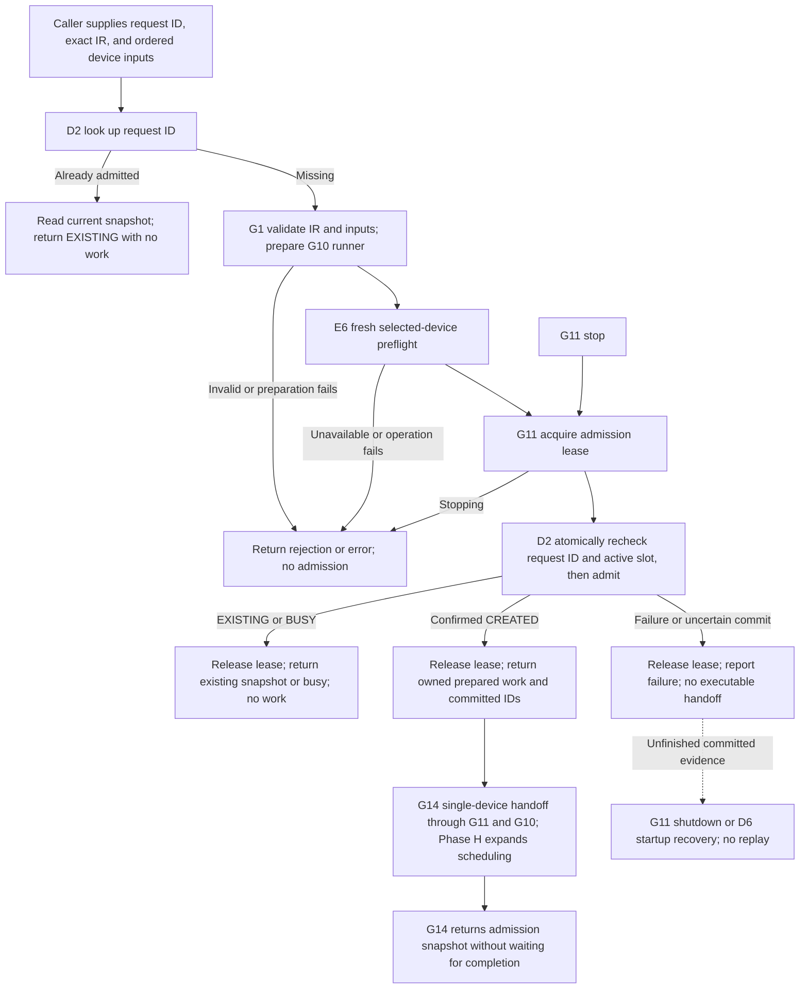

# G12 — Admission coordination

## Overview

G12 decides whether a start request refers to an existing run, can create a new
run, or must be rejected. It connects the implemented G1 executable validator,
E6 device preflight, D2 admission transaction, and G11 shutdown fence. Those
components already work separately; G12 supplies their ordering and preserves
the checked workflow/input pairing for the later scheduler.

For example, Studio starts a workflow and loses the response. Retrying the
same request ID returns that run's current SQLite snapshot. It does not check
the replacement workflow, probe its devices, or create executable work again.
A new request must pass all checks before any execution records are created.



**Status** — Internal service implemented and verified on Linux on 2026-11-18.
Full Go tests, focused race checks, vet, formatting, Linux build, and Windows
amd64 compilation of the agent, G12 tests, and smoke harness pass. Native Windows
and live ADB acceptance remain unverified. G13 owns snapshot routes,
G14 owns the single-device start route; H1/H2 later expand scheduling. G12 does not start workers
or make the production agent capable of accepting run-start requests by itself.

Authoritative dependencies are [A7 admission and idempotency](../contracts/local_api_v1.md#8-run-admission-and-idempotency),
[D2 admission](../d_persistence/d2_execution_repository.md#2-admission-and-idempotency),
[G1 checked content](g1_runtime_ir_admission.md#2-internal-entry-point-and-result),
[E6 selection preflight](../e_device_subsystem/e6_selection_preflight.md),
[G10 runner/input pairing](g10_sequential_device_runner.md#3-admission-and-device-input-pairing),
and [G11 admission fence](g11_runner_shutdown.md#4-work-gate-and-admission-fence).

## 1. Responsibility and limits

| Owner | Responsibility |
| --- | --- |
| G12 | Replay lookup, new-request checks, G1/G10/E6 ordering, G11 admission lease, D2 result handling, and prepared-work ownership. |
| G1 | Exact executable document, graph, installed handlers, compatibility, and per-device workflow-input validation. |
| E6 | Fresh discovery and readiness for the entire selected device list; bounded probes and ordered unavailable reasons. |
| D2/D3 | Atomic admission, final request-ID/active-run concurrency guards, initial state/events, and consistent snapshots. |
| G11 | Close admission during stop and join acquired admission leases before cancellation settlement. |
| G14 start use case / later H1/H2 | G14 hands one committed device to process-owned G11 execution. H1/H2 later add the bounded queue and configured concurrency. |
| G13/G14 | HTTP parsing, authentication, response projection, snapshot/start routes, and integration-guide examples. |

Keep the existing internal 1–32-device Admit contract. G14 uses the additional
AdmitSingleDevice entry point, which shares the admission implementation and
applies constants.MaxStartDevices only after request-ID lookup. It creates no
worker pool. This is the explicit public MVP limit; H1/H2 later switch the start
policy to multi-device admission and bounded scheduling. See the
[G14 expansion checklist](g14_start_run_api.md#15-phase-h-expansion-checklist).
There is one non-terminal RunGroup under D2; do not add a waiting queue of groups.

No new node validation rules, workflow compiler, SQLite schema, migration,
Production package authorization, device-history entity, or HTTP endpoint is
introduced. The exact runtime IR comes from C9 for Development; I2 later supplies
authorized decrypted Production content to the corresponding trusted boundary.

## 2. Internal entry point and dependencies

Use `internal/services/runadmission`, separate from the base `services` package.
It consumes the G10 runner and existing services without introducing the G9/G10
integration-test import cycle resolved in G11. Use constructor injection and
small consumer interfaces satisfied by the existing implementations:

```go
type IRValidator interface {
    Validate(context.Context, json.RawMessage, []json.RawMessage) (runtimeir.Result, error)
}

type DevicePreflight interface {
    Check(context.Context, []string) (services.DeviceSelectionResult, error)
}

type Repository interface {
    LookupRequest(context.Context, string) (string, error)
    Admit(context.Context, execution.Admission) (execution.AdmissionResult, error)
    SnapshotByID(context.Context, string) (execution.Snapshot, error)
}

type AdmissionGate interface {
    BeginAdmission(context.Context) (release func(), err error)
}

type Dependencies struct {
    Validator  IRValidator
    Preflight  DevicePreflight
    Repository Repository
    Lifecycle  AdmissionGate
    Runner     runner.Dependencies
}

func New(dependencies Dependencies) (*Service, error)
func (s *Service) Admit(ctx context.Context, request Request) (Result, error)
```

The normal dependencies are the installed `runtimeir.Validator`, E6
`services.DevicePreflight`, D2 `repositories.ExecutionRepository`, G11
`executionlifecycle.Service`, and the existing G2/G3/G6/D4 runner dependencies.
Build G1 with the installed build version and the same handler registry used
by the supplied runner invoker. A workflow cannot override that trusted version.

New rejects missing dependencies before use. Reuse existing runner construction
checks for its dependency graph; do not introduce reflection, a service locator,
a second invoker, or factory/clock frameworks. Constructor callers must not pass
typed-nil interface implementations. No new third-party dependency is required.

The service has no worker goroutine, persistent work cache, or Start/Wait/Shutdown
component of its own. Calls have independent local preparation state and may
overlap. D2 remains the final concurrency authority.

## 3. Request, result, and prepared work

These are internal Go values, not the HTTP DTOs that G14 will introduce:

```go
type DeviceInput struct {
    ADBSerial string
    Inputs    json.RawMessage
}

type Request struct {
    RequestID string
    RuntimeIR json.RawMessage
    Devices   []DeviceInput
}

type PreparedRun struct {
    Runner   *runner.Runner
    Devices  []runner.Request
}

type Rejection struct {
    FailureCode string
    Validation  *validation.Result
    Unavailable []services.DeviceSelectionIssue
}

type Result struct {
    Disposition constants.AdmissionDisposition
    RunGroupID  string
    Snapshot    *execution.Snapshot
    Work        *PreparedRun
    Rejection   *Rejection
}
```

| Outcome | Required result with `err == nil` |
| --- | --- |
| Confirmed new admission | `AdmissionCreated`, committed RunGroupID, non-nil Work; Snapshot and Rejection nil. |
| Existing admitted request | `AdmissionExisting`, existing RunGroupID, non-nil current Snapshot; Work and Rejection nil. |
| Another run holds the active slot | `AdmissionBusy`; no ID, Snapshot, Work, or Rejection. |
| Expected G1 or device-readiness rejection | Empty Disposition and ID, non-nil Rejection; Snapshot and Work nil. |

Malformed internal request shape, cancellation, infrastructure failure, broken
trusted preparation, and uncertain commit return an error with a zero Result.
Never return executable work with an error or alongside a replay/rejection.
Do not add another admission-disposition enum for these internal outcomes.

Created intentionally returns prepared work before attempting a snapshot read.
The later start use case must transfer that work to scheduling before reading
the HTTP response snapshot. A post-commit read failure must not discard the
only executable handoff. Replay has no handoff to preserve and reads its
snapshot directly using the caller context.

## 4. Processing order

Implement the following sequence without opening a transaction around G1,
runner construction, E6, or later scheduling:

1. Check the caller context and canonical request ID. Use `execution.ValidID`,
   which already uses the UUID package. Do not normalize an invalid ID.
2. Call `LookupRequest`. If found, read `SnapshotByID` and return EXISTING.
   Only `ErrExecutionNotFound` permits the new-request path; other errors stop it.
3. For a missing ID, check the new request's cheap shape and byte bounds from
   section 5. Preserve the original device order while collecting serials and
   raw input objects for the existing validators.
4. Call G1 exactly once with the exact RuntimeIR and ordered input objects.
   Preserve expected rejection diagnostics and FailureCode. A rejected or failed
   call supplies no accepted document, inputs, runner, or admission.
5. Construct one G10 runner from the successful checked Document and injected
   dependencies. Do this before D2 so a constructor failure creates no queued run.
6. Call E6 once with the selected serials. Any unavailable selection rejects the
   whole request; an operation/context error returns no partial readiness result.
7. Prepare fresh group/device UUID v4 identities, one UTC admission timestamp,
   D2's Admission, and the matching PreparedRun. Check trusted result consistency
   and the context before requesting a G11 lease. Identity-generation failure
   returns an error without writes.
8. Acquire `BeginAdmission(ctx)`. On failure do not call D2. After acquisition,
   always defer the returned idempotent release so the lease covers the whole
   D2 transaction outcome. A nil release without error is a dependency failure.
9. Call `Admit` once. For CREATED, return Work only after confirmed commit.
   For EXISTING, discard this call's prepared values and read the existing
   snapshot. For BUSY, discard preparation and return BUSY. For error, apply
   section 9. Never invoke a handler as part of admission.

Release the lease before a race-loser replay snapshot read; the admission
outcome is already known and that read must not hold up cancellation settlement.
The deferred release remains a safety net on every return.

## 5. Shape, replay precedence, and bounds

For every call require an active context and a lowercase canonical UUID v4
RequestID. For a new ID only, require 1–32 device entries, unique valid exact
ADB serials, and bounded IR/input bytes. Reuse `adb.ValidSerial` and shared
constants, including `MaxAdmissionDevices`, `RuntimeIRMaxContentBytes` (1 MiB),
and `RunRequestMaxContentBytes` (4 MiB). Bound the sum of raw IR and raw input
bytes before copying or decoding them. G1 owns JSON/input-schema semantics;
G12 does not implement a second input validator.

G14 must enforce the complete encoded HTTP body's 4 MiB limit, including its
envelope, through bounded reading. G12's internal byte check cannot substitute
for that transport limit. Authentication, valid bounded JSON, and extraction of
the canonical ID precede replay at the HTTP boundary. For an admitted ID, do
not run fresh-work required-field or semantic checks on a replacement body.

An admitted ID wins over an active-run conflict, disconnected devices, changed
inputs, invalid replacement IR, and newly changed installed compatibility.
It can refer to a terminal run while another run is active. Never compare a
replacement-body hash, recompile it, or change the saved run from its contents.
An unknown ID must pass the full new-request path.

Direct malformed internal input returns a classified guard error, not an A6
transport envelope. G14 later maps it to the existing INVALID_REQUEST or
PAYLOAD_TOO_LARGE contract. Do not invent a public G12 error code.

## 6. Device/input identity and memory ownership

Request order is the single pairing authority. At index `i`, retain:

```text
request.Devices[i].ADBSerial
    + checked.DeviceInputs[i]
    + newly generated DeviceExecutionID[i]
    + checked.Document.EntryNodeID
    -> D2 admission device[i] and PreparedRun.Devices[i]
```

Require a successful G1 result to contain a complete document and the same
number of non-nil checked input maps, a VALID or VALID_WITH_WARNINGS status, and no
FailureCode. Any other non-rejection combination is a trusted contract failure.
Require a successful E6 result to contain the same serials in the same order,
with no unavailable entries. Invalid trusted
results fail before D2; never silently zip a shorter list or trust map order.
Unavailable results must have no accepted serials and must identify valid
strictly increasing request positions with the corresponding exact serial and
existing safe reason. Duplicate/out-of-range issue positions are contract errors.

Each `runner.Request` contains the committed group ID, its paired device ID and
serial, `ir.Object(checked.DeviceInputs[i])`, and nil Control. G11 owns Control
when a worker is registered later. Every D2 device receives the checked entry
node; clients supply neither execution IDs nor an initial node position.

G1 owns its decoded document and copied input maps. G12 transfers those values
through Work without re-decoding inputs or serializing the workflow per device.
The runner borrows the checked document immutably under G10's existing contract;
its referenced maps/slices remain immutable for the runner's lifetime. Their
normal Go references retain the required data; no additional document cache
or manual memory-lifetime mechanism is needed. Do not add the raw IR bytes to PreparedRun when G10 already retains everything
needed to execute. Do not retain the caller's mutable Request in the service.

The caller must not mutate Request slices/bytes during Admit. After success,
changing the original bytes must not change prepared inputs or runner content.
Once a device starts, G10 makes its own execution-local input/output view.
SQLite receives only D2 records and events, never the IR or workflow inputs.

## 7. Concurrent requests and replay

| Race | Required outcome |
| --- | --- |
| Two valid calls initially miss the same ID | Both may prepare and preflight; D2 creates once. The winner returns CREATED with Work; the loser returns EXISTING with no Work. |
| Different IDs contend for the active slot | D2 admits at most one non-terminal group. The loser returns BUSY unless the slot is already free at its atomic check. |
| A terminal ID is replayed while another run is active | Return that terminal run's current snapshot before fresh checks or the active-slot check. |
| A missing-ID call fails validation while another later admits that ID | The first call may return its rejection. A subsequent retry finds the admitted ID; do not poll or bypass validation in anticipation of another commit. |
| A replay snapshot read fails | Return the classified read error with no Work; retrying the ID remains safe. |

The first lookup is a replay fast path, not a reservation. D2 must still recheck
the ID and active slot in its transaction. Do not add a process-wide admission
mutex, singleflight cache, distributed lock, or extra persisted reservation.
E6's normal bounds apply independently to each concurrent fresh call; G12 adds
no retrying probe loop. Future API load limits belong to their owning phase.

## 8. Admission lease and shutdown

Acquire G11's lease only after expensive fresh-work checks and runner preparation,
immediately before D2. E6/G1 remain cancellable through the caller context and do
not need an execution registration. A stop that closes the gate during preflight
causes lease acquisition to fail with no new records.

Once a lease is held, G11 waits for its release before inspecting unfinished
SQLite work. D2 either rolls back or confirms its admitted queued devices before
that release. G12 never creates records after releasing the lease.

If shutdown closes the worker gate after a new admission commits, return the
confirmed CREATED handoff without pretending the transaction was rejected.
The later scheduler must honor G11's gate. Refused queued work remains in SQLite
for G11's intentional cancellation or D6's failure/owner-loss fallback; do not
delete it, start it through an unfenced path, or hold the lease for the run's
entire execution. G12 itself never calls PrepareStop or grants cancellation.

## 9. Commit confirmation and failure boundaries

| D2 observation | G12 behavior |
| --- | --- |
| Confirmed CREATED | Return exactly one prepared handoff, even if the caller context becomes cancelled immediately after commit. Do not perform another cancellable operation before returning it. |
| Confirmed EXISTING | Discard candidate identities/content, release the lease, and return the existing snapshot. No candidate Work escapes. |
| BUSY | Return BUSY with no Work or partial execution records from this call. |
| Error before commit or with known rollback | Return the wrapped error with no Work; do not retry admission inside G12. |
| `ErrExecutionCommitUnknown` | Return the classified uncertainty with no Work; do not dispatch, retry Admit, or infer success from candidate IDs. Preserve any actual committed rows for shutdown/recovery. |
| Unexpected repository disposition or mismatched CREATED ID | Treat as a trusted contract/infrastructure failure, with no executable handoff. Do not overwrite or delete evidence. |

For the MVP, G12 adds no uncertain-admission read-back loop. An uncertain
transaction may have committed. A later request-ID lookup can reveal its saved
snapshot, but EXISTING is never authority to reconstruct or schedule it.
Unstarted committed work is settled through G11 on intentional shutdown or D6
on restart; it is not automatically resumed. This follows D2's requirement to
reconcile identity before considering any retry without introducing a second
admission writer or guessing which concurrent caller created the run.

The later process-owned start integration must treat uncertain admission or
post-commit trusted handoff failure as infrastructure failure: stop further
dispatch/admission through the owner/supervisor failure path and retain evidence
for recovery. It must not leave an unconfirmed queued run advertised as a normal
successful start. This wiring is an explicit G14 single-device handoff acceptance gate; G12's
classified return alone does not implement that process-wide failure action.

No node attempt exists during admission. An admission fault must not become a
fabricated FAILED/CANCELLED NodeAttempt or an error-edge transition. Existing
checkpoint uncertainty/reconciliation in D4/G9 remains unchanged.

## 10. Context lifetime and later scheduling handoff

The caller supplies an admission context cancelled by either the request or the
Runtime owner, with any earlier applicable deadline. G12 propagates it through
lookup, G1, E6, runner construction, and D2. E6 retains its existing 20-second
overall budget and probe limits; G12 adds no second competing timeout constant.
Do not store a request context or put one in PreparedRun.

Cancellation observed before D2 prevents admission or rolls back an uncommitted
transaction. A confirmed commit remains authoritative if cancellation follows.
For CREATED, there is no final `ctx.Err()` check that replaces Work with an error.
Use the known transaction outcome rather than inferring rollback from a lost
HTTP connection. An unconfirmed outcome still follows section 9.

The later process-owned start use case must consume G12 in this order:

```text
call G12.Admit(admissionContext, request)
  error       -> report failure; uncertainty follows the failure path
  rejection   -> return the owning A7 error/diagnostics; schedule nothing
  BUSY        -> return RUNTIME_BUSY; schedule nothing
  EXISTING    -> return saved current snapshot; schedule nothing
  CREATED     -> transfer Work to owner-bound scheduling exactly once
                then read the committed response snapshot
                then attempt the HTTP response
```

Scheduling must use the execution-owner lifetime, not the HTTP request context.
Client disconnect, snapshot-read error, or response-write failure after handoff
cannot cancel execution or cause another handoff. If scheduling cannot accept
the committed Work, use the bounded infrastructure-stop path; never silently
drop it or automatically resubmit it. New user intent after terminal completion
requires a new request ID, not another use of the old Work.

G12 does not call a scheduler callback or expose Work to HTTP clients. Returning
Work is the explicit internal ownership transfer for this phase. Its caller must
be the trusted start orchestration, not a handler that conditionally abandons
it when the socket closes. A direct G12 test/smoke caller may inspect queued
admission and intentionally shut down without starting a worker, settling it
through the existing G11 service.

## 11. Rejections, contextual errors, and disclosure

Expected content/readiness failures return Rejection with `err == nil` so a
consumer can distinguish them from infrastructure failure:

- G1: retain its existing FailureCode (`VALIDATION_FAILED` or
  `RUNTIME_INCOMPATIBLE`) and bounded validation result unchanged. No second
  diagnostic collection, reordered findings, or raw executable content.
- E6 unavailable selection: retain every ordered DeviceSelectionIssue, with
  no accepted subset. Set FailureCode to the first issue's existing A6 reason
  code in request order; Validation is nil. The issue list stays internal until
  G14 supplies the agreed bounded projection; do not invent an A7 `devices`
  error-envelope extension in G12.
- BUSY: preserve D2's disposition. G14 maps it to `409 RUNTIME_BUSY`.

Use the existing A6/A7 error vocabulary. G14 owns HTTP statuses and public
messages; G12 preserves the context/storage causes for `errors.Is/As`.
Operational ADB failure is distinct from a confirmed unavailable selection and
later maps to `ADB_UNAVAILABLE`. Operational persistence faults map to the
existing persistence error; cancellation retains its actual cause.

Place any new fixed guard sentinel in `pkg/x-error` and new shared constants
in `pkg/constants`. Use ErrRunAdmissionInvalid for malformed caller input and,
if existing classifications are insufficient, ErrRunAdmissionContract for broken trusted
results/dependencies. Keep those distinct so corrupted trusted results never
map to a client input error. Do not add a sentinel per field. Reuse existing
context, size, storage, commit-unknown, and G11 stopping classifications. Add fixed operation metadata
for request checking, replay lookup/read, checked-run preparation, device
preflight, and admission commit, preserving more specific existing operations.

Use the established B4 error boundary: helpers return contextual errors; the
owning API/process boundary logs material failures once at ERROR. G12 adds no
per-device success logs or duplicate SQL/ADB logs. Safe metadata can include the
operation, admission disposition, generated run ID, and device count. Never log
raw requests, input values, protected IR, serial lists, tokens, or raw ADB output.
Production disclosure and package authorization remain governed by A7/I2.

## 12. Implementation mapping and efficiency

| Runtime location | Implemented responsibility |
| --- | --- |
| `internal/services/runadmission/service.go` | Constructor, ordered Admit orchestration, replay, and confirmed-work handoff. |
| `internal/services/runadmission/types.go` | Request, result, rejection, prepared-work, and consumer-dependency types. |
| `internal/services/runadmission/preparation.go` | Bounded request checks, trusted G1/E6 result checks, UUID/input pairing, and context checks. |
| `internal/services/runadmission/service_test.go` | Deterministic call ordering, result exclusivity, cancellation, and trusted-result guards. |
| `internal/services/runadmission/admission_integration_test.go` | Real G1/G10/D2/G11 with migrated temporary SQLite and controlled E6 observation. |
| `pkg/x-error/run_admission.go` | Fixed request/contract guards where existing classifications are insufficient. |
| Phase G spec/index/roadmap | Track specified versus implemented and verification evidence. |

Keep local helpers private to the package; split a file only when it owns a
clear responsibility. Reuse existing validation, UUID generation, preflight,
runner, snapshots, and transactions. Do not change the schema, embed a second
catalog, add a generic repository base, or expand G9/G10 for admission.

Replay normally needs an indexed request lookup and one consistent snapshot
read. New admission performs one G1 pass, one runner construction, one E6
preflight, one lease, and one D2 transaction. A CREATED result requires no
additional snapshot read in G12. D2 retains its bounded batch inserts/events;
G12 makes no repository call inside a per-device loop. Build identity/input
pairings in memory in O(device count) and discard losing preparation promptly.

G12 code can be tested directly without changing `cmd/agent` composition or
enabling an endpoint. G14 wires the single-device admitted-work consumer with G11 ownership and
failure-stop behavior; H1/H2 later expand scheduling. No new CLI run flag or
test-only HTTP endpoint is needed for this phase.

## 13. Verification and acceptance

| Scenario | Required observable result |
| --- | --- |
| Valid one-device and 32-device requests | Confirmed CREATED, one group, the exact ordered queued devices, admission events, and matching Work; zero workflow-handler calls. |
| Existing ID with changed/invalid IR, different inputs/devices, or no replacement content | EXISTING and saved current snapshot; zero G1, runner preparation, E6, admission, or scheduling calls. |
| Known terminal ID while another group is active | Return that terminal snapshot instead of BUSY. |
| Malformed ID, serial, duplicate serial, count, or byte limits | Classified failure at the owning check with no writes/work; valid boundaries accepted. |
| G1 rejects workflow or per-device inputs, or reports incompatibility | Preserve exact bounded diagnostics and FailureCode; E6/D2/handlers never called. |
| Runner preparation or trusted G1/E6 result is inconsistent | Return infrastructure/guard error with no D2 write or Work. |
| Several selected devices unavailable | Preserve original ordered indices/reasons, no accepted subset, no run/events; operational ADB failure returns an error instead. |
| Preflight discovery order differs from requested order | D2 ordinals and prepared input/serial/UUID pairs still match the request. |
| Two valid same-ID calls race through real D2 | One CREATED Work and one EXISTING snapshot; one persisted admission batch; no duplicated executable handoff. |
| Different IDs race for the active slot | One CREATED and one BUSY while the first remains active; no partial losing run. |
| Stop closes the gate during G1/E6 | Lease refused; D2 not called. Existing E6 probes cancel/clean up under their context. |
| Stop races an acquired admission lease | G11 settlement waits for commit/rollback and lease release; any newly committed queued devices are included without a worker dispatch. |
| Context cancelled before transaction or during known rollback | No Work and no partial run/events. Every acquired lease is released. |
| Context cancelled immediately after a confirmed CREATED result from D2 | Return CREATED with Work; no post-commit snapshot read or context check drops it. |
| Statement/event failure | Real SQLite rollback leaves no partial records or admission events; no handoff. |
| Unknown commit: committed and rolled-back fixtures | Return classified uncertainty and no Work, with one Admit call and no automatic dispatch/retry. G11/D6 use actual stored evidence; replay never reconstructs work. |
| Replay snapshot failure or race-loser replay | No Work; release any lease before reading; retry preserves original identity. |
| Input ownership and repeated new runs | Mutating original request bytes after success cannot change prepared content; device inputs remain isolated and later new IDs receive fresh execution identities. |
| Tooling and scope | Full tests, focused race checks, vet, formatting, Linux build, and Windows cross-build; no Runtime API or scheduler claimed. |

Use real migrated temporary SQLite for transaction, race, shutdown, and recovery
acceptance. Reuse the existing G10 fixture IR and real G1 validator. Use a
controlled E6 source/preflight for stable order and failure injection, and a
handler spy proving that G12 never executes a node. Fault wrappers may model
confirmed commit followed by request cancellation, or unknown outcomes on
either side of commit. Keep real SQLite outside synthetic-time test bubbles.

Before marking implementation complete, inspect snapshot/event counts as well
as return values. A useful readable direct-call smoke performs CREATED, replay
with changed content, and a rejected new request against isolated SQLite, then
uses G11 to settle intentionally unstarted queued work. It is an admission
demonstration, not evidence that the public run API or scheduling is delivered.
Native Windows execution and live ADB acceptance remain separate evidence.

### Verified implementation evidence

| Check | Observed result |
| --- | --- |
| Ordering and result guards | Replay bypasses fresh checks. Confirmed CREATED alone returns Work. Race-loser replay releases its lease before snapshot read. Invalid identities, broken trusted results, and missing dependencies fail with contextual classified errors. |
| Existing G1 acceptance | VALID and VALID_WITH_WARNINGS retain G1's accepted-content behavior; invalid results preserve their bounded diagnostics and FailureCode. Byte-boundary and over-limit checks pass. |
| Real SQLite admission | One- and 32-device requests preserve serial/input/UUID order even with reversed discovery. Replay/busy/rejected requests add no work. A terminal request replays while a different run remains active; new runs receive fresh identities. |
| Concurrent calls | Barrier-controlled real D2 calls with the same ID produce one CREATED handoff and one EXISTING snapshot. Different IDs produce one CREATED and one BUSY while the first run remains active. |
| Context and shutdown | Cancellation before commit leaves no records and releases the lease. Cancellation immediately after confirmed commit preserves Work. G11 waits for a held lease, includes its committed queued device in cancellation, and refuses later worker registration. Stop during preflight prevents admission. |
| Persistence faults | Child/event insertion faults roll back all admission rows/events. Committed and rolled-back uncertain outcomes produce no Work and no internal retry. Reopening the same store lets D6 interrupt actual unfinished committed evidence without node dispatch; replay never reconstructs Work. |
| Readable smoke | Ignored `test_demo/g12-smoke`, run with `go run .`, prints CREATED with Work, EXISTING without Work for invalid replacement content, and a new validation rejection. Inspected local SQLite contains one CANCELLED group/device, four events, and zero attempts. |
| Tooling | `go test ./...`, focused race checks including G12/G11/repositories/runner/supervisor, `go vet ./...`, `make fmt build`, Windows amd64 agent/smoke builds, and G12 test cross-compilation pass. |

The production service adds no handler invocation, scheduling, HTTP route,
agent composition, schema, or dependency change. The smoke uses controlled
readiness and keeps its readable database under its own Git-ignored `state`
folder; automated SQLite tests use temporary state roots. Neither touches the
normal Runtime user database. Native Windows execution and real ADB readiness
remain separate acceptance evidence. G14 now supplies the single-device G11 handoff and fatal failure integration;
H1/H2 later expand ownership to bounded multi-device scheduling.

## 14. MVP delivery and deferred work

G12 is complete when its internal service returns exactly one executable handoff
for a confirmed fresh admission, no handoff for every other outcome, correct
replay snapshots, and no partial run for rejected/rolled-back requests. Its
shutdown-race tests must show that a newly committed queued run cannot escape
G11's settlement snapshot.

G13 adds snapshot routes. G14 adds single-device start DTOs/authentication, response
snapshots, the trusted G11 handoff, and API integration-guide sections for the
exactly-one-device public MVP. H1/H2 later enforce configured device concurrency
and consume G11 registrations. H5/H6 retain later
Pause/Resume and run-level cancellation controls. G15–G19 add the remaining
engine features under their existing contracts.

Keep the MVP small: one replay lookup, existing validators, one prepared runner,
one fenced admission, and one owned result. Defer durable executable queues,
resuming interrupted work, persisted IR/input caches, automatic uncertain-commit
resubmission, preflight reservations, and public scheduling policy controls.
