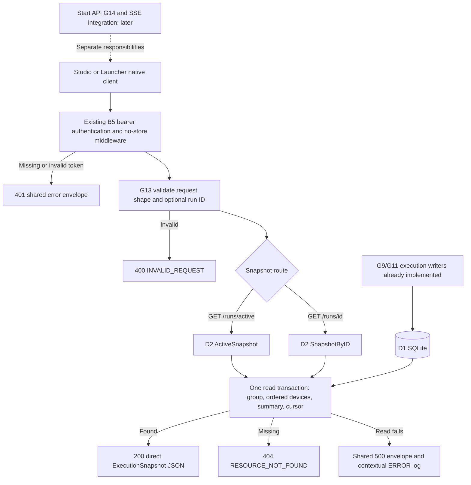

# G13 — Run snapshot APIs

## Overview

G13 lets Studio and Launcher read a workflow run's saved progress and result
through the local Runtime API. It exposes the existing D2 snapshot operations
as two authenticated GET routes: find the current active run, or read a known
run by ID. Each request returns the currently committed view without waiting
for the workflow to finish.

For example, a client reads a RUNNING group containing one running device and
one queued device. After completion, the active route returns not found, while
the route for that group's ID still returns its terminal result. The snapshot
includes an event cursor from the same SQLite read transaction, so later event
integration can continue from a consistent saved position.



**Status** — Implemented and verified on Linux on 2026-11-18. The built agent
serves both routes using the existing D2 store. Full tests, focused race checks,
vet, Wire generation, Linux build, and Windows amd64 agent/API-test compilation
pass. Shared/Studio/Launcher guide sections are updated; the Linux curl example
was exercised against the built agent. Native Windows execution remains
unverified. D2 retains snapshot consistency, ordering, and summary ownership. It does not admit work, schedule devices,
stream logs, or implement the later lifecycle-action endpoints.

Authoritative dependencies are [A7 transport and snapshots](../contracts/local_api_v1.md#9-execution-reads-and-lifecycle-control),
[A5 execution states](../contracts/execution_state_v1.md),
[A6 errors/events](../contracts/event_error_v1.md),
[D2 snapshots](../d_persistence/d2_execution_repository.md#3-snapshots-and-history),
[D3 event cursor](../d_persistence/d3_event_repository.md),
[G11 shutdown](g11_runner_shutdown.md), and
the [shared integration guide](../integration/managed_runtime.md).

## 1. Scope and ownership

| Owner | Responsibility |
| --- | --- |
| G13 | Two read handlers, request validation, the exact A7 snapshot response, classified HTTP errors, router/Wire integration, and acceptance evidence. |
| D2 | Read group/devices and cursor consistently; preserve admission order and calculate summary counts in memory. |
| D3/D4/G9/G11 | Commit state and events before those changes become observable. G13 does not write or recompute execution outcomes. |
| B3/B5 and existing API middleware | Listener/store lifecycle, local session authentication, no-store headers, and one request-log boundary. |
| G14 | Start-run API and its process-owned admission/scheduling handoff. |
| Later A7/I1 work | Paged attempt-history API and SSE replay/live delivery. |
| H5/H6 and I2 | Pause/Resume/run cancellation and Production package authorization under their separate contracts. |

This phase adds no schema, migration, new execution status, polling daemon,
snapshot cache, or ADB call. It needs no G1 validation, G12 admission, device
preflight, or G11 admission lease. Reading a saved status does not prove that
an Android device remains connected; E5/E6 retain that responsibility.

## 2. Routes and request validation

Both routes use the existing configured loopback listener and `/api/v1` group:

| Method and path | Handler | Input |
| --- | --- | --- |
| `GET /api/v1/runs/active` | `Handler.Active` | No body or query parameters. |
| `GET /api/v1/runs/{runGroupId}` | `Handler.ByID` | One canonical lowercase UUID v4 path value; no body or query parameters. |

Register the literal `active` route before `:runGroupId` for readability and
test their distinct dispatch. `active` is the literal active-run operation,
not an invalid UUID sent to the by-ID handler. Keep `/api/v1` factored outside
the endpoint registrations as in the current router.

Authentication runs before route-specific validation and database access.
Reject unknown query parameters, including apparent filters such as `status`,
`limit`, or `cursor`, with `400 INVALID_REQUEST`. There are no query options
to select a different snapshot or request event replay.

Reject any nonempty body, including `{}` or whitespace, with `400
INVALID_REQUEST`. Follow the existing device GET request-validation pattern:
reject a positive ContentLength immediately; when length is absent/unknown,
inspect at most one body byte to distinguish empty input from a body. A body
read error is an invalid request and must not fall through to a repository call.
Do not decode JSON, read the whole body, or add a new GET payload-size constant.
Normal server read limits/timeouts still apply. An empty request needs no
Content-Type header. A nonempty RawQuery is invalid; a bare empty query marker
does not introduce a parameter or change the operation.

Use the original decoded Gin path value and `execution.ValidID`. That helper
already uses the UUID package and verifies canonical spelling. Reject invalid,
uppercase, padded, non-v4, or noncanonical IDs before repository access. Do not
trim, case-fold, parse numeric IDs, use a second UUID regex, or decode the path
a second time. Missing/extra path segments, trailing slashes, and other HTTP
methods retain the existing router/no-route policy; this phase adds no redirects
or general method-handling change.

## 3. Handler and DTO contract

Use package `internal/api/runs`, following the existing constructor-injected
API packages. Consume a narrow read interface satisfied by the existing
ExecutionRepository:

```go
type SnapshotReader interface {
    ActiveSnapshot(context.Context) (execution.Snapshot, error)
    SnapshotByID(context.Context, string) (execution.Snapshot, error)
}

type SnapshotResponse = execution.Snapshot

func NewHandler(reader SnapshotReader) *Handler
func (h *Handler) Active(ctx *gin.Context)
func (h *Handler) ByID(ctx *gin.Context)
```

Put the response alias in `dto.go`, making the response type easy to locate
and use for fixtures. D2's explicit Snapshot/RunGroup/DeviceExecution types
already carry the exact A7 JSON fields. Reuse those projections rather than
maintaining a second field-by-field response model or serializing database
rows. Changes to the shared projection must continue to respect A7; an alias
does not authorize adding arbitrary persisted fields to the public response.

There is no request-body DTO for a bodyless GET. The only by-ID input is the
validated route parameter. No new validation package or generic read-service
layer is needed for these two pass-through operations. Normal composition
provides a non-nil reader, never a typed-nil implementation. Missing trusted
dependencies must not be treated as an empty database or a successful response.

Each valid handler makes exactly one reader call using
`ctx.Request.Context()`. Active calls ActiveSnapshot; ByID calls SnapshotByID.
On success, serialize the returned detached value directly as SnapshotResponse.
Do not perform a preliminary active lookup, re-admit a request ID, read attempts,
or make an extra cursor query in the HTTP layer.

## 4. Successful response

Both endpoints return `200 application/json; charset=utf-8` with a direct
ExecutionSnapshot and `Cache-Control: no-store`:

```json
{
  "cursor": "42",
  "runGroup": {
    "id": "550e8400-e29b-41d4-a716-446655440001",
    "requestId": "550e8400-e29b-41d4-a716-446655440000",
    "status": "RUNNING",
    "createdAt": "2026-11-18T08:00:00.000Z",
    "finishedAt": null,
    "summary": {
      "total": 1,
      "queued": 0,
      "running": 1,
      "paused": 0,
      "succeeded": 0,
      "failed": 0,
      "cancelled": 0,
      "interrupted": 0
    }
  },
  "deviceExecutions": [
    {
      "id": "550e8400-e29b-41d4-a716-446655440002",
      "adbSerial": "emulator-5554",
      "status": "RUNNING",
      "nextNodeId": "tap_01",
      "createdAt": "2026-11-18T08:00:00.000Z",
      "startedAt": "2026-11-18T08:00:00.010Z",
      "finishedAt": null,
      "terminalError": null
    }
  ]
}
```

| Field | Meaning and representation |
| --- | --- |
| `cursor` | Runtime-wide committed event watermark as a decimal string, not a JSON number or a per-run counter. |
| `runGroup` | Saved identity, originating request ID, current A5 status, timestamps, and derived summary. |
| `summary` | All existing count fields, including zero values. Counts describe the same device rows returned in this snapshot. |
| `deviceExecutions` | The selected devices in D2 admission ordinal order, then ID; never sorted independently by serial, status, or completion time. |
| `nextNodeId` | Saved execution position under A5. It can identify an active/retry node or a pending successor; it is not a separate live-handler observation. |
| `terminalError` | Null or the existing persisted safe A6 RuntimeError. No raw command output or wrapped driver error. |
| Timestamps | Existing UTC RFC 3339 millisecond strings; absent optional values are explicit JSON null. |

Preserve the exact property names and explicit nullable fields. Do not add a
`data` wrapper, attempt history, node outputs, workflow inputs, protected IR,
package content, internal SQLite fields, or filesystem paths. No successful
snapshot has an empty device list: D2 verifies a known run has 1–32 devices.
An empty store produces not found, not a fabricated zero-valued snapshot.

The whole read is bounded by one group and at most 32 devices. The event
watermark may advance because of another retained run's events; clients must
not interpret its value as this run's percentage complete or attempt count.

## 5. Active, terminal, and concurrent behavior

| Saved state | `/runs/active` | `/runs/{that ID}` |
| --- | --- | --- |
| No admitted run | `404 RESOURCE_NOT_FOUND` | `404 RESOURCE_NOT_FOUND` for an unknown canonical ID. |
| RUNNING group, including all devices initially QUEUED | `200` current snapshot. | `200` current snapshot. |
| PAUSED group | `200` saved paused snapshot under the existing D2 predicate. Pause/Resume controls remain later work. | `200` saved snapshot. |
| SUCCEEDED, FAILED, CANCELLED, or INTERRUPTED group with no active group | `404 RESOURCE_NOT_FOUND`. | `200` saved terminal snapshot. |
| Old terminal group while a newer group is active | `200` newer group's snapshot. | `200` requested old terminal group; do not substitute the active group. |

The active predicate is D2's existing RUNNING/PAUSED predicate. G13 does not
infer activity by checking device connectivity, goroutines, connection-file
presence, or a cached ID in Studio. Historical terminal reads stay available
under the current retained-user-data policy.

D2 reads group, devices, derived counts, and event watermark in one read
transaction. Preserve that boundary. A checkpoint finishing during a request
can yield the consistent earlier RUNNING snapshot or the later terminal/not-found
result. It must not yield terminal devices combined with a stale group or a
cursor fetched separately after those state reads. Do not loop until a run
becomes stable or terminal, and do not hold a database transaction while writing
JSON to a slow client. D2 returns detached values after its transaction closes.

G13 never recalculates terminal outcomes, increments counters, changes next-node
position, prunes events, or creates a missing run. A successful GET proves only
that committed state was read; it is not an execution command acknowledgement.

## 6. Authentication, caching, and errors

Reuse the existing Authentication, CacheControl, Recovery, and RequestLogging
middleware. Require the current local-session bearer token in Authorization.
Tokens in query parameters, bodies, cookies, or a previous Runtime session are
not accepted. Authentication failure precedes path validation and store access.
Keep the existing loopback binding and native-client/CORS policy unchanged.

| Condition | HTTP / A6 response |
| --- | --- |
| Snapshot found | `200`, direct SnapshotResponse. |
| No active group or unknown canonical group ID | `404 RESOURCE_NOT_FOUND`, existing shared not-found message, retryable false. |
| Malformed ID, query, nonempty body, or unreadable request body | `400 INVALID_REQUEST`, shared invalid-request message, retryable false; no reader call. |
| Missing, invalid, duplicate, or stale bearer token | Existing `401 UNAUTHORIZED`, retryable false; no reader call. |
| Classified SQLite/persistence or stored-state integrity failure | `500 PERSISTENCE_FAILED`, safe fixed message `unable to read execution snapshot`, retryable false. |
| Context cancellation/deadline or unexpected reader failure | `500 INTERNAL_ERROR` if an HTTP response can still be sent, using the existing shared internal-error message and retryable false. Retain the actual cause for contextual logging. |

Use the common error envelope only:

```json
{
  "error": {
    "code": "RESOURCE_NOT_FOUND",
    "message": "resource was not found",
    "retryable": false
  }
}
```

Classify repository errors with `errors.Is/As`, preserving existing operation
metadata. ErrExecutionNotFound maps to 404. ErrExecutionPersistence and
ErrRecoveryIntegrity map to the persistence response. An adapter returning
ErrExecutionInvalidInput after G13 has validated its inputs is an unexpected
trusted failure, not a reason to blame valid client input. Do not return a
partial snapshot or an extra ad hoc `details`, `snapshot`, or `validation`
field with a read error.

These reads require no ADB subsystem, so an offline emulator or failed ADB
installation does not turn them into `503 ADB_UNAVAILABLE`. Do not map request
cancellation to an Android error or invent a 499/public cancellation code. If
the client has disconnected there may be no usable response transport; preserve
the contextual read failure and perform no execution mutation.

Put any new fixed response message/constant in `pkg/constants`, reusing the
existing PERSISTENCE_FAILED code. There is no new public A6 code or per-field
sentinel needed. Continue `Cache-Control: no-store` for successes and all failures,
including 400/401/404/500. Return no session credentials in response bodies.

## 7. Context, lifetime, and logs

Pass the request context into the one repository read. Do not detach it with
Background/WithoutCancel, store it on Handler, create polling goroutines, or
extend the request after the client cancels. Existing listener timeouts and
supervisor shutdown bounds remain authoritative; G13 adds no competing timeout
configuration or new read-retry loop.

G11's admission gate does not block snapshot reads. During graceful shutdown,
the existing supervisor drains HTTP before closing execution services/SQLite.
Reads admitted during that drain either finish or observe cancellation under
the existing budget. The handler must not bypass store closure by opening a
second SQLite connection on its own. A stopped/failed store returns the classified
read failure, not an in-memory fallback result.

Use `apiresponse.AbortWithCause` and existing contextual operation wrapping for
read failures. Fixed fallback operations are `read_active_run_snapshot` and
`read_run_snapshot`; keep any more specific repository operation. Validation
uses a fixed safe operation such as `validate_run_snapshot_request` where useful.
Helpers return errors; the existing request middleware logs the response once.

Keep current logging levels: successful GETs follow the existing INFO policy,
and every 4xx/5xx is ERROR, including ordinary not-found responses. Do not add
special polling suppression or duplicate handler-level errors in this phase.
Use the registered route pattern rather than a raw URL as the log route. Never
log bearer headers, query contents, response snapshots, serial lists, workflow
values, or raw SQL/driver text. Safe existing operation/detail metadata remains
available without exposing it in the public response.

## 8. Composition and file mapping

| Runtime location | Implemented responsibility |
| --- | --- |
| `internal/api/runs/handler.go` | SnapshotReader, constructor, two thin handlers, bounded request validation, and shared error projection. |
| `internal/api/runs/dto.go` | Discoverable SnapshotResponse alias to the existing A7 projection. |
| `internal/api/runs/handler_test.go` | Isolated request guards, handler dispatch, error mappings, context propagation, and DTO serialization. |
| `internal/api/router.go` | Inject the runs handler and register the two routes inside the existing `/api/v1` group. |
| Existing API tests plus a focused snapshot integration test | Authenticated router behavior, real SQLite consistency/state transitions, and no write/dispatch side effects. |
| `pkg/constants/api.go` | Reuse error codes/messages; add only the fixed snapshot-read persistence message if needed. |
| `cmd/agent/wire.go`, generated `wire_gen.go` | Bind SnapshotReader to the existing ExecutionRepository and inject NewHandler. Regenerate with `make wire`. |

Reuse the same Store/ExecutionRepository instance already supplied to recovery,
checkpointing, and Runtime supervision. Wire may construct the store/repository
before the HTTP handler; construction must perform no reads. Keep lifecycle
startup order unchanged: store and recovery become ready before the listener
and connection/readiness publication. Do not create an independently managed
store for HTTP reads, hand-edit generated wiring, or add a dependency solely
for path validation.

Prefer a small private helper local to the runs package for common GET validation
and error projection. Reuse the established device-handler behavior without
refactoring unrelated endpoints into a generic framework. No additional domain
service is needed when the two existing repository methods already own the read.

## 9. Client integration documentation

This specification step updates only this file, the Phase G index, and the
roadmap. The later G13 code implementation must update the actual integration
guides after the routes and supported-host behavior are verified:

| Guide | Required verified content |
| --- | --- |
| [Managed Runtime](../integration/managed_runtime.md) | Shared route inventory; exact requests/responses/errors; no-store/auth; snapshot/cursor semantics; consistent completed-versus-active behavior. |
| [Studio](../integration/studio.md) | How to display Test Run progress and retained results, preserve run ID, and stop active polling when no run remains. Clearly label start as G14 until available. |
| [Launcher](../integration/launcher.md) | The same read contract and owner-managed readiness behavior, without implying Production package admission/execution is already implemented. |

Show Linux curl and Windows PowerShell/Postman usage through the existing
[authentication guide](../integration/local_authentication.md). Append routes to
the supplied apiBaseUrl, which already ends in `/api/v1`; do not duplicate that
prefix. Use placeholders for tokens/IDs and never check real credentials into
examples. Retain the shared actual-readiness check and relaunch policy before
each API operation; a run's 404 means missing data, not that the Runtime process
must be restarted. Preserve UI-owned shutdown instead of introducing a server
shutdown endpoint.

Each GET is an ordinary immediate JSON request. Clients can refresh or poll
through their native integration with at most one outstanding snapshot poll per
view, cancelling obsolete reads when that view closes. No mandatory new global
polling interval or UI implementation is introduced here. Polling does not add
SSE, logs, attempt history, or execution controls to this response. A later
event consumer uses the returned cursor under A6/SSE's own contract.

## 10. Verification and acceptance

| Scenario | Required evidence |
| --- | --- |
| Empty store, authenticated active read | 404 shared envelope, no-store, no fabricated snapshot. |
| Canonical unknown ID | 404; malformed/non-v4/noncanonical ID gives 400 before repository access. |
| Literal active route | Calls only ActiveSnapshot, never the UUID handler. |
| Newly admitted queued run | Both routes return 200, correct group/request IDs and queued counts, ordered selected devices, null start/finish/error fields, and a decimal-string cursor. |
| RUNNING and PAUSED fixture | Active and by-ID preserve the stored A5 state; no ADB/worker observation changes it. |
| Each supported terminal group state | Active is not found when no other group is active; by-ID retains the terminal status, counts, timestamps, and safe terminal error when applicable. |
| Old terminal ID while another group is active | By-ID returns the requested old group, not the active group. |
| Checkpoint or cancellation commits between reads | The next GET observes committed updates; each individual response has matching group/devices/summary/cursor from D2. |
| Concurrent checkpoint/read | Responses are consistent older or newer snapshots; no separately fetched watermark and no waiting for terminal completion. |
| Invalid query/body, unknown-length nonempty body, or body read error | 400, bounded body inspection, zero snapshot-reader calls. |
| Missing/invalid/duplicate/stale token, including malformed path | Existing 401 wins; no repository access; no-store. |
| Classified persistence/integrity and unexpected reader errors | Exact shared 500 envelopes/codes, no partial/extra fields or driver details; one contextual ERROR log. |
| Caller cancellation/deadline | Reader observes the original context and the handler does not detach/retry or change execution state. |
| No execution side effects | GETs leave state/event/attempt counts unchanged and call no admission, handler, scheduler, or ADB path. |
| Composition/startup/shutdown | Generated wiring uses the existing store, readiness follows recovery/listener startup, and existing owner lifecycle tests still pass. |
| Response compatibility | Exact DTO keys, nulls, lower-camel JSON, timestamps, summary counts, safe A6 error shape, no-store, and no data wrapper match A7. |

Use HTTP recorder/router tests for most acceptance, with the real authentication
middleware and controlled reader failures. Use migrated temporary SQLite and
real D2/D4/G11 fixtures for saved state, concurrency, cursor consistency, and
no-write evidence. Reuse established persistence fixtures rather than building
an alternate snapshot implementation in the tests. PAUSED may be arranged by
a controlled persistence fixture; this does not implement a Pause API.

Run focused API/repository tests and race checks, the full Go suite, vet,
formatting, Wire regeneration, Linux build, Windows amd64 compilation of the
agent and affected tests, and changed/new-file whitespace checks. Verify the
loopback routes on the built agent as well as isolated handlers. Distinguish
native Windows evidence from cross-compilation; no Android emulator is needed
to prove pure snapshot reads.

## 11. Manual demonstration before G14

G13 must be testable before a public start API exists. A fresh built agent with
an empty store can already demonstrate valid authentication, active/unknown-ID
404, and invalid-request 400 responses after G13 is implemented.

For a readable saved result, reuse G12's ignored admission smoke. It prints a
group ID and SQLite path and intentionally settles its queued run as CANCELLED.
After that tool exits and releases its lock, launch the agent with the same
state root: Linux uses XDG_STATE_HOME, Windows uses LOCALAPPDATA. The existing
smoke uses its own `state` folder, not the normal Runtime user database. Read
the new agent session token using the existing authentication guide.

Then `/runs/{printed ID}` must return the saved CANCELLED result and
`/runs/active` must return 404. Reopening the store must preserve that terminal
result without another attempt or interruption event. The implementation's
guide must include exact Linux/Windows state-root commands and state which
host checks were executed. Cross-compilation alone is not native Windows
acceptance. Running the agent against a different store is not evidence of a
lost record.

Observe a live RUNNING-to-terminal transition through a controlled execution/API
test composition until G14 exists. Do not add a hidden start route, new workflow
launch flag, or manual production-database edits just to demo these reads. Do
not run a smoke writer against an agent-owned SQLite store; its exclusive lock
correctly prevents two independent owners.

### Verified implementation evidence

| Check | Observed result |
| --- | --- |
| Isolated handlers | Exact A7 DTO keys/nulls/timestamps, active/by-ID dispatch, canonical-ID guards, query/body rejection including one-byte unknown-length inspection, error mapping, original context propagation, and no retries pass. |
| Authenticated router | Real local sessions reject missing/invalid/duplicate/stale/query credentials before reads. All failures use no-store and one ERROR log; storage context survives without exposing credentials or driver text. |
| Real SQLite reads | Empty/queued/RUNNING/PAUSED and all supported terminal group states, retained terminal ID while another group is active, admission ordering, matching state/cursor under a concurrent checkpoint, and unchanged row/event counts on GET pass. |
| Built Linux agent | A temporary copy of the readable G12 smoke store returns saved CANCELLED 200, idle/unknown-ID 404, invalid ID/query/body 400, and missing-token 401. Clean owner shutdown preserves the copied store's row/event counts. |
| Owner lifecycle | Existing managed-parent harness passes readiness/authentication, competing launch, shutdown, owner EOF, external kill, and shared replacement checks after Wire integration. |
| Guides | Shared snapshot contract, Linux curl/Windows PowerShell/Postman requests, state-root demonstration, and separate Studio/Launcher handling are documented. The actual published Linux curl helper passes authenticated readiness then idle 404 and by-ID 200 without token exposure. Windows examples follow cross-compiled code but were not executed natively. |
| Tooling | Full Go suite, focused API/repository/supervisor race checks, vet, make fmt/wire/build, Windows amd64 agent/API/runs-test compilation, and changed/new-file documentation checks pass. |

SQLite integration tests use temporary state roots. Loopback acceptance uses a
temporary copy of the G12 demo database; it does not change the normal Runtime
user store or the source demo's saved runs. No Android device is required or
claimed for these pure reads. G14 remains responsible for the public start
endpoint and scheduling integration.

## 12. MVP completion and deferred work

G13 is complete when the built agent exposes both authenticated snapshot routes,
returns the exact consistent A7 projections and classified failures, retains
existing lifecycle/security behavior, and publishes verified usage in the
shared/Studio/Launcher guides. The spec alone is not evidence of that delivery.

Keep the MVP implementation focused on existing read methods plus thin HTTP
adapters. G14 owns starting a run and the scheduling integration gate. Attempt
history, SSE, lifecycle actions, artifacts, Production authorization, UI polling
implementation, and new history-retention controls remain in their owning
phases. No additional engine state machine or database storage is needed here.
