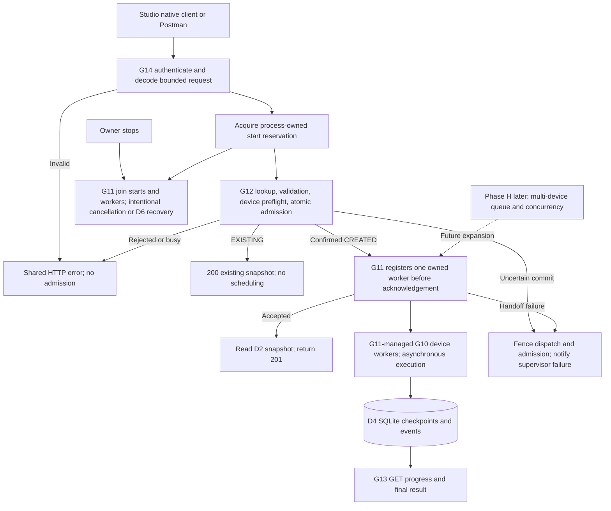

# G14 — Start-run API

## Overview

G14 lets Studio start a complete Development workflow through
`POST /api/v1/runs`. It connects the existing G12 admission service to a
process-owned single-device runner and returns the saved execution snapshot. The request
waits for admission and work handoff, not for the workflow to finish. G13 then
lets the client read progress and the final result.

For example, Studio submits Start → Delay → End for a connected Waydroid
device. A new request receives `201` and the RunGroup ID. Retrying the same
request ID receives `200` for the same run without executing it again. Losing
the HTTP connection after admission does not stop the accepted workflow.



**Status** — Single-device implementation completed and Linux-verified on
2026-11-19. Full Go tests, focused race checks, vet, Wire generation, Linux
build, and Windows amd64 agent/API/start-test cross-compilation pass. A built
managed agent passed real Waydroid preflight, Start → Delay → End, replay/busy/
rejection checks, intentional active-run cancellation, and crash/restart
interruption without redispatch. Native Windows execution remains unverified.

The user-approved MVP accepts exactly one device per new public start. G12's
broader internal admission and D2's 32-device capacity remain available for
Phase H. H1/H2 are not G14 delivery prerequisites; no public multi-device queue
or concurrency setting is implemented.

Authoritative dependencies are [A7 admission](../contracts/local_api_v1.md#8-run-admission-and-idempotency),
[A5 execution state](../contracts/execution_state_v1.md),
[A6 errors](../contracts/event_error_v1.md),
[G1 executable validation](g1_runtime_ir_admission.md),
[G12 admission coordination](g12_admission_coordination.md),
[G13 snapshots](g13_run_snapshot_apis.md), and the
[Phase G/H roadmap](../phases/plan.md#phase-g--workflow-engine).

## 1. Scope and delivery gate

| Owner | Responsibility |
| --- | --- |
| G14 | Start request/response DTOs, HTTP validation, process-owned start orchestration, error projection, route/Wire integration, and client-guide updates after verification. |
| G12 | Request-ID lookup, G1 validation, G10 preparation, E6 fresh preflight, G11-fenced D2 admission, and CREATED-only prepared work. |
| G11 single-device handoff | Register the accepted device worker synchronously, run it under the Runtime owner, track starts through shutdown, and publish infrastructure failure. |
| Phase H later | Expand public admission to multiple devices and introduce the bounded queue and configurable concurrency. |
| G10/G11 | Execute sequentially per device, supervise workers, stop dispatch, join work, and settle intentional cancellation. |
| D2/D4 | Atomic admission, consistent snapshots, authoritative checkpoints, events, and final-state calculation. |
| B3/B5/API middleware | Process ownership, loopback listener, readiness, bearer authentication, no-store headers, and contextual request logging. |

A new public request must select exactly one device. The existing array shape
is retained so Phase H can expand cardinality without changing the envelope.
Zero or multiple devices return 400 before G1/E6 or new admission, but after
request-ID lookup so an existing run can still be replayed. There is at most
one non-terminal RunGroup; no queue of additional groups is introduced.

The public start path calls G12.AdmitSingleDevice; the existing internal
G12.Admit still supports 1–32 devices. Both reuse the same ordered admission
implementation. Do not lower MaxAdmissionDevices globally or remove the
repository's multi-device capability.

G14 includes the small G11 connection needed to own one asynchronous worker
and fence/join the commit-to-dispatch gap. This phase does not implement
H1/H2, Pause/Resume, cross-device waits, Production packages, SSE,
attempt-history routes, artifact retrieval, or G15–G19 node features.

## 2. HTTP request and DTOs

Register `POST /runs` inside the existing `/api/v1` router group. Reuse the
existing authentication, recovery, no-store, and request-logging middleware.
There are no query parameters. Require `application/json`, optionally with
`charset=utf-8`, using the same media-type policy as workflow compilation.
Reject content encodings using that endpoint's existing policy.

```json
{
  "requestId": "550e8400-e29b-41d4-a716-446655440000",
  "runtimeIr": {},
  "devices": [
    {
      "adbSerial": "192.168.240.112:5555",
      "inputs": {}
    }
  ]
}
```

`runtimeIr: {}` above is a shape placeholder, not a valid executable document.
Use the exact successful compilation result for a real request.

Keep the public request DTOs discoverable in `internal/api/runs/dto.go`:

```go
type StartRequest struct {
    RequestID string             `json:"requestId"`
    RuntimeIR json.RawMessage    `json:"runtimeIr"`
    Devices   []StartDeviceInput `json:"devices"`
}

type StartDeviceInput struct {
    ADBSerial string          `json:"adbSerial"`
    Inputs    json.RawMessage `json:"inputs"`
}
```

Reuse G13's `SnapshotResponse` alias for success. Convert the request once to
the existing `runadmission.Request`; do not introduce a second domain admission
model, accept a trusted `runner.Request` from the client, or expose PreparedRun.

## 3. Transport validation versus new-run admission

The distinction matters for idempotency. Every HTTP request must be safe to
decode. Only a previously unadmitted request is subject to fresh executable,
device-selection, and workflow-input validation.

| Boundary | Required behavior |
| --- | --- |
| Before body access | Authenticate first; reject nonempty query or unsupported media/encoding with `400 INVALID_REQUEST`. |
| Entire body | Enforce `constants.RunRequestMaxContentBytes` (4 MiB), including whitespace/envelope bytes, using MaxBytesReader before full decoding. Oversized known-length and streamed bodies return `413`. |
| JSON syntax | Require valid UTF-8 and exactly one JSON object. Reject duplicate keys at every object depth, trailing JSON, missing fields, and null/wrong container types. |
| Public fields | Allow exactly the three root keys and two keys per device object, with exact case. Require requestId/adbSerial strings and runtimeIr/inputs objects; devices must be an array. |
| Request identity | Require `execution.ValidID(requestId)`; do not normalize, trim, generate, or substitute a client ID. |
| Raw executable size | Enforce the 1 MiB Runtime IR limit from `constants.RuntimeIRMaxContentBytes`; preserve RawMessage bytes for G1. |
| New admission only | G12.AdmitSingleDevice requires exactly one device, then checks the serial and G1/E6 semantics before D2 creation. |

Do not use a normal struct unmarshal alone as the strict decoder: it accepts
duplicate keys and case-insensitive field aliases. Follow the current bounded
workflow-handler pattern, adding only the missing strict scan required here.
Keep parsing linear in body size. An initial encoding/json validity check must
enforce the standard library's syntax/nesting limit; inspect duplicate keys
with an iterative token stack rather than unbounded recursive calls. Preserve
JSON numbers instead of coercing inputs through float64. Do not add a new
product nesting limit or third-party parsing/validation dependency.

Unknown fields inside the Runtime IR are G1 document semantics, not public
envelope fields. Workflow-input property names are defined by the submitted
schema. Do not treat either nested object as a fixed HTTP DTO.

After the transport checks, G12 performs request-ID lookup before interpreting
replacement executable/device semantics. A replay with `runtimeIr: {}` or
`devices: []` may return the existing run; it must not validate those replacement
values, probe devices, or schedule work. Malformed JSON, duplicate keys,
non-object IR, unknown public fields, invalid IDs, and payload-limit violations
remain transport failures even for an admitted ID. A missing or null field is
not the same as a syntactically valid replacement value.

For a new ID, malformed selection constraints such as an empty/oversized list,
duplicate serials, or invalid serial tokens map the existing
`ErrRunAdmissionInvalid` to `400`. Validly shaped IR/input objects that fail G1
produce `422` with G1 diagnostics. This preserves the existing service's
classification instead of duplicating validation in the handler.

## 4. Process-owned start use case

Put the orchestration beside admission in `internal/services/runadmission`,
retaining Service.Admit's internal multi-device contract. Service.AdmitSingleDevice
shares its implementation with a public-start cardinality limit. The API consumes a small constructor-injected
start interface, for example:

```go
type StartResult struct {
    Disposition constants.AdmissionDisposition
    Snapshot    *execution.Snapshot
    Rejection   *Rejection
}

type Starter interface {
    Start(context.Context, Request) (StartResult, error)
}
```

StartResult contains a snapshot only for CREATED/EXISTING, a Rejection only for
expected G1/E6 rejection, and neither for BUSY. Errors return a zero result.
The handler derives the HTTP status from the disposition, not snapshot status.
No prepared executable work or scheduler queue state enters the response.

The start use case follows this exact order:

1. Enter the G11 process-owned start reservation described below. Connect the
   admission context to both request cancellation and owner shutdown.
2. Call G12.AdmitSingleDevice exactly once. Do not perform an extra request-ID lookup,
   revalidate IR, refresh the inventory cache, or call Repository.Admit directly.
3. For rejection/BUSY/error, schedule nothing. Classify infrastructure uncertainty
   before returning. For EXISTING, return G12's saved snapshot without handoff.
4. For confirmed CREATED, pass the exact returned Work to the owner exactly
   once, even if request cancellation has just occurred. Do this before any
   response snapshot read or final request-context check.
5. Once ownership is acknowledged, release the start reservation. Read the
   committed D2 snapshot by the returned RunGroupID using the request context.
6. Return CREATED with that snapshot if readable. A later request cancellation,
   snapshot error, or response-write error does not revoke accepted work.

Release the reservation on every path, including handoff failure after the
failure fence has been published. Do not defer its release to worker completion
or hold it across the response snapshot read. A snapshot read is already a
consistent D2 operation; do not rebuild its projection in this service.

## 5. Single-device execution ownership

Use the existing executionlifecycle.Service as the owner; add no scheduler or
new supervised component. The start service consumes:

```go
type ExecutionOwner interface {
    BeginStart(context.Context) (context.Context, func(), error)
    Dispatch(*runner.Runner, runner.Request) error
    Fail(error)
}
```

| Operation | Guarantee |
| --- | --- |
| BeginStart | Acquire an outer G11 admission lease and return a context linked to both the request and owner stop. Release cancels that context and releases the lease idempotently. |
| Dispatch | Register the worker synchronously, then launch G10 under the Runtime owner context. Nil acknowledges ownership without waiting for execution. It receives no HTTP context. |
| Fail | Publish G11's failure fence, cancel affected work, and wake its existing supervised Wait path without waiting for the caller's lease. |

G12's internal admission lease ends when AdmitSingleDevice returns; the outer
lease spans its return and worker registration. The worker is registered before
Dispatch acknowledges it, so G11 cannot finish joining starts/workers while
committed work is unaccounted for.

If stop wins before registration, Dispatch acknowledges the admitted queued
record for G11/D6 settlement without launching a new node. If registration wins,
existing G11 cancellation tracks that worker. An owner-context cancellation
before PrepareStop is also treated as stop, retaining the supervisor's eventual
intentional/failure cause. Release the outer lease only after this ownership
or a published infrastructure failure.

BeginStart's admission context is cancelled by owner stop as well as the client.
The worker context is independent of the client. G11.Run remains the synchronous
entry for existing internal callers; Dispatch reuses its registration and
completion handling rather than copying the runner. Normal terminal device
failure is a saved outcome; unexpected runner/infrastructure errors reach Wait.

Phase H replaces this one-device handoff with group coordination, a bounded
queue, and configured worker slots. It must preserve these ownership guarantees.

## 6. HTTP lifetime, stop, and infrastructure failure

| Observation | Required action |
| --- | --- |
| Request/owner cancelled before admission | Propagate cancellation; do not create or dispatch work. Respect D2's actual transaction outcome. |
| Confirmed commit followed immediately by client disconnect | Consume CREATED Work under the owner; do not drop it or substitute ctx.Err before handoff. |
| Disconnect after handoff or during response snapshot | Keep execution running. A retry of the same ID reads the existing run. |
| Intentional owner stop races admission/handoff | Join tracked starts, fence dispatch, and settle unfinished records through G11 before SQLite closes. |
| Owner crash/forced exit | D6 marks actual unfinished persisted work INTERRUPTED on restart; it never redispatches an uncertain action. |
| ErrExecutionCommitUnknown | Schedule nothing; publish infrastructure failure and stop further admission/dispatch. Do not retry Admit or reconstruct Work from stored rows. |
| CREATED with invalid/nil Work, mismatched identities, or failed Dispatch | Publish infrastructure failure; retain committed evidence. Do not report 201, delete records, fabricate attempts, or resubmit. |
| Snapshot-read failure after successful handoff | Return a classified error if possible; execution stays owned. Do not call Dispatch again or undo admission. |

When uncertain admission or failed handoff is observed, publish the failure
fence before returning the start error or releasing its reservation. Failure
notification is bounded and uses the existing supervised shutdown mechanism.
G14 does not call Shutdown recursively from a request handler or classify a
failure-stop as intentional user cancellation. D6 retains the crash fallback.

## 7. Successful response and replay

Return a direct `SnapshotResponse`, with no `data` wrapper, Location-only
response, custom acknowledgement, or open request waiting for completion.

| Disposition | HTTP | Execution effect |
| --- | --- | --- |
| CREATED | `201` | One atomic admission and one accepted scheduling handoff. |
| EXISTING | `200` | Return the current saved run; no handoff or new admission. A lookup replay skips fresh G1/E6 checks. |

The shape is exactly the [G13 snapshot](g13_run_snapshot_apis.md#4-successful-response):
`cursor`, `runGroup` with summary, and ordered `deviceExecutions`. UUIDs,
UTC timestamps, explicit nulls, derived counters, and global cursor consistency
retain the existing D2/A7 rules. The response does not include IR, workflow
inputs, attempt outputs, a session token, scheduler slots, or raw ADB output.

The response snapshot is read after work handoff, so devices may already be
RUNNING or terminal. Even a new run can return a SUCCEEDED snapshot with `201`.
Do not delay workers to force QUEUED into the response, predict a cursor, or
assume `201` means the workflow succeeded. A concurrent same-ID replay may see
the saved queued snapshot before the creator finishes its handoff; only the
creator owns Work and the outer reservation protects its settlement.

If two calls both miss the initial lookup, both may prepare and preflight
before D2 resolves their race. The loser discards its candidate work and reads
the winner's snapshot. It must not repeat those checks after EXISTING or
schedule a second worker. Lookup replay and admission-race replay therefore
have the same external result without requiring identical preparation costs.

Reusing an ID after SUCCEEDED/FAILED/CANCELLED/INTERRUPTED still returns that
same run. To execute again, the client generates a new request ID. A replay
never resumes work after recovery. Simultaneous same-ID requests produce one
CREATED and the remaining EXISTING results; different new IDs contend for the
single active-group slot through D2.

## 8. Error projection

Use the exact A6 error envelope and existing `api/response` helpers. Add fixed
public messages to `pkg/constants`, not dynamic strings in handlers. Messages
are explanatory; clients branch on the code and status.

| Source | HTTP/code | retryable | Extra body |
| --- | --- | --- | --- |
| Authentication | `401 UNAUTHORIZED` | false | None. |
| Transport/DTO or ErrRunAdmissionInvalid | `400 INVALID_REQUEST` | false | None. |
| Body/IR byte limit, including ErrRuntimeIRPayloadTooLarge | `413 PAYLOAD_TOO_LARGE` | false | None. |
| G1 rejection | `422 VALIDATION_FAILED` or `422 RUNTIME_INCOMPATIBLE`, preserving FailureCode | false | Exact bounded G1 `validation` result. |
| E6 confirmed unavailable selection | `422` with its first ordered DEVICE_NOT_FOUND/DEVICE_UNAUTHORIZED/DEVICE_OFFLINE/DEVICE_NOT_READY code | true | None. |
| G12 BUSY | `409 RUNTIME_BUSY` | true | None. |
| Operational ADB discovery/readiness failure | `503 ADB_UNAVAILABLE` | true | None. |
| Owner already stopping before admission | `503 INTERNAL_ERROR` | false | None; fixed safe message that Runtime is stopping. |
| Persistence/recovery failure or commit uncertainty | `500 PERSISTENCE_FAILED` | false | None. |
| Trusted contract/handoff fault or other unexpected error | `500 INTERNAL_ERROR` | false | None. |

Classify known operation errors using errors.Is/As and existing sentinels, not
message matching. Do not misclassify ErrRunAdmissionContract or a broken trusted
repository result as a client 400. ErrExecutionNotFound is normally handled
inside G12; an impossible missing CREATED/replay snapshot is infrastructure
failure, not a public 404 for this POST.

A live response to an otherwise unclassified context cancellation/deadline
uses the shared `500 INTERNAL_ERROR` envelope, without inventing a 499 code or
claiming rollback. An operational ADB error is projected as 503 only when its
actual classification is known; an owner stop is not ADB unavailability.

For device selection rejection, all ordered issues remain internal. A7 allows
only `error` and, for actionable G1 rejection, `validation`; do not add an
unapproved `devices`, `details`, or partial `snapshot` field. Public messages
must not interpolate serials, input values, or paths. The full inventory can
be inspected separately through E7. Retryable means a future attempt is safe,
not that the client should send a new ID for an uncertain accepted request.

On an uncertain response, the client retains its original request ID. After
actual readiness and any necessary owner-managed restart, it retries that ID
to resolve saved identity. The server never automatically repeats admission
or reconstructs worker state. A changed token after restart must be reacquired.

## 9. Persistence and observable data changes

G14 adds no table or migration. D2 admission creates one RunGroup, N ordered
QUEUED DeviceExecutions, zero NodeAttempts, and N+1 admission events in one
transaction. Existing worker checkpoints create all later attempt/state events.
The initial `nextNodeId` is the admitted entry; queued startedAt/finishedAt are
null. No input/IR cache is added to SQLite.

| Action | Expected data effect |
| --- | --- |
| Rejected new request | No admission rows/events/attempts attributable to it. An unrelated active worker may still advance. |
| New admitted request | One group and N devices, each linked to the generated IDs; exactly one owned work handoff. |
| Same-ID replay or G13 GET | No writes by that request. Execution may independently advance. |
| Device node dispatch | Existing G9/D4 RUNNING attempt commit before command dispatch. |
| Completion | Existing committed attempt outputs, next-node transitions, terminal device state, and derived group result. |

Do not add per-node writes in the API, stored summary counters, HTTP-request
events, request-ID tombstones, or a second admission transaction. All DB access
uses the existing repositories/checkpoint service. The global cursor may
already exceed this run's event count and need not be contiguous.

## 10. Composition, logging, and efficiency

Construct G1 with trusted buildinfo and the same node catalog/installed handler
registry used by G10. Wire the existing binding resolver, invocation service,
output validator, checkpoint service, E6 preflight, G12, and work owner. Reuse
existing constructors; do not copy the ignored smoke harness into production.
Generate Wire output with `make wire`.

Scheduling and its failure supervision must start before HTTP readiness and
drain before checkpoints/SQLite close. B3/B5 ownership and G11's shared shutdown
deadline remain authoritative. No token/path details enter readiness logs.

Helpers return contextual errors. Existing request middleware logs each failed
HTTP request at ERROR, preserving the most specific fixed operation such as
commit_run_admission or handoff_admitted_run. The supervised owner separately
records material process failure under its lifecycle boundary. Do not add
duplicate helper logs, raw body logging, per-poll success logs, or stacks.

Keep the body and work ownership bounded: one bounded decode, one G12 call,
at most one work handoff, and one CREATED response snapshot read. Do not hold
SQLite transactions across ADB, scheduling, or response writes. Use existing
E6 probe budgets and G11 shutdown deadlines instead of new arbitrary timeouts.
No dependency, scheduler polling loop, retry queue, or generic event bus is
required by the HTTP feature.

## 11. Implementation mapping

| Location in Runtime repo | Expected change |
| --- | --- |
| `internal/api/runs/dto.go` | Start DTOs and bounded admission-error response; reuse SnapshotResponse. |
| `internal/api/runs/start.go` and `decode.go` | Strict body handling, Starter interface, HTTP result/error mapping. Preserve existing GET behavior. |
| `internal/services/runadmission/start.go` | Thin start orchestration around existing Admit and the single-device G11 owner contract. |
| `internal/services/executionlifecycle/lifecycle.go` and `dispatch.go` | Reused synchronous registration/completion, linked start lease, asynchronous owned dispatch, and failure fence. |
| `internal/api/response/error.go` | Reuse safe request-log metadata for the approved validation envelope. |
| `internal/api/router.go` | POST /runs registration inside the shared prefix. |
| `cmd/agent/execution.go`, `wire.go`, and generated `wire_gen.go` | Compose existing G1/G2/G3/G6/G12 services with the installed registry/build version and bind the start use case. |
| `pkg/constants/api.go` | Only needed fixed messages; reuse existing codes/size/device bounds. |
| Focused API/start integration tests | Transport, handoff ordering, real SQLite, concurrency, shutdown, and faults. |

G11 lifecycle/dispatch changes belong to the single-device handoff in this
phase. Reuse its existing supervised Wait path and shutdown order; no new
scheduler configuration or supervisor component is needed. Preserve existing
G1–G13 behavior except the explicitly scoped public cardinality policy.

## 12. Verification and acceptance

The following table remains the acceptance checklist. Verified evidence from
this implementation is recorded after it; native Windows remains separate.

| Case | Required evidence |
| --- | --- |
| Missing/stale/duplicate auth header | 401 before body decode, admission, ADB, or scheduling; no-store. |
| Invalid JSON/UTF-8, duplicate nested keys, unknown or wrong-case public fields, null/wrong types, trailing JSON, query/media/encoding violations | 400, zero Starter calls. Include streamed bodies and escaped-equivalent duplicate keys. |
| Exact body/IR byte boundaries and one byte beyond | Accepted transport at the bound, 413 beyond, bounded reads, zero admission for rejected transport. |
| Valid new single-device request | 201 direct G13-compatible snapshot; one admission and one handoff before response read. |
| Admitted-ID replay with invalid replacement semantics | 200 same group, no G1/E6/handoff; transport violations still reject. |
| Concurrent same-ID/different-ID requests | Real D2 gives one creator/no duplicate dispatch, or one creator and BUSY for another new intent. |
| G1 incompatibility/semantic failure, E6 unavailable, ADB operation failure | Exact error mapping, bounded diagnostics where permitted, no partial admission. |
| Request cancelled immediately after confirmed commit | Work handed off once despite cancellation; later same-ID replay resolves saved identity. |
| Snapshot or socket write fails after handoff | Owned work continues; no second handoff or rollback. |
| Commit-unknown and broken/failing handoff | Owner fences/notifies failure before reservation release; no successful acknowledgement, automatic admission retry, or reconstructed Work. |
| Stop at preflight, commit-return gap, worker registration, admitted-but-unstarted work, and active attempt | Starts/workers joined; intentional cancellation settled or D6 fallback preserved; no dispatch after the stop fence. |
| New requests containing 0, 2, or 32 devices | 400 before G1/E6 or admission; no writes. Existing-ID replay ignores replacement cardinality. Internal G12/D2 multi-device tests still pass. |
| Runtime restart after crash | Known unfinished records become INTERRUPTED; same-ID POST reads them without execution. |
| HTTP and source logging | Tokens, raw IR/inputs/serial lists/process output absent; operation context retained. |

Use controlled devices/handlers for deterministic HTTP-to-SQLite integration,
then one real Waydroid/ADB workflow for host acceptance. Run focused tests/race
checks, existing API/ownership regressions, full Go tests, vet, formatting,
Wire generation, Linux build, and Windows amd64 cross-compilation as appropriate
to the implementation diff. Native Windows process/device behavior requires
separate execution evidence; cross-compilation alone is not acceptance.

### Verified evidence — 2026-11-19

| Check | Evidence |
| --- | --- |
| Automated suites | Full Go tests; focused API/admission/runner/supervisor race tests; vet; formatting; Wire generation; Linux versioned build. |
| Transport/DTOs | Nested and escaped duplicate keys, invalid media/UTF-8/types/fields/IDs, read failures, streamed/exact body and IR size boundaries, response/error projection. |
| HTTP and real SQLite | Owned execution after request cancellation, eight simultaneous same-ID POSTs yielding one creator/worker, replacement-body replay, busy/rejections without partial records, active-attempt cancellation. |
| Handoff faults/races | Unit ordering for commit uncertainty and failed handoff; real-SQLite stop between confirmed commit and registration settles queued work without invoking a handler. |
| Built agent + live Waydroid | Real ADB preflight; 201 start, 200 replay, 409 busy, 400 multiple devices, 422 invalid IR. The readable three-node example finishes SUCCEEDED with three attempts and 13 events; replay adds no writes. |
| Managed active shutdown/recovery | Private shutdown during Delay exits cleanly after committing CANCELLED; forced process kill followed by startup recovery produces INTERRUPTED, and same-ID replay creates no attempts. |
| Process regressions | Existing managed-parent harness passes startup/auth, competing ownership, private shutdown, owner EOF, external kill, and shared replacement after failed readiness. |
| Windows | Agent and API/start-test binaries cross-compile for windows/amd64. Native Windows and Windows Android acceptance were not run. |

## 13. Manual acceptance scenario

Use a separate state root for deterministic counts and stop other Runtime
processes that own the listener/store. Build a compatible binary with
`make build VERSION=0.1.0`; the current default `0.0.0-dev` is intentionally
rejected by G1. Do not use a request field to bypass the build-version gate.

For Linux, from the Runtime repository root, the implementation acceptance
command will be:

```bash
make build VERSION=0.1.0
XDG_STATE_HOME="$PWD/test_demo/g14-manual-state" \
A2MATEX_RUNTIME_ADB_EXECUTABLE_PATH="$HOME/Documents/platform-tools/adb" \
./bin/a2matex-runtime
```

This selects the readable test database
`test_demo/g14-manual-state/a2matex/runtime/execution.sqlite3`; it does not
change the normal store or connection-file path. This is the same public workflow used for built-agent acceptance; the recorded
acceptance used an isolated temporary store/port to avoid the user's running agent.

Wait for runtime_ready and obtain the current connection credentials using
the [authentication guide](../integration/local_authentication.md). Connect
Waydroid through ADB, POST /devices/refresh, and confirm READY. E6 still checks
the selected serial afresh on admission.

Compile a valid Start → Delay → End workflow with literal durationMs=10000
and an attempt timeout of 15000 ms. The readable request in [the Runtime example](../../../../a2matex-runtime/examples/g14/start-delay-end.json)
contains that workflow. Replace its serial and generate a new UUID for a new
intent. For Studio, use the compilation result as runtimeIr,
empty workflow inputs `{}`, the actual ADB serial, and a fresh request UUID.
Use public compilation rather than a fake IR object or smoke-only serial.

| Step | API/result | SQLite/result check |
| --- | --- | --- |
| 1 | POST /runs → 201; save runGroup.id. | One new group, one device. Workers may already have created attempts. |
| 2 | GET /runs/active and GET /runs/id during Delay → RUNNING. | Start succeeded, Delay attempt RUNNING; End not dispatched yet. |
| 3 | Replay original POST ID → 200 and same group ID. | No second group/device/Delay invocation. |
| 4 | New ID during the Delay → 409 RUNTIME_BUSY. | No admission rows for the rejected ID. |
| 5 | After completion, GET /runs/id → SUCCEEDED; active → 404. | Three SUCCEEDED attempts, device nextNodeId null, group/device finishedAt non-null. |
| 6 | Replay original ID after completion → 200 SUCCEEDED. | No rerun. Use a new ID for a new execution. |
| 7 | Invalid semantic IR with a fresh ID → 422. | No partial run; inspect validation diagnostics. |

For this three-node, no-retry, no-error scenario, the settled run has one group,
one device, three attempts, and 13 events attributable to that group: two
admission events, one device-start event, six attempt events, two next-node
events, and two terminal device/group events. Verify by runGroupId, not global
table counts if the store was reused. No artifact or variable records are
expected. After settlement, repeated reads/replay leave those counts unchanged.

In DataGrip, bind `:runGroupId` to the ID returned by POST and inspect:

```sql
SELECT id, request_id, status, created_at, finished_at
FROM run_groups WHERE id = :runGroupId;

SELECT id, adb_serial, admission_ordinal, status, next_node_id,
       started_at, finished_at, terminal_error_json
FROM device_executions WHERE run_group_id = :runGroupId
ORDER BY admission_ordinal, id;

SELECT sequence, node_id, attempt_number, status, output_json, error_json
FROM node_attempts
WHERE device_execution_id IN (
    SELECT id FROM device_executions WHERE run_group_id = :runGroupId
)
ORDER BY device_execution_id, sequence;

SELECT cursor, event_type, node_id, payload_json
FROM execution_events WHERE run_group_id = :runGroupId
ORDER BY cursor;
```

The settled attempt outputs are `{}`, `{"durationMs":10000}`, and `{}` for
Start, Delay, and End respectively, with null errors. SQLite time values are
Unix milliseconds; the API projects UTC timestamp strings. The implementation
must provide a readable example workflow/request alongside its manual guide;
do not require an opaque temporary harness to exercise the public start API.

Separately test losing the client connection during execution and intentionally
closing the owner during Delay. The first continues to completion; the second
uses G11 cancellation. Crash/forced-exit testing should instead demonstrate D6
INTERRUPTED recovery without redispatch. Do not mix these outcomes into one
ambiguous manual test.

## 14. Client guides and completion criteria

On implementation, update the verified API inventory and examples in the
[shared guide](../integration/managed_runtime.md),
[Studio guide](../integration/studio.md), and
[Launcher guide](../integration/launcher.md). Document exact DTOs, size limits,
auth, response/status examples, request-ID lifetime, actual readiness before
each operation, token renewal, busy/rejection handling, polling, and how to
resolve a lost start response. Ordinary 400/409/422 responses do not trigger
Runtime relaunch. Actual process/readiness failure follows B3/B5 ownership;
never blindly resend a start with a new ID after a transport failure.

Studio owns the native Development start call and workflow-input preparation.
The Launcher developer can use the common process and snapshot behavior but
must not treat this plaintext endpoint as Production authorization. Its package
path input, decryption, licensing, and protected execution remain I2. Guides
must clearly label what the verified build exposes for each client.

G14 is complete only when the real agent starts accepted single-device workflows through
the owned G11 dispatch path, replays without duplicate dispatch, preserves
shutdown/failure guarantees, passes the focused acceptance cases, and has
updated integration guides. An isolated route test or implemented G12/G13
service is insufficient. Keep spec-ready, code-complete, automated verification,
real-ADB acceptance, and native-Windows acceptance recorded separately.


## 15. Phase H expansion checklist

The temporary public limit is explicit in constants.MaxStartDevices and
Service.AdmitSingleDevice. When multi-device scheduling is implemented:

1. Add the H1 group owner and H2 bounded queue/configuration; do not spawn one
   unrestricted goroutine per selected device.
2. Replace the start service's SingleDeviceAdmitter policy with existing
   G12.Admit and expand the accepted array from exactly one to 1–32 devices.
   Preserve request-ID lookup before replacement-body semantics.
3. Replace the single Work.Devices[0] Dispatch with an atomic ownership handoff
   for every ordered device/input pair. Retain the outer start reservation,
   stop-race acknowledgement, and fatal uncertain-handoff fence.
4. Schedule through G11/G10 with configured concurrency, device failure/input
   isolation, queued-work settlement, and no background recovery redispatch.
5. Update A7, this spec, G12's public-policy note, Phase G/H roadmaps, and both
   client guides/device pickers. Keep the current envelope, snapshot fields,
   replay statuses, and per-device SQLite identities.
6. Replace public multi-device rejection tests with 2/32-device queue/slot,
   isolation, failure, and shutdown tests; retain all replay/disconnect checks.
   Run real multi-device and native Windows acceptance separately.

No H1/H2 implementation or Phase H completion is claimed by G14. The internal
32-device admission/persistence tests remain preparation, not public scheduling
acceptance.
