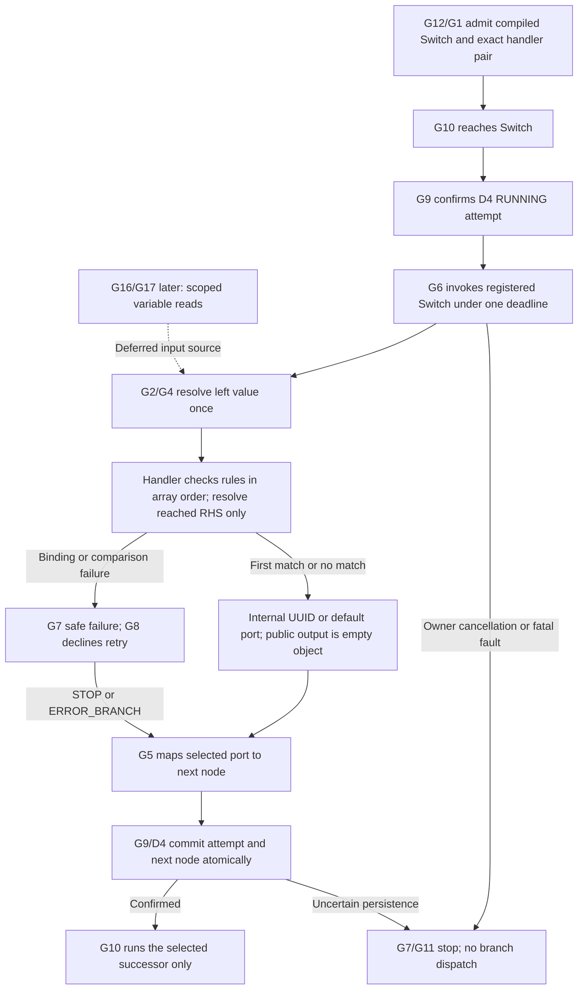

# G15 — Switch execution

## Overview

G15 makes `flow.switch` executable. A Switch reads one value, checks its
ordered rules, and continues through the first matching rule's output port.
If none match, it follows `default`. This gives publishers visible branches
instead of embedding conditions in Android action nodes.

For example, with rules `score < 50` and `score < 100`, score `30` takes the
first branch, `75` takes the second, and `150` takes Default. Only one branch
runs. Rule order matters: `30` satisfies both comparisons, but the first wins.

Authoring, compilation, and Switch port validation already exist. G15 adds
evaluation and connects its selected port to the existing checkpointed engine.
It supports the implemented Literal, Workflow Input, and Node Output sources.
Variable storage and variable bindings remain G16/G17; Set Variable remains G18.



**Status — Implemented and Linux-verified on 2026-11-19.** The registered
handler, lazy resolver, deadline observation, Switch routing, and G9/D4
checkpoints are connected. Full Go tests, focused race checks, vet, formatting,
and the Linux agent build pass. The agent and affected test binaries
cross-compile for Windows amd64. Native Windows execution remains unverified.
HTTP integration uses controlled device readiness and real SQLite; it verifies
compilation, all three example branches, rule reordering, replay, and error
continuation. No live Android command is claimed for this Flow-only scenario.

## 1. Scope and existing contracts

| Component                      | Responsibility in G15                                                                                                 |
| ------------------------------ | --------------------------------------------------------------------------------------------------------------------- |
| Installed Node Definition / G1 | Admit the existing rule shape, bindings, UUID ports, edge coverage, timeout, and handler identity.                    |
| Registered Switch handler      | Evaluate ordered typed comparisons, resolve only needed operands, return `{}`, and report one internal selected port. |
| G2/G4 resolver                 | Resolve a single named field using current execution inputs and confirmed successful output snapshots.                |
| G6 invoker                     | Own the single effective deadline, synchronous handler lifetime, and internal route observation.                      |
| G5 router                      | Map a successful Switch's selected port, or a routable failed outcome's error policy, to one successor.               |
| G7/G8/G9                       | Normalize outcome, apply existing retry policy, and confirm begin/finish checkpoints.                                 |
| G10–G14                        | Continue the existing single-device loop, lifecycle, admission, and HTTP APIs.                                        |

The accepted [binding and Switch contract](../contracts/workflow_bindings.md#switch-authoring)
and Backend `flow.switch` definition are authoritative. Reuse
[G3 outputs](g3_handler_output_validation.md),
[G5 routing](g5_ordinary_routing.md),
[G6 deadlines](g6_attempt_deadlines.md),
[G7 normalization](g7_execution_outcome_normalization.md),
[G8 retries](g8_safe_retry_policy.md), and
[G9 checkpoint coordination](g9_checkpointed_node_attempt.md).

No new public endpoint, Editor Graph version, IR version, database table,
migration, dependency, or Backend node-definition change is required.
Multi-device scheduling, variable state, Screenshot integration, and SSE are
outside this step.

## 2. Input and port contract

`type` and `runtimeHandler` are both `flow.switch`. `config` contains exactly
`rules`: an array of one to 32 objects, each containing exactly `id` and
`operator`. Use the existing UUID validator and `MaxSwitchRules`; do not
introduce a narrower UUID-version requirement or a parallel limit.

The ordered array is executable priority. A map can index rule IDs for
validation or edge lookup, but must never determine evaluation order.

| Field                         | Editor Graph                  | Runtime IR                                |
| ----------------------------- | ----------------------------- | ----------------------------------------- |
| Left operand                  | `bindings.value`              | `inputs.value`                            |
| Binary rule's right operand   | `bindings[rule.id]`           | `inputs[rule.id]`                         |
| Operand binding discriminator | `kind`                        | `source`                                  |
| Matching route                | Edge `sourcePort = rule.id`   | Same UUID string preserved by compilation |
| No matching rule              | Edge `sourcePort = "default"` | Same port                                 |

Each rule UUID must be unique within that Switch. Reordering preserves IDs,
operand keys, and edges. Do not use array indices, visible labels, or node IDs
as replacements for rule ports.

Require exactly one outgoing edge per rule UUID and one `default` edge. With
`ERROR_BRANCH`, require exactly one `error` edge. With `STOP`, `error` is
unavailable. Switch has no `success` port. Keep G1's existing diagnostics:
`EDGE_SOURCE_PORT_NOT_FOUND` for unknown ports and
`SWITCH_PORT_EDGE_COUNT_INVALID` for missing/duplicate required routes.

The router prepares an immutable per-Switch port-to-target index once per
prepared workflow. Different ports may lead to the same target. Preparation
must retain Switch error edges; the current router skips all Switch edges.

## 3. Operator behavior

| Operator                   | Required left / right types         | True when                                              |
| -------------------------- | ----------------------------------- | ------------------------------------------------------ |
| `EQ`                       | Matching number, string, or boolean | Values are equal.                                      |
| `NE`                       | Matching number, string, or boolean | Values are unequal.                                    |
| `LT`, `LTE`                | Number / number                     | Left is less than / less than or equal to right.       |
| `GT`, `GTE`                | Number / number                     | Left is greater than / greater than or equal to right. |
| `CONTAINS`                 | String / string                     | Left contains right.                                   |
| `NOT_CONTAINS`             | String / string                     | Left does not contain right.                           |
| `STARTS_WITH`, `ENDS_WITH` | String / string                     | Left has the specified prefix / suffix.                |
| `IS_EMPTY`, `IS_NOT_EMPTY` | String / no right operand           | Left has zero / nonzero length.                        |
| `IS_TRUE`, `IS_FALSE`      | Boolean / no right operand          | Left is `true` / `false`.                              |

Unary rules have no operand binding under their UUID. Binary rules require
one. An operand count or operator that contradicts admitted metadata is a
contract guard failure, not a false comparison.

Use strict scalar types, without coercion. In particular, `"10"` does not
equal numeric `10`; a cross-type `NE` is a type error, not `true`. Null,
objects, and arrays are invalid operands. A reached rule requiring a type
different from the resolved left value fails the Switch rather than being
silently skipped.

Numbers follow the existing floating-point contract: decode finite `float64`
values, compare directly, and do not add epsilon equality or integer-only
rules. `1` equals `1.0`; positive and negative zero are equal. Reject values
that cannot be represented as finite numbers. Arbitrary-precision arithmetic
is outside this contract.

String checks are case-sensitive and literal. Do not trim, normalize Unicode,
interpret regular expressions, or parse numbers. An empty string is empty;
whitespace is not. Standard substring/prefix/suffix semantics apply: every
string contains, starts with, and ends with the empty string.

## 4. Resolution and first-match algorithm

Evaluate only after the attempt's RUNNING checkpoint is confirmed:

```text
invoke Switch under the existing attempt context
    decode the bounded ordered rule array
    left = Resolve(attemptContext, node, "value", executionValues)
    for each rule in config.rules, preserving array order:
        check attempt context
        if binary:
            right = Resolve(attemptContext, node, rule.id, executionValues)
        compare using the rule's strict type contract
        if true:
            select rule.id
            return empty output object
    select "default"
    return empty output object
```

Resolve the left exactly once per attempt, even when several rules are tested.
Resolve each reached binary right operand once; do not resolve any operand
after the first match. Unary rules never request a right operand. Finish by
checking deadline/parent cancellation through G6/G7 before accepting success.

For example, if rule 1 matches and rule 2 refers to a producer with no
committed output, rule 1 still succeeds. If rule 1 does not match and rule 2
is reached, that missing output fails the Switch. Default means all evaluated
rules were valid and false; it is not an error-recovery route.

G1 continues validating the shape, known references, successful-producer
dominance, and statically known types of **all** rules before admission. Lazy
runtime evaluation does not permit malformed rules, unknown producers, or
references to a producer that may not have succeeded before the Switch.
Missing-producer execution tests exercise defensive handling below admission;
they do not broaden the accepted authoring graph.

Node Output uses G4's device-local successful committed snapshots. It can
refer to any eligible producer in that execution, not only the immediately
preceding node. It cannot read another device's result, a pending result, or
a failed attempt. Do not rerun a producer to obtain a missing value.

G15 adds no variable source implementation. Authoring/compilation keep their
accepted `FLOW_VARIABLE` and `GLOBAL_VARIABLE` forms. A reached variable
binding retains the resolver's existing non-retryable unsupported-source
failure until G17; an unvisited operand is not resolved. Do not silently use
null, zero, or a new variable map. Node-level capability advertisement does
not imply all planned binding sources are already executable.

## 5. Internal integration without a handler-wide rewrite

Keep the current registered handler signature returning `(map[string]any,
error)`. Replacing every handler's return type for one control node would
expand this phase across otherwise unchanged Android and Flow handlers.

Use the existing `registry.Invocation` callback pattern (already used for
attempt-scoped Screenshot staging) for two narrow internal capabilities:

```go
// Additive internal fields; names may follow local naming conventions.
ResolveInput func(context.Context, string) (json.RawMessage, error)
SelectPort   func(context.Context, string) error
```

`ResolveInput` is supplied for Switch by the G9 coordinator and closes over
the admitted node and immutable execution-local values. It delegates to
`Bindings.Resolve`; the Switch passes its received attempt context. Do not
expose the whole execution, database, HTTP request, or mutable output store
to the handler.

`SelectPort` is installed by the invoker for the active Switch call. It records
one proposed UUID/default port in call-local state. Missing or repeated
selection on an otherwise successful call is an internal guard failure.
Callbacks are synchronous, valid only during invocation, and must not be
retained or called by a goroutine. Ordinary handlers receive no such authority.

Extend the internal invocation `Observation` with `SelectedPort string`.
Accept that observation only when handler, attempt context, and parent all
succeed. A handler error or stop signal discards any proposed port, just as
it discards successful output. The router independently checks that the
selected port belongs to the prepared Switch.

The registered handler returns a non-nil empty object, which G3 validates
and freezes as `{}`. SelectedPort never becomes an output field, input binding,
HTTP DTO property, or Node Definition output. Switch remains unavailable in
the output picker; attempts cannot bind a fabricated `selectedPort` field.

In G9, bypass eager `ResolveInputs` **only for Switch** and supply the lazy
callback instead. Preserve the ordinary-node path and all begin/finish
confirmation, cancellation, normalization, and output checks. Remove only
Switch from the deferred-node guard; Set Variable, Wait Variable, Screenshot,
and Log keep their current integration gates.

## 6. Routing, failure, and checkpoint order

Extend G5 with a Switch-specific selection entry point, such as
`SelectSwitch(ctx, nodeID, finalStatus, selectedPort)`. Preserve the ordinary
`Select` behavior for other node types and share the existing error-policy
logic. G9 chooses the entry point after G7 normalization and G8 retry decision.

| Final evidence                                                            | Routing and persistence                                                                                             |
| ------------------------------------------------------------------------- | ------------------------------------------------------------------------------------------------------------------- |
| Valid comparison selects a UUID                                           | SUCCEEDED with `{}`; that UUID's target becomes `next_node_id`.                                                     |
| Every rule is valid and false                                             | SUCCEEDED with `{}`; Default target becomes `next_node_id`.                                                         |
| Missing reached binding or incompatible operand type                      | FAILED, `COMMAND_INPUT_UNSUPPORTED`, `retryable: false`; STOP terminates, ERROR_BRANCH selects `error`.             |
| Attempt deadline expires                                                  | G7 TIMED_OUT / `NODE_TIMED_OUT`; no automatic retry; use the existing routable timeout/error-policy behavior.       |
| Owner/group cancellation                                                  | Existing G7/G11 cancellation settlement; no UUID, Default, or error successor is dispatched.                        |
| Invalid internal selection, missing callback, inconsistent prepared route | Existing INTERNAL_ERROR stop/fence path; never treat it as a publisher comparison failure.                          |
| Begin unconfirmed                                                         | Do not evaluate the Switch.                                                                                         |
| Finish unconfirmed or persistence uncertain                               | Do not release output, dispatch any successor, or retry the Switch; retain G9/G11 fencing and D6 recovery behavior. |

Binding failures keep their current safe G2/G4 classification and operation
context. Comparison type errors use a bounded message such as
`Switch operands do not satisfy the comparison type`. Unsupported admitted
operators/configuration must fail closed as internal contract inconsistency.
Do not add new public A6 error codes solely for Switch.

Switch performs no device command. Its normal binding/comparison failures are
deterministic and non-retryable. Reuse G8 unchanged; configured `maxAttempts`
does not authorize retrying arbitrary failures. A matching comparison is a
success, not a retry trigger.

The existing G6 timeout encloses **all** Switch operand resolution and rule
evaluation. Do not restart a timer for each rule, run comparisons before
BeginAttempt, or launch an evaluator goroutine that can outlive cancellation.
Checkpoint persistence retains D4's bounded settlement context; it does not
consume a new comparison timeout or override an observed owner stop.

G9/D4 must commit the finished Switch attempt, successful `{}` or typed error,
device next-node position, and existing events atomically. Only confirmed
finish releases continuation to G10. Store the selected target using the
existing `next_node_id`; no selected-port column is needed. After the run
finishes that column is null, so use attempted branch node IDs to inspect
historical choices. Do not invent a durable selected-port history in this step.

## 7. Registration and external behavior

Register `{type: "flow.switch", runtimeHandler: "flow.switch"}` in the agent's
existing handler composition only when the complete execution path works.
Runtime Info must then report that exact pair through the same registry used
by G1. Do not maintain another capability list or advertise a placeholder
handler. Leave all other deferred pairs unchanged.

Studio keeps the current flow: validate Editor Graph, compile it, obtain the
Runtime IR, submit a fresh execution intent to `POST /api/v1/runs`, and poll
`GET /api/v1/runs/{runGroupId}`. Existing bearer authentication, readiness,
one-device admission, version compatibility, replay behavior, and response
DTOs remain in force. A Switch does not bypass device preflight merely because
it performs no ADB operation itself.

## 8. Implementation map and review boundary

| Expected location in `a2matex-runtime`       | Focused change                                                                                       |
| -------------------------------------------- | ---------------------------------------------------------------------------------------------------- |
| `internal/handlers/switcher/switch.go` (new) | Ordered evaluator, strict scalar comparison, one proposed port; follow existing per-handler folders. |
| `internal/handlers/registry/registry.go`     | Add internal invocation callbacks without changing ordinary handler returns.                         |
| `internal/execution/invocation/invoker.go`   | Capture/check the internal selected-port observation inside the existing deadline.                   |
| `internal/execution/attempts/coordinator.go` | Enable Switch and supply its lazy resolver after confirmed begin.                                    |
| `internal/execution/attempts/completion.go`  | Use Switch routing only for eligible normalized outcomes; preserve output/stop/commit handling.      |
| `internal/execution/routing/router.go`       | Index Switch ports and implement typed route selection.                                              |
| `cmd/agent/handlers.go`                      | Register the working Switch handler.                                                                 |

These are seven anticipated handwritten production files, near the roadmap's
upper review bound. Prefer roughly 200–350 production lines by reusing current
resolution, deadline, error, and checkpoint components. Tests and fixture/docs
changes must be reported separately. If implementation needs more than eight
handwritten files or roughly 400 production lines, propose a smaller ordered
delivery before expanding the diff. Do not create another attempt engine,
generic expression framework, parallel registry, or new persistence service.

Keep shared constants in `pkg/constants` and errors in `pkg/x-error` when new
shared declarations are actually needed. Reuse existing port/type/error
constants and validators. No Wire regeneration is expected when dependencies
remain unchanged; regenerate rather than hand-edit generated files if wiring
actually changes.

## 9. Security, logging, and cost

Evaluation is bounded by 32 rules and existing input/request limits. It needs
one left scalar, one current right scalar, and a selected port; no per-rule
database read, device request, sleep, worker, or retained comparison history.
The prepared router is built once, not rescanned for every Switch attempt.
String scans remain bounded by admitted scalar sizes. G9's ordinary begin and
finish checkpoints are the only required database writes for this node.

Use existing contextual error wrapping and the execution logging boundary.
Include operation, safe reason, run/device/attempt/node identity, and rule
index or UUID where appropriate. Do not log operand values, all bindings,
workflow JSON, tokens, or full committed outputs. Preserve the project's
ERROR severity policy and avoid logging the same propagated failure at every
layer. Pure comparison helpers return contextual errors rather than owning a
second logger.

## 10. Focused automated verification

| Layer              | Required cases and observable evidence                                                                                                                                                                                        |
| ------------------ | ----------------------------------------------------------------------------------------------------------------------------------------------------------------------------------------------------------------------------- |
| Evaluator          | Every operator true/false; matching scalar EQ/NE; cross-type NE fails; fractional/boundary numbers; empty string and empty substring semantics; case sensitivity; unary rules request no RHS.                                 |
| Ordering           | Two true rules choose the first array entry; reordering reverses the winner; IDs remain unchanged; all false choose Default.                                                                                                  |
| Resolution         | Left resolved exactly once; reached RHS once; missing later RHS ignored after a match; the same missing RHS fails if reached; earlier committed Node Output works; unavailable producer is not executed to satisfy a binding. |
| Guards             | Invalid rule count/ID/operator/config is rejected by existing admission or fails closed if injected internally; absent callbacks, duplicate/no selected port, and unknown selected port cannot continue.                      |
| Deadline/lifecycle | Resolver receives the attempt context; deadline before/between rules discards selection; parent cancellation wins over an apparent match; no evaluator goroutine survives return.                                             |
| Routing            | Every UUID and Default maps to its own target; error edge retained for ERROR_BRANCH; STOP has no continuation; cancellation/fatal evidence bypasses all branches; ordinary routing unchanged.                                 |
| Durable engine     | Real SQLite: begin before evaluation; selected branch only after confirmed finish; Switch output `{}`; error-branch run can succeed while its Switch attempt is FAILED; no retry for comparison errors/timeouts.              |
| Commit faults      | Failed begin invokes no evaluator; unconfirmed finish invokes no successor; existing G9/G11 fence behavior retained.                                                                                                          |
| Registry/API       | Exact Switch pair appears in Runtime Info and passes G1; the full compile/start/poll path routes correctly; other unsupported node pairs remain gated.                                                                        |

Use table-driven comparator tests and focused integration extensions to the
existing routing, invocation, attempts, and agent/start tests. Reuse existing
test fakes and real-SQLite harnesses; no emulator is needed for pure comparison
tests. Avoid cloning the entire G1–G14 suite into new Switch tests.

Run affected package tests first, the full Go suite once after final integration,
focused race checks for touched invocation/attempt/lifecycle paths, and vet.
Cross-build the agent and affected test binaries for Windows amd64. Report
Linux execution, Windows cross-compilation, native Windows execution, and
real-device evidence separately. A cross-build does not prove native-host
behavior. The status above records completed verification and its host/device
limitations; this matrix remains the regression contract.

## 11. Manual acceptance using the existing APIs

This scenario observes branching through saved attempts and different delays;
it does not require tapping coordinates or a new history API. Runtime and one
ADB-connected device must be ready. Follow the current
[authentication/process guide](../integration/managed_runtime.md) to obtain
the actual base URL and bearer token. Use a build whose reported version
satisfies the compiled IR's minimum; changing a Makefile variable alone does
not change an already-running binary.

### 11.1 Compile this Editor Graph

Send this body to authenticated `POST /api/v1/workflow-compilation`. The UUIDs
below identify rule ports, not node IDs or HTTP request IDs.
The same request is available as a readable
[example JSON file](../../../../a2matex-runtime/examples/g15/switch-score.json).

```json
{
  "editorGraph": {
    "schemaVersion": 1,
    "entryNodeId": "start",
    "nodes": [
      {
        "id": "start",
        "type": "flow.start",
        "config": {},
        "bindings": {},
        "errorPolicy": "STOP",
        "editor": { "x": 0, "y": 0 }
      },
      {
        "id": "check_score",
        "type": "flow.switch",
        "config": {
          "rules": [
            { "id": "bfbb31bc-d4b5-44ec-b9eb-a09d68e74083", "operator": "LT" },
            { "id": "db505e3c-49b6-47e5-bd5d-f2a935bef173", "operator": "LT" }
          ]
        },
        "bindings": {
          "value": { "kind": "WORKFLOW_INPUT", "inputName": "score" },
          "bfbb31bc-d4b5-44ec-b9eb-a09d68e74083": {
            "kind": "LITERAL",
            "value": 50
          },
          "db505e3c-49b6-47e5-bd5d-f2a935bef173": {
            "kind": "LITERAL",
            "value": 100
          }
        },
        "errorPolicy": "STOP",
        "editor": { "x": 200, "y": 0 }
      },
      {
        "id": "low_wait",
        "type": "flow.delay",
        "config": {},
        "bindings": { "durationMs": { "kind": "LITERAL", "value": 1000 } },
        "timeoutMs": 5000,
        "errorPolicy": "STOP",
        "editor": { "x": 400, "y": -150 }
      },
      {
        "id": "middle_wait",
        "type": "flow.delay",
        "config": {},
        "bindings": { "durationMs": { "kind": "LITERAL", "value": 2000 } },
        "timeoutMs": 5000,
        "errorPolicy": "STOP",
        "editor": { "x": 400, "y": 0 }
      },
      {
        "id": "high_wait",
        "type": "flow.delay",
        "config": {},
        "bindings": { "durationMs": { "kind": "LITERAL", "value": 3000 } },
        "timeoutMs": 5000,
        "errorPolicy": "STOP",
        "editor": { "x": 400, "y": 150 }
      },
      {
        "id": "end",
        "type": "flow.end",
        "config": {},
        "bindings": {},
        "errorPolicy": "STOP",
        "editor": { "x": 600, "y": 0 }
      }
    ],
    "edges": [
      {
        "id": "e1",
        "sourceNodeId": "start",
        "sourcePort": "success",
        "targetNodeId": "check_score"
      },
      {
        "id": "e2",
        "sourceNodeId": "check_score",
        "sourcePort": "bfbb31bc-d4b5-44ec-b9eb-a09d68e74083",
        "targetNodeId": "low_wait"
      },
      {
        "id": "e3",
        "sourceNodeId": "check_score",
        "sourcePort": "db505e3c-49b6-47e5-bd5d-f2a935bef173",
        "targetNodeId": "middle_wait"
      },
      {
        "id": "e4",
        "sourceNodeId": "check_score",
        "sourcePort": "default",
        "targetNodeId": "high_wait"
      },
      {
        "id": "e5",
        "sourceNodeId": "low_wait",
        "sourcePort": "success",
        "targetNodeId": "end"
      },
      {
        "id": "e6",
        "sourceNodeId": "middle_wait",
        "sourcePort": "success",
        "targetNodeId": "end"
      },
      {
        "id": "e7",
        "sourceNodeId": "high_wait",
        "sourcePort": "success",
        "targetNodeId": "end"
      }
    ]
  },
  "inputSchema": {
    "type": "object",
    "properties": { "score": { "type": "number" } },
    "required": ["score"],
    "additionalProperties": false
  }
}
```

Expect successful compilation. Preserve its returned Runtime IR exactly,
including versions and requirements; do not manually fabricate a hash or
strip metadata to get through admission.

### 11.2 Start three independent runs

In the existing POST /runs body, paste the complete compiled object into
`runtimeIr`, use the exact connected `adbSerial`, and set the device's
`inputs` to `{ "score": 30 }`. Generate a fresh canonical UUIDv4 `requestId`
for this new execution intent. Expect `201`, retain the RunGroup ID, and poll
its snapshot until terminal. The initial response need not already be terminal.

Repeat after completion with scores `75` and `150`, using a fresh request ID
each time. Replaying an existing request ID returns `200` for the original
run and does not test a different score or dispatch again. Keep that same ID
only when retrying an uncertain response for the same intended run.

| Input        | Expected attempt sequence                    | Final snapshot                                         |
| ------------ | -------------------------------------------- | ------------------------------------------------------ |
| `score: 30`  | `start`, `check_score`, `low_wait`, `end`    | Group/device SUCCEEDED; all four attempts SUCCEEDED.   |
| `score: 75`  | `start`, `check_score`, `middle_wait`, `end` | Same final statuses; only the middle delay attempted.  |
| `score: 150` | `start`, `check_score`, `high_wait`, `end`   | Same final statuses; only the Default delay attempted. |

The three delays last roughly one, two, and three seconds, plus overhead.
Timing is supporting evidence; saved node IDs are the routing evidence.
There should be no visible Android UI change because this graph has no
Android action node.

### 11.3 Inspect saved results in DataGrip

Open the Runtime's actual execution SQLite file using the configured storage
location. On Linux without an override it is
`$HOME/.local/state/a2matex/runtime/execution.sqlite3`; account for any
`XDG_STATE_HOME` override. On Windows use the configured Runtime store under
`LOCALAPPDATA`, as documented by D1. Do not point DataGrip at a new empty
database in the repository or a separate smoke-test database.

Replace `RUN_GROUP_ID` below with the returned ID and execute read-only SQL:

```sql
SELECT a.sequence, a.node_id, a.attempt_number, a.status,
       a.output_json, a.error_json
FROM node_attempts AS a
JOIN device_executions AS d ON d.id = a.device_execution_id
WHERE d.run_group_id = 'RUN_GROUP_ID'
ORDER BY a.sequence;

SELECT status, next_node_id, terminal_error_json
FROM device_executions
WHERE run_group_id = 'RUN_GROUP_ID';
```

Expect exactly four rows in sequence, Switch `output_json = '{}'`, no
`error_json` on successful attempts, and no rows for unselected delays. The
terminal device has `next_node_id = NULL` and no terminal error. Existing
event cursors should advance through committed checkpoints; this phase does
not add a chosen-port event or attempt-history HTTP endpoint.

For an additional order check, swap the two **rule objects** in `config.rules`
while preserving their IDs, bindings, and edges. Recompile and start score
`30` under a new request ID. It now takes `middle_wait` because `< 100` is
first. No branch edges need renaming.

## 12. Completion and deferred work

G15 is complete when the exact registry pair is usable through the existing
compile/start/poll path; every operator, lazy first-match rule, and failure
policy is verified; chosen continuation is released only after its checkpoint;
and ordinary handlers/routing keep passing their existing checks. Report
files, automated results, manual SQLite evidence, and host limitations.

G16 owns scoped storage; G17 adds variable reads to the reused resolver; G18
executes the single scope-aware Set Variable node. Switch → Set Variable is
two separately checkpointed operations, not an atomic compare-and-set.
Phase H owns scheduling and cross-device waits; Phase I owns history/live
observation integrations. G15 must not bring those implementations forward.
