# G16 — Scoped variable storage

## Overview

G16 builds RAM-only storage for named workflow variables inside the Runtime
process on the host computer. Each DeviceExecution has its own Flow map; all
executions in one RunGroup share that run's Global map. A first assignment
creates a key and a later assignment replaces it, without prior declaration.

For example, Device A can have `FLOW.score = 30`, Device B can have
`FLOW.score = 75`, and their RunGroup can have `RUN_GROUP.bestScore = 75`.
These maps survive Pause/Resume while Runtime remains alive. They are released
when the run ends and its workers join, and are lost when Runtime exits.
Restarting Runtime never resumes an old run or restores its variables.

G16 delivers ownership, scalar encoding, memory limits, synchronized access,
checkpoint-confirmed RAM publication, and cleanup. G17 connects binding reads.
G18 connects Set Variable and the existing node checkpoint. No variable table,
migration, repository method, filesystem snapshot, or new API is required.

```mermaid
flowchart TD
    O[G18: newly admitted RunGroup owns one store] --> S[G16 RAM: per-device Flow maps and one Global map]
    R[G17: resolve a variable binding] --> G[G16 synchronized lookup; return an owned scalar]
    G --> S
    W[G18: successful Set Variable candidate] --> V[G16 validate ownership, scalar, and quota under gate]
    V -->|Invalid| E[G18: finish failed attempt; no RAM mutation]
    V --> C[Trusted callback: existing D4 successful node checkpoint]
    C --> D[(Existing SQLite execution records only; no variable values)]
    D -->|Confirmed| P[G16 publish RAM value before releasing readers or continuation]
    D -->|Unresolved persistence error| F[Fence store and execution; no candidate publication]
    P --> G
    H[Phase H later: Pause and Resume] -. Keep process and maps alive .-> S
    X[Run terminal and workers joined] --> Z[G16 Close releases RAM]
    Q[Process exits or crashes] --> L[Maps lost; D6 interrupts unfinished runs after restart]
```



**Status — Implemented and Linux-verified on 2026-11-19.** The bounded RAM
store, scalar codec, scope constants, and contextual errors are implemented
in four production Go files. The full Go suite, focused race checks, vet,
formatting, Linux agent build, and local smoke demo pass. Windows amd64 agent,
affected test binaries, and smoke demo cross-compile; native Windows execution
remains unverified. Tests/demo use simulated checkpoint callbacks. G17 internal
binding reads are implemented. G18 now connects live run ownership and Set
Variable to real checkpoints, with built-agent compile/start/poll and managed
stop/crash checks using controlled ADB readiness. Phase H controls remain
pending. G16 itself introduced no SQLite schema or executable handler.

## 1. Scope and authoritative dependencies

| Owner   | Responsibility                                                                                                                                                                             |
| ------- | ------------------------------------------------------------------------------------------------------------------------------------------------------------------------------------------ |
| G16     | Bound RAM scopes, scalar codec, memory quotas, synchronized lookup, publication after confirmed checkpoint, failure fencing, and Close.                                                    |
| G17     | Resolve `FLOW_VARIABLE` and `GLOBAL_VARIABLE`; translate missing values and incompatible destination types into binding errors.                                                            |
| G18     | Resolve Set Variable input, construct its candidate, invoke the RAM publication boundary around the existing successful node checkpoint, handle failed candidates, and own store lifetime. |
| D4/G9   | Existing attempt/device/group updates, events, bounded settlement, commit confirmation/read-back, and persistence failure handling.                                                        |
| D6      | Mark unfinished executions INTERRUPTED after restart; never restore variables or resume those executions.                                                                                  |
| Phase H | Pause/Resume coordination, concurrent device execution, and Wait Variable registration/notification.                                                                                       |

The [execution-state extension](../contracts/execution_state_v1.md#9-scoped-variable-state)
and [workflow binding contract](../contracts/workflow_bindings.md#execution-semantics)
define scope semantics. Reuse [D4 checkpoints](../d_persistence/d4_atomic_checkpoint.md),
[D6 recovery](../d_persistence/d6_startup_recovery.md), and
[G9 coordination](g9_checkpointed_node_attempt.md).

G16 does not change SQLite, Goose, repository interfaces, D4 request/response
schemas, Runtime Info, IR/Editor Graph versions, or public HTTP DTOs. It adds
no dependency, automatic resume, background flusher, or variable-history API.
The earlier proposed durable-variable design is not part of this contract.

## 2. Ownership, names, and supported operations

| Scope       | Logical key                 | Visibility                                                  |
| ----------- | --------------------------- | ----------------------------------------------------------- |
| `FLOW`      | `(deviceExecutionId, name)` | Only that DeviceExecution.                                  |
| `RUN_GROUP` | `(runGroupId, name)`        | DeviceExecutions admitted to that RunGroup on this Runtime. |

Global is the authoring name for `config.scope = "RUN_GROUP"` and binding
source `GLOBAL_VARIABLE`. It is not a process-wide, account-wide, cross-run,
or cross-Runtime map. There remains one node type, `flow.set_variable`,
with explicit `config.scope` and `config.name`.

Names are case-sensitive and match the existing
`^[A-Za-z_][A-Za-z0-9_]{0,99}$` rule. Reuse `ir.ValidVariableName`, existing
UUID/node-ID validation; no fixed device-count maximum. Do not trim, lowercase,
reserve publisher names, or require predeclaration. `score` and `Score` are
separate keys.

Construct one store with a RunGroup ID and every unique admitted
DeviceExecution ID, without a fixed count ceiling. Capacity-policy code
is aligned; do not restore a count cap inside variable storage. Copy the identity list and keep membership immutable.
Both Flow and Global access must identify a registered device in this store;
a write's AttemptRef must match its group and device. IDs are trusted engine
identities, not ownership overrides accepted from a node binding.

G18 creates the store only for a new CREATED admission. Request-ID replay,
restart recovery, or inspection of an old run must not create another live
store. The constructor validates identity shape; the existing run owner
supplies admission and lifecycle authority.

Supported state operations are lookup, create/replace through confirmed
publication, and close. Replacement may change the scalar type. A missing
read does not create a key. There is no delete/reset operation, increment,
maximum, compare-and-set, or per-assignment history in the MVP.

## 3. Scalar representation and memory bounds

A value is one compact JSON scalar: string, finite `float64` number, or
boolean. Reject null, arrays, objects, invalid UTF-8, invalid/trailing JSON,
and non-finite numbers. Reuse the finite-scalar semantics of
`nodecontract.ScalarType`; do not introduce coercion or arbitrary precision.

Decode and re-encode with `encoding/json` before accounting. Check raw byte
size before decoding and encoded size afterward. Do not truncate values.
The store owns its canonical bytes and returns independent copies on reads;
caller mutation of an input or returned slice must not change stored values.

Missing is represented by a separate `found` result. `false`, numeric zero,
and the empty string are all valid present values.

| Constant planned under `pkg/constants` | Value         | Meaning                                                   |
| -------------------------------------- | ------------- | --------------------------------------------------------- |
| `MaxVariableValueBytes`                | `64 * 1024`   | Maximum raw and compact encoded bytes for one scalar.     |
| `MaxVariablesPerScope`                 | `512`         | Distinct names in one Flow scope or the RunGroup scope.   |
| `MaxVariableScopeBytes`                | `1024 * 1024` | Sum of name bytes plus encoded value bytes in that scope. |

All three limits apply together. Replacement uses
`used - oldEntryBytes + newEntryBytes` and does not consume another name slot.
Check limits under the publication gate so two writers cannot both consume
one remaining name or byte allowance. Maintain counts and totals in RAM.

| Execution configuration   | Maximum variable name/value payload           |
| ------------------------- | --------------------------------------------- |
| Current single-device run | 2 MiB: one Flow scope plus one Global scope.  |
| N-device run | `(N + 1) MiB`: N Flow scopes plus one Global scope. |

These are payload bounds, not a cap on process RSS. Map overhead, encoding
buffers, and read copies add memory. Workflow IR, workflow inputs, committed
node outputs, and artifacts have their own ownership/limits. Allocate actual
entries as needed; do not reserve 1 MiB for every empty scope. Supporting the
complete-group membership alone does not enable Phase H scheduling in G16.

## 4. Internal contract and architecture

Keep scope constants in `pkg/constants`, shared guard/state errors in
`pkg/x-error`, domain types/codec under `internal/execution`, and the RAM
store under `internal/execution/variables`. Reuse constructor injection.
There is no variable repository interface or SQL adapter.

Use `constants.VariableScope` with string values
`VariableScopeFlow = "FLOW"` and `VariableScopeRunGroup = "RUN_GROUP"`.
`ErrVariableInvalid` and `ErrVariableUnavailable` are internal sentinels;
reuse existing public command/error codes.

```go
// internal/execution: a RAM candidate, never a persistence DTO.
type VariableWrite struct {
    AttemptRef
    Scope constants.VariableScope
    Name  string
    Value json.RawMessage
}
```

The store API remains small:

```go
New(runGroupID string, deviceExecutionIDs []string) (*Store, error)
Get(ctx context.Context, deviceExecutionID string, scope constants.VariableScope,
    name string) (json.RawMessage, bool, error)
Apply(ctx context.Context, write execution.VariableWrite,
    checkpoint func(context.Context) (execution.CheckpointResult, error),
) (execution.CheckpointResult, error)
Close(ctx context.Context) error
```

`Apply` holds a candidate in RAM and calls a trusted checkpoint closure.
The closure captures G18's exact successful FinishAttempt request for the
same attempt. It does not receive the scalar, variable name, or scope as
persistence data. Do not add a standalone public Set method that publishes
an unconfirmed mutation.

This is an internal engine boundary, not a handler capability or new HTTP
API. Do not change agent/Wire composition until G18 gives the store its real
run owner. G17 receives lookup only; the engine retains mutation authority.

## 5. Synchronized lookup and publication

Use one context-aware gate per RunGroup store. It protects membership checks,
maps, quota accounting, closed/fenced state, and checkpoint-to-publication
ordering. A single gate is sufficient for the MVP. No per-key locks, sharding,
variable persistence, or background goroutine is required.

### 5.1 Read

1. Check context and acquire the gate cancellably.
2. Check availability, registered device, scope, and name.
3. Read that device's Flow map or this RunGroup's Global map.
4. Return an owned scalar copy with `found = true`, or `nil, false, nil` for
   an absent key; release the gate.

Reads perform no I/O. They may wait for a checkpoint holding the gate and
can cancel while waiting. G17 translates absence to the binding's existing
non-retryable error; absence is not false, zero, or an empty string.

### 5.2 Apply a candidate

1. Validate ownership/identity, scalar encoding, and callback presence.
2. Acquire the gate with context cancellation; recheck availability/context
   and the replacement's count/byte limits. Keep maps/counters unchanged.
3. Invoke the trusted checkpoint closure at most once while holding the gate.
4. On confirmed `CheckpointCommitted`, publish the scalar and accounting
   exactly once, then release readers and return confirmation to G18/G9.
5. On `CheckpointAlreadyFinalized` or `CheckpointStale`, publish nothing and
   preserve existing checkpoint result handling. An old finalized candidate
   must not overwrite a newer value.
6. On callback error or invalid confirmation, publish nothing, fence the
   store against subsequent reads/writes, and propagate contextual failure.
   Existing G9/G11 behavior owns execution fencing and shutdown.

Confirmation uses the existing committed disposition, positive sequence,
and valid positive cursor. Nil error alone does not prove checkpoint success.
Even an assignment equal to the current value requires its node checkpoint;
value equality is not a reason to skip execution history.

The closure must not reenter this store. Lock order is store gate → existing
D4 writer gate → existing SQLite transaction. Do not synchronously call a
subscriber that acquires the store gate before the closure returns. D4's
bounded settlement context limits checkpoint work; waiting readers can cancel.

If caller cancellation arrives after a confirmed checkpoint, publish that
confirmed assignment before returning. Do not leave RAM behind a successful
checkpoint solely because cancellation arrived later. G18/G11 apply the latest
lifecycle authority to further dispatch.

A publisher scalar/quota failure happens before the closure and leaves the
store usable. In G18, an already RUNNING attempt must then be finalized as
failed through the ordinary normalization/error-policy path. It must not be
left RUNNING, recorded as a successful assignment, or sent through a second
successful checkpoint. G16 itself does not finalize that failure.

## 6. Checkpoint ordering, concurrency, and crash windows

The SQLite node checkpoint remains unchanged: attempt outcome, output, next
position, execution state, and existing events. Set Variable's successful
output stays `{}`. Its variable name/value/map is not added to SQLite, an
A6 event payload, checkpoint read-back, or the run snapshot.

G18 must route every successful Set Variable completion through Apply and
wait for publication before releasing continuation. It must not call
FinishAttempt first and publish through an unrelated later Set call.

| Situation                                                            | Required behavior                                                                                                                  |
| -------------------------------------------------------------------- | ---------------------------------------------------------------------------------------------------------------------------------- |
| Candidate invalid or over quota                                      | No publication and no successful checkpoint closure; G18 records the failed outcome through its existing path.                     |
| Checkpoint rolls back or callback fails                              | Candidate remains unpublished; fence this store and retain existing execution-stop handling.                                       |
| Commit response uncertain, existing D4 read-back confirms checkpoint | D4 returns its normal confirmed result; publish the still-live RAM candidate once. No variable database lookup is needed.          |
| Commit outcome cannot be confirmed                                   | No publication, retry of the closure, successor dispatch, or continued variable reads.                                             |
| Crash before checkpoint commit                                       | RAM is lost. D6 interrupts unfinished execution after restart.                                                                     |
| Crash after checkpoint commit but before RAM publication             | RAM is lost. Keep the durable attempt evidence; D6 interrupts unfinished execution. No old run resumes into the lost-variable gap. |
| Crash after publication                                              | Variables are still lost; durable execution records remain.                                                                        |
| Two Global assignments                                               | Serialize publication with their successful checkpoints; last-committed-write-wins.                                                |

Readers are blocked through the checkpoint/publication gap. Existing D3
notifications may announce committed execution progress; a variable lookup
waits for the gate until the assignment is published. Variable waiters in
Phase H must be notified after publication, outside the locked closure.

G16 does not add durable-variable reconciliation. Existing D4 read-back checks
only its normal execution state. The candidate stays in this live invocation
while reconciliation happens. If the process dies, recovery never reconstructs
or reapplies that candidate.

Several lookups are not a multi-key snapshot. G15 still resolves its left
value once and evaluates reached operands lazily. Switch followed by Set
Variable is two operations, not atomic compare-and-set, increment, or maximum.
Phase H must coordinate waiter existence checks and registration with this
publication boundary; calling Get and registering later is not sufficient
to prevent a missed notification.

## 7. Lifecycle: pause, completion, shutdown, and restart

| Situation                                                              | Variable behavior                                                                                                    |
| ---------------------------------------------------------------------- | -------------------------------------------------------------------------------------------------------------------- |
| Run executing                                                          | Current Flow and Global maps remain available in Runtime RAM.                                                        |
| Run PAUSED, Runtime alive                                              | Preserve maps and quota accounting. Phase H Resume uses the same store.                                              |
| HTTP request/client connection disconnects, Runtime still owns the run | Keep maps with the accepted run; the HTTP request does not own their lifetime.                                       |
| One device completes or fails while siblings remain                    | Retain the RunGroup store; other devices still use its Global scope. Keep Flow maps until group cleanup for the MVP. |
| Group terminal and workers joined                                      | G18 closes the store and releases all scope maps/accounting.                                                         |
| Accepted cancellation or owner shutdown                                | Settle existing execution state, join owned work, then close/release the store.                                      |
| Runtime crashes or is forcibly killed                                  | Process memory is lost; no variable backup or restoration exists.                                                    |
| Runtime starts again                                                   | D6 marks old unfinished runs INTERRUPTED, including paused runs; it does not resume them.                            |
| New run / old request-ID replay                                        | New run starts empty; replay returns the old snapshot without creating another live store.                           |

There is no variable file location, SQLite history, TTL, terminal variable
snapshot, or shutdown flush. Existing execution/attempt/output history stays
under its current persistence contract. A producer's declared node output
may already contain the same scalar in its ordinary history; that is not a
stored variable map or a mechanism to reconstruct variables after restart.

Close acquires the gate cancellably, clears maps and accounting, and is
idempotent. A cancelled Close that cannot acquire the gate leaves state
unchanged. G18 calls it after workers have joined, so it cannot invalidate a
successful publication that another worker still needs. No periodic cleanup
worker or per-device eviction is needed in G16.

Dropping references makes the memory eligible for Go garbage collection;
it does not promise immediate process-RSS reduction or secure physical
zeroization. Pausing keeps the variable payload allocated and consumes RAM.

## 8. Failure classification and confidentiality

| Failure                                                               | Contract / later engine treatment                                                                                  |
| --------------------------------------------------------------------- | ------------------------------------------------------------------------------------------------------------------ |
| Missing key                                                           | `found = false`; G17 maps it to the existing non-retryable binding error.                                          |
| Unsupported scalar or value/count/byte quota                          | `COMMAND_INPUT_UNSUPPORTED`, `retryable: false`, with a bounded value-free message; G18 applies STOP/ERROR_BRANCH. |
| Invalid scope/name/identity, missing callback, malformed confirmation | Contextual internal guard error in `pkg/x-error`; never treat broken engine authority as a missing variable.       |
| Cancelled gate acquisition                                            | Propagate context error; call no checkpoint and do not fence an unchanged store.                                   |
| Closed/fenced store                                                   | Internal unavailable-state error; do not return successful empty data.                                             |
| Persistence-stage failure                                             | Preserve the original error chain and existing persistence-stop behavior.                                          |

Use contextual operations such as `read_scoped_variable`,
`apply_scoped_variable`, and `close_scoped_variables`. Existing logging
boundaries may include scope, safe name, owner IDs, attempt/node IDs, and
limit category. Never log values, full bindings, workflow inputs, protected
IR, or session tokens. Preserve ERROR severity and avoid duplicate logs.

Flow/Global values remain RAM-only in both Development and future Production
execution. Do not add mode-specific plaintext persistence or infer permission
to serialize maps into diagnostics, crash reports, API snapshots, or exports.
Phase J still owns Production workflow authorization/decryption, not variable
persistence. No new cryptographic dependency is needed here.

## 9. Implementation map and review budget

| Planned location in `a2matex-runtime`   | G16 change                                                                                       |
| --------------------------------------- | ------------------------------------------------------------------------------------------------ |
| `pkg/constants/variables.go`            | Scope enum and three memory quotas.                                                              |
| `pkg/x-error/variables.go`              | Internal invalid/unavailable errors; reuse A6 codes.                                             |
| `internal/execution/variables.go`       | VariableWrite and shared scalar codec.                                                           |
| `internal/execution/variables/store.go` | Ownership, context-aware gate, RAM maps, accounting, Get/Apply/Close, and confirmed publication. |

This is four handwritten production Go files, targeting roughly 150–300
production lines. Report tests and the manual harness separately. If the
implementation grows beyond eight production files or roughly 400 production
lines, propose a smaller ordered delivery before expanding it.

Do not modify repositories, migrations, schema verification, D4 DTOs,
checkpoint read-back, startup recovery, handlers, routing, APIs, or Wire in
G16. G17/G18 provide binding/execution integration; Phase H provides scheduling
and Pause/Resume/Wait controls. No unrelated preparatory refactor is required.

## 10. Automated acceptance

| Area                | Required evidence                                                                                                                                                                           |
| ------------------- | ------------------------------------------------------------------------------------------------------------------------------------------------------------------------------------------- |
| Codec               | Strings/finite numbers/booleans, Unicode, compact JSON, empty string/false/zero, owned copies; reject containers/null/invalid UTF-8/trailing JSON/non-finite/oversized values.              |
| Ownership           | Two isolated Flow maps, one shared RunGroup map, immutable copied membership, invalid/duplicate/foreign identities and scopes rejected.                                                     |
| Quotas              | Exact boundaries and one-over; replacement delta/count; failed validation calls no checkpoint and leaves state usable; final slot cannot be consumed twice.                                 |
| Publication         | Callback invoked once; Get cannot see a candidate before confirmation; confirmed results publish before continuation; caller-input and returned-copy mutation cannot corrupt stored values. |
| Checkpoint results  | Committed success publishes; finalized/stale result does not overwrite; callback error or malformed confirmation fences; unknown outcomes are not retried.                                  |
| Cancellation        | Cancellable gate waiting; no callback on pre-start cancellation; confirmed success still publishes when cancellation arrives afterward.                                                     |
| Concurrency         | Controlled competing Global writes follow committed order; reads block through publication; focused race tests pass.                                                                        |
| Lifetime            | Close waits and is idempotent; Pause/Resume simulation retains the same store; new run starts empty; close releases maps and later access fails.                                            |
| Capability/boundary | No new executable node, binding source implementation, HTTP route, SQL operation, migration, or startup wiring.                                                                             |

Use fake checkpoint callbacks for deterministic success, blocking, failure,
and uncertain-result cases. Their results model the existing D4 contract;
do not reproduce D4 in another production service. Storage tests need no
SQLite, emulator, ADB, backend, or filesystem snapshot. Existing full-suite
checks cover unchanged persistence/recovery behavior.

Run affected tests, the complete Go suite after integration, focused race
checks, vet, formatting, Linux build, and Windows amd64 cross-compilation of
affected code/tests. Report native Windows execution separately. This document
records completed evidence in its status above; the matrix remains the storage
regression contract.

## 11. Readable manual verification deliverable

The local harness is `test_demo/g16-smoke/main.go`, with embedded `demo.json`
and `README.md`, under the existing ignored `test_demo` directory. From that
folder, run `go run .` on Linux or Windows. The named steps display their
expected results and end with PASS. No Android setup, HTTP request, SQLite
file, migration, or DataGrip query is required. Actual execution has been
verified on Linux; Windows evidence is cross-compilation only.

The harness owns a synthetic RunGroup and two device IDs in RAM. Its callback
prints a controlled simulated checkpoint result; label this as a storage demo,
not execution through the actual workflow engine or proof that G18 is complete.
Do not open the user's Runtime store or advertise an executable handler.

| Step                                                 | Visible result                                                                           |
| ---------------------------------------------------- | ---------------------------------------------------------------------------------------- |
| Create group and devices A/B                         | Both Flow scopes and Global scope are empty.                                             |
| Apply A's Flow `score = 30` with confirmed callback  | A reads 30; B reports missing.                                                           |
| Apply B's Flow `score = 75`                          | A remains 30; B reads 75.                                                                |
| Apply Global `bestScore = 75`, then replace with 80  | Both devices read 80; only one Global name is counted.                                   |
| Apply false, zero, and empty string                  | Each reports present with its actual value.                                              |
| Simulate a pause and reuse the same store            | Existing values remain available; no clear/recreate occurs. This is not the Phase H API. |
| Reject an invalid scalar or quota candidate          | Checkpoint callback count stays unchanged; earlier successful values remain.             |
| Block a callback, then release confirmed completion  | Concurrent reader waits, then sees the new published value.                              |
| Use a separate synthetic store for a failed callback | Candidate is not exposed; later access reports fenced/unavailable.                       |
| Close the first store and create a new run's store   | Old store rejects access; new run reports missing.                                       |

Print only these synthetic fixture values in explicit demo output; reusable
Runtime code and logs keep the no-value-logging rule. Exit releases all demo
state, and rerunning starts empty. Do not claim this restores a run after a
Runtime crash. G18 will supply the actual compile/start/checkpoint scenario.

## 12. Completion and downstream handoff

G16 is complete when bounded RAM scopes pass ownership, quota, concurrency,
cancellation, publication, and lifecycle checks; the readable demo works;
and the Runtime's executable capabilities and SQLite schema remain unchanged.
Record changed files and actual verification rather than marking G17/G18 done.

G17 receives Get and explicit missing/present semantics. G18 receives Apply,
VariableWrite, quotas, store ownership/cleanup rules, and the requirement to
confirm the existing successful checkpoint before RAM publication and dispatch.
Phase H receives the same live store across pauses and the post-publication
waiter boundary. Phase J uses the same RAM-only variable policy. Supporting
restart and continuation of old runs would be a separate future design that
revisits more than variable storage; it is excluded from this MVP.
