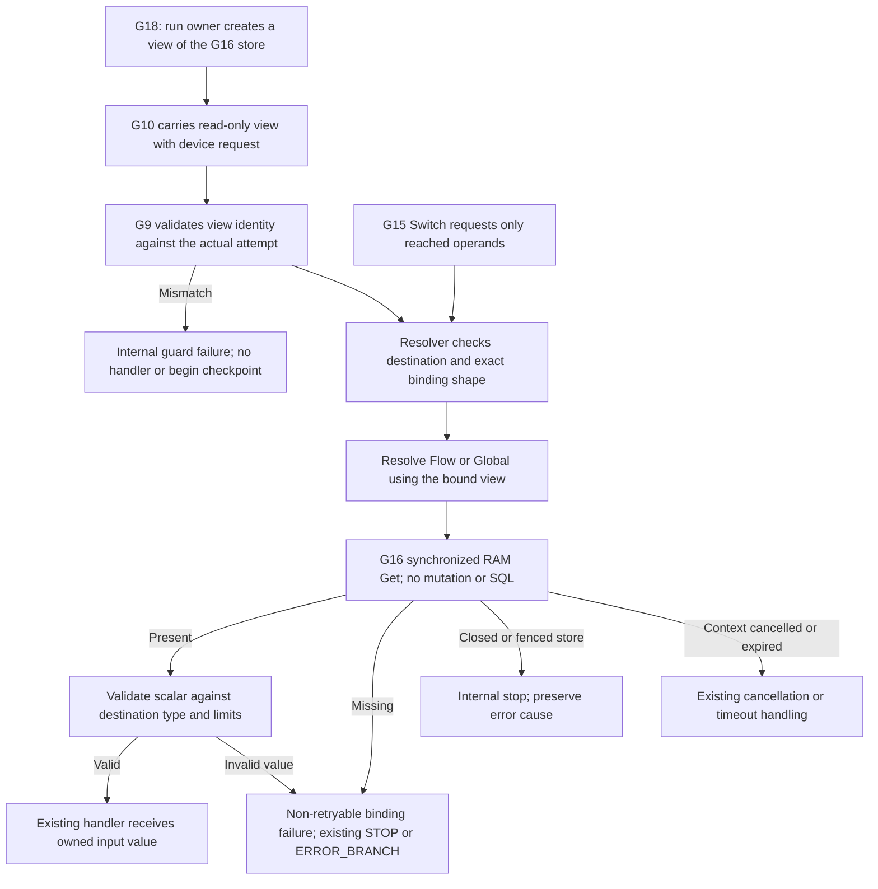

# G17 — Variable input bindings

## Overview

G17 lets an existing node input read a named Flow or Global variable from
G16's RAM store. It resolves the value for the current execution, checks the
destination input's contract, and passes an owned scalar to the existing
handler. The handler does not need to understand variable scopes.

For example, when Device A has `FLOW.message = "Hello A"`, an Input Text
binding can read that value as its `text` input. Device B reads its own Flow
message. Both can read a Global value from their shared RunGroup. Missing
values fail the node; reading does not create a key or wait for another writer.

G16 storage and authoring/compiler recognition are implemented. G17 now
implements both executable reads and carries trusted execution-bound access through
the runner. G18 now implements store construction/lifetime and Set Variable
execution; Phase H owns real Pause/Resume and Wait Variable scheduling.



**Status — Implemented and Linux-verified on 2026-11-19.** Flow/Global reads,
execution-bound views, destination validation, runner/attempt guards, and lazy
Switch integration are implemented in four production files. The full Go
suite, focused race checks, vet, formatting, Linux build, and local demo pass.
Real-SQLite runner/attempt tests verify existing checkpoint behavior while
variable values remain in G16 RAM. Windows amd64 agent, affected test binaries,
and local demo cross-compile; native Windows execution remains unverified.
G17 does not create live stores for public admission, make Set Variable
executable, or add an API to seed variables. G18 now supplies live stores and
Set Variable execution separately, with public compile/start/poll acceptance.

## 1. Scope and dependencies

| Owner     | Responsibility                                                                                                                                        |
| --------- | ----------------------------------------------------------------------------------------------------------------------------------------------------- |
| G17       | Two variable source kinds, exact source parsing, execution-bound read access, destination validation, runner/attempt propagation, and safe failures.  |
| G16       | RAM ownership, Get, missing/present result, synchronization, limits, publication, closed/fenced state, and Close.                                     |
| G2/G4     | Existing Literal, Workflow Input, and Node Output resolution; retain their behavior.                                                                  |
| G15       | Ordered Switch evaluation, one left resolution, lazy reached operands, and attempt deadline propagation.                                              |
| G7/G9/G10 | Normalization, checkpointing, handler dispatch, sequential execution, and execution identities.                                                       |
| G18       | Create one store per new run, construct its read views, execute Set Variable, confirm checkpoint before publication, and clean up after workers join. |
| Phase H   | Concurrent-device acceptance, live lifecycle controls, and waiting for a key to become present.                                                       |

Reuse the [binding contract](../contracts/workflow_bindings.md),
[G16 RAM store](g16_scoped_variable_storage.md),
[G2 resolution](g2_direct_input_bindings.md),
[G4 committed outputs](g4_previous_node_output_bindings.md), and
[G15 Switch](g15_switch_execution.md).

No schema, migration, repository, new dependency, HTTP DTO, endpoint, IR
version, Editor Graph version, Node Definition, or handler return type changes
are required. Runtime Info continues to advertise only executable node pairs.
Do not add a variable-write endpoint, a test seeding endpoint, or a new
capability list to make this phase appear publicly executable.

## 2. Binding contract

| Source          | Editor Graph                                    | Runtime IR                                        | Lookup scope                          |
| --------------- | ----------------------------------------------- | ------------------------------------------------- | ------------------------------------- |
| Flow variable   | `{"kind":"FLOW_VARIABLE","name":"message"}`     | `{"source":"FLOW_VARIABLE","name":"message"}`     | Current DeviceExecution's `FLOW` map. |
| Global variable | `{"kind":"GLOBAL_VARIABLE","name":"threshold"}` | `{"source":"GLOBAL_VARIABLE","name":"threshold"}` | Current RunGroup's `RUN_GROUP` map.   |

Each Runtime IR source object contains **exactly** `source` and `name`.
Require a string name satisfying `ir.ValidVariableName`, preserving its case.
Use the existing source and scope constants. No lookup ownership comes from
the binding: reject extra `scope`, device/run IDs, fallback values, nested
paths, field selectors, or other keys.

Before reading, require that the destination exists and its installed Node
Definition lists this source in its allowed binding kinds. Recognizing the
source globally does not authorize it for every input.

Android targeting remains literal-only. A Tap coordinate or selector binding
using a variable must fail `source_unsupported` without invoking the reader.
Keep authoring/compilation rules and targeting modes unchanged.

There is no publisher variable declaration, creation, or existence check at
authoring time. Existence and destination compatibility are checked when the
binding is actually resolved. The first writer will be G18, not this resolver.

## 3. Trusted execution-bound read view

Keep the Resolver stateless across runs. Do not put a mutable current run,
current device ID, or process-global store on the Resolver singleton.

Define a small read-only view under `internal/execution/bindings`, for example:

```go
type VariableLookup func(context.Context, constants.VariableScope, string) (json.RawMessage, bool, error)

type VariableView struct {
    RunGroupID        string
    DeviceExecutionID string
    Lookup            VariableLookup
}
```

G18's trusted owner binds the Lookup closure to the exact G16 store and the
device execution ID used for that admitted worker:

```go
boundDeviceID := deviceExecutionID
view := bindings.VariableView{
    RunGroupID: runGroupID,
    DeviceExecutionID: boundDeviceID,
    Lookup: func(ctx context.Context, scope constants.VariableScope, name string) (json.RawMessage, bool, error) {
        return store.Get(ctx, boundDeviceID, scope, name)
    },
}
```

G17 defines this view and its transport, not the production factory above.
Tests and the local smoke harness can construct it with a preloaded G16 store.
Do not add a constructor dependency to the agent, create stores in admission,
or instantiate one per device/read in G17.

The view exposes neither Apply nor Close. A handler never receives the view,
store, scope maps, or ownership IDs as a replacement for resolved inputs.
The callback's store association is trusted application wiring, not proof
derived from its metadata. G18 must construct both metadata and callback from
the same admitted run/store; bindings cannot inject or replace callbacks.

### 3.1 Optional view and identity checks

Add the view **by value** to `bindings.Values` and `runner.Request`, such as
`Variables VariableView` and `Variables bindings.VariableView` respectively.
The runner copies it into the execution-local Values passed to G9; no mutable
view pointer is shared between device requests. Callers keep captured state
and request fields immutable during a run, as they do for existing inputs.

The zero view has empty group/device IDs and a nil Lookup. It is optional:
existing workflows using the first three sources need no variable store.

If any view field is supplied, its owner IDs must be canonical Runtime UUIDs
matching the current `runner.Request.RunGroupID` and `DeviceExecutionID`.
G9 repeats that check against the actual `AttemptRef` for callers that invoke
the coordinator directly. Reuse one small view identity helper; do not copy
validation logic into each caller.

An ownership mismatch is an internal request/dependency guard failure before
input resolution, BeginAttempt, or handler dispatch. A request with no view
remains valid at this structural boundary. A view with valid owner metadata
but nil Lookup is diagnosed only if a variable binding is reached. This keeps
reader availability out of Switch's unvisited operands.

Direct Resolver calls trust the supplied view's ownership; they have no
separate AttemptRef. Validate owner ID shape when a variable is reached.
Actual runner/coordinator entry points provide the stronger identity match.
Do not add group-ID introspection or a new Get API to G16 solely for this step.

## 4. Resolution algorithm and value checks

Keep Literal, Workflow Input, and Node Output cases unchanged. For either
variable source:

1. Check the existing resolver context and destination contract.
2. Parse exactly `source` and `name`; validate the name and allowed kind.
3. Require an available execution-bound view and Lookup for this reached
   binding. Missing read access is an internal dependency error, not a missing
   publisher key and not an instruction to create a new store.
4. Map `FLOW_VARIABLE` to `VariableScopeFlow` or `GLOBAL_VARIABLE` to
   `VariableScopeRunGroup`, then invoke Lookup once with the same context.
5. On reader error, preserve its cause and stop classification. Do not turn
   a closed/fenced store into a normal missing-variable error.
6. On `found = false`, return the existing non-retryable input-binding error.
7. On `found = true`, use the existing UTF-8, scalar, and
   `ValidInputValue(node.Type, node.Config, field, value)` checks.
8. Return an owned scalar copy through the existing result path. Preserve
   the final context check; never mutate the stored value to coerce it.

No value caching or copy of the whole variable map is needed. Each reached
read sees G16's latest published value at that lookup. Several bindings do
not form a multi-key snapshot. Scope accounting and encoding limits remain
G16's responsibility; destination-specific restrictions remain the resolver's.

| Stored value and destination                                 | Result                                                         |
| ------------------------------------------------------------ | -------------------------------------------------------------- |
| String `"Hello A"` for an allowed string input               | Resolve that string.                                           |
| Numeric 75 for a string-only input                           | `input_value_invalid`; do not stringify.                       |
| `false`, 0, or `""`                                          | Present; validate against the actual destination contract.     |
| Empty string for an input requiring non-empty text           | Value-validation failure, not missing-variable failure.        |
| Absent name                                                  | Missing-variable binding failure.                              |
| Corrupt/non-scalar bytes supplied by an injected test reader | Existing scalar/value checks reject them; no handler dispatch. |

Reading does not create, replace, increment, consume, or remove a key. It does
not execute a producer, access another device's Flow scope, query SQLite,
restore an old run, or poll for a missing key.

## 5. Error mapping and lifecycle behavior

Keep existing A6 codes and public error projection. Use bounded safe messages
and existing `InputBindingError` field context for publisher binding errors.

| Failure                                               | Required treatment                                                                                                                                    |
| ----------------------------------------------------- | ----------------------------------------------------------------------------------------------------------------------------------------------------- |
| Unknown/disallowed source kind                        | Existing `source_unsupported`, `COMMAND_INPUT_UNSUPPORTED`, non-retryable; reader not called.                                                         |
| Wrong source shape or invalid name                    | Existing `binding_invalid`, same non-retryable code; reader not called.                                                                               |
| Missing key                                           | New safe detail `variable_missing`, message `Variable value is unavailable`, existing `COMMAND_INPUT_UNSUPPORTED`, non-retryable.                     |
| Present value violates destination                    | Existing `input_value_invalid`, same non-retryable code.                                                                                              |
| Reached binding has no usable view/Lookup             | Internal guard using existing `ErrVariableInvalid` and safe detail such as `variable_context_unavailable`; no public missing-variable classification. |
| Foreign view metadata at runner/coordinator entry     | Existing runner/attempt invalid-request guard; no begin checkpoint or lookup.                                                                         |
| G16 reports invalid identity, closed, or fenced store | Preserve `ErrVariableInvalid` / `ErrVariableUnavailable`; normalize as an internal stop through G7.                                                   |
| Lookup cancelled or deadline-expired                  | Preserve `context.Canceled` / `context.DeadlineExceeded` for existing G7/G11 handling.                                                                |
| Other reader error                                    | Preserve the contextual cause. Do not fabricate an empty value or label infrastructure failure as publisher data.                                     |

For wrapped storage/context errors, retaining safe destination-field context
is allowed, but must not replace the original error chain with CommandError.
Use `errors.Is`/`errors.As` semantics and avoid including values or arbitrary
callback error text in public responses.

A missing key is not a wait request. It follows STOP or ERROR_BRANCH through
the existing engine. G8 does not retry a deterministic variable binding/type
error. Wait Variable and wakeup registration remain Phase H.

G16 continues preserving the same store across a live pause. G17 reads it
after Resume without clearing, hydrating, or re-encoding all variables.
Run termination/owner shutdown cleanup belongs to G18's owner, not individual
resolution calls. Runtime restart still interrupts old runs and restores no
variable state.

## 6. Ordinary nodes, Switch, and checkpoint timing

| Path                               | Resolution timing and context                                                                                                                             |
| ---------------------------------- | --------------------------------------------------------------------------------------------------------------------------------------------------------- |
| Ordinary node                      | Existing G9 eager ResolveInputs runs before BeginAttempt using the execution-owner context. Preserve that ordering and its recorded binding-failure path. |
| Switch left/reached operand        | G15 invokes the resolver only when needed, after confirmed begin and under G6's existing attempt context/deadline.                                        |
| Any Get waiting behind publication | G16's context-aware gate allows cancellation; no extra polling, timeout constant, or goroutine is introduced.                                             |

G17 does not move ordinary resolution into handler invocation or redefine G6's
timeout start. Ordinary inputs retain the current execution-context timing;
Switch operands retain the current attempt-context timing. The trusted G18
checkpoint publisher remains bounded by D4 settlement limits.

For ordinary publisher binding failures, G9 still records the failed attempt
without calling the handler. For Switch, a reached failure is invocation
evidence handled by existing G7/G9 normalization and routing. Closed/fenced
state and cancellation must retain their stronger stop semantics on both paths.
An attempt-only deadline in the Switch path still follows G7's existing
TIMED_OUT/error-policy behavior; do not turn it into an internal or missing-key
error. Parent/execution stop signals retain their existing stronger precedence.

For Switch specifically:

- Resolve the left operand once per attempt.
- Resolve only binary operands of reached rules; unary rules request none.
- If an earlier rule matches, a later missing variable, nil reader, or closed
  store associated solely with an unvisited operand is never accessed.
- If that operand is reached, resolve and handle its real result normally.
- Validate all binding shapes and graph contracts in G1 as before; lazy
  evaluation does not excuse malformed admitted IR.

G18 must resolve Set Variable's value before entering G16 Apply. Do not invoke
this read path from inside its checkpoint closure: that would reenter the
store's gate and violate G16's lock-order contract. Reading an old value and
assigning another value is not an atomic compare-and-set operation.

## 7. Implementation map and review size

| Planned location in `a2matex-runtime`            | Focused change                                                                                                                  |
| ------------------------------------------------ | ------------------------------------------------------------------------------------------------------------------------------- |
| `internal/execution/bindings/variables.go` (new) | Read view/function type, optional-view identity helper, and narrow variable-source lookup handling.                             |
| `internal/execution/bindings/resolver.go`        | Add view to Values, accept the two allowed source kinds, delegate variable parsing/read, and reuse existing destination checks. |
| `internal/execution/runner/runner.go`            | Optional view on Request, entry identity guard, and propagation into execution Values.                                          |
| `internal/execution/attempts/coordinator.go`     | Validate the provided view against AttemptRef before resolution/begin, including direct coordinator calls.                      |

Target four handwritten production files and roughly 100–200 production
lines. Keep tests/manual tooling/status docs separate in the report. Before
exceeding eight production files or roughly 400 production lines, propose a
smaller ordered delivery. Reuse existing error/constant packages rather than
creating a new error taxonomy or generic binding framework.

Do not modify G16 storage, G6/G7 outcome semantics, handler registry, installed
catalog, compiler, admission service, lifecycle ownership, router, Wire, or
Production APIs for this step. Current nil-view requests remain usable for
the existing three-source workflows. G18 supplies the actual store views to
newly admitted device requests when its writer path is implemented.

## 8. Security, logging, and cost

Reads stay in the current process's RAM. Do not serialize variable values,
views, callback captures, or map snapshots into attempts, events, logs,
Runtime Info, HTTP DTOs, diagnostics, or files. Existing validated handler
output persistence is unchanged; the resolver does not add an input snapshot.

Log at the existing execution boundary with safe node/attempt identity,
destination field, source kind, operation, and reason. No scalar, binding
JSON, token, or full variable map belongs in error text or diagnostics.
Preserve ERROR severity and avoid duplicate logs at every wrapped return.

Each reached binding performs one synchronized Get and existing scalar/value
validation. Returned bytes are bounded by G16's 64 KiB value limit. Do not copy
all scopes or issue a database query per input. Ordinary nodes keep lexical
field resolution order; Switch keeps rule-array order. No background worker,
new cache, value hydration, or extra database write is needed.

## 9. Focused automated acceptance

| Area                  | Required evidence                                                                                                                                                              |
| --------------------- | ------------------------------------------------------------------------------------------------------------------------------------------------------------------------------ |
| Source parsing        | Both exact forms work; extra ownership/scope/fallback keys, missing/non-string/invalid names, and unknown/disallowed kinds fail before Lookup.                                 |
| Scope behavior        | Two views over one real G16 store read different Flow values and the same Global value; a different run/view cannot be selected by a binding.                                  |
| Identity transport    | Runner copies the optional view into Values; correct view passes; foreign group/device metadata fails before lookup/begin; direct coordinator calls enforce the same check.    |
| Optional dependency   | Existing three-source requests work with the zero view. A reached variable without read access fails internally; an unvisited Switch operand does not require it.              |
| Values                | String/number/boolean success for compatible fields; false/zero/empty remain present; type/length/range failures preserve existing errors; returned data is owned.             |
| Reader failures       | Missing produces non-retryable binding error; closed/fenced store remains internal stop; cancellation/deadline cause survives; arbitrary errors are not downgraded to missing. |
| Ordinary attempts     | Binding failure is checkpointed with no handler call; ERROR_BRANCH/STOP retain current behavior; internal/owner-context failures do not dispatch a normal error successor.     |
| Switch                | Left read once; reached RHS once; first match skips later variable reads; reached missing RHS fails; unary RHS not read; Get sees the attempt deadline.                        |
| Blocking/cancellation | Real G16 pending publication blocks a read; release yields confirmed value; owner cancellation stops waiting without mutating the store.                                       |
| Regression            | Literal/Workflow Input/Node Output, literal-only targeting, G15 routing, G16 limits/cleanup, and enabled node pairs remain unchanged.                                          |

Use existing resolver tests/fakes and the actual G16 store. Seed it through
G16 Apply with explicitly simulated successful checkpoint callbacks, not a
new public setter. Use existing real-SQLite attempt/runner harnesses only to
verify unchanged checkpoint/error integration; variable maps remain RAM-only.
No emulator or backend is needed for input-resolution tests.

Run affected tests, the complete Go suite after integration, focused race
checks for the touched binding/runner/attempt paths, vet, formatting, Linux
build, and Windows amd64 cross-compilation of affected code/tests. Report
native Windows and real-device evidence separately. This verification matrix
remains the regression contract; completed verification is recorded
in the status above. The local demo uses simulated seed checkpoints and no
real Android device commands.

## 10. Readable manual verification deliverable

The local harness is `test_demo/g17-smoke/main.go`, with embedded `demo.json`
and `README.md`, under the existing ignored local smoke directory. From that
folder, run `go run .` on Linux or Windows. Linux execution is verified;
Windows evidence is cross-compilation only. No server, token, SQLite file,
Android device, or ADB is required.

The fixture contains synthetic seed assignments and consumer bindings.
The harness creates one real G16 store, seeds it using simulated checkpoint
confirmation, binds one read view per synthetic device, and calls the actual
Resolver. It prints resolved synthetic values and expected safe failures.
Label this as internal resolution, not execution of Input Text on Android or
proof that Set Variable is advertised/implemented.

The simplest successful consumer fixture is:

```json
{
  "type": "android.input_text",
  "config": {},
  "inputs": {
    "text": { "source": "FLOW_VARIABLE", "name": "message" }
  }
}
```

This is a resolver fixture, not complete executable Runtime IR. The demo
supplies any internal node identity needed by the resolver harness. Do not
present it as a valid POST /runs request.

| Step                                                                 | Expected observation                                                                                                                                                                                                        |
| -------------------------------------------------------------------- | --------------------------------------------------------------------------------------------------------------------------------------------------------------------------------------------------------------------------- |
| Seed A's Flow message as `"Hello A"` and B's as `"Hello B"`          | Identical consumer bindings resolve their own device's message.                                                                                                                                                             |
| Seed Global `sharedText = "Shared"`                                  | Both views resolve `"Shared"` using `GLOBAL_VARIABLE`.                                                                                                                                                                      |
| Bind an absent name                                                  | Safe missing-variable error, no value creation.                                                                                                                                                                             |
| Bind a stored number into Input Text's string field                  | Type-validation failure; no implicit conversion.                                                                                                                                                                            |
| Read false/zero/empty through compatible installed input contracts   | Values are present; any further restriction is a destination validation result.                                                                                                                                             |
| Try a variable Tap coordinate                                        | Source rejected before any variable read.                                                                                                                                                                                   |
| Invoke a Switch whose first rule matches                             | Use the real Switch handler/invoker and a Resolver-backed ResolveInput callback; later missing variable is not requested. Show its internal selected port without fabricating a Node Output. No real checkpoint is claimed. |
| Check a foreign execution view with the shared entry identity helper | Rejected before any read. The automated runner/coordinator tests verify actual transport/begin behavior.                                                                                                                    |
| Block a G16 publisher and cancel the consumer                        | Lookup exits with cancellation; no mutation from the read.                                                                                                                                                                  |
| Close the store and attempt another read                             | Internal unavailable-state failure, not missing-variable success.                                                                                                                                                           |

Keep any synthetic-value printing in the local demo's explicit output;
reusable Runtime code keeps the no-value-logging rule. End successful checks
with PASS. Exit loses demo variables; rerunning seeds a new empty run.

G18 now implements the user-facing Set Variable → variable-bound consumer →
normal completion sequence. See its [manual API scenario](g18_set_variable_execution.md#11-manual-acceptance-with-the-existing-apis).
G17 itself adds no public seed API.

## 11. Completion and G18 handoff

G17 is complete when both reads work through the real resolver and the
runner/coordinator transport with real G16 RAM state; ownership and error
semantics pass; Switch stays lazy; existing workflows/capabilities remain
usable; and the readable internal demo provides inspectable results.

Completion does not advertise Set Variable, construct a store for public
admission, enable cross-device scheduling, implement Wait Variable, or restore
old runs. G18 receives the view type, identity requirements, missing/type
error semantics, and the requirement to bind views to its one store per newly
created RunGroup and keep that store until joined cleanup.
