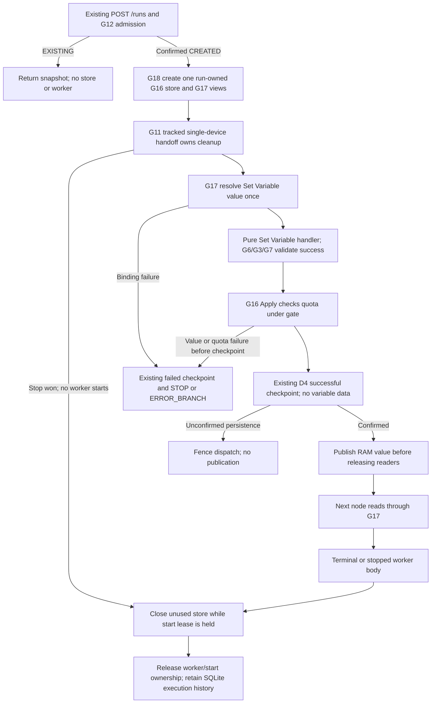

# G18 — Set Variable execution

## Overview

G18 makes `flow.set_variable` executable and supplies live variable storage to
new workflow runs. G16 already provides bounded RAM maps; G17 already reads
through execution-bound views. This step connects the writer and run ownership
so publishers can use variables through the existing compile/start/poll APIs.

There is one Set Variable node. `config.scope` chooses the current device's
Flow map or the current RunGroup's Global map; `bindings.value` selects the
value. First assignment creates the name, later assignment replaces it.
The handler validates and returns `{}`. The engine confirms its existing node
checkpoint, publishes the value to RAM, and only then permits continuation.



**Status — Implemented and Linux-verified on 2026-11-19.** Both batches are
complete in eight production files. Full Go tests, focused race checks, vet,
formatting, and Linux build pass. Real SQLite tests cover candidate failure,
rollback, and uncertain-commit read-back. Built-agent HTTP checks verify
compile/start/poll/replay, both variable-driven branches, fresh empty scopes,
intentional stop, owner loss, and forced crash/restart using controlled ADB
readiness and an isolated store. Windows amd64 agent and six affected test
binaries cross-compile; native Windows and live Android acceptance are
unverified. G19 screenshots, Phase H scheduling/controls, and Production
authorization remain later work.

## 1. Responsibility and delivery boundaries

| Component              | G18 responsibility                                                                                                                                            |
| ---------------------- | ------------------------------------------------------------------------------------------------------------------------------------------------------------- |
| Set Variable handler   | Validate its exact config and resolved scalar input under the attempt context; produce empty output and no side effect.                                       |
| G9 attempt coordinator | Form the candidate from the same resolved input, normalize the outcome, and use G16 Apply around the successful checkpoint. Record candidate failures safely. |
| G10 device request     | Carry trusted write-store authority alongside the existing G17 read view; do not create or close shared storage in the device loop.                           |
| G14 StartService       | After confirmed CREATED, allocate the run's store, bind the accepted device view, and transfer cleanup with the work handoff.                                 |
| G11 lifecycle          | Retain cleanup ownership through worker completion or a stop that skips dispatch; clean up before reporting ownership drained.                                |
| Composition root       | Advertise the exact Set Variable pair only after the complete production path is usable.                                                                      |

Authoritative dependencies are [workflow bindings](../contracts/workflow_bindings.md),
[execution state](../contracts/execution_state_v1.md#9-scoped-variable-state),
[G16 storage](g16_scoped_variable_storage.md),
[G17 reads](g17_variable_input_bindings.md),
[G9 attempts](g9_checkpointed_node_attempt.md),
[G11 shutdown](g11_runner_shutdown.md), and
[G14 start](g14_start_run_api.md).

Keep the existing public single-device limit, one-active-RunGroup admission,
201/200 replay behavior, authentication, version checks, and request DTOs.
There is no variable table, migration, repository method, checkpoint schema
extension, value-bearing event, public seed/inspection endpoint, or IR version
change. The variable map is never restored after Runtime restart.

## 2. Node contract and pure handler

`type` and `runtimeHandler` are both `flow.set_variable`. Use the installed
Backend-derived definition; do not create another variant for Global.

| Field                     | Rule                                                                          |
| ------------------------- | ----------------------------------------------------------------------------- |
| `config`                  | Exactly `name` and `scope`.                                                   |
| `config.name`             | Case-sensitive existing variable-name rule; reuse `ir.ValidVariableName`.     |
| `config.scope`            | Explicit `FLOW` or `RUN_GROUP`; do not default an omitted value at execution. |
| Resolved handler `inputs` | Exactly `value`, one supported scalar.                                        |
| Editor Graph source       | `bindings.value` with `kind`.                                                 |
| Runtime IR source         | `inputs.value` with `source`.                                                 |
| Success output            | Non-nil empty object, frozen by G3 as `{}`.                                   |
| Ports/error policy        | Ordinary `success`, and `error` only with ERROR_BRANCH; reuse G5.             |

Value sources are Literal, Workflow Input, eligible successful Node Output,
Flow Variable, and Global Variable. G17 resolves them before handler invocation;
G4's producer-success dominance rule still applies to Node Output. Variable
existence is checked when read, not through a declaration registry.

Reuse `execution.EncodeVariableScalar`, G16 scope constants, and existing safe
errors. The pure handler uses the existing Flow attempt-context checks. Invalid
config/value is a non-retryable contract/input failure, not a successful no-op.
No scalar, variable name, or scope is added to the successful Node Output.
The output picker must not offer a fabricated Set Variable `value` field.

### 2.1 Candidate preparation without new invocation callbacks

Use a small shared helper in the Set Variable handler package, for example:

```go
Prepare(config ir.Object, resolvedInputs ir.Object) (execution.VariableWrite, error)
```

It validates node-level fields and returns an owned candidate with an empty
AttemptRef. The handler calls it to validate its invocation, then returns `{}`.
After normalized success, the coordinator uses the same helper on the same
immutable config and already-resolved inputs, and supplies its actual AttemptRef.
No second binding lookup is performed. Bounded repeated parsing/encoding is
acceptable; avoid a framework refactor to remove those few field checks.

The handler never reads or mutates a store, commits a checkpoint, chooses the
current run/device, or retains a callback. Do not add a StageVariable callback,
change handler return types, or add a candidate field to public outputs.
Existing Invoker/Observation and registry.Invocation need no extension here.

## 3. Write authority and device request transport

Add optional internal `VariableStore *variables.Store` authority to the runner
and attempt requests. The runner forwards it unchanged to G9, separately from
`bindings.Values.Variables`. The read view remains read-only; ordinary handlers
receive only resolved inputs. No public DTO contains this pointer or a map.

Existing internal three-source workflows can still use nil variable fields.
A reached Set Variable node requires a write store before binding resolution,
BeginAttempt, or handler dispatch; missing authority is an internal request
failure. Existing G17 view identity checks remain in force.

The coordinator builds the writing AttemptRef from its active request, never
from node config or bindings. G16 Apply checks the store's bound group/device
before invoking the checkpoint closure. A mismatched injected store fails
closed without a successful checkpoint or publication. Do not add store-owner
introspection or broaden G16 Get/Apply for this step.

The production owner must install matching read and write access from the same
store. A direct internal caller may provide a pre-created shared store and
views for tests; that caller retains lifetime ownership unless it explicitly
transfers cleanup through managed Dispatch.

## 4. Successful assignment and failed-candidate finalization

Retain the existing G9 begin/invoke/normalize/finish flow. Remove only Set
Variable from its deferred-node guard. Wait Variable, Screenshot engine
integration, and Log keep their current gates.

For a Set Variable attempt:

1. Verify request/view/write authority and resolve the sole value once through
   G17. Preserve ordinary-node resolution ordering before BeginAttempt.
2. Confirm the RUNNING checkpoint, then invoke the pure handler under G6.
3. Use existing G3/G7/G8/G5 completion to derive validated output, status,
   control authority, and next position. No mutation is proposed for any
   non-SUCCEEDED outcome.
4. For success, prepare the owned candidate and assign the current AttemptRef.
5. Call G16 Apply. It validates scalar/ownership/quotas under its gate and calls
   the trusted successful-checkpoint closure at most once.
6. Inside that closure, sample owner/control stop authority again before
   starting FinishAttempt. Commit only the prepared SUCCEEDED checkpoint.
   Never commit a cancelled/failed outcome inside Apply: a committed result
   there would authorize RAM publication.
7. On confirmed successful finish, G16 publishes RAM before returning. G9
   releases continuation/output only after its normal confirmation check.

Track locally whether the successful checkpoint call has actually started.
This distinguishes a rejected candidate from an attempted persistence operation.
It is not a new durable record or retry counter.

### 4.1 Candidate rejected before successful persistence

If scalar/quota validation fails before the checkpoint closure starts, discard
only the pending assignment. Keep the existing handler invocation evidence
and rerun existing completion with that safe stage error. Record one FAILED
attempt through the ordinary FinishAttempt path and choose STOP/ERROR_BRANCH.
No handler, source binding, or successful checkpoint is invoked again.

The prior value/count/accounting remain unchanged, and the G16 store remains
usable for a publisher value/quota error. An initial create failure leaves the
key missing. Do not leave the already-begun attempt RUNNING because Apply
rejected its candidate.

An internal candidate/authority error follows existing fatal-stop handling;
do not convert it to an ordinary publisher quota failure. An already-started
checkpoint error must never enter this fallback or trigger another finish.

### 4.2 Stop or cancellation while waiting to publish

If owner cancellation/control wins before the successful checkpoint call,
do not publish or attempt a successful finish. Reuse existing completion and
G11 settlement authority for a non-success finalization outside Apply. Only do
so when the successful persistence call provably never started. Intentional
cancellation may commit CANCELLED; owner loss/forced exit retains D6 fallback
as defined by G11. Never label an uncertain Android attempt safe to replay.
When the accepted control flag is the stop signal, recompute from the original
invocation evidence and current control snapshot. Do not inject an isolated
command-cancellation stage error that G7 would classify as an internal fault.

A rejected checkpoint closure can fence the G16 store, as its existing contract
requires. During accepted group/runtime stop no further variable consumer may
continue; joined cleanup closes that store. Do not change G16 fencing rules
merely to permit a post-cancellation read.

If the successful checkpoint is confirmed before a later cancellation, G16
must still publish it. Subsequent dispatch observes the latest lifecycle stop.
Do not rewrite the completed attempt or erase its confirmed assignment early
while another reader is still owned by the run.

## 5. Outcome, timeout, and visibility matrix

| Evidence                                                         | Attempt/variable behavior                                                                  |
| ---------------------------------------------------------------- | ------------------------------------------------------------------------------------------ |
| Valid create or replacement                                      | SUCCEEDED with `{}`; confirm checkpoint, publish RAM, then continue.                       |
| Same scalar assigned again                                       | Still record the new successful attempt; value equality is not replay identity.            |
| Missing value source, wrong scalar, or exceeded quota            | Non-retryable COMMAND_INPUT_UNSUPPORTED; failed checkpoint/error policy; no mutation.      |
| Handler or output validation fails                               | Existing normalized failure; no Apply and no assignment.                                   |
| Handler attempt deadline expires                                 | Existing TIMED_OUT/error-policy behavior; no assignment or automatic retry.                |
| Owner/control stop before successful finish                      | No successful publication; existing G11 cancellation/interrupt settlement.                 |
| Commit response uncertain but D4 read-back proves the checkpoint | Return normal confirmation, publish the still-live candidate once.                         |
| Finish cannot be confirmed or persistence fails                  | No publication, no second finish, retry, error successor, or further dispatch.             |
| Already-finalized/stale disposition                              | G16 publishes nothing; existing G9 confirmation/guard handling applies.                    |
| Crash after commit but before publication                        | Variables are lost; D6 interrupts unfinished work after restart. No old execution resumes. |

Set Variable has no external device side effect and must not manufacture
COMMAND_START_FAILED/ADB_UNAVAILABLE retry evidence. G8 remains unchanged.
The pure handler uses its existing effective node deadline. G16 gate waiting
uses the owner execution context; D4 uses its existing bounded settlement and
shutdown deadline. Do not restart a node timer for checkpointing or claim the
node timeout bounds the complete SQLite/publication duration.

Readers are blocked through the checkpoint/publication gap. Existing D3
checkpoint notifications may occur after commit; a variable lookup waits until
publication. Phase H waiter notification must follow RAM publication and
coordinate registration; no waiter engine is introduced here.

Switch followed by Set Variable remains two operations. Last-committed-write-wins
is retained for Global assignments; no atomic increment/maximum or
compare-and-set operation is added.

## 6. New-run store creation and handoff

Create the store in the existing StartService's confirmed CREATED branch,
using the accepted RunGroup and DeviceExecution IDs. Preserve G12 admission
ordering and its immutable prepared work; do not allocate stores during
validation, compilation, replay lookup, or rejected/busy requests.

The current public limit is one device. Create **one store for that RunGroup**,
not a store per node or per read. Attach its write pointer and G17 view to the
local copy of the accepted device request; keep G12 prepared work immutable.
Prepared requests must not arrive with a pre-owned store or injected variable
view; unexpected ownership is an internal handoff-contract failure.
Bind the closure to that exact store/device; neither
caller JSON nor node bindings choose ownership.

The existing BeginStart lease must cover construction and cleanup/transfer.
After admission commits, allocation/wiring failure fences the owner and returns
safe start failure; do not erase the admitted records or dispatch partial work.
Existing request-ID replay remains the way to retrieve that admitted result.

### 6.1 Explicit cleanup transfer

Extend the internal ExecutionOwner/Dispatch seam with one narrow cleanup
callback, for example:

```go
Dispatch(worker *runner.Runner, request runner.Request,
    onExit func(context.Context) error,
) error
```

For the new store, StartService supplies its Close function. It retains a
fallback cleanup obligation until Dispatch returns nil. Nil means the owner
has consumed that obligation, including the case where shutdown wins and no
worker starts. An error leaves fallback cleanup with StartService; Close is
idempotent, and cleanup errors retain safe contextual failure reporting.

The lifecycle owner must call onExit before removing the worker from its
tracking map and signaling drained. For the current single-device run, the
worker body and synchronous node callbacks have returned at that point, so
no owned execution still needs its maps. Cleanup failure fences the owner;
it must not be silently discarded. Use a bounded cleanup context derived from
existing shutdown/settlement limits, not an already-cancelled worker context.

The current direct Service.Run path can pass nil cleanup to its private
runRegistered helper. Internal callers supplying shared storage retain its
ownership and close it after their own workers join. No new generic resource
manager or automatic per-device store factory is needed.

| Handoff case                                               | Store/cleanup result                                                                                                   |
| ---------------------------------------------------------- | ---------------------------------------------------------------------------------------------------------------------- |
| Rejection, busy, or EXISTING replay                        | No store, view factory call, cleanup callback, or worker.                                                              |
| CREATED; worker accepted                                   | Lifecycle owns onExit before acknowledging; HTTP disconnect cannot release live maps.                                  |
| Stop wins before worker registration; Dispatch returns nil | Dispatch consumes cleanup immediately while the start lease still protects settlement. Queued rows remain G11/D6 work. |
| Stop wins during registration race                         | Same no-worker cleanup guarantee; no leaked unused store.                                                              |
| Dispatch returns error                                     | StartService fallback closes the store and reports owner failure.                                                      |
| Snapshot read fails after accepted handoff                 | Worker/store remain owner-bound; do not close because the HTTP response failed.                                        |
| Worker succeeds/fails or stop joins it                     | Run cleanup before worker deregistration/drained signal.                                                               |

## 7. Lifecycle and Phase H handoff

Normal completion, STOP failure, accepted cancellation, and owner shutdown
all release live maps after their owned execution bodies finish. Keep the
existing store for any future live pause; do not clear values at a safe-node
pause boundary. G18 implements no Pause/Resume action or scheduling policy.

The public single-device limit stays unchanged. H1/H4 will expand ownership
from one accepted worker to an admitted group of devices. That expansion must:

- Create one shared store with all accepted DeviceExecution IDs.
- Bind a different read view per device but the same write store.
- Keep the store through queued/waiting/paused/rescheduled workers.
- Move cleanup to group ownership after all relevant workers join and the
  RunGroup is terminal, never to an individual sibling's completion.
- Preserve explicit cleanup transfer for stopped or rejected handoffs.

Do not implement that scheduler or introduce worker/reference counters for
future queueing in G18. Existing internal multi-device tests may inject a
shared store manually without public multi-device dispatch.

Process exit/crash loses maps. D6 still interrupts old runs; request replay
returns their snapshot and starts no writer/store. A new run starts empty.
There is no variable file, checkpoint snapshot, shutdown flush, or hydration.

## 8. Capability, confidentiality, and API behavior

Register `{type: "flow.set_variable", runtimeHandler: "flow.set_variable"}`
in the agent only after the internal path and public run ownership work.
G1 and Runtime Info reuse that actual registry. An unsupported pair still
fails executable admission; do not advertise a placeholder in the first batch.

The success payload stays `{}`. Do not serialize assignment candidates,
resolved values, views, or map contents into FinishAttempt, SQLite, events,
run snapshots, ordinary logs, diagnostic exports, or Runtime Info. Preserve
existing node-output persistence; a producer's declared scalar output is not
variable history. No protected scalar is printed by reusable Runtime code.

Use safe contextual operation/reason fields, node/attempt identity, scope,
name, and limit category where appropriate. Preserve ERROR severity and
existing cause chains; public errors never echo raw input or arbitrary
callback error text. Development and future Production use RAM-only variables.
Phase J continues owning authorization/decryption.

Existing compile, POST /runs, GET snapshot, bearer, and readiness contracts
are unchanged. After the owner wiring is installed, a reached missing key
is a normal publisher binding error because the run has a valid empty store;
it is no longer the transitional G17 missing-context failure in the public
API test. A broken/mismatched context remains an internal stop.

## 9. Two implementation batches and review budget

| Batch                           | Planned production locations                                                                                                                                                                                                             | Reviewable outcome                                                                                                                                                                     |
| ------------------------------- | ---------------------------------------------------------------------------------------------------------------------------------------------------------------------------------------------------------------------------------------- | -------------------------------------------------------------------------------------------------------------------------------------------------------------------------------------- |
| Internal writer/checkpoint path | New `internal/handlers/setvariable/set_variable.go`; `internal/execution/runner/runner.go`; `internal/execution/attempts/coordinator.go`; new `internal/execution/attempts/variables.go` helper if needed to keep coordination readable. | A manually supplied G16 store receives assignments only after the real G9/D4 successful finish. Quota, cancellation, fault, and routing tests pass. Public registry remains unchanged. |
| Live ownership and enablement   | `internal/services/runadmission/start.go`; `internal/services/executionlifecycle/dispatch.go`; `internal/services/executionlifecycle/lifecycle.go`; `cmd/agent/handlers.go`.                                                             | Confirmed CREATED runs obtain one store/views; handoff and joined cleanup work; registry pair and existing public APIs are usable.                                                     |

Target approximately 100–200 production lines per batch and no more than four
production files in each. Report tests, examples, and status/integration docs
separately. Both batches are one G18 contract; neither alone completes it.
Before exceeding eight production files or roughly 400 production lines,
propose a smaller ordered delivery. Do not silently expand invocation,
checkpoint schemas, G16 storage, or Phase H to meet this phase.

No change to registry.Invocation, Invoker/Observation, repository interfaces,
Goose, current API DTOs, or Wire constructors is expected. Regenerate Wire only
if constructors actually change; never hand-edit generated code. Tests may
update internal Dispatch fakes for the added cleanup parameter.

## 10. Automated acceptance

| Area                 | Required evidence                                                                                                                                                           |
| -------------------- | --------------------------------------------------------------------------------------------------------------------------------------------------------------------------- |
| Pure handler         | Exact config/input shape, both scopes, all scalar types and limits, context/deadline checks, `{}` output; no store/ADB access or mutation.                                  |
| Binding sources      | Literal, Workflow Input, successful Node Output, Flow, and Global sources; no second variable lookup during candidate preparation.                                          |
| Create/replace       | First write, same-name replacement, scope isolation, empty/false/zero present, and same-value assignment still checkpointed.                                                |
| Candidate failures   | Missing source, wrong type/size, count/byte quota; prior state unchanged; one FAILED finish/error route, no successful finish or repeated handler.                          |
| Checkpoint boundary  | Confirm begin before invocation; confirm success before RAM visibility/next node; failure or unconfirmed finish releases no candidate or successor.                         |
| Cancellation/control | Stop during handler, gate wait, pre-finish authority sampling, and after confirmed commit; no cancelled outcome is committed inside Apply and then published as success.    |
| Faults               | Real SQLite rollback/uncertain-commit read-back through existing fixtures; no extra variable reconciliation, second finish, or automatic retry.                             |
| Ownership            | CREATED-only factory; correct read/write context; replay/busy/rejection allocate nothing; direct internal shared-store callers retain ownership.                            |
| Handoff races        | Stop before/during registration, dispatch error, disconnected/failing snapshot response, worker failure, and cleanup failure; exactly owned cleanup and no premature drain. |
| Lifetime             | Success/failed run and intentional stop release maps; new run empty; crash/restart preserves old attempt evidence but restores no variable state.                           |
| Registration/API     | Exact Set Variable pair appears only in the working build; compile/start/poll/replay and missing-key error policy pass with the actual agent composition.                   |
| Regression           | G1/G15/G16/G17 behavior, ordinary handlers, single-device admission, and G11 ownership/shutdown continue passing.                                                           |

Use existing handler/attempt/runner, real-SQLite, start-service, lifecycle, and
API fixtures. Keep synthetic preloading explicit in internal batch tests;
the final API tests must use actual Set Variable execution, not injected
pre-seeded values or a public seed endpoint.

Run affected tests first, full Go tests after final integration, focused race
checks, vet, formatting, Linux build, and Windows amd64 agent/test/example
cross-compilation. Verify a controlled managed owner stop/crash in the final
integration batch. Distinguish Linux execution, controlled device readiness,
live Android preflight, cross-build, and native Windows evidence. This
implementation used controlled ADB readiness for its built-agent checks; it
did not run a live Android command or alter the user's execution database.

## 11. Manual acceptance with the existing APIs

Use the [managed Runtime/authentication guide](../integration/managed_runtime.md).
Runtime must report a compatible build version and the Set Variable pair in
GET /runtime-info. The current POST /runs still needs one connected, refreshed,
ready ADB device even though the graph below uses only Flow nodes.

### 11.1 Compile this graph

Send this complete body to authenticated POST /api/v1/workflow-compilation:

```json
{
  "editorGraph": {
    "schemaVersion": 1,
    "entryNodeId": "start",
    "nodes": [
      {
        "id": "start",
        "type": "flow.start",
        "config": {},
        "bindings": {},
        "errorPolicy": "STOP",
        "editor": { "x": 0, "y": 0 }
      },
      {
        "id": "set_score",
        "type": "flow.set_variable",
        "config": { "scope": "FLOW", "name": "score" },
        "bindings": {
          "value": { "kind": "WORKFLOW_INPUT", "inputName": "score" }
        },
        "errorPolicy": "STOP",
        "editor": { "x": 200, "y": 0 }
      },
      {
        "id": "set_threshold",
        "type": "flow.set_variable",
        "config": { "scope": "RUN_GROUP", "name": "threshold" },
        "bindings": { "value": { "kind": "LITERAL", "value": 50 } },
        "errorPolicy": "STOP",
        "editor": { "x": 400, "y": 0 }
      },
      {
        "id": "choose",
        "type": "flow.switch",
        "config": {
          "rules": [
            { "id": "bfbb31bc-d4b5-44ec-b9eb-a09d68e74083", "operator": "LT" }
          ]
        },
        "bindings": {
          "value": { "kind": "FLOW_VARIABLE", "name": "score" },
          "bfbb31bc-d4b5-44ec-b9eb-a09d68e74083": {
            "kind": "GLOBAL_VARIABLE",
            "name": "threshold"
          }
        },
        "errorPolicy": "STOP",
        "editor": { "x": 600, "y": 0 }
      },
      {
        "id": "low_wait",
        "type": "flow.delay",
        "config": {},
        "bindings": { "durationMs": { "kind": "LITERAL", "value": 1000 } },
        "timeoutMs": 5000,
        "errorPolicy": "STOP",
        "editor": { "x": 800, "y": -100 }
      },
      {
        "id": "high_wait",
        "type": "flow.delay",
        "config": {},
        "bindings": { "durationMs": { "kind": "LITERAL", "value": 2000 } },
        "timeoutMs": 5000,
        "errorPolicy": "STOP",
        "editor": { "x": 800, "y": 100 }
      },
      {
        "id": "end",
        "type": "flow.end",
        "config": {},
        "bindings": {},
        "errorPolicy": "STOP",
        "editor": { "x": 1000, "y": 0 }
      }
    ],
    "edges": [
      {
        "id": "e1",
        "sourceNodeId": "start",
        "sourcePort": "success",
        "targetNodeId": "set_score"
      },
      {
        "id": "e2",
        "sourceNodeId": "set_score",
        "sourcePort": "success",
        "targetNodeId": "set_threshold"
      },
      {
        "id": "e3",
        "sourceNodeId": "set_threshold",
        "sourcePort": "success",
        "targetNodeId": "choose"
      },
      {
        "id": "e4",
        "sourceNodeId": "choose",
        "sourcePort": "bfbb31bc-d4b5-44ec-b9eb-a09d68e74083",
        "targetNodeId": "low_wait"
      },
      {
        "id": "e5",
        "sourceNodeId": "choose",
        "sourcePort": "default",
        "targetNodeId": "high_wait"
      },
      {
        "id": "e6",
        "sourceNodeId": "low_wait",
        "sourcePort": "success",
        "targetNodeId": "end"
      },
      {
        "id": "e7",
        "sourceNodeId": "high_wait",
        "sourcePort": "success",
        "targetNodeId": "end"
      }
    ]
  },
  "inputSchema": {
    "type": "object",
    "properties": { "score": { "type": "number" } },
    "required": ["score"],
    "additionalProperties": false
  }
}
```

The same request is available as the readable
[compile-score.json example](../../../../a2matex-runtime/examples/g18/compile-score.json). Use the exact successful compiler
Runtime IR, including its versions/requirements, in the normal POST /runs
request. Do not hand-edit the IR or treat an empty runtimeIr object as valid.

### 11.2 Start, poll, and inspect

Use a new canonical UUIDv4 requestId, the exact ready device serial, and that
device's inputs `{ "score": 30 }`. Expect 201 for the new run, retain its group
ID, and poll GET /api/v1/runs/{runGroupId} until terminal. Repeat with score 75
under a fresh requestId after the first run finishes.

| Input | Expected attempt sequence                               | Final result                                    |
| ----- | ------------------------------------------------------- | ----------------------------------------------- |
| 30    | start, set_score, set_threshold, choose, low_wait, end  | Group/device SUCCEEDED; six SUCCEEDED attempts. |
| 75    | start, set_score, set_threshold, choose, high_wait, end | Same result through Default.                    |

Both Set Variable rows and the Switch row have output `{}`. The unselected
Delay has no attempt. Android UI need not change: this graph sends no Tap,
Swipe, or Input Text command. Branch node IDs are the evidence, supported by
roughly one/two seconds of delay rather than exact timing guarantees.

Inspect the Runtime's actual execution database in DataGrip using its normal
configured location, then replace RUN_GROUP_ID in this read-only query:

```sql
SELECT a.sequence, a.node_id, a.status, a.output_json, a.error_json
FROM node_attempts AS a
JOIN device_executions AS d ON d.id = a.device_execution_id
WHERE d.run_group_id = 'RUN_GROUP_ID'
ORDER BY a.sequence;
```

There is no variable table/query or durable map to inspect. A successful
branch proves the values were available in RAM before its consumer. After
the group has settled and cleanup has joined, those maps are released.

### 11.3 Replacement, failed assignment, and fresh-run checks

| Scenario         | Graph/request change                                                                                                                                                                             | Expected observation                                                                                                                                                     |
| ---------------- | ------------------------------------------------------------------------------------------------------------------------------------------------------------------------------------------------ | ------------------------------------------------------------------------------------------------------------------------------------------------------------------------ |
| Replacement      | Insert a second Set Variable with a new node ID, FLOW/score, literal 75 before choose; reconnect the linear success edges.                                                                       | Input 30 now takes high_wait; both assignments have separate successful attempts.                                                                                        |
| Failed overwrite | Insert a Set Variable named try_replace before choose, targeting FLOW/score but reading absent FLOW/missing; use ERROR_BRANCH and connect both success/error to choose.                          | try_replace is FAILED with COMMAND_INPUT_UNSUPPORTED, its output is null, and choose still uses the earlier score. The run can finish SUCCEEDED through its error route. |
| Replay           | Resend the same successful POST body/requestId.                                                                                                                                                  | 200 for the same group, no new attempt/store/dispatch.                                                                                                                   |
| New empty run    | Remove set_score/set_threshold and their edges from the compile example; connect start directly to choose, keeping its binding/ports and both Delay routes. Recompile and start with a fresh ID. | Valid graph admits with an empty store; choose fails COMMAND_INPUT_UNSUPPORTED for missing score. No old value is inherited.                                             |
| New normal run   | Submit the original compiled graph with another fresh ID and input.                                                                                                                              | New setters initialize a fresh namespace normally.                                                                                                                       |

Use unique node/edge IDs and remove disconnected nodes when editing variants.
False, zero, empty string, count/byte quotas, injected finish faults, and stop
races belong in automated acceptance so the manual walkthrough stays short.
A missing variable never becomes zero/empty or triggers an implicit wait.

## 12. Completion and later handoff

G18 is complete only when both batches pass: actual registry-supported Set
Variable execution creates/replaces values, actual CREATED run ownership
supplies the shared store/views, checkpoint confirmation precedes publication,
and handoff/stop cleanup has verified ownership. Public compile/start/poll
acceptance must work without test-only preloading or a seed endpoint.

At that point update G16/G17/contracts/status references and existing client
examples against the verified build; distinguish completed node support from
still-pending H controls. G19 can continue Screenshot integration independently
of variable persistence, since none exists. H1/H4 receive the group-store
expansion/cleanup checklist above; Phase J receives the same RAM-only policy.
Do not mark scheduling, Pause/Resume, Wait Variable, or Production execution
complete because Set Variable now works.
