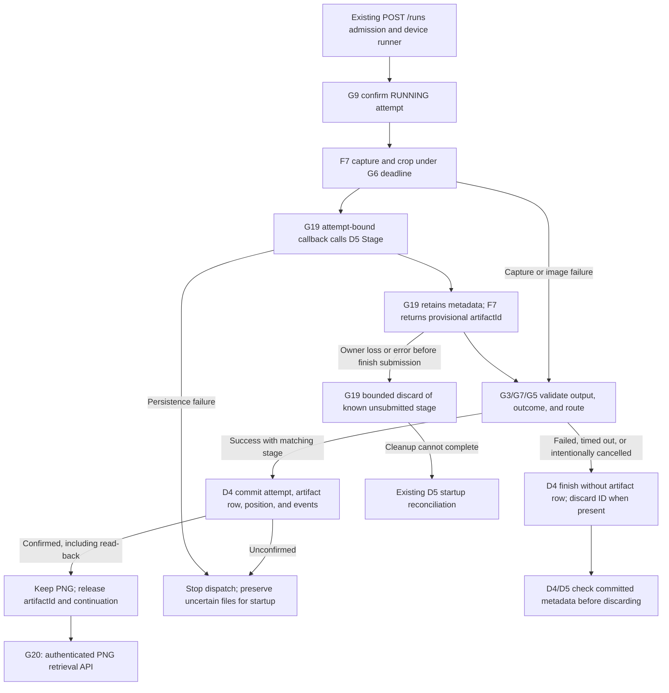

# G19 — Screenshot execution integration

## Overview

G19 makes the existing `android.screenshot` handler usable in a normal workflow
started through POST /runs. F7 already captures and crops the image. D5 already
stages PNG files, and D4 already commits artifact metadata with an attempt.
G19 connects those pieces to the real attempt coordinator and enables the
handler in the agent registry.

The handler receives a callback bound to its actual attempt. That callback
stages the PNG and retains its metadata in the coordinator. The returned ID is
provisional until D4 confirms the successful checkpoint. Only then can the
next node consume `artifactId`. Keeping the stage independently of handler
output also covers cancellation after the file has been saved.



**Status — Implemented and Linux-verified on 2026-11-19.** Five handwritten
production files plus regenerated Wire output connect the attempt-bound stage,
checkpoint settlement, and actual handler registry. Full Go tests, affected
race checks, vet, formatting, and Linux build pass. Real-PNG/SQLite tests cover
all modes, metadata/output pairing, cancellation after staging, rollback, and
uncertain-commit read-back. Built-agent HTTP checks with controlled ADB PNG
output verify all modes, downstream NODE_OUTPUT → RAM variable → Switch,
replay/error routes, managed stop/owner loss, and a forced crash after PNG
publication before commit. Restart removes only the orphan and never repeats
the old capture. Windows amd64 agent and affected tests cross-compile;
native Windows and live Android acceptance remain unverified. G20 now separately
implements authenticated retrieval; automatic output discovery remains A7/I1.

## 1. Responsibility and existing foundations

| Owner   | Existing behavior or G19 addition                                                                                                                |
| ------- | ------------------------------------------------------------------------------------------------------------------------------------------------ |
| F7      | Validate mode/region, capture one bounded Android frame, crop when requested, and call StageScreenshot. Implemented already.                     |
| D5      | Stage PNG bytes, return metadata, protect filesystem access, discard confirmed uncommitted files, and reconcile at startup. Implemented already. |
| D4      | Commit artifact metadata with the attempt, position, and events; reconcile uncertain commits and settle submitted stages. Implemented already.   |
| G19     | Supply the callback, retain attempt-local stage ownership, pair output with metadata, hand it to D4, and enable the actual handler.              |
| G20     | Expose the authenticated artifact download endpoint. Implemented separately in G20.                                                                                 |
| Phase H | Schedule multiple devices and provide execution controls. Later work.                                                                            |

Authoritative dependencies are [F7 Screenshot](../f_device_commands/f7_screenshot.md),
[D5 artifacts](../d_persistence/d5_artifact_store.md),
[D4 checkpoints](../d_persistence/d4_atomic_checkpoint.md),
[G3 outputs](g3_handler_output_validation.md),
[G6 deadlines](g6_attempt_deadlines.md),
[G9 attempts](g9_checkpointed_node_attempt.md),
[G11 shutdown](g11_runner_shutdown.md), and
[G14 start](g14_start_run_api.md).

Reuse the installed Backend-derived Screenshot definition. Preserve current
Editor Graph/Runtime IR versions, request-ID replay, one-device public start,
authentication, and existing execution/variable lifetimes. The existing D5
migration already supplies the artifact table; G19 adds no migration, schema,
repository method, request DTO, or endpoint.

F7's earlier combined Phase G/A7 integration acceptance is delivered across
G19 execution and G20 retrieval. Advertising this executable node means the
workflow handler works; it does not advertise an artifact HTTP route. Keep
native-host and final combined Screenshot acceptance labelled separately.

## 2. Executable node contract

| Item                     | Required behavior                                                                                          |
| ------------------------ | ---------------------------------------------------------------------------------------------------------- |
| Type and runtime handler | Both `android.screenshot`.                                                                                 |
| Capability               | Existing `android.screen.capture`.                                                                         |
| Config                   | Exactly one explicit `targetMode`; no omitted-mode fallback.                                               |
| Inputs                   | Exactly the selected mode's literal coordinates, resolved by existing G2.                                  |
| Output                   | Exactly `{"artifactId":"<canonical lowercase UUIDv4>"}` for the staged artifact belonging to this attempt. |
| Ports                    | Existing `success`; `error` only with ERROR_BRANCH.                                                        |
| Time budget              | Existing admitted `timeoutMs`; catalog default 30,000 ms.                                                  |

| Mode              | Editor bindings / resolved inputs                                                                                 |
| ----------------- | ----------------------------------------------------------------------------------------------------------------- |
| `FULL_SCREEN`     | Empty object.                                                                                                     |
| `ABSOLUTE_PIXELS` | `startX`, `startY`, `endX`, `endY`. Integers 0–4096, ordered top-left to bottom-right.                            |
| `SCREEN_PERCENT`  | `startXPercent`, `startYPercent`, `endXPercent`, `endYPercent`. Integers 0–100, ordered top-left to bottom-right. |

Target coordinates remain literal-only. Do not add selectors, variable-driven
corners, fractional percentages, or another targeting representation. G1 and
F7 retain their respective admission and resolved-value checks. F7 uses the
actual captured frame, including its orientation and dimensions; G19 performs
no extra display query or coordinate calculation.

Reuse the shared limits: 16 MiB encoded PNG, 4096 pixels per dimension, and
12,000,000 pixels total. Source capture and stored crop each satisfy their
existing limits. Width/height in D5 metadata describe the stored image.
The PNG bytes, dimensions, digest, and local path are not added to the node
output. `artifactId` is an opaque string reference, not the image contents.

## 3. Minimal dependency and identity wiring

Add an optional Screenshot artifact dependency to `attempts.Dependencies` and
`runner.Dependencies`. Define the small consumer-owned interface in the
attempt package, for example:

```go
type ScreenshotArtifacts interface {
    Stage(context.Context, string, []byte) (execution.Artifact, error)
    DiscardUncommitted(context.Context, string)
}
```

The concrete implementation is the existing `*services.ArtifactService`.
Pass the same instance already used by CheckpointService's ArtifactDiscarder.
The composition root passes it through newRunAdmission into runner construction;
the runner passes it to the coordinator. It is a shared service dependency,
not a publisher-selected store or a new field on the public run request.

Existing internal workflows without Screenshot may omit this dependency.
A reached Screenshot requires it before input resolution, BeginAttempt, or
ADB capture. Missing infrastructure is an internal guard failure, not an
ordinary publisher input error. Remove only Screenshot from G9's deferred-node
guard; Wait Variable and Log keep their current gates.

Use the actual `request.Ref.AttemptID` in every Stage call. RunGroup, device,
node, and attempt identity continue coming from the existing runner request.
Workflow JSON cannot supply an attempt ID, artifact ID, callback, or file path.

`registry.Invocation.StageScreenshot` and the G6 forwarding path already exist.
No Invocation/Observation extension, alternate handler return type, context
value transport, or new invoker framework is required.

## 4. Attempt-local staging callback

Create the stage holder for one confirmed-begun Screenshot attempt. Keep it
inside that coordinator Run call; never put mutable stage state on the shared
Coordinator, Runner, Invoker, handler registry, or ArtifactService.

The holder needs only the bound attempt identity, optional staged metadata,
whether its callback was called/closed, and any callback-contract failure.
One attempt owns at most one stage. Use the existing synchronous handler
contract rather than a goroutine, channel, or shared stage registry.

The callback follows this order:

1. Require the active Screenshot invocation, a live supplied attempt context
   with a deadline, and a live owner context. Reject a repeated or
   post-invocation call before any further staging I/O.
2. Call `Stage(callbackCtx, request.Ref.AttemptID, pngBytes)` once. Forward the
   G6 context unchanged; do not detach staging or start a fresh node timeout.
3. When Stage succeeds, copy its metadata into the holder **before** a later
   context/control check can return cancellation. No PNG buffer is retained
   by the holder.
4. Require `Artifact.Valid()` and exact AttemptID ownership. A broken service
   result cannot authorize success or identify a file for G19 to delete.
   Only a valid, owned stage supplies a later discard ID; never open a path
   or discard an unrelated ID from malformed/foreign metadata. Leave such
   unresolved files to startup reconciliation.
5. Recheck the supplied context and owner context, then return
   the provisional ID to F7 if still allowed.

The accepted GroupCancellation flag remains G9 completion authority. If that
flag is visible before context cancellation propagates, do not fabricate an
isolated command context.Canceled error in this callback: G7 would classify
it as an internal fault. A still-live callback can return its provisional ID;
completion samples the accepted control and settles CANCELLED with discard
instead of publishing success. Actual context cancellation is propagated as
usual through G6 evidence.

D5 owns cleanup for an operation that returns an error before returning a
successful stage record, including partial filesystem writes. G19 owns a
successfully returned record even if cancellation wins immediately afterwards.
If a staging contract failure is ignored by a controlled/incorrect handler,
the holder must still prohibit a successful finish. Do not manufacture a
success from a previously retained ID after a second callback fails.

F7 invokes the callback synchronously and at most once. Close its authority
as soon as Invoke returns, including an outer invocation error. No callback
may be retained or called asynchronously. An ignored callback failure follows
the existing safe internal/persistence failure rules; when F7 already returns
an error, preserve that evidence instead of also injecting the same error as
an unrelated second stage failure into G7.

## 5. Coordinator completion and checkpoint handoff

Keep G9's existing resolve → begin → invoke → normalize → finish ordering.
There is no capture or file staging before a confirmed RUNNING checkpoint.

For Screenshot, the exact sequence is:

1. Resolve the admitted inputs through G2; preserve ordinary binding failures.
2. Confirm BeginAttempt, create the stage holder, and supply its callback in
   the Invocation alongside the actual ADB serial/config/resolved inputs.
3. Invoke the existing F7 handler once through G6 and close callback authority
   when it returns. Retain metadata independently of Observation.Output.
4. Use the existing completion function for G3 validation, G7 normalization,
   G8 retry policy, G5 routing, and the latest G11 control authority.
5. For a proposed SUCCEEDED outcome, verify its validated output ID exactly
   matches the holder's valid metadata and current AttemptID.
6. If this pairing fails, recompute completion from the original invocation
   evidence plus the safe pairing error. Do not reread a binding, capture
   another frame, reinvoke F7, or attempt a successful finish first.
7. Attach `finish.Artifact` only to a final SUCCEEDED outcome. For every
   non-success outcome with a known stage, attach only DiscardArtifactID.
8. Mark finish submitted immediately before the existing FinishAttempt call.
   Confirm its result through the usual G9 sequence/cursor/disposition checks.
9. Only confirmed success releases output and next-node continuation. G10's
   existing committed-output map then makes artifactId eligible for NODE_OUTPUT.

This deliberately reuses the current completion function. A bounded second
completion preparation for a pairing failure is acceptable, as in G18's
candidate rejection path. Do not refactor unrelated normalization or change
the handler protocol merely to eliminate a small repeated calculation.

| Pairing evidence                                | Result                                                                                                                                                                    |
| ----------------------------------------------- | ------------------------------------------------------------------------------------------------------------------------------------------------------------------------- |
| G3 rejects output shape/type                    | Existing NODE_OUTPUT_INVALID; configured ordinary error handling; discard any known stage.                                                                                |
| Valid staged metadata and matching validated ID | Eligible for successful D4 finish.                                                                                                                                        |
| Structurally valid output names a different ID  | Non-retryable NODE_OUTPUT_INVALID; no artifact row/reference; discard the actual owned stage.                                                                             |
| Successful output without a stage               | Internal execution-contract failure; no success or ordinary successor.                                                                                                    |
| Metadata invalid or bound to another attempt    | Infrastructure/contract stop; never submit it as a successful artifact or use its ID to discard another attempt's file. Startup reconciliation settles unknown ownership. |
| Handler/attempt/owner already failed or stopped | Preserve existing outcome authority; no pairing error should replace it merely because successful output is absent.                                                       |

D4 already requires the same metadata/output/attempt pairing. The coordinator
check prevents a bad internal result from becoming a rejected successful
checkpoint request. Keep D4's validation as the final storage boundary.
No image processing or filesystem write occurs in the SQLite transaction.

## 6. Stage settlement and cleanup ownership

Track whether FinishAttempt has been called, not whether it returned success.
That flag decides which layer owns settlement. A failed return can describe
an uncertain commit, so a generic deferred delete is unsafe.

| Boundary                                                                        | Owner and required handling                                                                                                                  |
| ------------------------------------------------------------------------------- | -------------------------------------------------------------------------------------------------------------------------------------------- |
| No successful Stage return                                                      | D5 owns partial-file cleanup/reconciliation. G19 has no artifact record to submit.                                                           |
| Known stage; completion exits before FinishAttempt                              | G19 calls D5 DiscardUncommitted using bounded cleanup context after invocation has returned.                                                 |
| Non-success finish submitted with discard ID                                    | D4/D5 settle the file after the write outcome, under their existing writer gate and metadata lookup.                                         |
| Successful finish confirmed, including matching read-back                       | Keep the PNG and committed row; publish output once.                                                                                         |
| Finish rolls back or returns stale                                              | Existing D4/D5 cleanup checks the ID has no committed row before deleting it. G9 releases no continuation for an unconfirmed finish.         |
| Duplicate finalized attempt                                                     | G9 does not rerun its successor. D4/D5 preserve the original committed image and may discard only a different, confirmed-unreferenced stage. |
| Finish is uncertain and matching read-back fails                                | Keep the file; stop dispatch; allow D5 startup reconciliation. No second finish or capture.                                                  |
| Finish rejects before acquiring its writer gate or before its cleanup hook runs | Treat the submitted stage as unresolved; leave reconciliation to startup. Do not guess absence from that error.                              |
| Cleanup lookup/deletion cannot complete                                         | Existing D5 ERROR log and deferred startup reconciliation; preserve the original attempt outcome.                                            |

For the unsubmitted-stage branch, cleanup uses
`context.WithoutCancel(ownerCtx)` bounded by the existing CheckpointTimeout and
the latest earlier shutdown deadline. It must run after the synchronous
invocation body returns and before the coordinator relinquishes this attempt.
Use the service's ID-based DiscardUncommitted, not direct filesystem access.
Discard is idempotent and checks committed metadata before deletion.

After submission, G19 must not call DiscardUncommitted again from its own
defer, even if a context is cancelled or G9's confirmation check fails.
D4/D5 retain or discard according to their transaction and read-back evidence.
No new cleanup queue, reconciliation table, timer, or background worker is
introduced. An orphan left by a bounded failed cleanup is existing D5 work.

## 7. Cancellation, deadlines, retry, and restart

The G6 handler budget covers executable resolution, capture, decoding/crop,
PNG encoding, and the staging callback through handler return. G3/completion,
checkpoint settlement, and deferred discard use their existing owner bounds;
do not claim the node timeout also caps their complete wall-clock duration.

| Situation                                                    | Expected execution/file behavior                                                                                                                 |
| ------------------------------------------------------------ | ------------------------------------------------------------------------------------------------------------------------------------------------ |
| Input rejected before capture                                | Existing failed attempt/error policy; no capture or stage.                                                                                       |
| Capture succeeds but region lies outside this device's frame | Non-retryable COMMAND_INPUT_UNSUPPORTED; no stored image.                                                                                        |
| Invalid/truncated/oversized PNG or D5 image rejection        | Existing non-retryable COMMAND_FAILED; no successful artifact.                                                                                   |
| Stage filesystem failure                                     | Existing PERSISTENCE_FAILED stop; no error successor, retry, or successful reference. Any partial file remains D5's responsibility.              |
| Handler deadline expires before/after staging                | Existing TIMED_OUT and configured error policy; submit discard ID when a non-success finish can be prepared. No timed-out artifact row.          |
| Intentional owner stop after staging                         | Existing accepted cancellation authority may commit CANCELLED with discard ID; no success branch.                                                |
| Owner loss before finish submission                          | Preserve G11's unsettled-stop behavior; bounded cleanup of the unsubmitted stage, with startup fallback. D6 later interrupts unfinished records. |
| Cancellation arrives during successful checkpoint settlement | Honor D4's confirmed result. A committed image/attempt is preserved; next dispatch observes current stop authority.                              |
| Crash after staging but before commit                        | D6 interrupts unfinished work; D5 removes an unreferenced file on restart. Never resume or recapture the old attempt.                            |
| Crash after successful checkpoint                            | Preserve committed Screenshot evidence and PNG, even if a later node/run becomes INTERRUPTED.                                                    |

Reuse G8's narrowly allowed retries. A retry requires an eligible F1
COMMAND_START_FAILED/ADB_UNAVAILABLE result, an admitted policy, and a confirmed
failed checkpoint. It gets a new AttemptID and its own stage holder. Do not
retry a timeout, crop/image failure, stage failure, or uncertain commit just
because capture reads the screen rather than changing it.

## 8. Storage, confidentiality, and efficiency

PNG files stay under `<D1 state directory>/artifacts/<artifactId>.png`, beside
the existing execution database. D5 records size, stored-image dimensions,
digest, and ownership in the artifacts table. G19 introduces no custom output
directory, Android Gallery copy, download encoding, upload, or export feature.
ArtifactService retains its existing process lifetime. Committed screenshots
survive run completion; G18's joined RAM-variable cleanup never deletes them.

Keep only bounded metadata in the stage holder. Release image/decoded-frame
references when F7 returns. Avoid duplicating PNG buffers, revalidating images
in G19, performing an extra wm size query, or rereading the saved file merely
to hand metadata to D4. Existing F7/D5 validation and storage remain authoritative.
Capture memory is bounded but can exceed the 16 MiB encoded limit because a
decoded crop source also occupies memory; do not describe that byte limit as
the entire handler's RAM ceiling.

An artifact ID may appear in committed node output/events according to the
existing contract. Exclude raw PNG, device serial, local path/file key, ADB
stdout/stderr, workflow inputs, and arbitrary filesystem errors from public
diagnostics and execution events. Use safe operation/reason and execution
identity fields in ERROR logs. Preserve existing cause chains and cleanup
diagnostics without adding duplicate success/failure logs at every layer.

Scoped variables remain RAM-only. A workflow may store the declared string
artifactId through an eligible binding; this does not turn the image into a
variable value or add durable variable maps.

## 9. Implementation map and review batches

| Batch                      | Expected production files                                                                                                            | Reviewable outcome                                                                                                                                                                                             |
| -------------------------- | ------------------------------------------------------------------------------------------------------------------------------------ | -------------------------------------------------------------------------------------------------------------------------------------------------------------------------------------------------------------- |
| Attempt integration        | `internal/execution/attempts/coordinator.go`; new `internal/execution/attempts/screenshot.go`; `internal/execution/runner/runner.go` | Inject optional artifact service, bind/retain the stage, validate pairing, attach finish metadata/discard ID, and settle unsubmitted stages. Internal real-SQLite tests work; shipped registry still disabled. |
| Composition and enablement | `cmd/agent/execution.go`; `cmd/agent/handlers.go`; regenerated `cmd/agent/wire_gen.go`                                               | Use the existing ArtifactService, register F7's exact executable pair, and verify the existing compile/start/poll path.                                                                                        |

Target roughly 100–250 handwritten production lines in the first batch and a
small composition change in the second. Expect five handwritten production
files plus Wire output. If additional handwritten production files or roughly
400 production lines become necessary, explain the dependency and propose a
split before expanding. Report tests, examples, docs, and generated output
separately so the actual reviewed diff remains visible.

Regenerate Wire with the project's existing command after the provider
signature changes. Change wire.go only if required by the existing injector;
never hand-edit wire_gen.go. No new dependency, repository adapter, migration,
handler rewrite, Invocation/Observation field, or routing framework is planned.
Small direct completion helpers belong beside the attempt coordinator.

The final implementation updates the existing capability tests that currently
expect Screenshot to be disabled, plus G9's deferred-node tests. Keep the
existing output/event-size test meaningful: it must still test bounded output
preparation without turning its synthetic ID into a committed artifact.

## 10. Automated acceptance and verification

| Area                       | Required evidence                                                                                                                                                                                    |
| -------------------------- | ---------------------------------------------------------------------------------------------------------------------------------------------------------------------------------------------------- |
| Guard and identity         | Missing artifact dependency rejects a reached Screenshot before binding/begin/capture. Failed/stale begin invokes no handler. Callback uses the actual AttemptID and serial.                         |
| Real handler               | F7 with controlled PNG capture exercises full-screen, absolute, and percentage modes through G9/G10, not a test-only successful output stub.                                                         |
| Successful settlement      | One PNG, one matching artifacts row, successful attempt output, position/events committed together; next consumer sees artifactId only after confirmation.                                           |
| Pairing guards             | No stage, wrong output ID, invalid metadata/attempt ownership, duplicate callback, ignored callback failure, and output-schema failure never publish a successful reference.                         |
| Region failure             | Region outside actual frame fails after capture but before staging; existing strict targeting/source validation remains enforced.                                                                    |
| Cancel/timeout             | Before capture, during capture/staging, immediately after Stage returns, and after confirmed checkpoint. In particular, metadata survives even when G6 clears Observation.Output.                    |
| Unsubmitted cleanup        | Completion/owner-loss exit before finish uses bounded, live cleanup context; cleanup failure is logged/deferred and does not hide the original outcome.                                              |
| Submitted cleanup          | Non-success discard, stale/duplicate finish, and rollback use D4/D5. After submission, the coordinator never blindly deletes on an error return.                                                     |
| Persistence faults         | Real file-backed SQLite rollback and uncertain-commit read-back. Matching evidence preserves one committed image; unresolved evidence stops continuation and preserves the stage for reconciliation. |
| Early checkpoint rejection | Gate/stopped/validation failure before D4 cleanup leaves the submitted stage for startup rather than authorizing unsafe deletion.                                                                    |
| Run/API ownership          | Actual capability registry, compile/start/poll, request replay without recapture, HTTP disconnect after admission, intentional managed stop, and owner loss work through production wiring.          |
| Restart                    | Orphan stage removed, committed image preserved, unfinished records interrupted, no old Screenshot dispatched again.                                                                                 |
| Regression and hosts       | G1–G18 and ordinary handlers remain usable; Linux execution and Windows compilation are checked separately from native Windows/live Android acceptance.                                              |

Reuse the existing F7, artifact-store, real-SQLite checkpoint fault, runner,
start/API, and managed-owner fixtures. Synthetic PNGs and controlled ADB are
appropriate for deterministic integration; final live-device acceptance must
be labelled separately. Check raw PNG dimensions/content and stored digest
against the selected image, not only the existence of a file or ID.

Keep filesystem/SQLite I/O outside synthetic-time bubbles. Use existing
controlled boundaries for cancellation and child-process ownership. Run
focused tests first, full Go regression tests, affected race checks, vet,
formatting, Linux build, Windows amd64 agent/affected-test cross-compilation,
and whitespace checks. Do not claim native Windows behavior from a cross-build.
Implementation checks use isolated test state and controlled ADB/PNG output;
live Android and native Windows evidence remain separate acceptance work.

## 11. Manual acceptance through existing APIs

### 11.1 Compile a small workflow

Start the compatible Runtime with configured ADB and one READY device. Use the
[existing authentication guide](../integration/local_authentication.md). Runtime Info must advertise the exact Screenshot pair.
Compilation alone does not capture a screen.

Send this body to authenticated POST /api/v1/workflow-compilation:

```json
{
  "editorGraph": {
    "schemaVersion": 1,
    "entryNodeId": "start",
    "nodes": [
      {
        "id": "start",
        "type": "flow.start",
        "config": {},
        "bindings": {},
        "errorPolicy": "STOP",
        "editor": { "x": 0, "y": 0 }
      },
      {
        "id": "wait",
        "type": "flow.delay",
        "config": {},
        "bindings": { "durationMs": { "kind": "LITERAL", "value": 1000 } },
        "timeoutMs": 5000,
        "errorPolicy": "STOP",
        "editor": { "x": 200, "y": 0 }
      },
      {
        "id": "capture",
        "type": "android.screenshot",
        "config": { "targetMode": "FULL_SCREEN" },
        "bindings": {},
        "timeoutMs": 30000,
        "errorPolicy": "STOP",
        "editor": { "x": 400, "y": 0 }
      },
      {
        "id": "end",
        "type": "flow.end",
        "config": {},
        "bindings": {},
        "errorPolicy": "STOP",
        "editor": { "x": 600, "y": 0 }
      }
    ],
    "edges": [
      {
        "id": "e1",
        "sourceNodeId": "start",
        "sourcePort": "success",
        "targetNodeId": "wait"
      },
      {
        "id": "e2",
        "sourceNodeId": "wait",
        "sourcePort": "success",
        "targetNodeId": "capture"
      },
      {
        "id": "e3",
        "sourceNodeId": "capture",
        "sourcePort": "success",
        "targetNodeId": "end"
      }
    ]
  },
  "inputSchema": {
    "type": "object",
    "properties": {},
    "required": [],
    "additionalProperties": false
  }
}
```

The body is provided as [compile-screenshot.json](../../../../a2matex-runtime/examples/g19/compile-screenshot.json),
with a [Postman/storage walkthrough](../../../../a2matex-runtime/examples/g19/README.md).
Keep the original example's one-second Delay; automated checks may shorten
their own copy.

### 11.2 Start, poll, and inspect the image

Use the successful compiler response's exact runtimeIr object in the existing
POST /api/v1/runs envelope: fresh canonical UUIDv4 requestId, one exact READY
adbSerial, and `inputs: {}`. The
[start API guide](../integration/managed_runtime.md#workflow-start-api)
defines the full envelope and authentication.

Expect HTTP 201 for the new run. Retain runGroup.id and poll
GET /api/v1/runs/{runGroupId} until SUCCEEDED. The snapshot reports execution
state; it does not gain Screenshot output or image bytes in G19. Capture does
not visibly change the Android screen.

Inspect the normal Runtime database in DataGrip with this read-only query:

```sql
SELECT n.sequence, n.node_id, n.status, n.output_json,
       a.id AS artifact_id, a.file_key, a.byte_length,
       a.width, a.height, a.digest
FROM node_attempts AS n
JOIN device_executions AS d ON d.id = n.device_execution_id
LEFT JOIN artifacts AS a ON a.attempt_id = n.id
WHERE d.run_group_id = 'REPLACE_WITH_RUN_GROUP_ID'
ORDER BY n.sequence;
```

Expect four SUCCEEDED attempts in order: start, wait, capture, end. Only capture
has an artifact row. Its output is exactly `{"artifactId":"<that row's ID>"}`.
The file is `<state directory>/artifacts/<file_key>`; open it with the host
image viewer and compare it to the selected device. G20 now also supports
`GET {apiBaseUrl}/artifacts/{artifact_id}` with the current Bearer token; see
the [download guide](../integration/managed_runtime.md#screenshot-artifact-download-api).
This SQL lookup is a manual test aid, not a Studio integration dependency.

The state directory is the existing configured D1 location. Default Linux is
`${XDG_STATE_HOME:-$HOME/.local/state}/a2matex/runtime`; Windows uses
`%LOCALAPPDATA%\A2MaTeX\Runtime`. Append the artifacts directory and stored file
key in the host's normal path syntax. An installed application's folder is
not an artifact destination supplied by this workflow.

### 11.3 Small manual variants

Recompile after changing the Screenshot node. Use a new requestId for each
new capture, except the intentional replay check.

| Scenario                  | Change and expected observation                                                                                                                                                                              |
| ------------------------- | ------------------------------------------------------------------------------------------------------------------------------------------------------------------------------------------------------------ |
| Full screen               | Original graph. Stored dimensions equal the captured frame.                                                                                                                                                  |
| Percentage crop           | Use SCREEN_PERCENT with literal startXPercent=20, startYPercent=20, endXPercent=40, endYPercent=30. On a 1920×1080 frame the stored PNG is 384×108. Other frames use F7's existing floor/ceiling edge rules. |
| Pixel crop                | Use ABSOLUTE_PIXELS with literal startX=0, startY=0, endX=100, endY=100 on a device at least 100×100. Store a 100×100 PNG.                                                                                   |
| Replay                    | Resend a successful request unchanged. HTTP 200 returns the same run; no additional Screenshot attempt, artifact row, or capture.                                                                            |
| Authoring rejection       | Equal/reversed corners or variable coordinate source fails validation/compilation. No new run should be submitted.                                                                                           |
| Frame-dependent rejection | Valid admitted pixel coordinates extending outside the actual frame fail capture's region check with COMMAND_INPUT_UNSUPPORTED; no artifact row. Choose values within the catalog's 0–4096 field bounds.     |

For ERROR_BRANCH testing, connect capture's error port to a separate End with
a unique ID. A failed capture may then leave the group SUCCEEDED while its
Screenshot attempt is FAILED and has no artifact row. The normal success
successor must not run. Disk faults, exact cancellation races, and uncertain
commits belong in automated acceptance rather than a long manual command list.

## 12. Completion, MVP scope, and handoff

G19 is complete when the production registry supports Screenshot and the
actual compile/start/poll workflow creates the correct committed PNG/metadata,
releases only confirmed output, and settles cancellation/failure stages with
the ownership rules above. Record actual host/device evidence, update F7/G19
status references, and add the verified existing-API example to Studio/shared
integration guides when the code is delivered.

Keep the MVP narrow: reuse F7 cropping, D5 file ownership, D4 commit/read-back,
G9/G10 execution, and G11 shutdown. Do not add another artifact manager,
pre-capture screen query, download route, artifact listing/preview DTO,
Android Gallery export, custom directory, retention scheduler, or variable
persistence to finish this step.

G20 receives the committed artifact ID and existing D5 Open service for the
authenticated PNG route. G21/G22 cover final-result and combined engine
acceptance. Phase H receives the same per-attempt stage isolation and bounded
capture memory requirements when adding concurrent devices. Production
authorization/decryption remains its later owner.
