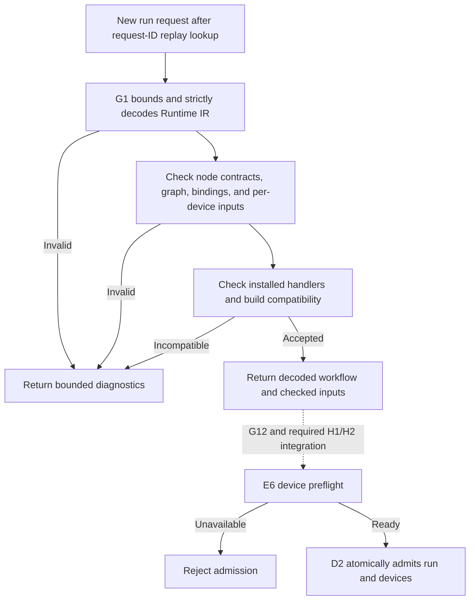

# G1 — Runtime IR admission validator

## Overview

G1 checks the exact executable workflow and the input values supplied for each
selected device before Runtime creates a run. A successful Studio compilation
can describe a node whose execution handler is unavailable in the installed
build. A caller can also change compiled JSON or supply incompatible execution
inputs. G1 checks those execution contracts again against the installed node
definitions and executable handler registry.



**Status** — Implemented and verified on Linux on 2026-11-18. Windows
amd64 cross-build passes. Native Windows execution remains unverified.
Phase C supplies the installed catalog and compiler, F9 supplies executable
registrations, and C1
supplies diagnostic assembly. G1 delivers a callable validation service and
focused fixtures. G10 consumes its checked content; G12 and G14 connect
admission and the start API.

The [Runtime IR contract](../contracts/runtime_ir_v1.md),
[workflow binding contract](../contracts/workflow_bindings.md), and
[A7 run contract](../contracts/local_api_v1.md#8-run-admission-and-idempotency)
define its accepted data. G1 validates the submitted IR directly. It performs
no compilation, device observation, or execution persistence.

## 1. Responsibility and ownership

| Owner                                   | Responsibility                                                                                                               |
| --------------------------------------- | ---------------------------------------------------------------------------------------------------------------------------- |
| A2 and installed node definitions       | Executable structure, field constraints, binding forms, ports, capabilities, and minimum Runtime requirements.               |
| C7–C9                                   | Produce Runtime IR from Editor Graph source using installed definitions.                                                     |
| G1                                      | Decode and validate that exact IR, check supplied per-device input values, and check execution availability.                 |
| F9                                      | Supply exact enabled `type` and `runtimeHandler` pairs. G1 looks up functions without invoking them.                         |
| E6                                      | Observe the requested serials and verify current device readiness after G1 accepts a new request.                            |
| G12/G14 and required H1/H2 coordination | Authenticate and parse the run request, resolve request-ID replay, call G1/E6, admit through D2, and schedule accepted work. |
| G2/G4/G17 and G5/G15                    | Resolve execution-time outputs and variable values, then evaluate routing and Switch comparisons.                            |
| G3, G6–G11, G18–G19, and D4/D5          | Invoke handlers, enforce attempt lifecycle, validate returned outputs, and commit results, variables, and artifacts.         |

The same G1 service will validate plaintext Development IR and the protected
IR supplied after I2 verifies a Production package and authorization. Package
opening and Production error disclosure belong to I2.

## 2. Internal entry point and result

Implement the validator under `internal/validation/runtimeir`. Constructor
dependencies are the immutable installed `nodecontract.Registry`, the immutable
F9 `registry.Registry`, and the installed build version from `buildinfo.Info`.
Use constructor injection and the existing diagnostic/result types.

The intended callable shape is below. The result is an internal service value.
The HTTP adapter owns response serialization.

```go
type InputValues map[string]json.RawMessage

type Result struct {
    Validation   validation.Result
    RawIR        json.RawMessage
    Document     *ir.Document
    DeviceInputs []InputValues
    FailureCode  string
}

func New(
    definitions *nodecontract.Registry,
    handlers *registry.Registry,
    runtimeVersion string,
) (*Validator, error)

func (v *Validator) Validate(
    ctx context.Context,
    rawIR json.RawMessage,
    deviceInputs []json.RawMessage,
) (Result, error)
```

| Result field   | Contract                                                                                                      |
| -------------- | ------------------------------------------------------------------------------------------------------------- |
| `Validation`   | Existing `validation.Result`, including required arrays and deterministic ordering.                           |
| `RawIR`        | Owned byte-for-byte copy of the checked IR on success. Nil on rejection or operational failure.               |
| `Document`     | A complete decoded A2 document on success. Nil on rejection or operational failure.                           |
| `DeviceInputs` | Fresh decoded scalar maps in request order on success. No partial accepted input list on rejection.           |
| `FailureCode`  | Empty on success. `VALIDATION_FAILED` or `RUNTIME_INCOMPATIBLE` for rejected content, according to section 9. |

`deviceInputs[i]` corresponds to the original request's `devices[i].inputs`.
The caller retains serial ownership and pairs checked maps by that same index.
The approved capacity revision accepts a non-empty ordered input list without
a fixed count ceiling. Shape/empty-list misuse is a contract rejection at
`devices`; byte-budget errors retain their payload classification. Count-policy
code is aligned; no configurable concurrency maximum is required.

An expected content rejection returns a result with `err == nil`. Cancellation,
deadline expiry, oversized byte input, and broken trusted dependencies return
an error and no accepted document or inputs. Put shared sentinel errors under
`pkg/x-error` and preserve context errors through operation wrapping.

Keep actual device inputs as copied scalar JSON values in `InputValues`.
Validation can decode a scalar temporarily for field checks. This preserves
the JSON type and numeric representation supplied to the later binding
resolver. `ir.Document` models the exact A2 envelope and effective node
policies. Its input-source objects retain their validated tag and fields,
and its config and schema objects retain owned JSON values.

`New` rejects missing trusted registries with an internal configuration error.
It records the supplied build version for compatibility checks during
`Validate`, including a development placeholder. Concurrent `Validate` calls
share only the immutable injected registries and version. All request state,
indexes, scalar maps, and diagnostic accumulation belong to the individual
call.

On an operational error return `Result{}` and the error. On content rejection,
return the invalid validation result and failure code with `RawIR`, `Document`,
and `DeviceInputs` all nil. Success returns all three accepted data fields,
with a non-nil input map for each selected device, even when it is empty.

Return an owned copy of the submitted IR bytes in `RawIR` on success.
Fresh decoded maps and slices must not alias caller-owned mutable data. G12
hands the checked document and bytes to G10 for the admitted run.
This ownership is an in-memory lifetime guarantee. I2 controls the protected
document's lifetime and Production persistence rules.

## 3. Admission sequence

For a new request, execute these stages in order.

1. Check the caller context and byte budgets before decoding.
2. Decode one UTF-8 JSON object and inspect `formatVersion`. An unsupported
   positive integer version returns its compatibility diagnostic immediately,
   before interpreting that version's node semantics.
3. Strictly decode the supported envelope and nested structures. Check
   required keys, JSON kinds, identifiers, policy bounds, and count limits.
4. Decode the shared workflow input schema. Validate topology and build bounded
   node/edge indexes to establish whether producer-success analysis is safe.
5. Resolve installed node definitions. Check static config, selected input
   names and sources, literal values, supported error policies, instance-derived
   ports, and port counts. Check statically known binding types and producer-success
   dominance when the schema and graph prerequisites are valid.
6. Validate each supplied device input object and known values against its workflow
   schema, destination constraints, and execution-specific representability.
   Literal adapter checks also run here, without invoking handlers.
7. Recompute capability and minimum-version declarations. Check the installed
   build and every exact executable type/key pair.
8. Assemble the result, recheck cancellation, and return the complete checked
   document and inputs only when the result has no errors.

Structural decoding failure returns structural diagnostics and no partial
document. Count-limit failure stops before graph indexing or traversal. Once
structure is safe, collect independent findings where their prerequisites are
available. An unknown node can still coexist with a safely discoverable graph
error. Skip dependent checks when their node, schema, or graph prerequisites
are invalid. Untrusted content must never produce a panic or an internal error.

The validator uses the caller's context without adding a new default timeout.
Check cancellation between stages and within bounded traversal and per-device
loops. A cancelled call returns the context outcome with no accepted data.

## 4. Strict decoding and limits

| Item                                | Required rule                                                                                                                     |
| ----------------------------------- | --------------------------------------------------------------------------------------------------------------------------------- |
| Raw IR content                      | At most 1,048,576 UTF-8 bytes, including its supplied whitespace.                                                                 |
| Complete later run request          | A7 enforces 4 MiB before request decoding. A direct G1 call bounds the combined IR and supplied input bytes to that same ceiling. |
| Nodes and edges                     | 2–500 nodes and 1–1,000 edges.                                                                                                    |
| Selected input objects              | Non-empty ordered list; no fixed device-count ceiling.                                                                                                   |
| Node config and input maps          | At most 100 properties each.                                                                                                      |
| Workflow input schema               | At most 100 flat scalar properties.                                                                                               |
| Node and edge IDs                   | Exact A2 identifier pattern, at most 128 ASCII characters.                                                                        |
| Type, handler, and capability names | Exact A2 dotted-name pattern, at most 255 ASCII characters.                                                                       |
| Returned findings                   | Existing C1 cap of 100 errors and warnings combined.                                                                              |

Reuse the existing constants where the value and responsibility match. Add
execution-admission constants to `pkg/constants`, following the Runtime layout.

The supported envelope has exactly `formatVersion`, `minimumRuntimeVersion`,
`metadata`, `entryNodeId`, `inputSchema`, `nodes`, `edges`, and
`requiredCapabilities`. `metadata` contains exactly
`sourceGraphSchemaVersion`, with supported value `1`. Validate every node,
edge, retry policy, schema, and source object against its exact A2 fields.

Reject missing keys, unknown keys, explicit nulls, invalid UTF-8, trailing JSON,
arrays in object positions, objects in scalar positions, and unsupported
source tags. Empty `config` and `inputs` objects remain valid for nodes whose
contracts require them. Presence checks distinguish a required empty object
from an omitted object. Duplicate object properties follow the existing
Backend/Runtime last-write-wins JSON behavior.

Identifiers remain exact and case-sensitive. Validate rather than trim or
normalize executable identifiers. Array order preserves the submitted node,
edge, and Switch rule order. Execution follows edges from `entryNodeId`.

Integral JSON numbers such as `100.0` satisfy integer fields. Reject numeric
strings and fractions for those fields. Integers and integer bounds stay
inside the JavaScript safe-integer range. `number` accepts finite numeric
values, including decimals. Strings use UTF-16 code-unit lengths to match the
accepted cross-platform field contracts.

## 5. Node contracts and executable input checks

Every node supplies its effective `timeoutMs`, full `retryPolicy`, and
`errorPolicy`. Check timeout 1–600,000 ms, attempts 1–3 including the first,
and retry delay 0–60,000 ms. Validate the declared error policy against the
installed port contract. G1 validates the supplied values without filling
compiler defaults or changing the retry policy.

Read node semantics from the installed catalog through a read-only accessor.
The accessor must expose the required config, input/output schemas, allowed
sources, ports, capabilities, and minimum version using copies or immutable
values. HTTP callers supply none of those definitions.

The accessor must retain per-input source permissions and required fields.
Set Variable's `value` and Switch's `value`/binary operands use their approved
scalar binding contracts. A Switch instance derives operand names and route
ports from its rule IDs. The current installed projection uses empty
`properties` for these two special nodes. Extend its trusted projection or
typed node descriptors so that this empty map cannot be interpreted as
permission to omit their required inputs. Keep those descriptors under
`nodecontract`, derived from the approved Backend definitions.

Validate node input keys against the resolved node instance. Switch UUID
operand keys are accepted through its rule-derived input contract. The
workflow-property name pattern applies to workflow schema fields and named
static inputs, and cannot reject those approved dynamic UUID keys.

| Node family                | Admission checks                                                                                                |
| -------------------------- | --------------------------------------------------------------------------------------------------------------- |
| Start, End, Back, and Home | Exact empty config and inputs, with the node's supported policy and ports.                                      |
| Delay                      | Exact `durationMs` input source. Known values must be integers in 0–300,000.                                    |
| Tap                        | Explicit pixel, percentage, or selector mode and exactly its literal fields.                                    |
| Swipe                      | Explicit pixel or percentage mode, exactly its literal endpoints, and duration 1–60,000 ms.                     |
| Long Press                 | All three accepted point modes and duration 1–60,000 ms at execution admission.                                 |
| Screenshot                 | Explicit `FULL_SCREEN` with zero inputs, or exactly four pixel/percentage literals with ordered corners.        |
| Launch App                 | Exact package input source and approved package-name syntax for any value already known at admission.           |
| Input Text                 | Known text must meet catalog bounds and the F5 printable-ASCII and literal `%s` restrictions.                   |
| Set Variable               | Explicit `FLOW` or `RUN_GROUP` scope, valid name, and exactly one scalar value source.                          |
| Switch                     | Ordered unique UUID rule IDs, accepted operators, exact binary/unary operands, and corresponding dynamic ports. |
| Wait for Variable and Log  | Validate their installed contracts and require an enabled executable pair before admission.                     |

All targeting inputs remain literal-only under the accepted targeting
contract. `FULL_SCREEN` belongs only to Screenshot. Apply approved coordinate,
percentage, selector syntax, and Screenshot geometry rules without reading a
display or hierarchy. Long Press at 60,001 ms is rejected here even when the
earlier authoring contract accepted it.

For a known literal or supplied workflow input, reuse the applicable pure
adapter validation, such as `InputTextCommand.Validate`. The executable path,
encoded Windows command-line length, actual package availability, current
selector match, screen dimensions, image bounds, and remaining attempt budget
are checked by their owning F/E/G execution paths when those facts are known.

Validate timeout and gesture duration independently. A short attempt timeout
remains an execution-time timeout scenario under G6/F1. G1 adds no screen-size,
gesture-completion, or Android business-result guarantee.

## 6. Graph and producer-output rules

Enforce every A2 graph rule, including these execution-critical conditions.

- IDs are unique, endpoints exist, and each source node/port pair has exactly
  its permitted route count.
- Exactly one Start matches `entryNodeId`, has no incoming edge, and has one
  `success` edge. End has no outgoing edge.
- Every node is reachable from Start, at least one End is reachable, and the
  complete graph is acyclic.
- Every ordinary non-End node has exactly one `success` edge. `ERROR_BRANCH`
  requires exactly one `error` edge. `STOP` permits zero error edges.
- Switch has exactly one edge for each rule UUID and `default`, plus the
  conditional error edge. Its ports come from the validated node instance.

Use indexed adjacency and the existing iterative topology approach. Multiple
incoming edges are valid. One control port selects one route, and execution
remains sequential for a device.

For `NODE_OUTPUT`, require an existing producer, a declared required output
field, destination type compatibility, and a different consumer node. Every
path reaching the consumer must cross a successful producer route. A path
through the producer's error edge cannot establish its output.

Reuse the existing success-edge bypass analysis after graph validation.
For each distinct referenced producer, traverse from Start while excluding
that producer's success edge. If the consumer remains reachable, reject its
binding. Cache that result for all fields referencing the same producer.
With the bounded graph, work is `O(V + E)` for ordinary checks and at most
`O(P × (V + E))` for the distinct referenced producers. There are at most
500 producers. Avoid rescanning all edges for every individual binding.

## 7. Input sources and per-device values

Decode source objects using the following exact key sets. Each listed key is
required, and additional keys reject that source object.

| `source`          | Exact keys                  | Field rules                                                                |
| ----------------- | --------------------------- | -------------------------------------------------------------------------- |
| `LITERAL`         | `source`, `value`           | A non-null string, finite number, or boolean, then destination validation. |
| `WORKFLOW_INPUT`  | `source`, `inputName`       | A valid A2 workflow field name.                                            |
| `NODE_OUTPUT`     | `source`, `nodeId`, `field` | A valid A2 node ID and output field name.                                  |
| `FLOW_VARIABLE`   | `source`, `name`            | A valid variable name.                                                     |
| `GLOBAL_VARIABLE` | `source`, `name`            | A valid variable name.                                                     |

For example, a `LITERAL` object containing both `value` and `nodeId` fails
source decoding. An integer destination receiving a finite fractional literal
passes source-shape decoding and fails destination validation.

| Source            | Admission responsibility                                                                                              | Execution responsibility                                      |
| ----------------- | --------------------------------------------------------------------------------------------------------------------- | ------------------------------------------------------------- |
| `LITERAL`         | Exact `source`/`value` object, supported scalar, destination constraints, and any node-specific literal rule.         | G2 passes the checked value.                                  |
| `WORKFLOW_INPUT`  | Exact source shape, declared input name, compatible schema type, and concrete value checks for every selected device. | G2 reads that device's checked input map.                     |
| `NODE_OUTPUT`     | Exact producer/field shape, required output field, compatible schema, and success-edge dominance.                     | G4 reads the committed output and checks its actual value.    |
| `FLOW_VARIABLE`   | Exact source/name shape and permission to bind the destination field.                                                 | G17 checks existence and value type in this device execution. |
| `GLOBAL_VARIABLE` | Exact source/name shape and permission to bind the destination field.                                                 | G17 checks existence and value type in this RunGroup.         |

Variable names follow `^[A-Za-z_][A-Za-z0-9_]{0,99}$`. Workflow field names
follow the separate A2 lowercase-leading field-name rule. G1 performs no
variable-existence analysis and requires no earlier Set Variable declaration.
The publisher exercises missing-variable behavior during product testing.

Validate `inputSchema` with the complete A2 reduced vocabulary, including
`string`, `integer`, `number`, and `boolean`, property and required-name rules,
finite bounds, and `additionalProperties: false`. Publisher input schemas
accept no arbitrary regex, default values, nested objects, arrays, or nulls.

The reduced schema root requires exactly `type`, `properties`, `required`,
and `additionalProperties`. Scalar property objects allow `type` plus only
the constraints listed for that type in A2. Bound keys are optional, but a
present bound must have the required numeric kind, valid range, and consistent
lower/upper order. Apply declared string bounds without inventing a default
minimum or maximum. The existing content budgets bound supplied values.

For every device, reject unknown keys, missing required values, nulls, wrong
JSON types, invalid strings, unsafe integers, non-finite numbers, and values
outside declared bounds. Validate each bound `WORKFLOW_INPUT` against its
destination as well as the workflow schema. A required destination may
reference only a required workflow input. An explicitly used source value
must be present in every selected input map. An unreferenced optional property
may be absent. No defaults, implicit conversions, or fallback values are added.

For ordinary inputs, declared source and destination field types must match,
including the distinction between `integer` and `number` schema fields.
Actual values still follow A2's value rules, so a `number` field can contain
an integral or fractional numeric value. Set Variable accepts the supported
scalar types, and Switch uses its approved operator/type contract.

Validate Switch operand types when their schema or concrete input makes them
known. Numeric comparisons require numbers, string operators require strings,
boolean operators require booleans, and equality requires compatible operand
types. Unknown variable values are checked by G17/G15 during execution.

Switch uses the same numeric comparison category for `integer` and `number`
operands. This is its approved operator behavior. Preserve the ordered rule
array and require 1–32 unique UUID IDs, each reused exactly as its binary
operand key and control port. Match the Backend's accepted UUID text syntax
using the existing UUID dependency and explicit canonical-shape checks. Keep
the supplied ID text for case-sensitive port and binding lookup.

| Operators                                              | Right operand input           | Known operand types                           |
| ------------------------------------------------------ | ----------------------------- | --------------------------------------------- |
| `EQ`, `NE`                                             | Required at `inputs[rule.id]` | Both strings, both booleans, or both numeric. |
| `LT`, `LTE`, `GT`, `GTE`                               | Required                      | Both numeric.                                 |
| `CONTAINS`, `NOT_CONTAINS`, `STARTS_WITH`, `ENDS_WITH` | Required                      | Both strings.                                 |
| `IS_EMPTY`, `IS_NOT_EMPTY`                             | Absent                        | Left is a string.                             |
| `IS_TRUE`, `IS_FALSE`                                  | Absent                        | Left is a boolean.                            |

A binary rule with a missing operand and a unary rule with an extra operand
both reject the input contract. G1 checks the operand types and routing shape.
G15 evaluates actual comparisons during the run.

An error in one selected device's inputs rejects the whole new run. Return
findings in the normal bounded result with that device's request index.

## 8. Compatibility and current build behavior

For every known node, require the submitted `runtimeHandler` to equal the
installed definition's handler key. Then use F9 `Lookup(type, runtimeHandler)`
to establish whether that exact callable is enabled. Catalog presence alone
does not establish execution support. Include unreachable or error-branch
nodes in availability and compatibility checks because they are part of the
submitted workflow.

Recompute `requiredCapabilities` from node definitions in IR array order and
each definition's capability order, keeping first occurrences. Require the
submitted list to match that exact deduplicated list. Recompute the highest
node minimum version and require the submitted `minimumRuntimeVersion` to
equal it. Lower and artificially raised declarations both fail validation.

Derive declarations only when every referenced node definition is available.
For an unknown type, return its compatibility finding and skip comparisons
that require that missing definition. Check F9 availability only after the
submitted key matches a known definition, so a mismatched key produces its
semantic finding without a duplicate unavailable-handler finding.

Compare strict `major.minor.patch` versions numerically. Reject prefixes,
leading zeros, suffixes, and malformed workflow versions. Compare bounded
component strings or checked numeric components without integer overflow.
Require the installed release version to meet the recomputed minimum.

The current default build reports `0.0.0-dev`. G1 must return
`RUNTIME_INCOMPATIBLE` for a run using an unversioned development build,
with a version diagnostic and a safe message. Its constructor does not turn
that placeholder into a Runtime startup failure. For the current installed
catalog, build runnable Development tests with `make build VERSION=0.1.0`,
or a later release version satisfying the document. The run API has no client
version override or compatibility bypass.

The current shipped F9 registry has ten pairs. A valid Screenshot, Switch,
Set Variable, Wait for Variable, or Log node is rejected for unavailable
execution until its actual implementation and registration are enabled.
G1 neither adds registrations nor invokes handlers to probe support.

## 9. Diagnostics and failure mapping

Reuse C1's result shape, diagnostic sorter, safe-message lookup, combined cap,
and status calculation. G1 produces no MVP warnings. Paths are relative to
the complete future run request, rooted at `runtimeIr` or
`devices[index].inputs`. Use zero-based indexes and JSON field names.

Add the following admission-specific diagnostic codes to the existing
validation infrastructure during implementation.

| Code                                 | Safe message                                                 | Typical path                                  |
| ------------------------------------ | ------------------------------------------------------------ | --------------------------------------------- |
| `RUNTIME_IR_CONTRACT_INVALID`        | Runtime IR does not match the required contract              | `runtimeIr` or a malformed supported field    |
| `RUNTIME_IR_FORMAT_UNSUPPORTED`      | Runtime IR format version is not supported                   | `runtimeIr.formatVersion`                     |
| `NODE_RUNTIME_HANDLER_INVALID`       | Node handler key does not match its installed definition     | `runtimeIr.nodes[i].runtimeHandler`           |
| `NODE_RUNTIME_HANDLER_UNAVAILABLE`   | Node execution is unavailable in this Runtime build          | `runtimeIr.nodes[i].runtimeHandler`           |
| `RUNTIME_IR_CAPABILITIES_INVALID`    | Required capabilities do not match the workflow nodes        | `runtimeIr.requiredCapabilities`              |
| `RUNTIME_IR_MINIMUM_VERSION_INVALID` | Minimum Runtime version does not match the workflow nodes    | `runtimeIr.minimumRuntimeVersion`             |
| `RUNTIME_VERSION_UNSUPPORTED`        | Runtime build does not satisfy workflow version requirements | `runtimeIr.minimumRuntimeVersion`             |
| `WORKFLOW_INPUT_INVALID`             | Device input does not satisfy the workflow input schema      | `devices[i].inputs` or a valid field name     |
| `NODE_EXECUTION_INPUT_UNSUPPORTED`   | Known node input cannot be executed by this Runtime adapter  | Literal or concrete workflow-input value path |
| `START_NODE_HAS_INCOMING_EDGE`       | Start node must have no incoming edge                        | `runtimeIr.edges[i].targetNodeId`             |

Reuse existing `WORKFLOW_INPUT_SCHEMA_INVALID`, `GRAPH_SCHEMA_VERSION_UNSUPPORTED`,
node/edge topology, node config, binding, error-policy, and port-count codes
where the same condition applies. Prefix their paths with `runtimeIr` and use
`inputs` for executable binding locations. Unknown installed node types use
`NODE_TYPE_NOT_ACTIVE`. These additions belong to execution admission, and
existing authoring endpoints retain their own finding rules.

Apply the following precedence within each input check so a single invalid
value produces the specific finding below. Independent fields can each
produce a finding.

| Condition                                                                                                                                                     | Code and path                                                                                                                                                               |
| ------------------------------------------------------------------------------------------------------------------------------------------------------------- | --------------------------------------------------------------------------------------------------------------------------------------------------------------------------- |
| Missing supported IR field, wrong JSON kind, or invalid source-object keys/tag/name syntax                                                                    | `RUNTIME_IR_CONTRACT_INVALID` at the affected known field or source object. Stop its dependent semantic checks.                                                             |
| Malformed `minimumRuntimeVersion` string                                                                                                                      | `RUNTIME_IR_CONTRACT_INVALID` at `runtimeIr.minimumRuntimeVersion`. A well-formed version with the wrong derived value uses `RUNTIME_IR_MINIMUM_VERSION_INVALID`.           |
| `inputSchema` is an object but violates the reduced vocabulary or property rules                                                                              | `WORKFLOW_INPUT_SCHEMA_INVALID` at the affected location under `runtimeIr.inputSchema`. Skip actual input validation that requires that schema.                             |
| Node config is an object but violates its installed config contract                                                                                           | `NODE_CONFIG_INVALID` at the config field, or at `config` for an invalid overall shape.                                                                                     |
| Selected targeting mode has missing/extra inputs or an out-of-contract literal                                                                                | `NODE_BINDINGS_INVALID` at the missing field, offending value, or input map for unknown keys.                                                                               |
| Ordinary node, Set Variable, or Switch has a missing/extra input, forbidden source, invalid destination literal, or invalid declared reference/type/dominance | `NODE_VALUE_BINDING_INVALID` at `runtimeIr.nodes[i].inputs[field]`, with `value` appended for an invalid literal. Include the bounded consumer `nodeId`.                    |
| Actual device input fails its workflow schema                                                                                                                 | `WORKFLOW_INPUT_INVALID` at `devices[i].inputs[field]`. Skip consumer-specific checks for that invalid value. A non-object input map points at `devices[i].inputs`.         |
| Actual workflow input satisfies its schema but violates a bound ordinary destination                                                                          | `NODE_VALUE_BINDING_INVALID` at `devices[i].inputs[inputName]`, with the bounded consumer `nodeId`.                                                                         |
| A value passes field constraints but violates a known F adapter representation/range                                                                          | `NODE_EXECUTION_INPUT_UNSUPPORTED` at the literal's `value` or the actual device input value, with the bounded consumer `nodeId`.                                           |
| Known static or dynamic route has a missing/duplicate edge                                                                                                    | `NODE_PORT_EDGE_COUNT_INVALID` or `SWITCH_PORT_EDGE_COUNT_INVALID` at `runtimeIr.nodes[i]`. Unknown edge ports use `EDGE_SOURCE_PORT_NOT_FOUND` at the edge's `sourcePort`. |

For example, a 10,001-character Input Text literal fails its declared field
bound first. A valid-length string containing `%s` reaches the adapter check
and produces `NODE_EXECUTION_INPUT_UNSUPPORTED`. Long Press at 60,001 ms
similarly passes its current authoring bound and fails the execution range.
The execution-specific finding supplements the accepted authoring rules.

An invalid unknown property or source tag is reported at its nearest safe
parent object. Include a property name or node/edge reference only after it
passes its bounded identifier rule. Messages and paths exclude supplied
values, raw parser errors, serials, executable paths, and protected content.

Choose the top-level rejection from all discovered findings before response
truncation. Any structural or semantic error yields `VALIDATION_FAILED`.
When all errors are compatibility findings, use `RUNTIME_INCOMPATIBLE`.
Compatibility findings are unsupported format/source version, unknown node
type, unavailable executable pair, and insufficient or unusable installed
build version. An invalid submitted minimum-version declaration, incorrect
handler key, or incorrect capability list is a semantic error.

Keep diagnostic retention bounded during validation. Use C1's comparison
order to retain the canonical first 100 findings, and separately track whether
any finding was omitted and whether a semantic error occurred. Continue the
checks needed to establish rejection classification after the response budget
is full. Reaching 100 findings is a response cap, and gives no permission to
return success or to classify an omitted semantic failure as compatibility.
Add bounded collection to the existing validation result assembly so G1
retains bounded findings instead of building an unbounded list before sorting. Preserve
the same ordered result, status, and `truncated` behavior.

| Condition                                       | Internal outcome                                                       | Later Development HTTP mapping                     |
| ----------------------------------------------- | ---------------------------------------------------------------------- | -------------------------------------------------- |
| Supported document and all input objects pass   | `VALID`, complete document and checked input maps, empty failure code. | G12 continues through E6 and D2.                   |
| Contract or semantic rejection                  | `INVALID`, `VALIDATION_FAILED`, no accepted document or inputs.        | `422` with `error` and `validation`.               |
| Compatibility-only rejection                    | `INVALID`, `RUNTIME_INCOMPATIBLE`, no accepted document or inputs.     | `422` with `error` and `validation`.               |
| IR or aggregate content exceeds its byte budget | Typed oversized-input error before decoding.                           | `413 PAYLOAD_TOO_LARGE`.                           |
| Cancellation or deadline                        | Preserve context error, no accepted data.                              | The owning request lifecycle handles cancellation. |
| Missing or corrupted trusted dependency         | Contextual internal error, no accepted data.                           | `500 INTERNAL_ERROR`.                              |

The later HTTP boundary handles malformed request JSON, invalid outer fields,
non-object `runtimeIr`, request-ID syntax, authentication, and unsupported
transport before G1. A direct G1 call with malformed IR receives a structural
finding. Transport-invalid requests are handled by A7's `400`/`401` rules.

Example Development rejection for a known node whose handler is disabled:

```json
{
  "error": {
    "code": "RUNTIME_INCOMPATIBLE",
    "message": "run admission failed",
    "retryable": false
  },
  "validation": {
    "status": "INVALID",
    "errors": [
      {
        "code": "NODE_RUNTIME_HANDLER_UNAVAILABLE",
        "message": "Node execution is unavailable in this Runtime build",
        "nodeId": "capture",
        "path": ["runtimeIr", "nodes", 2, "runtimeHandler"]
      }
    ],
    "warnings": [],
    "truncated": false
  }
}
```

The HTTP request boundary logs one safe failure record at ERROR with the
existing operation, error-code, duration, and request-correlation fields.
The validator returns diagnostics without logging every finding or serializing
IR, input values, variable values, or raw parser errors into operational logs.

## 10. Implementation mapping and reuse

| Location                                          | Planned implementation                                                                                                                                            |
| ------------------------------------------------- | ----------------------------------------------------------------------------------------------------------------------------------------------------------------- |
| `internal/execution/ir/model.go`                  | Shared typed executable document, nodes, edges, policy objects, and source values for G1 and the later engine.                                                    |
| `internal/validation/runtimeir/validator.go`      | Constructor, result, bounded validation sequence, failure classification, and context propagation.                                                                |
| `internal/validation/runtimeir/decode.go`         | Presence-aware supported-envelope and nested-shape decoding.                                                                                                      |
| `internal/validation/runtimeir/inputs.go`         | Reduced input schemas and actual per-device scalar validation.                                                                                                    |
| `internal/validation/nodecontract/bindings.go`    | Shared source/type checks and cached producer-success analysis. G1 supplies executable paths and source tags through `view.go`.                                   |
| `internal/validation/runtimeir/compatibility.go`  | Derived declarations, SemVer comparison, and F9 lookup.                                                                                                           |
| `internal/validation/nodecontract` and `topology` | Read-only semantic access and extraction of reusable source-independent checks, with existing C-facing wrappers.                                                  |
| `internal/validation/service/compile.go`          | Reuse the shared IR representation when removing equivalent private compiler DTOs. Preserve the approved compilation contract and unchanged-case fixture results. |
| `internal/validation/contract.go`                 | Admission diagnostic constants/messages using the existing result assembler.                                                                                      |
| `cmd/agent/admission_test.go`                     | Composition test using `newHandlerRegistry` to verify the actual enabled pairs without duplicating the agent's registration list.                                 |
| `pkg/constants` and `pkg/x-error`                 | Shared execution bounds, enum strings, and typed operational errors.                                                                                              |

Keep semantic checks with the existing node-contract owner where practical.
Extract topology and field checks only when the G1 consumer needs them. A
source-independent graph view may carry node IDs/types and edges. Keep
existing C entry points and their path roots while allowing G1 to supply IR paths.
Validate executable `source` objects directly without rebuilding an Editor
Graph or attaching invented editor metadata.

Two existing helper limitations need explicit treatment during reuse. The
current Go Switch helper accepts `rule_` names and a smaller operator list,
while the accepted shared contract and Backend use UUID rule IDs and the full
operator set. The current workflow-input schema helper also handles fewer
types than A2's complete vocabulary. Its current scalar binding helper also
restricts literals to integers. G1 must implement the accepted contracts,
including UUID rules, the full operator set, finite decimal scalar bindings,
and `number` workflow fields. A direct call to those older helpers cannot
establish G1 conformance.

The G1 implementation includes the narrow shared-helper and installed
projection corrections needed for those rules, including explicit Set
Variable scope and required value metadata. Exercise both C9 compilation and
G1 admission with the corrected cases. Replace obsolete `rule_`/operator/type
expectations only after comparing them with the current Backend definitions
and validator. Record that Backend reference in the affected parity fixtures.
Keep other existing fixture outcomes intact. These corrections make the
normal compilation entry point produce the same contracts that G1 accepts.

Include corrected compilation/admission cases for an explicit Set Variable
scope, its required `value`, a finite decimal literal such as `0.5`, and a
workflow `number` property with fractional bounds. Validate future node cases
with test-only enabled callables, and separately verify that the shipped
registry still rejects those pairs until their execution phases enable them.

Implement G1 with direct constructor-based tests first. G14 adds its actual
composition-root consumer and regenerates Wire when that dependency is wired.
C9 compilation remains independent of executable availability, so it can
continue compiling supported authoring contracts whose handlers ship later.

Use the checked-out Backend's `flow-node-definitions.ts`,
`switch.validator.ts`, and `node-binding.validator.ts` as reference evidence
for these special-node corrections. Compare the typed installed projection
with those source definitions and record the reference commit in fixtures.
This work keeps fixed trusted node semantics in the installed Runtime package.

## 11. Verification and manual handoff

### Golden fixture contract

Use a minimal `Start → Delay → End` IR with empty workflow schema, one input
object `{}`, and an installed version of `0.1.0` as the initial accepted case.
Exercise the real installed definitions and actual enabled-pair registry.
Test-only callable registrations may exercise future node contracts, with
call counters proving that validation never invokes them.

Save the following IR as the base G1 fixture during implementation. The test
constructs G1 with trusted version `0.1.0` and supplies `deviceInputs` as `[{}]`.
The build version is constructor input from Runtime, outside the run request.

```json
{
  "formatVersion": 1,
  "minimumRuntimeVersion": "0.1.0",
  "metadata": { "sourceGraphSchemaVersion": 1 },
  "entryNodeId": "start",
  "inputSchema": {
    "type": "object",
    "properties": {},
    "required": [],
    "additionalProperties": false
  },
  "nodes": [
    {
      "id": "start",
      "type": "flow.start",
      "runtimeHandler": "flow.start",
      "config": {},
      "inputs": {},
      "timeoutMs": 1000,
      "retryPolicy": { "maxAttempts": 1, "delayMs": 0 },
      "errorPolicy": "STOP"
    },
    {
      "id": "wait",
      "type": "flow.delay",
      "runtimeHandler": "flow.delay",
      "config": {},
      "inputs": { "durationMs": { "source": "LITERAL", "value": 10 } },
      "timeoutMs": 1000,
      "retryPolicy": { "maxAttempts": 1, "delayMs": 0 },
      "errorPolicy": "STOP"
    },
    {
      "id": "end",
      "type": "flow.end",
      "runtimeHandler": "flow.end",
      "config": {},
      "inputs": {},
      "timeoutMs": 1000,
      "retryPolicy": { "maxAttempts": 1, "delayMs": 0 },
      "errorPolicy": "STOP"
    }
  ],
  "edges": [
    {
      "id": "e1",
      "sourceNodeId": "start",
      "sourcePort": "success",
      "targetNodeId": "wait"
    },
    {
      "id": "e2",
      "sourceNodeId": "wait",
      "sourcePort": "success",
      "targetNodeId": "end"
    }
  ],
  "requiredCapabilities": []
}
```

Its expected validation is exactly the following JSON value. The accepted
result also contains the exact copied input bytes, the complete three-node
document, one non-nil empty input map, and an empty failure code. It has zero
handler invocations and external side effects.

```json
{
  "status": "VALID",
  "errors": [],
  "warnings": [],
  "truncated": false
}
```

Apply each independent mutation below to a fresh copy of the base fixture.
Require the exact code/path, one error, no warnings, `truncated: false`, and
nil accepted data fields. Keep the standard safe message for that code.

| Mutation                                                           | Failure code           | Diagnostic code and exact path                                                                           |
| ------------------------------------------------------------------ | ---------------------- | -------------------------------------------------------------------------------------------------------- |
| Change Delay's literal to `300001`                                 | `VALIDATION_FAILED`    | `NODE_VALUE_BINDING_INVALID`, `["runtimeIr","nodes",1,"inputs","durationMs","value"]`, `nodeId: "wait"`. |
| Change Delay's handler key to `flow.start`                         | `VALIDATION_FAILED`    | `NODE_RUNTIME_HANDLER_INVALID`, `["runtimeIr","nodes",1,"runtimeHandler"]`, `nodeId: "wait"`.            |
| Change the declared minimum to `0.0.0`                             | `VALIDATION_FAILED`    | `RUNTIME_IR_MINIMUM_VERSION_INVALID`, `["runtimeIr","minimumRuntimeVersion"]`.                           |
| Supply two device input maps, `[{}, {"extra":1}]`                  | `VALIDATION_FAILED`    | `WORKFLOW_INPUT_INVALID`, `["devices",1,"inputs","extra"]`.                                              |
| Keep valid IR and change the injected build version to `0.0.0-dev` | `RUNTIME_INCOMPATIBLE` | `RUNTIME_VERSION_UNSUPPORTED`, `["runtimeIr","minimumRuntimeVersion"]`.                                  |

### Full acceptance matrix

| Case                                                                                         | Required observation                                                                                           |
| -------------------------------------------------------------------------------------------- | -------------------------------------------------------------------------------------------------------------- |
| Valid minimal workflow and current compiler output using enabled nodes                       | `VALID`, complete decoded IR, owned checked input maps, and no side effects.                                   |
| 1 MiB raw IR boundary and one byte over                                                      | Boundary reaches content validation. Over-limit input fails before decoding. Include whitespace in the count.  |
| Aggregate byte limit and input lists above 32 devices                                              | Accept valid lists above 32; byte-budget overflow uses A7 payload errors, not count errors.                                                             |
| Invalid UTF-8, missing/null/unknown field, wrong container, trailing JSON                    | Structural rejection with no partial executable document.                                                      |
| Duplicate JSON properties                                                                    | Final property wins consistently with existing transport behavior.                                             |
| 500/501 nodes, 1,000/1,001 edges, 100/101 fields                                             | Correct boundary findings. Excessive graph sizes skip indexing and traversal.                                  |
| Duplicate IDs, missing endpoints, bad Start/End, unreachable node, or cycle                  | Existing topology diagnostics under IR paths and no accepted run data.                                         |
| Invalid ordinary and Switch port counts                                                      | Exact allowed routes, including conditional error edges and UUID-derived rule ports.                           |
| Missing mode, cross-node `FULL_SCREEN`, mixed fields, non-literal target, reversed crop      | Config or binding findings before device access.                                                               |
| Long Press at 60,000 and 60,001 ms, unsupported known text                                   | Execution range and representation checks apply before device access.                                          |
| Per-device missing/unknown/wrong-type/boundary input                                         | Findings identify the original device index. One invalid device rejects the complete request.                  |
| `number` workflow property and decimal scalar                                                | Accepted when the schema and destination permit it. Integer destinations reject fractional values.             |
| Prior output field absent, optional, incompatible, self-referenced, or bypassed              | Consumer binding is rejected. Include a bypass through the producer's error edge.                              |
| Variable read before any declared write                                                      | Structurally valid binding passes G1 when its containing nodes are executable. G17 owns missing-value failure. |
| UUID Switch rules and full accepted operator vocabulary                                      | Contracts pass with a test-enabled callable. Invalid rule/operand shapes fail.                                 |
| Unknown type, wrong handler key, or known disabled handler                                   | Distinct catalog, mismatch, or availability findings. A disabled node never becomes enabled by validation.     |
| Altered capability order, duplicates, omission, extra capability, or altered minimum version | Derived-declaration rejection with deterministic paths.                                                        |
| Runtime older/equal/newer than required, malformed build, `0.0.0-dev`                        | Correct compatibility result. Large SemVer components cannot overflow.                                         |
| More than 100 findings and repeated/concurrent calls                                         | Existing deterministic cap and `truncated` behavior. No shared mutable request data or map-order differences.  |
| Cancellation before and during validation                                                    | Context outcome and no accepted data.                                                                          |
| Changed input bytes/maps after validation                                                    | Returned document and inputs remain the checked values owned by this invocation.                               |

Run the G1 fixtures and affected compiler, topology, catalog, registry, and
diagnostic suites with the race detector. Cross-build for Windows. G1 is a
pure contract check and can be verified without ADB or a running SQLite store.

Add a cap-precedence case with a valid chain containing 101 Log nodes and a
test registry where Log is disabled. Supply an undeclared device input to
produce `WORKFLOW_INPUT_INVALID`, which sorts after the 101
`NODE_RUNTIME_HANDLER_UNAVAILABLE` compatibility findings.
Require `FailureCode == VALIDATION_FAILED`, exactly 100 returned errors, and
`truncated: true`. Also assert zero G1 handler invocations while a real
installed Android pair is enabled and its ADB executable is unusable.

After G13/G14 introduce the snapshot and start endpoints, repeat these cases
through Postman.
Compile source with C9, retain the exact successful `runtimeIr`, then submit
it with a fresh `requestId` and device inputs to `POST /api/v1/runs`.
For rejected content, verify the HTTP mapping, zero new execution/event rows,
and zero ADB calls. For valid content, G1 approval is followed by E6 and D2.

G14 returns HTTP `201` with the initial snapshot after successful admission,
then execution continues under its own lifecycle. A replayed admitted request
ID returns HTTP `200` with its existing snapshot and skips G1 and E6.
`GET /api/v1/runs/{runGroupId}` returns the current committed snapshot while
the run is active or terminal. Continuous events use A7's separate SSE stream.

Client developers use the following integration boundaries when G13/G14 expose
these admission results.

| Platform | Integration responsibility                                                                                                                                                                                                          |
| -------- | ----------------------------------------------------------------------------------------------------------------------------------------------------------------------------------------------------------------------------------- |
| Studio   | Submit the exact C9 IR and per-device inputs. Handle both `422` rejection codes, map `nodeId` to the canvas, and distinguish `runtimeIr` paths from `devices[i].inputs` paths. Use the returned execution snapshot after admission. |
| Launcher | Reuse G1 after I2 package verification and authorization. Apply the Production disclosure policy at that boundary and use the protected admitted document for execution.                                                            |
| Backend  | Preserve the accepted A2 and node-definition semantics in authoritative compiled IR. Share contract fixtures where applicable. Authoring validation results remain independent of the installed Runtime's enabled handler list.     |

### Implementation verification recorded on 2026-11-18

The implementation is in `a2matex-runtime`. The base fixture is
`internal/validation/runtimeir/testdata/valid-delay.json`. Run its exact accepted
result and five reviewed rejection mutations with:

```bash
go test ./internal/validation/runtimeir -run TestGoldenAdmission -v
```

The G1 suites also cover strict envelopes, graph/map/byte limits, all 14 Switch
operators, direct input constraints, output references and error bypass,
capability ordering, versions, ownership, cancellation, concurrency, and
semantic rejection after diagnostic truncation. The composition test
`cmd/agent/admission_test.go` uses the actual agent registry with an unusable
ADB dispatcher. It accepts enabled Tap and rejects disabled Screenshot without
dispatching either handler. Compiler-to-admission cases exercise the corrected
Set Variable and Switch contracts with test-only enabled callables.

Verification passed: full `go test ./...`, affected suites with `-race`,
`go vet ./...`, `make fmt`, Linux `make build VERSION=0.1.0`, Windows amd64
cross-build, and diff whitespace checks. All 36 refreshed binding fixtures
were separately checked against complete responses from the current Backend
validator at commit `96a7b258fb47a55786f723bb68ce8d8a4bc2dd51`.
The catalog and fixture reference is recorded in Runtime
`internal/validation/testdata/COMPILATION_REFERENCE.md`.

G1 is a constructor-injected service. Agent composition and authenticated run
endpoints remain G12–G14 work. No G1 HTTP endpoint, device command, SQLite write,
or execution loop is introduced. Native Windows execution was not run.

## 12. Completion and later phases

G1 is complete when its real validator passes the cases above, returns
deterministic bounded feedback, supplies a complete checked document and all
per-device inputs on success, preserves caller data, and performs zero
external I/O. Reuse changes must pass the affected compilation and authoring
fixtures with the Backend-supported corrections recorded explicitly. The
implementation must also reject currently disabled handler
pairs using the actual agent's enabled registry.

G2, G4, and G17 deliver direct, output, and variable bindings. G3 validates
handler output. G5 and G15 select ordinary and Switch routes. G6–G8 provide
attempt deadlines, normalized outcomes, and safe retries; G9–G11 connect durable
attempts, sequential execution, and owner shutdown. G12–G14 deliver admission
coordination and run/snapshot APIs with the required H1/H2 scheduling integration.
G16 and G18 define variable storage and atomic scope writes. G19 integrates
Screenshot staging/commit, and G20 exposes artifact retrieval under A7.
G21–G22 verify final results and complete single-device engine behavior.
I2 later supplies protected Production IR and its disclosure rules to the same
validator. The [Phase G roadmap](../phases/plan.md#phase-g--workflow-engine)
defines the implementation order; this numbering does not change G1 behavior.
