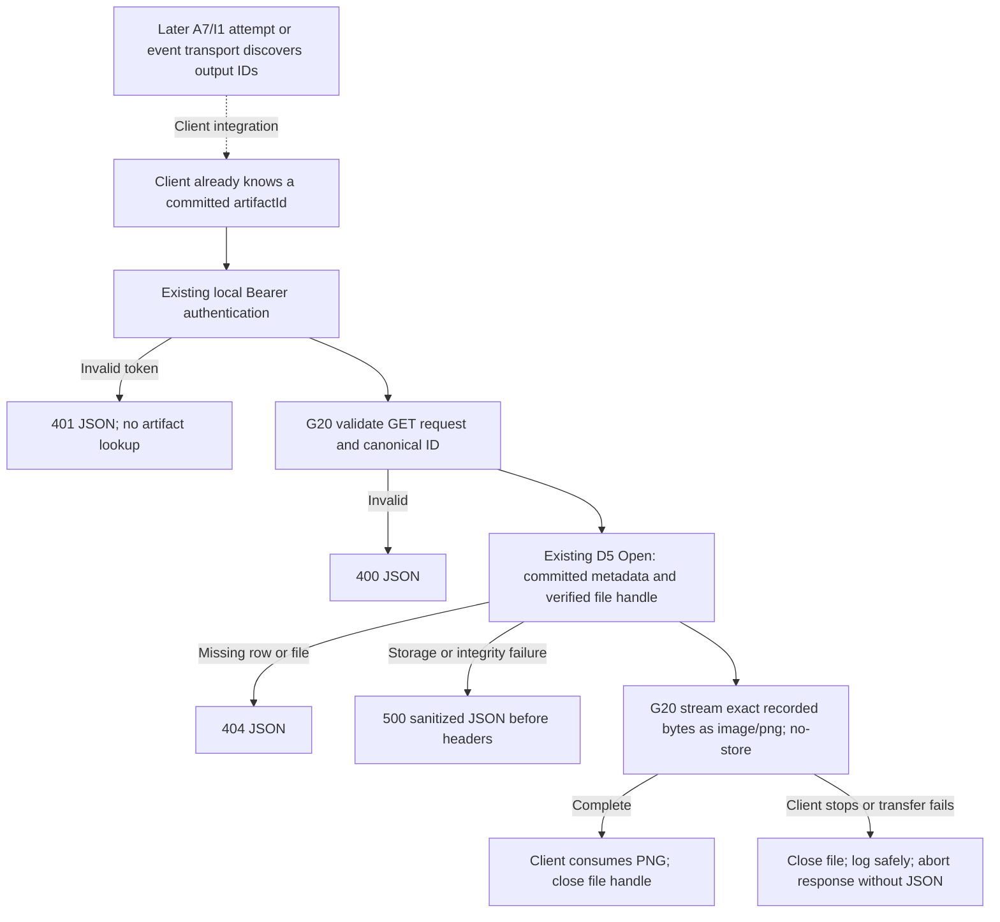

# G20 — Artifact API

## Overview

G20 lets an authenticated local client download a committed Screenshot as a
PNG. G19 already captures the image and commits its artifact ID and metadata.
D5 already opens a verified file by ID. G20 adds the HTTP route and transfers
that opened file to the client without exposing its local path.

The client supplies an artifact ID it already knows. Runtime authenticates
the request, validates the ID, opens the committed content through D5, and
streams its recorded byte length. Missing content produces a normal JSON
error before streaming. If a transfer breaks after PNG headers have been
sent, Runtime closes the response rather than appending JSON to the image.



**Status — Implemented and Linux-verified on 2026-11-19.** Five handwritten
production files plus regenerated Wire output expose authenticated PNG downloads
through the existing D5 service. Handler and real HTTP tests cover authentication,
request validation, errors, bounded streaming, cancellation, incomplete transfers,
and handle closure. Real PNG/SQLite tests cover full-frame and cropped content,
concurrent reads, missing files, and length mismatches. Built-agent checks verify
all capture modes, repeated downloads without ADB, replay, managed stop/owner loss,
and crash-before-commit orphan cleanup. Full Go tests, affected race checks, vet,
Linux build, and Windows amd64 cross-compilation pass. Native Windows, live Android,
and actual Studio rendering remain unverified. Automatic committed-output discovery
remains A7/I1. G21 final-result verification is now separately complete;
G22 now separately supplies automated combined-engine acceptance; its real
Android/native Windows gates remain pending.

## 1. Responsibility and MVP boundary

| Owner                         | Responsibility                                                                                                                           |
| ----------------------------- | ---------------------------------------------------------------------------------------------------------------------------------------- |
| G19/D4                        | Create the PNG and atomically commit artifact metadata with successful Screenshot output. Already implemented.                           |
| D5                            | Resolve only committed metadata, validate the stored file key, securely open a regular file, and verify its length. Already implemented. |
| B5/A7 middleware              | Authenticate the current local session and apply the shared error/logging/cache contracts. Already implemented.                          |
| G20                           | Validate the download request, call D5 Open, stream the returned handle, map failures, and close resources.                              |
| A7/I1 output transport        | Deliver committed attempt outputs/events to Studio so it can discover artifact IDs automatically. Still separate work.                   |
| Studio/Launcher native client | Perform readiness/authentication, request binary content, and pass approved image data to its UI. Actual UI integration is separate.     |

Authoritative dependencies are [A7 artifact retrieval](../contracts/local_api_v1.md#11-artifact-retrieval),
[D5 Open by ID](../d_persistence/d5_artifact_store.md#5-open-by-id),
[G19 Screenshot execution](g19_screenshot_execution.md),
and the [managed Runtime guide](../integration/managed_runtime.md).

Deliver exactly one read endpoint. Reuse the process-owned ArtifactService,
existing artifact table, state directory, local session, and HTTP server.
There is no new migration, repository query, image cache, retention rule,
PNG encoding, external service, or dependency. Downloads do not capture a
new screenshot, start a run, create an event, or alter stored history.

## 2. Request contract

| Setting              | Required value                                                                                                            |
| -------------------- | ------------------------------------------------------------------------------------------------------------------------- |
| Method               | GET only.                                                                                                                 |
| URL                  | `{apiBaseUrl}/artifacts/{artifactId}`; apiBaseUrl already includes `/api/v1`.                                             |
| Authentication       | Exactly one valid `Authorization: Bearer <current-session-token>` header under existing B5 rules.                         |
| Path parameter       | Canonical lowercase UUIDv4; reuse `execution.ValidID`. No trimming, case conversion, aliases, or filename interpretation. |
| Query                | No nonempty query string. No path, filename, run ID, download mode, or token parameter.                                   |
| Body                 | Empty. Follow existing run-read validation, including at most a one-byte probe for an unknown-length body.                |
| Accept               | `image/png` is recommended; it is not required for routing. The successful representation is always PNG.                  |
| Request Content-Type | Unnecessary for an empty GET; do not require application/json.                                                            |

Authentication runs before ID validation and before any service or filesystem
lookup. An unauthorized malformed ID still produces 401. For authenticated
requests reaching this route, a malformed ID, nonempty body, or nonempty query
produces 400 INVALID_REQUEST without invoking D5.

Keep the existing router's literal `/api/v1` group and register
`GET /artifacts/:artifactId` inside it. Preserve disabled path/trailing-slash
redirects. Missing/extra path segments and unmatched methods retain the
existing authenticated not-found behavior. No HEAD alias or path-cleaning
redirect is introduced. Traversal strings and encoded separators must never
reach artifact lookup as a filesystem path.

Ordinary headers may be present. MVP requests containing Range/If-Range are
served as a complete 200 PNG; do not implement 206, Content-Range, or advertise
Accept-Ranges. Ignore conditional cache headers and return the full content
instead of introducing ETag, Last-Modified, or 304 behavior. Generic static
file helpers that enable these features by default are unsuitable here.

## 3. Successful binary response

| Item                   | Exact behavior                                                                                         |
| ---------------------- | ------------------------------------------------------------------------------------------------------ |
| HTTP status            | 200 after the file is successfully opened and the response starts.                                     |
| Content-Type           | `image/png`.                                                                                           |
| Content-Length         | Decimal recorded Artifact.ByteLength. A complete transfer sends exactly this many PNG bytes.           |
| Cache-Control          | `no-store`, through the existing middleware.                                                           |
| Body                   | The committed file's binary PNG bytes. No JSON envelope or Base64.                                     |
| Filename/path metadata | No Content-Disposition filename, filesystem root/key, digest, dimensions, or storage path header/JSON. |

An artifact ID references the stored image from that completed Screenshot,
not the device's current display. Downloads during a later running node or
after terminal run completion return the same stored content. A RunGroup
need not be SUCCEEDED: an earlier Screenshot can be committed even if a later
node fails, is cancelled, or is interrupted after restart.

Never require a live ADB device to read an existing artifact. A file on disk
without committed metadata is not downloadable. Missing metadata/file is not
recreated by recapturing Android or replaying the old run.

## 4. Service seam and open-file ownership

Use a small consumer-owned interface in the new HTTP handler package:

```go
type Reader interface {
    Open(context.Context, string) (execution.Artifact, *os.File, error)
}
```

The concrete service is the existing `*services.ArtifactService`. Inject it
and the existing logger into `internal/api/artifacts.Handler`. Wire that
handler into api.NewHandler/newRouter. The API layer must not query SQLite,
join the caller's ID onto a directory, call os.Open on a path, or reopen a
checked file through its name.

D5 Open already releases the metadata query before returning, validates the
canonical file key, uses host-specific safe open rules, rejects links/unsafe
types, and compares the opened handle's size to metadata. Its returned handle
is the only source used for streaming. G20 performs no second Stat, image
decode, digest calculation, full-file buffering, or alternate metadata lookup.

At the handler boundary, require a non-nil handle and matching valid metadata
for a successful result. Reuse Artifact.Valid and exact ID matching to bound
the transfer to the existing maximum of 16 MiB. A broken reader result is an
internal contract failure; it cannot authorize a download. Do not repeat D5's
filesystem verification in the handler.

Arrange handle cleanup immediately after Open returns, including a non-nil
handle returned with an error by a controlled/broken implementation. Close
exactly once on complete transfer, request cancellation, early validation
failure, write failure, and panic unwind. A close error is a safe operational
ERROR log; it cannot change a response already sent or delete the artifact.
Avoid a second request-failure log when a transfer failure is already recorded.

Open handles belong to HTTP requests. Do not hold a SQLite transaction,
ArtifactService mutex, G19 attempt, or run lease while transmitting. Existing
HTTP shutdown/drain and forced-close behavior governs active responses; there
is no new download worker, queue, or process component.

## 5. Streaming and failure boundaries

### 5.1 Prepare before writing

1. Let existing authentication run first.
2. Validate the matched GET request and ID. Check required handler dependencies.
3. Pass the HTTP request context into Reader.Open and arrange handle cleanup.
4. Map any pre-response error through the shared JSON error envelope.
5. Check the successful handle/metadata pair and request cancellation before
   starting a binary response.
6. Set PNG headers and stream at most Artifact.ByteLength bytes from the same
   returned handle. Only a completed exact-length transfer is a complete PNG
   response.

Use standard bounded copying, such as io.CopyN with a small context-checking
reader around the handle. Check request cancellation between reads. Keep
memory independent of the encoded image size; do not allocate ByteLength
bytes or buffer every PNG before sending it. No new goroutine should outlive
the request to race copying against cancellation.
This is a per-transfer bound, not a whole-process RAM ceiling. Concurrent
requests retain the existing server policy; native clients should bound
parallel previews rather than issue an unbounded prefetch fan-out. No download
scheduler or new capacity-error contract is introduced in G20.

The existing HTTP server supplies read/write timeouts; its default write
timeout is 30 seconds. Reuse that configured bound rather than adding another
timeout setting or reusing a Screenshot node timeout for downloads. A context
check does not make an underlying blocked filesystem read preemptible; retain
the existing regular-file/local-storage assumptions and report host evidence.

### 5.2 Error before response headers are committed

Use `ctx.Writer.Written()` to determine whether response headers have actually
started. A planned status of 200 or a zero copied-byte count does not answer
that question.

If a file-read failure occurs before any response has started and the request
is still live, return sanitized 500 PERSISTENCE_FAILED JSON. If PNG headers
were prepared but remain uncommitted, remove Content-Type and Content-Length
before invoking the shared JSON error writer. Preserve Cache-Control:
no-store. This prevents a JSON error from retaining an image type or PNG length.

If the client/request is already cancelled, stop copying, close the handle,
and abort the response. Do not invent a node timeout/cancellation payload or
try to manufacture a normal completed 200 response for an interrupted request.

### 5.3 Error after response headers are committed

Once PNG headers have started, a source read error, premature EOF, socket
write error, or cancellation cannot be converted to a different HTTP status.
Never append a JSON envelope, send a second status, silently accept a short
copy, or return a truncated PNG as a completed transfer.

Record one safe ERROR for the incomplete transfer, close the handle through
normal unwind, and terminate the HTTP response using the standard
`panic(http.ErrAbortHandler)` sentinel. net/http owns connection/stream
termination and suppresses a panic stack for this sentinel. The Runtime
process remains available for subsequent requests.

This needs one narrow change to the existing Recovery middleware:

- Re-panic http.ErrAbortHandler without logging an ordinary application panic
  or writing JSON.
- Preserve existing sanitized JSON 500 behavior for ordinary panics before
  a response starts.
- For an ordinary panic after a response has started, log its existing safe
  panic event without the panic value, then abort through the same sentinel
  rather than appending JSON.

The current RequestLogging code runs after ctx.Next and is skipped when this
sentinel unwinds. Therefore the artifact handler logs the known transfer-abort
event itself before raising the sentinel. No general RequestLogging refactor
is required. Record component, event, GET, the route template, duration,
safe operation/reason/error code, and the committed status if headers started.
Use status 0 when no HTTP status was committed. A started 200 plus a transfer
failure is an aborted download, not a successfully completed image response.
Do not report a fictitious wire 500 after sending 200.

Use `component=local_http_server`, `event=artifact_transfer_aborted`,
`method=GET`, `route=/api/v1/artifacts/:artifactId`, `status`, `duration_ms`,
`operation=stream_artifact`, and `error_code=INTERNAL_ERROR` for this known
transport-abort log. Its reason is `artifact_transfer_cancelled` when the
request context stopped, otherwise `artifact_transfer_incomplete`. A close
failure without an already-selected request failure uses the separate safe
event `artifact_handle_close_failed` and operation `close_artifact_handle`;
it does not alter the PNG or report another public response.

Ordinary pre-response 4xx/5xx errors continue through apiresponse and the
existing request logger. Known aborts must not also generate the generic
panic log. Unknown write/read error text, tokens, file names/paths, raw URLs,
and PNG bytes are excluded from all transfer diagnostics.

## 6. Error and state matrix

All normal JSON errors use the existing exact A7 RuntimeError envelope,
including retryable=false. Existing shared messages remain authoritative.
Add only a shared safe artifact-read message if needed, for example
`unable to read screenshot artifact`; never include an ID or local path in it.

| Condition                                                                                           | Result before response starts                                                                  |
| --------------------------------------------------------------------------------------------------- | ---------------------------------------------------------------------------------------------- |
| Missing, malformed, duplicate, stale/foreign session authorization                                  | 401 UNAUTHORIZED; reader not called.                                                           |
| Authenticated malformed UUIDv4, nonempty query/body                                                 | 400 INVALID_REQUEST; reader not called.                                                        |
| Unknown canonical ID or staged file with no committed row                                           | 404 RESOURCE_NOT_FOUND.                                                                        |
| Committed row exists but file is absent                                                             | 404 RESOURCE_NOT_FOUND; retain history, no recapture.                                          |
| D5 reports unsafe link/type, length mismatch, storage/read failure, or integrity error              | 500 PERSISTENCE_FAILED with sanitized message.                                                 |
| Handler/reader missing, unexpected reader error, nil successful handle, invalid/mismatched metadata | 500 INTERNAL_ERROR. Close any returned handle.                                                 |
| Request cancelled                                                                                   | Abort transport and release the handle; no invented public domain-error code.                  |
| File read fails before headers                                                                      | 500 PERSISTENCE_FAILED JSON after clearing prepared PNG headers.                               |
| Read/write/EOF/cancel failure after headers                                                         | Existing status cannot change; abort transport, no JSON body suffix.                           |
| Committed artifact from an older session/run                                                        | Download with the current valid local session; historical run state is not an additional gate. |

G20 authorizes through the established local OS-user/session trust model. It
adds no server login, account-wide artifact ACL, product lease, per-run token,
signed URL, or token query parameter. Production authorization remains its
later phase. An artifact ID alone does not bypass the local Bearer requirement.

Per-download hashing remains deferred by D5. The endpoint verifies/opened-file
length through D5 and transfers those bytes; it does not promise detection of
an equal-length file modification performed outside Runtime. Preserve runtime
file ownership, safe opens, and the existing stored-content policy.

## 7. How clients obtain and use artifact IDs

G19 stores the declared artifactId in successful node output and the committed
attempt event payload. The current run snapshot API exposes state/summary,
not per-node outputs. Current paged attempt-history and SSE transport are
separate A7/I1 integration work. G20 does not add artifact IDs to snapshots,
list SQLite rows over another endpoint, or create a public artifact-list API.

For immediate Postman/manual testing, use the known ID from the G19 SQLite
inspection query below. Studio must not open Runtime's SQLite file as its
application integration strategy. Automatic Screenshot preview needs the
planned committed-output transport to deliver that ID first. G20 can be
completed and tested with a known committed ID while that prerequisite is
explicitly pending.

Once the native client knows the ID:

1. Run the existing per-operation readiness/authentication gate.
2. Construct `{apiBaseUrl}/artifacts/{artifactId}` from the trusted local base
   URL and a canonical ID. Bypass proxies and reject redirects as already
   required by the managed client.
3. Fetch with the current native-owned Bearer token and no body/query.
4. For a normal non-200 response, parse the JSON RuntimeError rather than
   treating it as a PNG. For 200, require image/png, the bounded content
   length, and complete body consumption; headers alone do not prove success.
5. If body reading fails/truncates, discard partial content. A bounded retry
   of this read is safe after the readiness gate; never start the workflow
   again merely to retry its download.
6. Pass image bytes or a short-lived native-owned object URL/asset handle to
   the renderer according to the desktop app's bridge. Keep the session token
   out of renderer state, DOM URLs, logs, and caches. Dispose transient preview
   handles when no longer needed.

An intentionally cancelled preview needs no automatic retry. It is not, by
itself, evidence that Runtime lost readiness; later operations still use the
existing readiness gate. The read endpoint never rewrites the original run's
status or Screenshot result when a download fails.

A bare img URL normally cannot attach the required authorization header. Do
not solve that by embedding a token in the URL or weakening auth. This phase
documents the native authenticated download; it does not implement a new
Studio bridge, framework SDK, browser CORS policy, preview panel, or save dialog.

## 8. Implementation map and review batches

| Batch                               | Expected production files                                                                                                                          | Outcome                                                                                                                                                                                           |
| ----------------------------------- | -------------------------------------------------------------------------------------------------------------------------------------------------- | ------------------------------------------------------------------------------------------------------------------------------------------------------------------------------------------------- |
| Handler and safe streaming          | New `internal/api/artifacts/handler.go`; `internal/api/middleware/recovery.go`; `pkg/constants/api.go` only if a new safe public message is needed | Reader interface/injection, exact request validation, D5 Open, bounded copy, error mapping, handle cleanup, and abort-sentinel recovery semantics. Focused tests run without public registration. |
| Composition and public verification | `internal/api/router.go`; `cmd/agent/wire.go`; regenerated `cmd/agent/wire_gen.go`                                                                 | Register GET /artifacts/:artifactId, supply the existing ArtifactService and logger, and verify the actual HTTP route with G19-created content.                                                   |

Expect about five handwritten production files plus generated Wire output,
roughly 100–250 handwritten production lines. Keep one handler package owning
this small read use case. Avoid a generic download framework or refactoring
other endpoints to remove a few request checks. Report test/example/docs and
generated changes separately. Explain and propose a split before materially
exceeding this scope or roughly 400 production lines.

Use a Wire binding from the handler's Reader to *services.ArtifactService and
the existing logger provider. Regenerate with make wire; never hand-edit
wire_gen.go. Existing router fixtures receive the extra handler dependency;
there is no need to change the run-start request, runner, Screenshot handler,
repository, artifact store, or HTTP-server timeout configuration.

On implementation completion, update D5/F7/G19/G20 and roadmap status notes
to distinguish creation, download, output discovery, and native/live evidence.
Replace the current integration-guide statements that retrieval is pending
with exact verified usage and errors. Keep the output-discovery prerequisite
visible. Add the short verified Postman instructions to the G19 example README
or a nearby G20 example without duplicating its whole compile graph.

## 9. Automated acceptance

| Area                    | Required evidence                                                                                                                                                                               |
| ----------------------- | ----------------------------------------------------------------------------------------------------------------------------------------------------------------------------------------------- |
| Auth ordering           | Invalid/missing/duplicate Bearer rejects before ID validation/reader lookup. Tokens never enter URLs or logs.                                                                                   |
| Strict request          | Canonical IDs accepted; malformed/case-changed IDs, query/body, traversal strings, and encoded separators invoke no arbitrary path access. Other methods/trailing paths retain router behavior. |
| Exact success           | Real committed PNG returns 200, exact bytes, image/png, recorded length, no-store; no private metadata or extra response envelope.                                                              |
| Committed-only          | A staged PNG without a row is not downloadable. G19-confirmed content becomes readable.                                                                                                         |
| Run state/lifetime      | Artifact remains downloadable during later nodes, after success/failure/cancellation, and after restart when the committed row/file survive. No ADB call or run-state mutation occurs.          |
| Missing/error mapping   | Missing metadata/file is 404. Unsafe entry/length mismatch/D5 storage error is sanitized 500 PERSISTENCE_FAILED. Broken reader results are safe INTERNAL_ERROR.                                 |
| Resource ownership      | Returned handle closes on success, open-error-with-handle, early exit, context cancellation, short source, writer failure, and panic. Concurrent requests own separate handles.                 |
| Range/cache policy      | Range/If-Range and conditional cache headers do not produce partial/conditional responses or expose filesystem metadata.                                                                        |
| Pre-header read fault   | JSON 500 has JSON type, no stale PNG length/header, and one normal ERROR request log.                                                                                                           |
| Late transfer fault     | Real HTTP transfer aborts on short read/write/cancel; no appended JSON, fake status replacement, generic panic log, or false completed-image result.                                            |
| Recovery regression     | Existing ordinary panic before response still produces sanitized JSON 500. Unexpected panic after response starts aborts safely. Runtime remains ready for a later request.                     |
| Logging                 | Known aborted transfers have one safe ERROR event, correct started/unstarted status semantics, and no token, raw error/path, artifact filename, PNG, or raw panic value.                        |
| Composition/manual flow | Built agent captures through G19, exposes only committed content through G20, serves repeated reads without recapture, and closes handles on managed shutdown/cancellation.                     |
| Platforms               | Linux execution plus Windows amd64 agent/affected-test cross-compilation; native Windows acceptance recorded separately.                                                                        |

Reuse file-backed SQLite and real PNG/G19 fixtures for end-to-end tests. Keep
reader/response fault injection in tests; add no public seed or fault endpoint.
httptest.ResponseRecorder alone cannot prove net/http's connection abort:
use an actual local test server/client for sentinel and truncated-body checks.
A client must observe failed body consumption even if it received 200 headers.

Test a stream larger than one copy buffer so an implementation that reads the
whole file or loses cancellation after its first chunk is detectable. Keep
these files below D5's existing bound. Test both full-frame and cropped PNG
retrieval, with image bytes/metadata matched to the existing G19 producer.

Run focused handler/router/recovery tests, full Go tests, targeted race checks,
vet, formatter, Linux build, Windows cross-compilation, and whitespace checks.
Report real-socket sandbox limitations explicitly. Native Windows, live
Android capture, and actual desktop rendering are separate evidence. See the
implementation status above for completed checks; controlled ADB fixtures do
not establish live-device acceptance.

## 10. Manual acceptance with Postman

### 10.1 Create a real committed Screenshot

Rebuild/restart the compatible Runtime and use
the existing [authentication guide](../integration/local_authentication.md).
Get the actual apiBaseUrl and current session token. Tokens change after a
restart; an old Postman token is not reusable.

Run the [G19 example](../../../../a2matex-runtime/examples/g19/README.md):
compile its complete graph, start with a fresh requestId and one READY device,
and poll the returned group to completion. Downloading later does not require
the device to remain connected.

Use the normal Runtime database in DataGrip for this **manual-only** lookup:

```sql
SELECT a.id AS artifact_id, n.output_json, a.byte_length,
       a.width, a.height, a.digest
FROM artifacts AS a
JOIN node_attempts AS n ON n.id = a.attempt_id
JOIN device_executions AS d ON d.id = n.device_execution_id
WHERE d.run_group_id = 'REPLACE_WITH_RUN_GROUP_ID'
  AND n.node_id = 'capture';
```

The original G19 graph produces one row. The output's artifactId must equal
artifact_id. Record that ID and byte length; this query is a test aid until
committed node-output transport is integrated, not a new Studio dependency.

### 10.2 Download and inspect

Create this request in Postman:

```http
GET {{base-url}}/artifacts/{{artifact-id}}
Authorization: Bearer {{session-token}}
Accept: image/png
```

Set base-url to the published apiBaseUrl, including `/api/v1`, and set
artifact-id to the exact row ID. Select **Body → none**; add no query or path
parameter containing a local filename. Use Postman's Bearer Token option or
the single header above, not both.

Expect 200, Content-Type image/png, Content-Length equal to the stored length,
and Cache-Control no-store. Use the response preview if available, or save the
response body as a PNG and open it in the host image viewer. Verify dimensions
against the SQL row and the G19 full-screen/crop choice. A second GET returns
the same PNG without a new capture, artifact row, or execution event.

### 10.3 Small negative checks

| Request/change                                            | Expected observation                                       |
| --------------------------------------------------------- | ---------------------------------------------------------- |
| Omit or change Bearer token                               | 401 UNAUTHORIZED JSON; no image.                           |
| Use `not-an-id`                                           | With valid auth, 400 INVALID_REQUEST JSON.                 |
| Use a fresh canonical UUIDv4 with no committed row        | 404 RESOURCE_NOT_FOUND JSON.                               |
| Add `?path=/tmp/example.png` or a request body            | 400 INVALID_REQUEST; never treat it as a path.             |
| Add `Range: bytes=0-9`                                    | Complete 200 PNG, not 206; full recorded length.           |
| Disconnect Android after the Screenshot is committed      | Download still succeeds from stored content.               |
| Restart Runtime, refresh Postman's token, GET the same ID | Same committed image remains readable; no old run resumes. |

A normal missing-ID response has the existing shape:

```json
{
  "error": {
    "code": "RESOURCE_NOT_FOUND",
    "message": "resource was not found",
    "retryable": false
  }
}
```

Do not corrupt/delete the user's stored PNGs merely to demonstrate failure.
Missing-file, integrity, slow-client, partial-transfer, and exact cancellation
tests use isolated fixtures. A truncated network response is a failed transfer,
not a second JSON error response hidden inside the PNG.

## 11. Completion and later integration

G20 is complete when the production router exposes the authenticated route,
G19-created committed images are returned accurately by ID, validation and
failure contracts hold, all handles are released, and partial responses abort
without JSON corruption or false success. Record actual host/socket evidence
and update integration guides from the verified build.

This completes the known-ID capture-and-download slice. Automated Studio
preview still requires committed-output discovery and the native/UI bridge;
track those under A7/I1 instead of silently extending snapshots or adding an
artifact list here. G21/G22 retain final-result and combined engine acceptance.
Range support, caching, thumbnails, custom export folders, Android Gallery
copies, listing/deletion/upload, and additional artifact types remain outside
this MVP endpoint.
