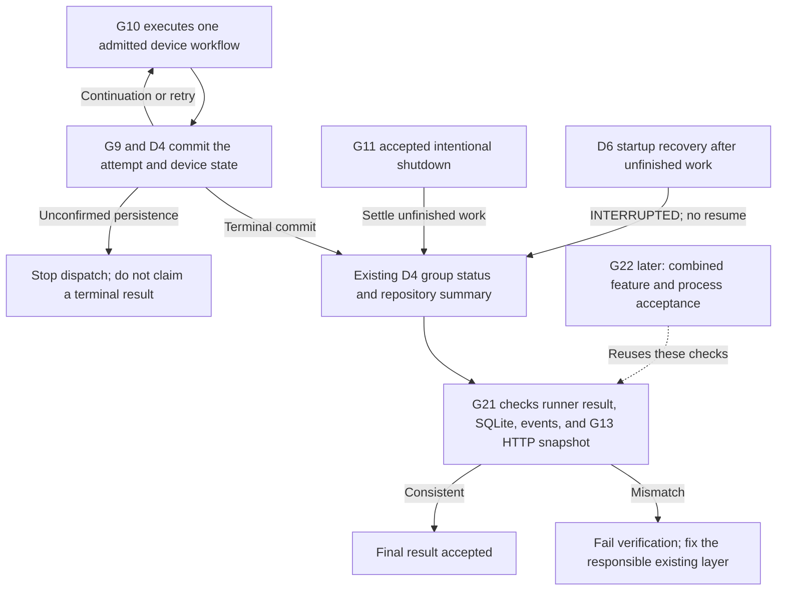

# G21 — Final-result verification

## Overview

G21 verifies that the Runtime reports the correct result when a workflow
finishes. The execution engine already records attempts, settles device and
run-group states, and exposes snapshots. This phase checks those existing
parts together and adds regression tests where their agreement was not
previously asserted. It does not introduce another result calculator.

The central distinction is between a **failed attempt** and a **failed
workflow**. A failed node can follow its error branch and reach End successfully.
That workflow succeeds while its earlier failure remains visible in history.
Likewise, a successful retry does not leave the workflow permanently failed.



**Status — Complete for the G21 verification scope, Linux-verified on 2026-11-19.**
Twenty-three new focused scenarios pass against the real runner/checkpoints,
file-backed SQLite, events, and authenticated snapshot routes. Existing terminal
race, unconfirmed-checkpoint, crash/reopen, and lifecycle tests also pass. No
production defect was found in these checks; no production code, API, or schema
change was needed. Full Go tests, targeted race checks, vet, formatting, Linux
build, and Windows amd64 cross-compilation pass. G22 now separately supplies
automated process acceptance; its real-device/native gates remain pending. Native
Windows, live Android, and actual Studio/Launcher acceptance remain unverified.

## 1. Responsibility and boundaries

| Owner            | Responsibility                                                                                                                |
| ---------------- | ----------------------------------------------------------------------------------------------------------------------------- |
| G7/G8            | Normalize one attempt outcome and select eligible retries.                                                                    |
| G9/D4            | Confirm the attempt, continuation/terminal device state, group transition, and events in the existing checkpoint transaction. |
| G10              | Return a projection of its confirmed terminal device result. A nil Go error alone does not mean SUCCEEDED.                    |
| G11              | Fence/join execution and settle accepted intentional cancellation before storage closes.                                      |
| D6               | Mark unfinished work INTERRUPTED during startup; never resume or redispatch old runs.                                         |
| Repositories/G13 | Read stored group/device states and derive summary counts from device rows in one consistent snapshot.                        |
| G21              | Verify agreement, preserve existing semantics, and fix concrete defects only if discovered.                                   |
| G22              | Exercise complete feature combinations, client/process failures, and the final single-device acceptance flow.                 |

Read the [execution state contract](../contracts/execution_state_v1.md),
[D4 checkpoints](../d_persistence/d4_atomic_checkpoint.md),
[G10 runner](g10_sequential_device_runner.md),
[G11 shutdown](g11_runner_shutdown.md), and
[G13 snapshots](g13_run_snapshot_apis.md) as the authoritative behavior.

No endpoint, DTO, migration, dependency, aggregate table, second finalization
write, or background reconciliation loop is added. G21 does not enable
multi-device dispatch, Pause/Resume, Wait Variable, SSE, attempt-history APIs,
or Production package authorization. Storage fixtures with two devices test
existing aggregation only; Phase H still owns scheduling those devices.

## 2. Inputs and observable results

Tests start from a G1-checked Runtime IR and a real D2 admission, or a precise
persisted lifecycle boundary created through checkpoint services. Use isolated,
file-backed SQLite with the normal migrations and real repository/services.
Only handler outcomes and test process lifetime may be controlled.

| Observation                   | Expected evidence                                                                                                       |
| ----------------------------- | ----------------------------------------------------------------------------------------------------------------------- |
| runner.Result                 | Confirmed DeviceStatus, safe TerminalError, empty terminal NextNodeID, and final attempt ID/sequence/cursor.            |
| node_attempts                 | Actual ordered attempts, individual terminal statuses, timestamps, validated outputs or safe errors.                    |
| device_executions             | Terminal status, NULL next_node_id, finished_at, appropriate started_at and terminal_error_json.                        |
| run_groups                    | Correct final status and finish timestamp; no premature completion while a sibling remains queued/running.              |
| GET /api/v1/runs/{runGroupId} | HTTP 200 with the same saved result, summary, nullability, and committed cursor.                                        |
| GET /api/v1/runs/active       | HTTP 404 once no active group remains. This is not a failure of the historical by-ID read.                              |
| execution_events              | One terminal device event followed by one terminal group event for the single-device finish, committed with the result. |

Use the existing local Bearer authentication for HTTP assertions. Direct SQL
reads are test evidence, not a new Studio/Launcher integration requirement.
Run snapshots stay state-only; they do not gain attempt outputs or image bytes.

## 3. Final-result rules

| Execution path                                           | Last relevant attempt                       | Device / single-device group result               | Terminal error                                           |
| -------------------------------------------------------- | ------------------------------------------- | ------------------------------------------------- | -------------------------------------------------------- |
| Ordinary path reaches End                                | SUCCEEDED                                   | SUCCEEDED                                         | Null.                                                    |
| STOP on a failed node                                    | FAILED                                      | FAILED                                            | That terminal attempt's safe A6 error.                   |
| Deadline exceeded with STOP                              | TIMED_OUT                                   | FAILED                                            | NODE_TIMED_OUT; no device/group TIMED_OUT state.         |
| Failed node follows ERROR_BRANCH and reaches End         | End SUCCEEDED; earlier FAILED remains       | SUCCEEDED                                         | Null; earlier error remains on its attempt.              |
| Timed-out node follows ERROR_BRANCH and reaches End      | End SUCCEEDED; earlier TIMED_OUT remains    | SUCCEEDED                                         | Null.                                                    |
| Eligible retry later succeeds and workflow reaches End   | Retried node and End SUCCEEDED              | SUCCEEDED                                         | Null; failed retry remains in history.                   |
| Eligible retries exhausted with STOP                     | FAILED                                      | FAILED                                            | Final failed attempt's safe error.                       |
| Exhausted retries follow ERROR_BRANCH and reach End      | End SUCCEEDED                               | SUCCEEDED                                         | Null.                                                    |
| Accepted cancellation during an active attempt           | CANCELLED                                   | CANCELLED                                         | Null; intentional cancellation is not a command failure. |
| Intentional stop while queued or between attempts        | No fabricated attempt                       | CANCELLED                                         | Null; preserve completed attempts.                       |
| Startup finds unfinished queued/active/between-node work | Active attempt, if any, becomes INTERRUPTED | INTERRUPTED                                       | Existing EXECUTION_INTERRUPTED error.                    |
| Stop arrives after a confirmed terminal result           | Preserve the existing terminal attempt      | Preserve the committed result                     | Preserve the existing error/null.                        |
| Final checkpoint is unconfirmed                          | No terminal success may be claimed          | Lifecycle settlement/recovery remains responsible | Propagate the existing infrastructure failure.           |

A terminal node failure is an execution result: runner.Run may return nil Go
error together with DeviceStatus FAILED. Callers inspect the result rather
than interpreting nil as workflow success. Persistence errors and incomplete
settlement remain distinct from a confirmed FAILED workflow.

The error's retryable flag remains the normalized A6 value; exhausting a retry
budget does not invent a new error shape. Error objects contain only code,
message, and retryable. They must not expose raw handler/SQLite errors,
credentials, protected workflow data, or local paths.

## 4. Group status and summary counts

Preserve the existing D4 rules. The group stays RUNNING while any device is
QUEUED/RUNNING; existing paused/cancellation semantics stay authoritative.
When ordinary execution has completed, all successful devices yield SUCCEEDED,
and any failed device yields FAILED. Accepted group cancellation yields
CANCELLED after unfinished work is settled. Startup recovery yields INTERRUPTED
for an unfinished group while preserving already-terminal device rows.

Summary counts describe **device executions**, not nodes or attempts. A
single-device successful workflow always has total=1, succeeded=1 and all
other counters zero, even if hundreds of nodes ran or earlier attempts failed.
A two-device persisted fixture with one success and one failure has total=2,
succeeded=1, failed=1 and group FAILED, regardless of completion order.

The sum of queued, running, paused, succeeded, failed, cancelled, and interrupted
equals total. Every counter remains present in the JSON response. Counts are
derived on read by the existing repository; do not persist another count map
or scan attempt history to decide a group's final status.

## 5. Checkpoint, lifetime, and idempotence

1. G9/D4 completes the existing checkpoint before G10 acknowledges a terminal
   result. Keep finalization and event publication in that transaction.
2. Successful/failed terminal execution has no next node. Finish timestamps
   must exist and not precede the execution/attempt start. A queued execution
   cancelled/interrupted before its first attempt retains null startedAt.
3. A single-device group's finishedAt matches the device's terminal settlement;
   ordinary runner completion also matches the final attempt's completion.
4. Earlier completed attempts retain their original status, output/error, and
   timestamps. Shutdown/recovery does not fabricate a cancelled/interrupted
   attempt when no attempt was active.
5. Repeated finish requests, repeated recovery, and repeated shutdown settlement
   cannot rewrite terminal state or append a second terminal event. Repeated
   result GETs are read-only and cannot advance the event cursor.
6. Cancellation after a confirmed terminal commit cannot replace success with
   CANCELLED. An unconfirmed finish must not manufacture a terminal result;
   startup recovery remains the fallback for unfinished records.
7. Recovery interrupts old work and starts no worker. Variables remain RAM-only;
   there is no checkpoint restoration or resume-after-restart added here.

G21's new boundary tests invoke the real shutdown/recovery services against
prepared SQLite states. Existing subprocess crash/reopen and cancellation-race
tests supply process/restart evidence. Do not label an in-process recovery
fixture as a real owner crash or live Android test.

## 6. Source and test map

| Source or test                                       | Role                                                                                                              |
| ---------------------------------------------------- | ----------------------------------------------------------------------------------------------------------------- |
| internal/execution/runner/state.go                   | Existing terminalResult projection; no new result service.                                                        |
| internal/services/checkpoint_finish.go               | Existing finishDevice/checkpointGroupStatus and atomic checkpoint orchestration.                                  |
| internal/repositories/execution_checkpoint.go        | Persist attempt/device/group transitions.                                                                         |
| internal/repositories/execution_history.go           | Existing snapshot reads and device-based countStatus.                                                             |
| internal/services/checkpoint_cancellation.go         | Existing accepted cancellation settlement.                                                                        |
| internal/services/execution_recovery.go              | Existing startup interruption.                                                                                    |
| internal/api/final_result_integration_test.go        | New G21 runner-result, SQLite, event, and authenticated snapshot agreement tests, plus lifecycle-boundary checks. |
| internal/repositories/execution_final_result_test.go | New completion-order and exact-summary regression tests using existing two-device persistence fixtures.           |

Expected change scope: two focused test files, this specification, and G21
references/status in phase_g.md and plan.md. Production files change only for
a demonstrated defect with a regression test. Preserve unrelated staged and
unstaged work. Reuse current fixtures instead of introducing a general test
framework, public seed endpoint, fake database, or new dependency.

## 7. Acceptance and execution

| Check                        | Required coverage                                                                                                                                                                                                                                                          |
| ---------------------------- | -------------------------------------------------------------------------------------------------------------------------------------------------------------------------------------------------------------------------------------------------------------------------- |
| Real runner outcomes         | Success, STOP failure, handled failure, STOP timeout, handled timeout, successful retry, exhausted retry, handled exhaustion, and accepted active cancellation.                                                                                                            |
| Cross-layer agreement        | Expected attempt sequence, runner terminal evidence/error, raw SQLite terminal fields, complete HTTP summary, terminal event order/cursor, and absence from active snapshots.                                                                                              |
| Lifecycle boundaries         | Intentional stop and startup interruption at queued, between-node, and active-attempt boundaries; repeat settlement without mutation.                                                                                                                                      |
| Existing aggregation         | All success, failure first, failure last, and both failed; RUNNING until the other device finishes, exact partial/final summaries, unchanged first terminal sibling, duplicate finalization protection, and cancellation/recovery preserving succeeded or failed siblings. |
| Existing regression evidence | Cancellation after terminal commit, finish rollback/unconfirmed evidence, subprocess crash without redispatch, reopening/recovery, and preservation of committed siblings.                                                                                                 |
| Resource/security boundaries | Temporary stores only; bounded test contexts; no user DB, emulator, network service, real ADB dispatch, token logging, or protected data required.                                                                                                                         |

Run from the Runtime repository:

```bash
go test ./internal/api ./internal/repositories -run '^TestG21' -count=1 -v
go test ./internal/execution/runner ./internal/repositories ./internal/services/executionlifecycle -count=1
go test -race ./internal/api ./internal/repositories ./internal/execution/runner ./internal/services/executionlifecycle
go test ./...
go vet ./...
make fmt
make build
```

Existing real-loopback tests may require host permission in a sandbox. Run the
supported checks with access or report the limitation; do not skip silently.
Cross-compile the agent and affected test packages for Windows amd64. This
checks compilation only; native Windows, live Android, and actual UI rendering
remain separate evidence.

### Verification record

| Verification performed on 2026-11-19                                   | Result                                                                                                                                                                                                                                              |
| ---------------------------------------------------------------------- | --------------------------------------------------------------------------------------------------------------------------------------------------------------------------------------------------------------------------------------------------- |
| TestG21RunnerFinalResults                                              | PASS, nine scenarios; actual G1 validation, G9/G10 execution, D4 persistence and authenticated G13 snapshots.                                                                                                                                       |
| TestG21StoppedAndInterruptedFinalResults                               | PASS, six queued/between-node/active lifecycle boundaries, including idempotent repeat settlement.                                                                                                                                                  |
| TestG21GroupFinalResultAggregation                                     | PASS, four completion-order/status combinations with exact summaries and late-finish protection.                                                                                                                                                    |
| TestG21GroupStopPreservesTerminalSibling                               | PASS, four combinations; cancellation/interruption keep succeeded and failed siblings unchanged.                                                                                                                                                    |
| go test ./... -count=1                                                 | PASS, complete Runtime regression suite.                                                                                                                                                                                                            |
| go test -race for API, repositories, runner, and executionlifecycle    | PASS; new G21 tests also rerun with -race after final assertions.                                                                                                                                                                                   |
| Existing runner/repository lifecycle regressions                       | PASS, including TestSQLiteCancellationHandoffAndTerminalRace, TestSQLiteFinishFaultReturnsUnconfirmedEvidence, TestRunnerRestartInterruption, TestRecoveryReopensInterruptedTapExactlyOnce, and TestCancellationPreservesTerminalHistoryAndRestart. |
| go vet ./..., make fmt, make build, whitespace checks                  | PASS.                                                                                                                                                                                                                                               |
| Windows amd64 agent and affected API/repository test cross-compilation | PASS; compile-only evidence.                                                                                                                                                                                                                        |

The API result tests use the real router with httptest request/response objects;
they do not claim a live Studio session. The complete suite also runs existing
real-loopback checks with sandbox permission. The existing runner crash test
executes a child process which exits during a controlled dispatch, reopens
SQLite, and verifies one interruption without repeating its side-effect marker.
No new manual Waydroid or native-Windows test was performed for G21. All newly
created databases belong to test temporary directories; user data is untouched.

## 8. Optional manual observation

Use the existing Studio Development compile/start/poll flow and a fresh requestId
for each new run. No new G21 API or Postman environment script is needed.

- Success: Start → Delay → End. Expect group/device SUCCEEDED, total=1,
  succeeded=1, terminalError=null, nextNodeId=null, and finish timestamps.
- Timeout: set Delay durationMs greater than its timeoutMs with errorPolicy STOP.
  Expect FAILED and NODE_TIMED_OUT. SQLite keeps the attempt TIMED_OUT while the
  device/group statuses are FAILED.
- Handled timeout: connect that Delay's error port to End and use ERROR_BRANCH.
  Expect SUCCEEDED and terminalError=null while the timed-out attempt remains.
- Intentional Stop and exit during Delay: after starting a new Runtime and
  obtaining its fresh token, the old by-ID snapshot remains CANCELLED.
- For forced-exit/recovery checks, use a disposable state directory and existing
  process fixtures. Do not kill unrelated user processes or damage the user DB.

Inspect group/device rows and ordered attempts through DataGrip if desired.
The automated tests additionally inspect committed internal events; no SSE or
attempt-output endpoint is introduced for manual observation.

## 9. Completion and deferred work

G21 is complete when the acceptance matrix passes against the real checkpoint,
repository, runner, and snapshot code, discovered defects are fixed or clearly
reported as blockers, and the roadmap records actual verification limits.
Production code may remain unchanged if the existing behavior is correct.

G22 still owns combined single-device engine acceptance. Phase H owns real
multi-device scheduling, live controls, and cross-device waits. A7/I1 still
owns committed-output discovery; G20 remains the known-ID PNG download route.
No new Studio/Launcher integration contract is required unless verification
finds and corrects an externally visible defect.
