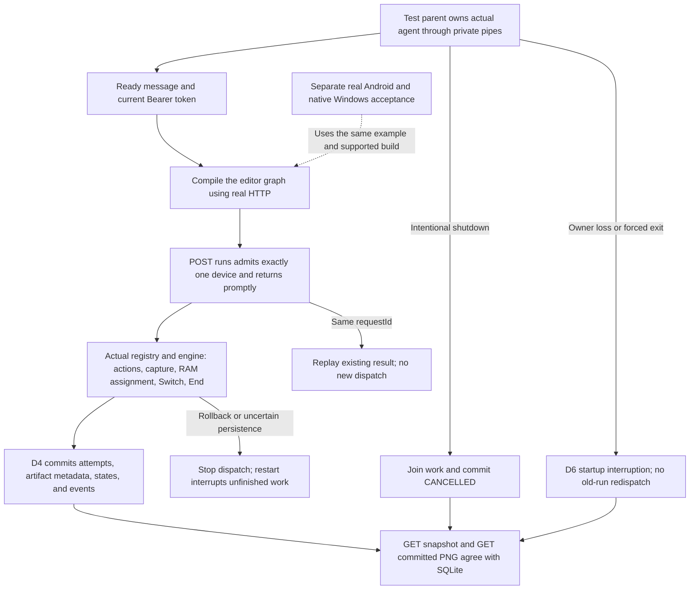

# G22 — Workflow-engine integration acceptance

## Overview

G22 checks that the single-device Development engine works as one assembled
Runtime. Earlier phases implemented validation, execution, persistence,
variables, actions, screenshots, and HTTP. G21 checked final-result agreement.
G22 now starts the actual agent and drives a combined workflow through the
same APIs that Studio uses, including failure, shutdown, and restart paths.

The automated test controls only the external ADB executable. The production
composition root, registry, compiler, admission, process runner, checkpoints,
RAM scopes, SQLite, HTTP, and artifact service remain real. This detects wiring
and lifetime errors which isolated handler or helper tests cannot establish.
A separate manual run on a real Android target remains necessary for device
acceptance; controlled ADB output does not establish Android UI behavior.



**Status — Specification and automated Linux acceptance delivered on 2026-11-19.**
All ten primary process scenarios pass against the actual built agent with
controlled ADB, real network HTTP, SQLite, private owner pipes, and PNG files.
The complete Go suite and race suite pass; the same process scenarios also pass
with the agent itself built using -race. Vet, formatting, Linux build, and
Windows amd64 agent/portable-test cross-compilation pass. No production defect
was found and no production code/schema/API change was needed. Real Android,
native Windows, and actual Studio/Launcher acceptance remain pending. The
available ADB device list was empty; M5's real-device gate remains open.

## 1. Scope and ownership

| Slice                       | G22 responsibility                                                                                                                                      |
| --------------------------- | ------------------------------------------------------------------------------------------------------------------------------------------------------- |
| Composition                 | Start the real compiled cmd/agent, use its generated Wire composition and shipped registry, and authenticate through its private ready handoff.         |
| Editor to execution         | Compile a real Editor Graph through POST /workflow-compilation and submit the exact resulting Runtime IR to POST /runs.                                 |
| Device/command path         | Discover/probe one endpoint through configured ADB, then use real adapters and child processes for typed action commands.                               |
| Binding/control combination | Combine literal targeting, workflow inputs, NODE_OUTPUT, Flow/Global bindings, Set Variable, Switch, ordinary routing, and End.                         |
| Persistence/observation     | Check attempts, events, summaries, opaque artifact output, exact stored PNG download, and read-only snapshots.                                          |
| Lifetime/failure            | Verify replay, busy rejection, post-admission client disconnect, safe retry, no unsafe retry, rollback, shutdown, owner loss, and forced-exit recovery. |
| Existing regression suites  | Reuse G21 and the variable/artifact/deadline/commit fault tests instead of duplicating every helper matrix in a process harness.                        |

No production feature, API, migration, dependency in go.mod, or scheduler is
introduced. Python 3 is a development-test prerequisite on Linux, following
the existing managed-parent acceptance pattern; its standard library is enough.
No Python code or controlled ADB tool is bundled into the production Runtime.

The public start endpoint still accepts exactly one device per new group.
Phase H owns multi-device scheduling, live controls, and cross-device waits.
A7/I1 owns automatic committed-output discovery; G20 downloads a known artifact
ID. Attempt/SSE transport, Production package authorization, real Studio UI,
and installed-bundle acceptance retain their existing later-phase ownership.
Wait Variable and Log remain outside the shipped Phase G node set.

Authoritative dependencies are [G14 start](g14_start_run_api.md),
[G18 scoped assignment](g18_set_variable_execution.md),
[G19 Screenshot](g19_screenshot_execution.md),
[G20 artifact retrieval](g20_artifact_api.md),
[G21 final results](g21_final_result_verification.md), and the
[execution-state contract](../contracts/execution_state_v1.md).

## 2. Combined workflow and contracts

The reusable [Editor Graph and input schema](../../../../a2matex-runtime/examples/g22/compile-workflow.json)
follow this success path:

**Start → Home → Tap → Swipe → Long Press → Input Text → Screenshot →
Set Flow variable → Set Global variable → Switch → Delay → End.**

| Node or input | Contract exercised                                                                                                                                     |
| ------------- | ------------------------------------------------------------------------------------------------------------------------------------------------------ |
| Home          | Ordinary no-output Android action through the shipped registry.                                                                                        |
| Tap           | Literal SCREEN_PERCENT coordinates; two-attempt safe-retry budget. Current targeting contracts do not permit a workflow binding in a coordinate field. |
| Swipe         | Literal percentage endpoints and duration, resolved against the selected device's current logical display size.                                        |
| Long Press    | Literal ABSOLUTE_PIXELS point and duration.                                                                                                            |
| Input Text    | WORKFLOW_INPUT text; no text or command arguments in Runtime logs/events.                                                                              |
| Screenshot    | SCREEN_PERCENT region from 20%/20% to 40%/30%; output contains only committed artifactId.                                                              |
| remember      | One Set Variable node, scope FLOW, assigning NODE_OUTPUT capture.artifactId.                                                                           |
| share         | The same Set Variable type, scope RUN_GROUP, reading the Flow variable.                                                                                |
| choose        | EQ between the Flow and Global values; matching UUID port selects wait, default selects fallback.                                                      |
| wait          | WORKFLOW_INPUT holdMs controls a real Delay after Screenshot/assignments are committed.                                                                |
| fallback      | Literal zero Delay, also used by Screenshot's ERROR_BRANCH; rejoins the same End.                                                                      |

Normal input is holdMs=0 and a printable text marker. The manual example uses
holdMs=1000 for visibility. The success path contains 12 SUCCEEDED attempts,
one artifact, and no fallback attempt. Set Variable and Switch output `{}`;
values are verified by later reads/routing, not by exposing a variable store.
Each new run group gets fresh RAM scopes. Restart restores no variable maps.

The controlled tool reports a 200×100 logical display and returns a real
200×100 PNG. Expected typed commands include Tap 50/50; Swipe from 100/79 to
100/30 for 200 ms; and Long Press represented by Swipe 40/50 to 40/50 for
300 ms. These values follow F8's existing round-to-nearest conversion over
(dimension - 1). Screenshot uses its separate frame-edge crop contract,
producing a 40×10 PNG. Neither algorithm is reimplemented in production here.

## 3. Automated process fixture

The Linux Go test builds a versioned agent into a temporary directory, then
runs cmd/agent/testdata/g22_acceptance.py with that binary and the example.
The test must fail if compilation, readiness, HTTP, state, or cleanup assertions
fail. If Python 3 is unavailable, it explicitly skips the process test; that
host has no G22 process acceptance evidence.

For each scenario, the harness:

1. Creates a private temporary state directory, a loopback port, a PNG fixture,
   a controlled ADB executable, and a private command trace.
2. Starts the actual agent as an owned child with inherited command/ready pipes.
   Read readiness with a deadline. Keep its session token in parent memory;
   managed launch must not create runtime-connection.json.
3. Uses the ready apiBaseUrl and current token for real network requests.
   Refresh devices, check advertised handler pairs, compile the example, and
   start a new run with a fresh canonical UUIDv4 requestId and one exact serial.
4. Checks normal results through HTTP and temporary SQLite. Any direct SQL is
   test evidence/fault injection only, not a Studio/Launcher integration path.
5. Joins/kills only its own child processes and closes its private pipes/files.
   All waits and HTTP operations are bounded. Remove temporary stores on exit.

The controlled tool accepts only the version/discovery/readiness/display,
Home/Tap/Swipe/Long Press/Input Text, and Screenshot operations used by this
fixture. Unknown commands fail the test. Runtime still constructs argv and
executes the configured absolute path through its real process runner.

A process-start failure is injected by temporarily removing execute permission
from this test-owned executable after Home completes. After observing the
failed Tap attempt, the parent restores permission during the configured retry
gap. No Android action was dispatched on the failed start. A separate nonzero
Tap process simulates a command that already started and must not be retried.

## 4. Acceptance matrix

| Scenario                     | Required observable result                                                                                                                                                                                    |
| ---------------------------- | ------------------------------------------------------------------------------------------------------------------------------------------------------------------------------------------------------------- |
| Combined success             | All 12 expected attempts, selected Switch branch, literal/workflow/output/variable bindings, exact command argv/serial, one cropped artifact, SUCCEEDED summary and matching terminal events.                 |
| New-run isolation            | A second group reading the previous group's Global key before assigning it fails with COMMAND_INPUT_UNSUPPORTED. No old RAM value is inherited.                                                               |
| Request replay               | Same requestId returns HTTP 200 and the same group; no additional attempts, artifact, or device command, including after restart.                                                                             |
| Safe retry                   | First Tap is FAILED/COMMAND_START_FAILED/retryable=true; exactly one retry event; attempt 2 succeeds and only one actual Tap command is dispatched.                                                           |
| Unsafe retry prevention      | Started Tap exits nonzero: COMMAND_FAILED/retryable=false, one Tap attempt/dispatch, FAILED group, no downstream command/capture.                                                                             |
| Handled crop failure         | A region valid syntactically but outside the captured frame fails at capture; ERROR_BRANCH → fallback → End succeeds. No artifact row or variable assignment is published.                                    |
| Client disconnect            | Disconnect after admission without consuming POST response; work continues. A competing new start returns 409 RUNTIME_BUSY; the accepted group still succeeds.                                                |
| Intentional stop             | During final Delay, send private shutdown. Runtime exits cleanly, commits CANCELLED, and keeps earlier artifact/history readable after restart with a fresh token.                                            |
| Owner loss                   | Close the command pipe during final Delay. Restart marks unfinished work INTERRUPTED, preserves the committed image, and dispatches no old work.                                                              |
| Forced exit during action    | Observe the started Tap and RUNNING attempt, then kill only the test-owned process group. Startup interrupts that attempt/group and never dispatches it again.                                                |
| Variable checkpoint rollback | Reject remember's successful checkpoint in the temporary DB. Runtime stops on persistence failure; no share/choose/wait dispatch. Startup interrupts remember and preserves the earlier committed Screenshot. |
| Artifact checkpoint rollback | Reject metadata insertion in the temporary DB. No committed artifact/output or later node; startup interrupts capture, removes unpublished PNGs, and never recaptures old work.                               |
| Confidentiality              | Session tokens and the private input marker never appear in Runtime logs. The text marker is absent from committed event payloads.                                                                            |

Every settled result must have exact device-state summary counters, a null
next node, consistent finish timestamps, matching SQLite/HTTP errors, and the
ordered terminal device/group events. GET snapshots and PNGs must not mutate
state or advance the event cursor. The downloaded bytes must match the stored
file, metadata byte length/digest, and PNG header dimensions. Existing F7/G19
regressions separately decode and verify cropped pixels.

## 5. Reused regression evidence

| Existing test area                         | Evidence reused by G22                                                                                                                                       |
| ------------------------------------------ | ------------------------------------------------------------------------------------------------------------------------------------------------------------ |
| G21 final-result tests                     | Handled failure/timeout, exhausted retries, terminal error selection, exact aggregate counts, and preserved terminal siblings.                               |
| variables_test.go in attempts              | Checkpoint-confirmed assignment visibility, reader publication fencing, quota failures, rollback/uncertain commit, and no mutation on unsuccessful outcomes. |
| screenshot_integration_test.go in attempts | All crop modes, PNG pixel correctness, cancellation after staging, rollback, confirmed read-back, and uncertain settlement.                                  |
| runner integration tests                   | Terminal cancellation race, checkpoint finish failure, competing calls, and subprocess crash/reopen without a second side-effect marker.                     |
| G13/G14 HTTP tests                         | Authentication/DTO rejection, read-only consistent snapshots, concurrent same-ID starts, and post-admission request cancellation.                            |
| G20 real HTTP tests                        | Incomplete PNG transfer/cancellation closes handles and aborts safely without appended JSON; server remains available.                                       |
| E/F tests                                  | Selector/targeting variants, launch/key/input-text behavior, process argument bounds, and deadline handling outside the representative combined graph.       |

These lower-level tests remain their owning phase's regression coverage. G22
adds an assembled process path rather than creating another engine, fake router,
mock checkpoint repository, or parallel aggregate implementation.

## 6. Execution and verification record

From the Runtime repository:

```bash
go test ./cmd/agent -run '^TestG22CombinedEngineAcceptance$' -count=1 -v
go test ./... -count=1
go test -race ./...
go vet ./...
make fmt
make build
```

Local socket tests need loopback permission in a sandbox. Run them with the
required host access or report the limitation. A parent go test -race does not
instrument a separately built agent: for child-process race verification,
build the agent itself with -race and run the same Python harness against it.
Use a valid embedded Runtime version, as the Go launcher already does.

Cross-compile the agent and Go tests for Windows amd64. The Linux-only process
test uses Linux inherited descriptors/process-group cleanup; cross-compilation
is not a Windows managed-process or Android acceptance result. The native
Windows owner-pipe milestone remains tracked by the existing ownership/release
plan and must be verified on its supported host before claiming that gate.

### Verification performed on 2026-11-19

| Check                                                 | Result                                                                                                                                                                 |
| ----------------------------------------------------- | ---------------------------------------------------------------------------------------------------------------------------------------------------------------------- |
| TestG22CombinedEngineAcceptance                       | PASS, ten primary process scenarios; combined success additionally verifies fresh-run scope isolation, with replay/privacy/event/PNG checks embedded in the scenarios. |
| go test ./... -count=1                                | PASS, complete Runtime suite, including G21 and the reused fault/lifetime regressions.                                                                                 |
| go test -race ./... -count=1                          | PASS, complete Go race suite.                                                                                                                                          |
| Actual child agent built with -race                   | PASS, all ten process scenarios rerun through the same Python harness; GORACE=atexit_sleep_ms=0 removes only the detector's exit sleep.                                |
| Existing managed_parent.py against the rebuilt binary | PASS, managed readiness/authentication, competing launch, shutdown, owner EOF, external kill, and shared replacement after a failed probe.                             |
| go vet ./..., make fmt, make build                    | PASS.                                                                                                                                                                  |
| Windows amd64 agent and all portable Go test binaries | Cross-compilation PASS; no Windows execution performed. Linux-only test sources are excluded by their filename.                                                        |
| New Markdown/JSON/Python/Go files                     | Formatting/syntax, local documentation links, and whitespace checks pass.                                                                                              |
| Live Android and native Windows                       | Pending. The configured platform-tools adb devices -l returned no connected targets on this host.                                                                      |

Automated execution uses only temporary state/tool directories, which are
removed after their owned processes exit. No user SQLite record or Android
application was modified by the suite. The new example is compiled through
the public API by the process test, not merely parsed as JSON. Test fixture
corrections were limited to current literal-only targeting, the actual F8
display query/conversion, and the existing binding-error code; no change to
those production contracts was made.

## 7. Manual Android acceptance and handoff

Use the [G22 Postman walkthrough](../../../../a2matex-runtime/examples/g22/README.md)
with an actual compatible Runtime, configured platform-tools, and one READY
Android device/emulator. The graph intentionally sends real UI input, so use
a disposable screen and adjust literal coordinates to make effects observable.

A reviewer should observe action order and delays, inspect the final cropped
PNG, compare the saved attempts and summary, then replay the same requestId
and confirm no UI action repeats. Use a fresh requestId for new work. For text
entry, target an editable field first; command completion alone is not evidence
that a particular application accepted the intended text or business action.

Repeat the stop scenario with a long final Delay. After restarting and obtaining
the new token, inspect CANCELLED versus crash/owner-loss INTERRUPTED, preserved
history/images, and the absence of automatic resume. Use isolated state for
fault/crash experiments. Do not damage ordinary user data to demonstrate an
integrity error. Windows and Linux device results are recorded independently.

No connected Android device is assumed by automated tests. If none is available,
record real-device acceptance as pending. Keep M5's real-device evidence open;
do not silently substitute the controlled executable for a real Android target.

## 8. Completion and deferred work

The deliverable is this specification, a reproducible combined example, focused
process acceptance tests, and evidence linked from phase_g.md and plan.md.
Automated Linux acceptance may be complete while real-device/native-host
acceptance remains pending. Report both, rather than marking all Phase G or
installed-product readiness complete from compilation or a mock device.

Multi-device scheduling and live controls remain Phase H. Studio output/SSE
integration, protected Launcher execution, and installed release acceptance
remain the existing I/J/K responsibilities. This phase adds no new platform API;
Studio can continue its current Development compile/start/poll integration and
known-ID PNG retrieval using the existing guides.
