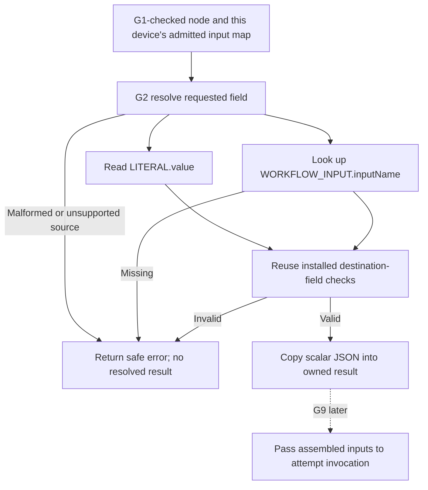

# G2 — Direct input bindings

## Overview

G2 turns a node's literal and workflow-input sources into the scalar JSON
values its handler receives. G1 has already checked the workflow and each
device's inputs. G2 performs the actual lookup for the selected device,
checks the selected value against its destination, and returns an owned copy.
For example, an Input Text node bound to workflow input `message` receives
`{"text":"hello"}` instead of the source object naming `message`.



**Status** — Implemented and verified on Linux on 2026-11-18. The agent and
resolver test package cross-compile for Windows amd64; native Windows execution
was not run. G2 provides a pure resolver and focused tests. It adds no handler
invocation, run endpoint, SQLite access, ADB operation, or executable node
registration. G9/G10 remain responsible for runner integration.

The [Runtime IR input sources](../contracts/runtime_ir_v1.md#6-input-sources),
[workflow bindings](../contracts/workflow_bindings.md), and
[G1 admission contract](g1_runtime_ir_admission.md#7-input-sources-and-per-device-values)
remain authoritative. G4 now provides previous-node output resolution; G17
will add variable reads. G9/G10 later connect resolution to attempts and the runner.

## 1. Scope and ownership

| Owner                             | Responsibility                                                                                                                              |
| --------------------------------- | ------------------------------------------------------------------------------------------------------------------------------------------- |
| G1                                | Validate complete IR, workflow schema, device input maps, required bindings, allowed sources, and known-value constraints before admission. |
| G2                                | Resolve one direct binding, validate its selected value, and assemble direct inputs for an ordinary node.                                   |
| Installed `nodecontract.Registry` | Supply the destination's selected-mode or static field contract and allowed source kinds.                                                   |
| G4 / G17                          | Extend resolution to committed node outputs / scoped variables.                                                                             |
| G7 / G8                           | Normalize execution outcomes / decide whether an actual attempt can retry.                                                                  |
| G9 / G10                          | Own attempt integration, the current device context, and the admitted data's lifetime.                                                      |
| G15                               | Decide which Switch operand to request and evaluate rules in order.                                                                         |

G2 does not revalidate a graph, compile source, parse the complete workflow
input schema, select devices, or inspect another device's input map. It must
not add placeholder output/variable stores or register future handlers.

## 2. Internal entry points

Implement package `internal/execution/bindings`. Use the installed definition
registry through constructor injection and reuse `ir.Node`, `ir.Object`,
`json.RawMessage`, and the existing source-kind constants.

```go
func New(definitions *nodecontract.Registry) (*Resolver, error)

func (r *Resolver) Resolve(
    ctx context.Context,
    node ir.Node,
    field string,
    values Values,
) (json.RawMessage, error)

func (r *Resolver) ResolveInputs(
    ctx context.Context,
    node ir.Node,
    values Values,
) (ir.Object, error)
```

Both methods use the execution-local `Values` type defined in
[G4's API extension](g4_previous_node_output_bindings.md#2-resolver-api-extension).
For direct bindings, pass `Values{WorkflowInputs: deviceInputs}` or `Values{}`
when only literals/empty inputs are needed. G4 reads `CommittedOutputs` through
the same entry points; no direct-only compatibility signature is retained.

`Resolver` stores only the immutable registry. Request values, parsed source
objects, and result maps belong to each call. Reject a nil registry during
construction with a contextual sentinel error under `pkg/x-error`.

`Resolve` resolves exactly `node.Inputs[field]`. Its success value is the
scalar JSON alone. It returns `nil, err` on failure. An explicitly requested
field must have a binding, even when that field is optional in the definition.
Field lookup is exact and case-sensitive, with no trimming or renaming.

`ResolveInputs` calls the same resolution logic for every supplied input key
in lexical order, stopping at the first error. Success returns a fresh,
non-nil map, including `{}` for a valid node without inputs. Any failure
returns a nil map; partially resolved inputs must never escape.

Do not enumerate required definition fields or reconstruct G1's validation
pipeline in `ResolveInputs`. Required binding presence was checked by G1.
The per-field entry point still rejects a requested missing binding. Confirm
that the node type has an installed definition before returning an empty map;
an unknown node must not succeed merely because its input map is empty.

G15 must use the per-field entry point for Switch operands. Calling the bulk
helper would eagerly resolve every rule input before routing decides which
ones it needs. G2 itself performs no Switch evaluation.

## 3. Caller contract and value ownership

The production caller supplies a node from G1's accepted `Document` and only
the corresponding `DeviceInputs[i]` map. Its underlying representation matches
`ir.Object`; the caller passes
`bindings.Values{WorkflowInputs: ir.Object(checked.DeviceInputs[i])}`. The
explicit map conversion shares the immutable source map. Do not import the `runtimeir` validator into this execution package
merely to name the input map.

The caller must keep supplied maps and bytes immutable during resolution.
G2 never mutates the node, config, source objects, or workflow input values.
Concurrent calls may share the resolver and immutable admitted data.

Copy successful scalar bytes with `bytes.Clone` or an equivalent owned copy.
Preserve their JSON representation, including `1.0`, `1e2`, escaped strings,
and whitespace within the selected raw value. Do not decode into `any` and
marshal again to produce the result. Temporary decoding for checks is allowed.

Changing the original source/input bytes after return must not change the
result. Changing a result must not change the admitted data or another result,
even when two fields reference the same workflow input. The returned map is
also independent of `node.Inputs`.

The resolver receives no serial or device list. Per-device isolation comes
from the caller supplying the correct map; G2 cannot authenticate that pairing.
G10 owns and verifies the pairing when it creates each execution context.

## 4. Direct source rules

Each direct source in this section is a UTF-8 JSON object with exactly two required keys.
Use the same last-property-wins JSON behavior as G1. Do not trim identifiers.

| Source           | Exact source object                                 | Selected value                                        |
| ---------------- | --------------------------------------------------- | ----------------------------------------------------- |
| `LITERAL`        | `{"source":"LITERAL","value":10}`                   | The raw JSON stored under `value`.                    |
| `WORKFLOW_INPUT` | `{"source":"WORKFLOW_INPUT","inputName":"message"}` | The raw value found by exact map lookup of `message`. |

Require the expected tag and keys. Reject nulls, wrong containers, trailing
JSON, extra keys, a missing value/name, or an invalid workflow field name.
Reuse `ir.ValidFieldName` for `inputName`. Do not apply that rule to the
destination key: a future Switch operand key may be a UUID and is checked
through the installed field accessor instead.

Use the comma-ok map lookup to determine whether a workflow value exists.
`false`, `0`, and `""` are present values. A present nil/empty raw message or
JSON `null` is invalid, not a default or an absent optional value. An explicit
binding always requires its selected value to be present. Unreferenced
optional workflow properties need not exist.

`NODE_OUTPUT` is implemented by G4 using `Values.CommittedOutputs` and its
own exact three-key source form. `FLOW_VARIABLE` and `GLOBAL_VARIABLE` remain
non-retryable unsupported-source errors until G17. Recognize those tags before
applying the direct forms' two-key check; never skip them or return an empty
value. These execution capabilities do not change G1's accepted vocabulary.

## 5. Destination checks and reuse

For each requested field:

1. Use `Registry.Input(node.Type, node.Config, field)` to confirm the
   destination exists and obtain its allowed source kinds.
2. Confirm the parsed direct source kind is permitted by that field.
3. Select its raw scalar value and reject invalid UTF-8 or non-scalar JSON.
4. Use `Registry.ValidInputValue` for type, finite-number, safe-integer,
   length, pattern, and numeric bounds already defined by the installed field.

Reuse `nodecontract.ScalarType` for scalar checks. Do not create another
schema interpreter, field table, targeting matrix, or numeric-coercion layer.
String lengths and integer checks follow the current shared validator's
semantics. A string `"10"` cannot satisfy an integer field. An integer field
accepts mathematically integral JSON numbers such as `10.0` and rejects `1.5`.
Scalar-union destinations retain finite decimal values.

The caller already supplied admitted values whose workflow-schema constraints
were checked by G1. G2 checks the selected destination value; it does not
reparse the workflow schema or compare declared schema types again. Extra,
unreferenced entries in an internal input map are outside this local lookup.
They remain prohibited by G1 at admission.

Mode-specific fields must use the same registry accessor. For example, Tap
allows only literal coordinates in its selected mode, so a workflow-input
source for Tap `x` fails the source-permission check. An unknown field or one
from another mode is not silently forwarded.

Input Text's ADB encoding limits and Long Press's execution-duration limit
remain G1/F adapter responsibilities. G2 does not import ADB or reproduce
those checks. Passing G2 establishes a resolved field value, not successful
device dispatch or final node success.

## 6. Resolution algorithm and cancellation

`Resolve` follows this bounded sequence:

1. Check `ctx.Err()` before work.
2. Look up the installed destination field; reject an unavailable definition.
3. Find and decode that binding as one source object.
4. Check exact direct-source shape and allowed kind.
5. Select the literal bytes or current device's workflow value.
6. Check scalar validity and destination constraints using existing helpers.
7. Recheck cancellation, then return an owned copy.

`ResolveInputs` checks context before work, confirms the installed node,
sorts supplied field names, and resolves them in order. Check context between
fields and immediately before returning success, including for an empty map.
If cancellation occurs during any local stage, return the context error with
no accepted result. Check context before returning a local failure as well,
so cancellation already observed by that point takes precedence.

Preserve `context.Canceled` and `context.DeadlineExceeded` through wrapping
for `errors.Is`. Add no timeout, goroutine, cache, background task, or clock
dependency. G6 later owns attempt deadlines.

G1 bounds nodes to 100 input fields and the admission byte budgets. G2 consumes
that bounded data and adds no second request-size policy. Per-field work is
linear in the selected source/value size. Bulk resolution adds `O(F log F)`
sorting for at most 100 fields. Do not scan other nodes or devices, perform
I/O, or add database lookups inside the input loop.

## 7. Errors and logging

Use existing `xerror.CommandError` and operation wrapping. Resolution failures
use `COMMAND_INPUT_UNSUPPORTED`, `retryable: false`; they do not introduce new
A6 codes or return admission diagnostic arrays. Constructor dependency failure
uses the new internal sentinel, not a fabricated node outcome.

Use fixed operation `resolve_input_binding` for per-field failures and
`resolve_node_inputs` for bulk-only failures. Preserve the more specific
wrapped operation using the existing `WithOperation` behavior. Add only fixed
safe reason labels to `OperationError.Detail`; never include parser errors,
raw values, or caller-supplied names in its message/detail.

| Failure                                               | Safe message                                       | Reason label                   |
| ----------------------------------------------------- | -------------------------------------------------- | ------------------------------ |
| Unknown node or destination field                     | Node input definition is unavailable               | `input_definition_unavailable` |
| Requested binding absent                              | Node input binding is unavailable                  | `binding_missing`              |
| Malformed direct source or invalid name               | Input binding does not match its contract          | `binding_invalid`              |
| Source unsupported here or forbidden for the field    | Input binding source is not supported              | `source_unsupported`           |
| Referenced workflow input absent                      | Workflow input value is unavailable                | `workflow_input_missing`       |
| Selected value is invalid or violates the destination | Resolved input does not satisfy its field contract | `input_value_invalid`          |

The first failing field in sorted order determines the bulk failure. No
fallback, partial map, or retry occurs. Preserve that field as structured
internal context with a small `xerror.InputBindingError` wrapper:

```go
type InputBindingError struct {
    Field string
    Err   error
}
```

Its `Error()` delegates to the safe wrapped error and `Unwrap()` returns
`Err`. Populate `Field` only after the installed field lookup succeeds;
otherwise leave it empty. Both entry points use this same wrapper, allowing
`errors.As` to recover the field, existing `OperationError`, and existing
`CommandError`. Context outcomes remain context errors, not CommandErrors.
Do not serialize the wrapper as an A6 error or add its field to that envelope.
G7 later extracts the classified outcome; G9/G5 handle checkpointing and routing.

G2 performs no direct logging. The attempt boundary knows the current node
and can log its bounded failing field from the wrapper, the fixed reason,
and the classified error once using B4 conventions. This preserves useful
bulk-resolution context without exposing the source name or value. No logger
or new event payload is needed in this pure resolver.

## 8. Concrete examples

For an `android.input_text` node with empty config and this input:

```json
{
  "text": { "source": "WORKFLOW_INPUT", "inputName": "message" }
}
```

| Supplied device input map                       | `Resolve(..., "text", ...)` | `ResolveInputs(...)`       |
| ----------------------------------------------- | --------------------------- | -------------------------- |
| `{"message":"hello"}`                           | Raw JSON `"hello"`          | `{"text":"hello"}`         |
| `{"message":"other device"}` in a separate call | Raw JSON `"other device"`   | `{"text":"other device"}`  |
| `{"message":""}`                                | Raw JSON `""`               | `{"text":""}`              |
| `{}`                                            | Missing-input error         | Nil map and the same error |
| `{"message":null}`                              | Invalid-value error         | Nil map and the same error |
| `{"message":123}`                               | Invalid-value error         | Nil map and the same error |

For `flow.delay.inputs.durationMs = {"source":"LITERAL","value":10.0}`,
resolve the scalar bytes `10.0` and assemble `{"durationMs":10.0}`. The source
tag never appears in handler inputs. Input Text still validates its command
representation when invoked later.

A direct `Resolve` call for Set Variable's `value` may exercise `false`, `0`,
and `1.25` through its installed scalar-union contract. This is a field-check
test only; G2 must not enable Set Variable execution or mutate a scope.

## 9. Implementation locations and expected review size

All code paths below are relative to `a2matex-runtime`.

| Location                                                    | Change                                                                                                    |
| ----------------------------------------------------------- | --------------------------------------------------------------------------------------------------------- |
| `internal/execution/bindings/resolver.go`                   | New stateless constructor, per-field resolution, bulk assembly, and small private decoding/error helpers. |
| `internal/execution/bindings/resolver_test.go`              | Focused table tests for the contracts below, using the real installed registry.                           |
| `pkg/x-error/bindings.go`                                   | Internal sentinel `ErrInputBindingDependencies` and the small `InputBindingError` field-context wrapper.  |
| Existing `ir`, `nodecontract`, constants, and error helpers | Reuse directly. No broad refactoring planned.                                                             |

The original G2 delivery added 148 production lines across two production
files, plus one focused test file. G4 subsequently extended the shared resolver
and its per-call values API as described above. G1, compiler fixtures, handlers,
router, Wire, migrations, and dependency files were not changed. No new
third-party dependency or shared-validator refactoring was required.

## 10. Verification and completion

Use direct constructor-based tests; no HTTP server, SQLite, or Android device
is required. Define expected values and error properties explicitly rather
than deriving expectations by running the resolver under test.

| Case                                                                     | Required result                                                                                                                                                                             |
| ------------------------------------------------------------------------ | ------------------------------------------------------------------------------------------------------------------------------------------------------------------------------------------- |
| String, boolean, integer, and decimal literals in suitable fields        | Owned scalar bytes with their original JSON representation.                                                                                                                                 |
| Workflow input lookup and an empty string                                | Exact selected-device value; no source object in the handler map.                                                                                                                           |
| `false` and `0` through an allowed scalar field                          | Present valid values, never treated as missing.                                                                                                                                             |
| Two sequential/concurrent calls with different device maps               | Independent results with no cross-device state.                                                                                                                                             |
| Absent key, nil raw bytes, empty raw bytes, and JSON null                | Correct missing/invalid-value error, never a default.                                                                                                                                       |
| String-to-integer, fractional integer, unsafe integer, overflowed number | Non-retryable invalid-value error.                                                                                                                                                          |
| Applicable length, pattern, and numeric boundaries                       | Same destination-field acceptance as the installed validator.                                                                                                                               |
| Wrong source container/tag/keys, malformed JSON, invalid UTF-8/name      | Safe error with no raw input or parser text.                                                                                                                                                |
| Workflow source in a literal-only target field                           | Unsupported-source error; no adapter call.                                                                                                                                                  |
| Each deferred source kind                                                | Unsupported-source error; no placeholder result.                                                                                                                                            |
| Unknown node/field, requested missing binding, wrong-mode field          | No success result.                                                                                                                                                                          |
| Empty valid Start/End inputs                                             | Fresh non-nil empty map.                                                                                                                                                                    |
| First field succeeds and a later field fails                             | Nil bulk result; no partial input map.                                                                                                                                                      |
| Multiple failing keys supplied in different insertion orders             | Same first error from lexical field order.                                                                                                                                                  |
| Caller/result mutation after return and repeated references              | No aliasing in either direction or between resolved fields.                                                                                                                                 |
| Cancellation, deadline, and cancellation during bulk resolution          | Preserved context error and no accepted result.                                                                                                                                             |
| Field-error metadata and error unwrapping                                | Known destination field is recoverable with `errors.As`; unknown keys and source values stay out of metadata/messages. Existing CommandError and context classification remain recoverable. |
| Nil constructor dependency                                               | `errors.Is` identifies the internal dependency sentinel.                                                                                                                                    |

Run the focused suite, the affected validation suites, race checks, vet,
formatting, Linux build, and Windows amd64 cross-build using existing project
commands. These verify platform-independent resolution; they do not establish
native Windows or device execution acceptance. For an inspectable local check,
the focused example tests can print their named cases with `go test -v`; no
new executable or API is needed.

G2 is complete when both entry points satisfy these cases using existing field
checks, return only owned results, preserve safe errors/cancellation, and
perform zero external I/O. Mark implementation complete only after the code
and checks exist. G3, G4, G7, G9, G15, and G17 retain their separately numbered
responsibilities.

### Implementation verification record

The following checks passed on 2026-11-18:

- `go test ./...` for the full Runtime suite.
- `go test -race ./internal/execution/bindings ./internal/validation/...`.
- `go vet ./...`, `make fmt`, and `make build VERSION=0.1.0`.
- Windows amd64 cross-compilation of `cmd/agent` and the bindings test binary.
- Focused resolver tests, including the executable `ExampleResolver_ResolveInputs`.
- Diff whitespace checks.

The resolver tests check direct sources, representation-preserving copies,
field constraints, selected-device values, deterministic bulk errors, safe
error metadata, deferred sources, ownership, and cancellation. They use the
real installed catalog without dispatching handlers or opening a database.
Run the named cases locally with:

```bash
go test ./internal/execution/bindings -v
```

G2 implementation is complete at this callable-helper boundary. G3 output
validation, G4 previous-node output resolution, and
[G7 outcome normalization](g7_execution_outcome_normalization.md) are also
implemented. G9/G10 runner wiring and G17 variable reads remain pending.
Windows binaries were compiled but not executed on a Windows host.
