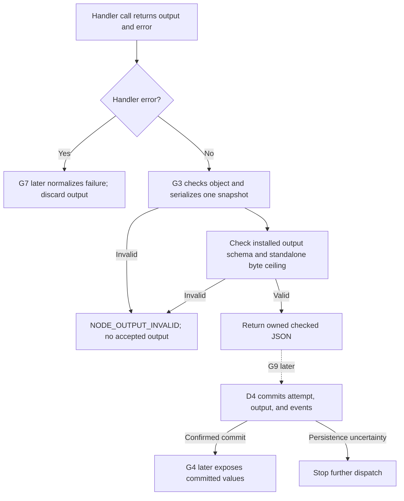

# G3 — Handler output validation

## Overview

G3 checks the output returned by a successful handler call before the Runtime
can record that attempt as successful or make its values available to another
node. A handler returning no error is insufficient: its result must also match
the installed node's output schema. G3 returns one checked, owned JSON snapshot
or a safe error with no accepted output.



**Status** — Implemented and verified on Linux on 2026-11-18. The agent and
output test package cross-compile for Windows amd64; native Windows execution
was not run. G3 provides a pure validator and its read-only catalog helper.
It does not invoke handlers, create attempts, write SQLite, publish events,
register nodes, or verify artifacts. Runner integration remains G9 work.

The [Runtime IR output contracts](../contracts/runtime_ir_v1.md#9-current-node-matrix),
[A5 NodeAttempt contract](../contracts/execution_state_v1.md#5-nodeattempt), and
[A6 error/event rules](../contracts/event_error_v1.md) remain authoritative.
G9 later integrates this check into the durable attempt lifecycle.

## 1. Responsibility and boundaries

| Owner             | Responsibility                                                                                                      |
| ----------------- | ------------------------------------------------------------------------------------------------------------------- |
| F handlers        | Return their business output as `map[string]any`, or an error. Empty-output handlers return a non-nil empty map.    |
| Installed catalog | Define required output keys, allowed fields, scalar types, and field constraints.                                   |
| G3                | Serialize the successful return value, check that exact JSON object, and return only its checked bytes.             |
| G7 / G8           | Normalize the attempt outcome / respect the non-retryable output failure.                                           |
| G9 / D4           | Record success only after G3 passes, validate the complete A6 event, and commit output atomically with the attempt. |
| G4                | Read successful, committed producer output for downstream bindings.                                                 |
| G19 / D5          | Match Screenshot output to the real staged artifact and settle its metadata/file lifecycle.                         |

Call G3 only when the handler returned `err == nil`. If a handler returns both
a payload and an error, the caller discards the payload and handles the error.
G3 does not choose success/error routes or retries. `NODE_OUTPUT_INVALID`
is a failed attempt outcome, not an admission diagnostic or a persistence error.

The installed catalog may describe nodes that F9 has not enabled. Checking
such a node's output in a unit test never enables execution or changes
`supportedNodes`. G1/F9 retain execution-availability ownership.

## 2. Callable contract and result ownership

Implement package `internal/execution/outputs`, following G2's constructor
injection and context-aware style.

```go
func New(definitions *nodecontract.Registry) (*Validator, error)

func (v *Validator) Validate(
    ctx context.Context,
    nodeType string,
    output map[string]any,
) (json.RawMessage, error)
```

The constructor stores only the immutable installed registry. A nil registry
returns a contextual `xerror.ErrOutputValidationDependencies` sentinel. Each
call owns its temporary maps and encoded bytes; concurrent calls share no
mutable request state.

Success returns non-nil bytes containing the checked JSON object. Any failure
returns `nil, err`, never the encoded invalid payload. No result wrapper,
diagnostic array, persisted status, or node-output cache is needed here.

The caller keeps the returned handler map and its values immutable during
validation. Serialize once with the standard JSON encoder, decode that
snapshot into `ir.Object` for field checks, and return the same serialized
bytes. Do not validate one representation and later serialize the handler map
again for persistence. Mutating the original map, its raw-message values, or
another successful result after return must not change the accepted snapshot.

Handlers return Go values, so the encoder defines their JSON representation.
For example, `float64(10)` can encode as `10`, while `json.Number("10.0")`
can retain `10.0`; both satisfy a suitable integer output field. This differs
from G2's requirement to copy existing scalar JSON bytes exactly. No string,
boolean, or number coercion is added by G3.

`nodeType` is the admitted node's exact type. Output schemas do not depend on
target mode for the current catalog, so no config, device serial, handler
registry, input values, or execution repository is a constructor/method dependency.

## 3. Installed output-schema access

The registry retains `OutputSchema` and now compiles its fields once for
G3, alongside the existing input fields. The catalog owner provides this narrow
extension:

1. Compile each installed `OutputSchema` once during `installCatalog`, using
   the existing `compileContract`/`compileField` implementation.
2. Store that compiled output contract privately with its catalog node.
3. Add the read-only object check below in `catalog.go`.

```go
func (r *Registry) ValidOutput(nodeType string, output ir.Object) bool
```

Return false for a missing installed node, nil output, missing required key,
unknown key, or invalid declared field value. For a present field, reuse
`validValue` with the compiled output field. Omitted optional fields remain
omitted. Never add defaults, drop extra keys, or return mutable registry data.

All current output schemas are strict objects with scalar properties and
`additionalProperties: false`. Do not add a second schema language or output
field table. A malformed trusted field contract must fail registry loading
with the existing contextual configuration error; do not treat that corruption
as ordinary handler output or silently disable its checks.

The execution validator uses `CompilationDefinition(nodeType)` to distinguish
an unavailable installed definition before calling `ValidOutput`. The latter
bool helper does not need to allocate execution errors or know A6 codes.

## 4. Object and field rules

| Rule                            | Required behavior                                                                                                   |
| ------------------------------- | ------------------------------------------------------------------------------------------------------------------- |
| Root object                     | The public parameter is a map. A nil map is invalid even for an empty-output node; never normalize it into success. |
| Empty output contract           | Accept only a non-nil empty object `{}`.                                                                            |
| Required fields                 | Every required key must be present with a valid value.                                                              |
| Additional fields               | Reject them, including keys that resemble diagnostics or metadata. Never strip them.                                |
| Scalar fields                   | Apply the installed string, boolean, integer, or finite-number contract through the shared checker.                 |
| Null, arrays, or nested objects | Reject when supplied to the current scalar fields.                                                                  |
| Non-JSON values                 | Encoding failures such as channels, functions, cycles, NaN, or infinity produce a safe output error.                |
| Numeric semantics               | Integral JSON numbers may satisfy an integer field; fractional or unsafe integers do not.                           |
| Wrong types                     | A string `"10"` never satisfies an integer output field.                                                            |

Apply the **output** schema, not `ValidInputValue`. The current cases are:

| Node                                                                                                            | Valid output                                        | Important distinction                                                                                                                |
| --------------------------------------------------------------------------------------------------------------- | --------------------------------------------------- | ------------------------------------------------------------------------------------------------------------------------------------ |
| Start, End, Tap, Swipe, Long Press, Input Text, key actions, Launch App, and other installed empty-output nodes | `{}`                                                | `null`, missing/nil output, or additional fields are invalid.                                                                        |
| `flow.delay`                                                                                                    | Exactly `{"durationMs": non-negative safe integer}` | Its output has no 300,000 upper bound. That bound belongs to the input. G3 does not compare returned duration to requested duration. |
| `android.screenshot`                                                                                            | Exactly `{"artifactId": non-empty string}`          | G3 does not add a UUID rule, open SQLite, inspect a file, or prove artifact ownership/existence.                                     |

Screenshot's F7 handler already checks the ID returned by its stage callback.
G19/D4 later check the actual stage and metadata before committing success.
A non-empty test string may pass G3's field contract while being unsuitable
for an artifact commit. Keep those separate guarantees explicit.

## 5. Serialization and the event ceiling

The output snapshot must be valid, compact object JSON. Standard `json.Marshal`
provides a deterministic representation of supported handler maps. JSON
encoding errors must be discarded as raw causes because they can include
untrusted values, paths, or custom marshaler text.

Reject an encoded output larger than `constants.MaxEventBytes` with
`NODE_OUTPUT_INVALID`. The existing A6 complete-event ceiling is 16 KiB;
an output object alone cannot exceed that and still fit its success event.
Reuse that constant rather than inventing another size value. No truncation
or partial output is allowed.

This is only a necessary standalone ceiling. A smaller output can still
overflow the full event after correlation fields and payload metadata are
added. G9/D4 must validate the **complete event** against A6 before success
commit. G9 must classify an unrepresentable success payload as output failure
before attempting that success checkpoint, not publish it or retry the handler.
G3 has no attempt IDs/timestamps and does not reserve guessed envelope space.

For the current real handlers, Delay's integer and Screenshot's staged ID are
small. G3 does not introduce streaming serialization, output chunking, a new
artifact format, or arbitrary output-object persistence.

## 6. Validation order and cancellation

Follow this sequence:

1. Check the caller context.
2. Confirm an installed definition exists for `nodeType`.
3. Reject a nil output map.
4. Serialize once; reject serialization errors without exposing their text.
5. Check context and the encoded standalone byte ceiling.
6. Decode the snapshot into a non-nil `ir.Object`; reject any decode failure.
7. Apply the read-only installed output-contract check.
8. Recheck context and return the same owned encoded bytes.

Check context before returning a local validation failure as well. Preserve
`context.Canceled` and `context.DeadlineExceeded` through operation wrapping
so `errors.Is` still works. Cancellation is not `NODE_OUTPUT_INVALID` and
must not be converted to a retryable command error.

Add no timeout, goroutine, background task, clock dependency, or cancellation
watcher. Check cancellation between local encoding/validation stages; G6 owns
the attempt deadline. Work is bounded by trusted handler production and the
selected output size. Field checking is linear in the encoded values and
declared fields, with no per-field I/O or per-attempt schema compilation.

## 7. Errors and contextual logging

Use existing `xerror.CommandError` and `OperationError`. Add
`constants.NodeOutputInvalid = "NODE_OUTPUT_INVALID"` alongside the existing
execution error constants; A6 already defines this code. Do not add a new
wire error code or return validation diagnostics.

Use operation `validate_node_output` and fixed safe reason labels:

| Condition                                                                      | Outcome                              | Safe message / reason                                                                     |
| ------------------------------------------------------------------------------ | ------------------------------------ | ----------------------------------------------------------------------------------------- |
| Constructor registry is nil                                                    | Contextual internal sentinel         | `ErrOutputValidationDependencies`; configuration operation `configure_output_validation`. |
| Installed node definition unavailable                                          | `INTERNAL_ERROR`, non-retryable      | Node output definition is unavailable / `output_definition_unavailable`.                  |
| Nil output map                                                                 | `NODE_OUTPUT_INVALID`, non-retryable | Node output must be a JSON object / `output_missing`.                                     |
| JSON encoding fails                                                            | `NODE_OUTPUT_INVALID`, non-retryable | Node output cannot be encoded as JSON / `output_not_serializable`.                        |
| Encoded output exceeds the standalone ceiling                                  | `NODE_OUTPUT_INVALID`, non-retryable | Node output exceeds the execution event limit / `output_too_large`.                       |
| Snapshot cannot decode as an object, or its fields fail the installed contract | `NODE_OUTPUT_INVALID`, non-retryable | Node output does not satisfy its installed contract / `output_contract_invalid`.          |
| Context is cancelled or expired                                                | Preserve wrapped context error       | No fabricated CommandError or accepted output.                                            |

Do not attach the invalid output, unknown key names, raw JSON errors, handler
values, or artifact content to messages/details. The caller knows the current
node and can log its bounded identity with the fixed operation/reason.
G3 performs no direct logging. G7/G9 later classify and log the failure once
at the attempt boundary using B4 conventions.

Invalid output is never safely retryable, even when the node's policy permits
multiple attempts: the handler may already have affected the device. G5 may
follow the configured error route after the failed attempt is committed.
No success output is persisted or made available to G4 from that attempt.

## 8. Implementation locations and review scope

Paths below are relative to `a2matex-runtime`.

| Location                                            | Planned change                                                                                     |
| --------------------------------------------------- | -------------------------------------------------------------------------------------------------- |
| `internal/execution/outputs/validator.go`           | Stateless constructor, snapshot serialization, context checks, schema call, and safe errors.       |
| `internal/execution/outputs/validator_test.go`      | Public contract, ownership, error, cancellation, and real-handler checks.                          |
| `internal/validation/nodecontract/catalog.go`       | Private compiled output contract during catalog loading and the read-only `ValidOutput` method.    |
| `internal/validation/nodecontract/registry_test.go` | Focused assertions that installed output fields, required keys, and extra-field rules are honored. |
| `pkg/x-error/outputs.go`                            | Constructor dependency sentinel.                                                                   |
| `pkg/constants/execution.go`                        | The existing A6 `NODE_OUTPUT_INVALID` code constant.                                               |

The implementation adds 106 net production lines across four production
files and 354 test lines across two test files. The catalog extension is limited
to G3's direct dependency. Catalog JSON, input validation, handlers, G1/G2,
compiler fixtures, DTOs, router, Wire, database schemas, and dependency files
were not changed. G9 introduces the actual runner consumer later.

## 9. Acceptance and completion

Use real installed definitions. Expected results must be explicit, not
calculated by calling the same registry helper being tested.

| Case                                                                                           | Required observation                                                       |
| ---------------------------------------------------------------------------------------------- | -------------------------------------------------------------------------- |
| Non-nil empty Start/End/Tap output                                                             | Accepted bytes are exactly `{}`.                                           |
| Nil map for empty-output or data-output node                                                   | No accepted bytes; `NODE_OUTPUT_INVALID`.                                  |
| Empty-output node returns stdout, status, or another extra field                               | Rejected; no stripping or silent success.                                  |
| Delay returns integer `0`, positive integer, or integral JSON number                           | Accepted according to its output schema.                                   |
| Delay returns `300001`                                                                         | Accepted by G3; do not import the input maximum.                           |
| Delay omits duration or returns negative, fractional, unsafe integer, string, boolean, or null | Rejected with the output-contract error.                                   |
| Screenshot returns one non-empty `artifactId` string                                           | Accepted by schema without touching storage.                               |
| Screenshot omits ID, uses empty/wrong-type ID, or adds path/bytes fields                       | Rejected.                                                                  |
| Non-empty non-UUID Screenshot test ID                                                          | Passes G3 only; no claim that it can be committed as an artifact.          |
| NaN, infinity, unsupported Go value, cyclic value, or failing JSON marshaler                   | Safe encoding failure; original error text and values are absent.          |
| Encoded output exceeds `MaxEventBytes`                                                         | `output_too_large`; no truncation.                                         |
| Standalone output at the ceiling that otherwise satisfies its schema                           | G3 accepts it; final full-event fit remains a G9 check.                    |
| Source map/raw-value mutation after success, and returned-byte mutation                        | Checked snapshots, source values, and separate results remain independent. |
| Repeated/concurrent calls on one validator                                                     | Correct independent outputs and no shared mutable state.                   |
| Unknown installed type                                                                         | Safe internal configuration outcome, not handler success.                  |
| Nil constructor registry                                                                       | `errors.Is` identifies the dependency sentinel.                            |
| Pre-cancellation, expired deadline, and cancellation during validation                         | Context outcome preserved and accepted bytes nil.                          |
| Actual Start/End and zero-duration Delay handlers under an attempt context                     | Their current successful returns pass G3 without any Android dependency.   |

Run focused output/catalog tests, the existing G1/G2 validation suites, race
checks, vet, formatting, Linux build, and Windows amd64 cross-compilation.
Keep cross-compilation distinct from native Windows execution evidence.
No HTTP server, database, Android device, or new smoke executable is required.

G3 is complete when it returns only an owned schema-checked snapshot, rejects
invalid successful handler returns with safe non-retryable errors, preserves
cancellation, and uses the existing field checker without external I/O.
Record actual checks before marking code complete. G4 output consumption,
G7 outcome normalization, G9 commit integration, and G19 artifact settlement
remain separate steps.

### Implementation verification record

The following checks passed on 2026-11-18:

- `go test ./...` for the complete Runtime suite.
- `go test -race ./internal/execution/outputs ./internal/execution/bindings ./internal/validation/...`.
- `go vet ./...`, `make fmt`, and `make build VERSION=0.1.0`.
- Windows amd64 cross-compilation of `cmd/agent` and the output test binary.
- Diff whitespace checks.

Focused tests verify strict schemas, output-only bounds, nil and malformed
returns, safe non-retryable errors, standalone byte boundaries, cancellation,
owned snapshots, one serialization, and concurrent calls. Real Start, End,
and zero-duration Delay handlers also return values accepted by G3 under a
caller-supplied attempt context. These tests dispatch no Android command and
open no execution database. Inspect the named cases with:

```bash
go test ./internal/execution/outputs ./internal/validation/nodecontract -v
```

G3 is complete at its callable-validator boundary. G9 still validates full
success-event size and commits the snapshot; G4 consumes committed output;
G19 settles Screenshot artifacts. Native Windows and real-device execution
acceptance are separate evidence and were not run for this pure component.
